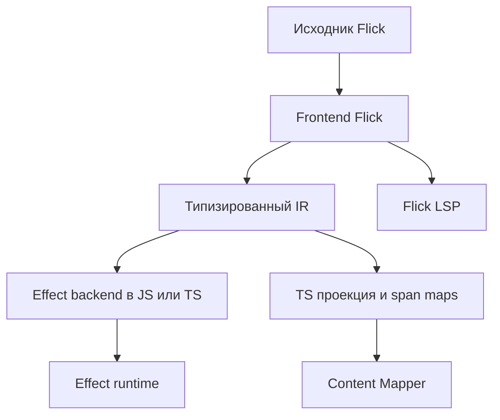

**Рабочая спецификация Flick 0.7. 21 октября 2026. Решения для первой реализации.**

Цель — спроектировать функциональный язык **Flick** с ML-подобным синтаксисом, HKT, классами типов и единственным backend на Effect. Стандартная библиотека и runtime-контракты опираются на Effect. Чистые участки компилируются в обычный JS/TS в составе того же backend.

Flick — ML-подобный язык с HKT, классами типов и одним Effect backend. Прямые runtime-вызовы используют обычный let; `task` строит холодный Eff, await выполняет его в текущем fiber. Полная сигнатура стоит над каждой именованной функцией. Для первой версии выбраны MPTC/FD, higher-rank callbacks, pure generalization, точные records и List поверх JS array, fresh regions/captures, явный FFI с `.d.ts` importer, полный deriving Schema, PostgreSQL eDSL и `ui { ... }` поверх React. Ниже зафиксированы контракты и цена решений. Это спецификация ещё не реализованного языка Flick; флажки решений не обозначают готовность compiler.

Документ можно комментировать и править по абзацам и примерам. Раздел «Что требуется решить до реализации» теперь содержит принятые ответы. Сравнения с альтернативами объясняют tradeoffs; явно исключённые из первой версии возможности не остаются открытыми блокерами. Раздел «Критерии проверки реализации» сохраняет незакрытые проверки будущего compiler/runtime.

# 1 Цель и подтверждённые требования

| Требование | Смысл |
| - | - |
| Имя и инструменты | Flick, CLI `flick`, исходники `.fl`; общий Rust core для compiler и LSP |
| ML-подобный синтаксис | Функции, `let`, ADT, pattern matching и компактная запись прикладного кода |
| HKT | Абстракции над конструкторами типов, включая `Functor`, `Foldable`, `Traversable` |
| Классы типов | Ограничения в сигнатурах, instances и выбор реализации по типам |
| Единственный backend на Effect | Исполнение через Effect, его стандартные типы и runtime-контракты; чистые участки оптимизируются до обычного JS/TS |
| Часть Effect в семантике языка | Встроенные правила typed recovery, provide, lexical owner и structured concurrency |
| Прямые эффектные вызовы | Обычный `let` связывает результат выражения; эффект вызова учитывается в типе функции |
| Эффект в стрелке | `a -> b` для чистого вызова; `a ->{r; e} b` для runtime-вызова |
| Единый стиль функций | Полная сигнатура непосредственно над каждой именованной функцией |
| Higher-rank callbacks | Полиморфные параметры функций с явным вложенным `forall` |
| Числа JavaScript | `Number` и `BigInt` с соответствующей арифметикой JS; BigDecimal и другие специальные типы отдельно |
| Полноценный deriving Schema | Генерация для всего поддерживаемого языка данных, включая generics и рекурсию, с явными policies и расширениями |
| Значения вычислений | `task { ... }` создаёт Eff; `await` исполняет его в текущем fiber; запуск приложения находится в entry point |
| Статическая безопасность ресурсов | Запрет выхода зависимых от scope значений и связанных задач; выбраны fresh regions, transitive captures и двухфазное закрытие |
| Доступ к экосистеме JS | Явные bindings и фиксированный ABI; генерация bindings из проверяемого подмножества `.d.ts` |
| Оптимизация | Подходящие passes и приёмы ReScript с сохранением выбранной семантики Effect и Number |
| Schema-интеграции | Расширяемые компиляторы/экспортёры; неподдерживаемый wire-контракт даёт явную диагностику |
| Проверка type-level выразительности | SQL и типизированный UI eDSL как реальные задачи для rows, классов, callbacks и lifetime |

Generic do, let\* и единый effect-polymorphic map не входят в первую версию. Блоки функций основаны на отступах, специальные task/scope/sql/ui — на фигурных скобках; последняя expression возвращает результат. Имена task, await и явный entry point зафиксированы.

Frontend Flick проверяет программу, единый Effect backend генерирует исполняемый JS/TS, а Content Mapper обслуживает TS-проекцию и интеграцию с инструментами. Чистые вызовы и вызовы Effect проходят через один типизированный IR. Исходная система типов развивается независимо от выразительности TypeScript.

# 2 Решения первой версии

| Область | Принято | Цена выбора |
| - | - | - |
| Sequencing | Прямые вызовы с let; task/await; без generic do | Для пользовательских монад обычные combinators |
| Тип вычисления | Eff r e a, результат последним | Source order отличается от native TS order |
| Классы | MPTC, superclasses, FD; canonical instances | Strict coverage/termination; часть instance chains не переносится |
| Coherence | No overlap/orphans/local implicits; package ownership | Для альтернатив нужны wrappers или explicit dictionaries |
| Generalization | Только доказанно pure построения; runtime results мономорфны | Иногда требуется фабрика; variance-generalization отложена |
| Higher-order API | map и последовательный map_effect; явный parallel limit | Два семейства операций вместо скрытого runtime bridge |
| Collections | List = dense immutable JS array; отдельный Effect Chunk | Prepend/tail/update обычно O(n) |
| Records | Exact structural + row polymorphism | Нет implicit width subtyping и silent overwrite |
| Type-level | Fixed row primitives, labels, finite kinds, MPTC/FD | Общие type families и associated types отложены |
| Lifetime | Fresh regions, captures, без early close | Закрытие ждёт children и foreign quiescence |
| Errors | Native recovery; opaque Failure/Exit/RawCause; region-free typed payloads | Raw failures нельзя считать остаточной e |
| Concurrency | Structured combinators, scoped supervisor, native race/timeout | Нет nursery, detached scoped work и hard deadline |
| FFI | Fixed ABI, четыре callback families, checked `.d.ts` subset | Purity/retention/cancellation требуют contracts |
| Schema | Full deriving, explicit codecs, strict exporters | Не всякая schema выражается во внешнем формате |
| SQL | Pure DSL, PostgreSQL, Query/Template | Зафиксирован ограниченный SQL subset |
| UI | ui-блок, React adapter, explicit event policy | Без JSX, собственного renderer, SSR и полной hooks-модели |
| Compiler | Rust core Flick, typed IR, source LSP, versioned JSON iface | Собственный checker, Mapper — слой интеграции |
| Optimization | Debug baseline и typed release passes из подходов ReScript | Нужны доказательства сохранения observable contracts |
| CLI | `flick`, `.fl`, `flick.toml`, один pnpm lockfile; check/build/run/dev/test/fmt и инструменты FFI/Schema | Команды разделяют один checker; версии runtime и интерфейсов проверяются явно |

Все перечисленные решения относятся к первой версии. Pure `a -> b`, runtime `a ->{r; e} b` и runtime без requirements/errors `a ->{} b` различаются в checker и IR. Статические guarantees действуют для проверенного source и правдивых trusted bindings; native Effect и Content Mapper не доказывают их автоматически.

# 3 Прямые эффектные вызовы

Эффектная функция вызывается в обычном выражении, а `let` связывает его результат. Последовательность операций записывается обычными выражениями и bindings.

```flick
load_name : UserId ->{Users, Log; NotFound} String
let load_name id =
  let user = Users.get id
  let name = normalize_name user.name

  Log.info name

  name
```

Аннотация стрелки: `a ->{r; e} b`, где `r` — требования к сервисам, `e` — ожидаемые ошибки. Вид стрелки обозначает runtime-вызов; обычная `a -> b` обозначает чистый вызов. Пустые `r` и `e` не делают runtime-вызов чистым.

Аннотация пишется слитно со стрелкой: `->{r; e}`, `->{}`. Стрелка с пробелом перед фигурной скобкой, `a -> { name : String }`, — обычная чистая стрелка, результат которой record type. Так runtime-стрелка и запись различаются уже по лексемам, без контекста.

```text
normalize_name : String -> String

Users.get :
  UserId ->{Users; NotFound} User

load_name :
  UserId ->{Users, Log; NotFound} String
```

Результат выражения `Users.get id` — `User`, а эффект его вычисления учитывается отдельно. Компилятор генерирует нужное связывание, в том числе для самостоятельных выражений вроде `Log.info name`.

`let` связывает значение выражения без дополнительного преобразования: значение типа `Eff` остаётся `Eff`, `Option` — `Option`, `List` — `List`, `Result` — `Result`. Эффект правой части определяется исходной сигнатурой вызываемой функции.

Блоки функций и `match` задаются отступами. `in` не нужен; последнее выражение — результат блока. Самостоятельное промежуточное выражение должно иметь тип `Unit`; иной результат отбрасывается явно через `ignore`. Фигурные скобки используются у records и специальных блоков `task`, `scope`, `sql`, `ui`. Внутри них переводы строк разделяют bindings и выражения; для компактной записи разрешён `;`. Аргументы и поля вычисляются слева направо. Саморекурсия помечается `let rec`; взаимная рекурсия функций — `rec { ... }`, где у каждого определения своя полная сигнатура. Рекурсивные значения с немедленным вычислением в первой версии запрещены.

## Полная сигнатура над каждой функцией

Каждая именованная функция имеет полную сигнатуру непосредственно над определением. Правило одинаково для публичных, внутренних и локальных функций, методов instances и функций, полученных частичным применением. В заголовке `let` остаются имена аргументов; второй стиль с типами параметров и результата в заголовке не используется.

```flick
render : Show a => a -> String
let render value =
  show value

to_view : User -> UserView
let to_view user =
  {
    id = user.id
    title = String.trim user.name
  }

load_view : UserId ->{Users, Log; NotFound} UserView
let load_view id =
  let user = Users.get id
  let view = to_view user
  Log.info view.title
  view
```

Сигнатура содержит constraints, весь функциональный тип и эффект каждой стрелки. Например, `A -> B ->{R; E} C` означает чистое частичное применение первого аргумента и runtime-вызов после второго. У `A ->{R; E} (B -> C)` runtime-вызов происходит уже после первого аргумента.

```flick
greet : String -> String -> String
let greet prefix name =
  prefix ++ ", " ++ name

hello : String -> String
let hello =
  greet "Hello"
```

У анонимной лямбды выводятся вид каждой стрелки и обе строки либо она проверяется по ожидаемому типу. `fun x -> normalize_name x` — чистая функция, `fun x -> task { Users.get x }` — чистый builder `Eff`, `fun x -> Users.get x` — runtime-функция. При вложенных лямбдах эффект относится к той стадии, которая его выполняет. Не являющиеся функциями bindings не обязаны иметь отдельную сигнатуру; локальные подсказки типов остаются доступны.

Чистое тело или callback разрешено в ожидаемой runtime-позиции через проверяемый узел lift в IR: backend откладывает тело и оборачивает его результат в Effect. Это адаптация представления, а не равенство стрелок. Lift не запускает возвращённое значение `Eff` и не снимает дополнительный слой. Обратное превращение runtime-вызова в чистый по пустым строкам запрещено; captures при lift сохраняются.

Новые свободные типовые переменные в сигнатуре функции неявно универсально квантифицируются; kind выводится из позиции. Во вложенной сигнатуре имена переменных внешней сигнатуры обозначают те же переменные. Сигнатура проверяется и не отменяет value restriction, invariance mutable containers или ограничения lifetime. Полиморфная рекурсия разрешена только при явно написанном полном `forall` у рекурсивной функции: checker проверяет тело против сигнатуры, но не выводит её. Инстанцирование остаётся predicative. Тип метода instance проверяется против сигнатуры класса после подстановки его параметров; новые требования к вызывающему коду нельзя добавить незаметно.

# 4 Значения вычислений и их выполнение

## Два разных типа функций

```text
make_request : UserId -> Eff {Users} {NotFound} User
get_user : UserId ->{Users; NotFound} User
```

`make_request` чисто строит описание. `get_user` выполняет операцию при вызове в исходной семантике. Обе функции могут иметь одно TS-представление `(id) => Effect<User, E, R>`, поэтому это различие должно храниться в типизированном IR и интерфейсах модулей. Восстановить его только по сгенерированному TS-типу нельзя.

## Task и выполнение сохранённого значения

```flick
load_user : UserId ->{Users; NotFound} User
let load_user user_id =
  let request = task {
    Users.get user_id
  }

  let same_request = identity request

  await same_request
```

`task` откладывает тело и возвращает `Eff`. `identity request` только передаёт значение. `await` выполняет сохранённое вычисление в текущем fiber и извлекает один слой: если успешным результатом был ещё один `Eff`, он остаётся значением. Создание задачи само не запускает новый fiber и не запоминает результат: два `await` обычно означают два выполнения тела. Обычные лексические значения захватываются при построении; lookup сервисов выполняется при исполнении в текущем окружении, если автор явно не сохранил отдельный сервис. Захваченные scoped-значения дополнительно ограничивают время жизни самой задачи.

Запуск приложения — отдельная внешняя граница. `await` внутри языка не превращается во вложенный `Effect.runPromise`. Инициализация исходного модуля остаётся чистой; IO начинается в entry point. Верхнеуровневые значения `task` допустимы, потому что их тела отложены. Статический импорт FFI требует доверенного контракта чистой инициализации внешнего модуля: ESM может выполнить код при импорте. Модуль с эффектной инициализацией загружается через явную runtime-операцию.

Порядок вычисления — строгий, слева направо, с учётом каждой стадии каррирования. `f x y` означает `(f x) y`: сначала вычисляются `f` и `x`, затем выполняется применение `f x`, затем вычисляется `y` и выполняется второе применение. Если первая стрелка runtime, её эффект завершается до вычисления второго аргумента. Тело `task` вычисляется при запуске; повторный запуск заново проходит его тело. Разделение ресурсов, кеширование и memoization задаются явными операциями. Чистота не гарантирует завершение и отсутствие defect: перенос чистого выражения за границу запуска тоже требует доказательства сохранения поведения.

### Повторный запуск и значение await

```flick
load_twice :
  UserId ->{Users; NotFound} (User, User)
let load_twice id =
  let request = task { Users.get id }
  let first = await request
  let second = await request
  (first, second)
```

Вызов `Users.get` происходит дважды. Сохранение `request` не делает его cache и не создаёт Promise. Для единственного получения с повторным использованием результата пишется `let user = Users.get id`, после чего используется готовое `user`. Memoization вычисления — отдельная runtime-операция с явно заданным sharing.

`await` нужен только для уже имеющегося значения `Eff`. Обычный runtime-вызов `let user = Users.get id` остаётся прямым и не требует дополнительного `await`.

## Чистота отделена от строк ошибок и сервисов

В checker нужен отдельный признак чистого выражения и runtime-вычисления, например `Pure` и `Runtime(r, e)`, либо эквивалентная модель. Пустые `r` и `e` не делают runtime-вычисление чистым.

`none` обозначает пустую строку требований или ошибок. Отсутствие сервисов и typed failures не исключает IO, состояние, defect или interruption. `provide` обеспечивает зависимость, но не стирает сам факт выполнения через runtime.

## Unit Never и пустые строки

`Unit` — обычный тип с единственным значением `()`: операция завершилась, полезного результата нет. `Never` — обычный тип без значений. Отдельный исходный `Void` не вводится. `none` — литерал пустой строки, а не тип результата и не конструктор `Option.None`.

| Запись | Смысл |
| - | - |
| `a -> Unit` | Чистый вызов с результатом `()` |
| `Unit ->{} a` | Принимает `()`, выполняется через runtime, не требует сервисов и не имеет typed errors |
| `a ->{Users; none} Unit` | Runtime-вызов требует `Users`, не имеет typed errors и возвращает `()` |
| `a ->{none; FsError} b` | Runtime-вызов без сервисов с ошибкой `FsError` |
| `Eff none none a` | Сохранённое runtime-вычисление с двумя пустыми строками |

`->{}` — сокращение runtime-стрелки с двумя пустыми строками; оно не сокращается до чистой `->`. `Eff Unit Unit a` отвергается по kinds. Во внутреннем JS/TS-представлении `Unit` соответствует `undefined`, а пустые `E` и `R` — `never`. Публичный TS API может использовать `void` для игнорируемого результата; при входе в язык адаптер нормализует такой результат в `()`.

В [TypeScript](https://www.typescriptlang.org/docs/handbook/2/functions.html) `void` и `undefined` различаются. В [Effect](https://effect.website/docs/v4/getting-started/the-effect-type) отсутствие ожидаемых ошибок и требований обозначается `never` в соответствующих параметрах.

Это согласуется с Effect: его требования отражают контекстные зависимости; некоторые сервисы предоставляются по умолчанию и не появляются в пользовательском `R`. [Тип Effect](https://effect.website/docs/v4/getting-started/the-effect-type), [сервисы по умолчанию](https://effect.website/docs/v4/requirements-management/default-services).

## Пример конкурентного выполнения

```flick
load_name_pair : UserId -> UserId ->{Users; NotFound} (String, String)
let load_name_pair first_id second_id =
  let first = task { Users.get first_id }
  let second = task { Users.get second_id }

  let (first_user, second_user) =
    parallel first second

  (first_user.name, second_user.name)
```

В прямом стиле `parallel (Users.get first_id) (Users.get second_id)` сначала вычислял бы оба аргумента. Отложенные блоки позволяют передать управление началом выполнения самой операции `parallel`.

Имена и основной контракт зафиксированы: `task` — описание, `await` — выполнение в текущем fiber, entry point — внешняя граница запуска. Выполнение вложенного `Eff` требует следующего явного `await`; автоматического рекурсивного flatten нет.

# 5 Типовое ядро HKT и классы типов

## Вычисления и kinds

Представление вычисления — `Eff requirements errors result`. Результат стоит последним, чтобы `Eff r e` был конструктором kind `Type -> Type`.

```text
Unit, Never, Number, BigInt : Type
Option, List, Ref, Redacted, Schema : Type -> Type
Result, PureCodec : Type -> Type -> Type

Eff : ServiceRow -> ErrorRow -> Type -> Type
Layer : ServiceRow -> ErrorRow -> ServiceRow -> Type
Codec : ServiceRow -> ServiceRow -> Type -> Type -> Type
Errors : ErrorRow -> Type

FieldRow = Row Type
Region, CaptureRow, Symbol : Kind

Eff r e : Type -> Type
```

`FieldRow = Row Type` здесь обозначает равенство форм kinds, а не пользовательское объявление типа. `ServiceRow`, `ErrorRow` и `CaptureRow` — разные встроенные kinds. Labels полей имеют kind `Symbol`; service/error identities номинальны и не подменяются строковыми labels.

При генерации кода `Eff r e a` отображается в `Effect<A, ErrorUnion<E>, ServiceUnion<R>>`. Исходные rows имеют собственные номинальные идентификаторы, нормализацию и правила ограничений. TS unions служат выходным представлением; пустая строка в обоих случаях даёт `never`.

## Запись и объединение строк

В позиции отдельной строки используются `none`, переменная `r`, закрытая строка `{Users, Log}` либо открытая `{Users, Log | r}`. В стрелке внешние скобки строк опускаются: `a ->{Users, Log; NotFound} b` и `a ->{Users | r; NotFound | e} b`. Здесь `| r` и `| e` обозначают хвост строки. Без хвоста список закрыт. Порядок элементов несущественен, повторы одного номинального элемента нормализуются.

`r1 + r2` и `e1 + e2` обозначают объединение строк одного kind, например `Eff (r1 + r2) (e1 + e2) a`. Это встроенная операция row solver, не пользовательская type family. Сигнатура задаёт верхнюю границу: реализация может требовать меньше сервисов или допускать меньше ошибок. Расширение строки не превращает runtime-стрелку в чистую.

`Errors e` переводит строку ошибок в обычный тип значений: `Errors none = Never`, `Errors {NotFound} = NotFound`, а для нескольких элементов получается сумма номинальных ошибок. Это фиксированная проекция checker. Произвольный тип нельзя автоматически обратить в строку: для generic-моста нужна сохранённая строка `e` либо аннотация, для отдельной объявленной ошибки доступна singleton-строка.

## Пример HKT

```flick
class Functor (f : Type -> Type) =
  val map :
    forall c d a b.
    (a -> b)^c -> ((f a)^d -> (f b)^(c + d))^c

instance Functor Option =
  map :
    forall c d a b.
    (a -> b)^c ->
    ((Option a)^d -> (Option b)^(c + d))^c
  let map f value =
    match value with
    | None -> None
    | Some x -> Some (f x)
```

Обычный `Functor.map` принимает pure callback. `c` ограничивает его captures, `d` — captures входного контейнера; результат консервативно сохраняет `c + d`, поскольку абстрактный f может отложить применение и удерживать input/callback. Partial application пока хранит только callback. Option вычисляет его сразу и удовлетворяет более широкому контракту через weakening верхней границы. `Eff r e` создаёт холодное описание и сохраняет captures. Eager List.map имеет более точный контракт раздела 6.

## Выбор instances и dictionaries

Frontend проверяет kinds, выводит типы и ограничения, разрешает instances и вставляет явные dictionary-аргументы. В runtime dictionary — значение с реализациями методов; HKT не требуют отдельного исполнителя типов.

```flick
class Show a =
  val show : a -> String

render : Show a => a -> String
let render value =
  show value
```

```ts
interface Show<A> {
  readonly show: (value: A) => string
}

const render =
  <A>(dictionary: Show<A>) =>
  (value: A): string =>
    dictionary.show(value)
```

Похожая передача реализаций используется в PureScript. [Классы типов и сгенерированные dictionaries](https://book.purescript.org/chapter6.html).

## Требования к типовому ядру

- Higher-rank callbacks с вложенным `forall`, проверкой полных сигнатур и выводом типов внутри тела.

- Номинальные ADT, точные structural records с row polymorphism и исчерпывающий `match`.

- HKT с конструкторами типов и частичным применением.

- Multiparameter classes, superclasses и functional dependencies входят в первую версию; row solver имеет фиксированные детерминированные primitives.

- Уникальные canonical instances без overlap, orphans и локального implicit-поиска; владение определяется пакетом.

- Явные интерфейсы публичных модулей.

Associated types, пользовательские открытые и закрытые type families, instance chains, impredicative instantiation и общий higher-rank inference не входят в первую версию. Полиморфная рекурсия проверяется только по явно написанной полной `forall`-сигнатуре. SQL/UI используют встроенные row primitives, обычные HKT, ограниченные relations классов и типизированные AST.

Обобщение обычного чистого `let` и результата effectful binding нельзя механически считать одинаковым. Для состояния и FFI нужны правила generalization и value restriction, предотвращающие небезопасное разделение полиморфных изменяемых значений.

## Полиморфные callbacks

Higher-rank callbacks входят в язык сразу. Вложенный `forall` в полной сигнатуре означает, что вызываемая функция вправе применять один callback при разных типах. Обычные выражения по-прежнему получают локальный inference; на границе с полиморфным аргументом checker использует ожидаемую сигнатуру. HKT и ранг полиморфизма остаются разными свойствами.

| Правило | Следствие |
| - | - |
| Явный вложенный `forall` | Полиморфизм аргумента виден в полной сигнатуре; угадывать его по нескольким вызовам не нужно |
| Bidirectional checking | Checker выводит обычные типы и проверяет выражение против заданного полиморфного типа |
| Predicative instantiation | Обычная переменная типа инстанцируется мономорфным типом; произвольный `List (forall a. ...)` автоматически не допускается |
| Constraints внутри `forall` | При каждом применении callback передаются dictionaries для соответствующего типа |
| Rows во внешней области | Callback может быть полиморфным по результату, сохраняя один и тот же набор сервисов и ошибок |
| Проверка захватов и skolem escape | Полная сигнатура не разрешает скрыть mutable alias или выдать фиксированный тип за произвольный |
| Объём первой версии | Вложенные `forall` в аннотированных функциональных типах; общий higher-rank inference и impredicativity не обещаются |

Простой пример: один callback вызывается при `Number` и при `String` в одном теле.

```flick
apply_twice :
  (forall a. a -> a) -> (Number, String)
let apply_twice transform =
  (transform 42, transform "hello")

render_twice :
  (forall a. Show a => a -> String) -> (String, String)
let render_twice render =
  (render 42, render "hello")
```

Runtime-callback тоже может быть полиморфным:

```flick
decode_pair :
  (forall a. Schema a -> Unknown ->{r; SchemaError} a) ->
  Unknown -> Unknown ->{r; SchemaError} (User, Settings)
let decode_pair decode user_input settings_input =
  let user = decode (schema User) user_input
  let settings = decode (schema Settings) settings_input
  (user, settings)
```

Здесь `a` меняется при каждом вызове, а `r` принадлежит внешней сигнатуре. Для примера предполагаются объявленные `User`, `Settings` и их Schema.

Цена higher-rank — bidirectional checking, проверка жёстких типовых переменных, инстанцирование и диагностика escape. Полиморфная рекурсия и mutable generalization остаются отдельными проверками. Такой подход к аннотированным границам описан в [GHC](https://ghc.gitlab.haskell.org/ghc/doc/users_guide/exts/rank_polymorphism.html#type-inference); наличие общих сигнатур над функциями делает его естественным для Flick.

## Структурность records

Выбраны **точные закрытые structural records и полиморфизм строк полей**. `type alias User = { ... }` — прозрачный alias формы; номинальность вводится отдельным opaque/newtype объявлением. ADT номинальны. Неявного width subtyping нет: дополнительные поля принимаются только через явно открытый хвост строки либо удаляются явной проекцией.

| Модель | Что удобно | Цена |
| - | - | - |
| Точные structural records + открытые строки полей — выбрано | Литералы без конструкторов; функции принимают любую явно описанную дополнительную строку; точная форма пригодна для Schema | Нужны унификация строк полей, уникальность labels и правила constraints для открытого хвоста |
| Структурность с width subtyping | Большой объект проходит в API меньшей формы почти как в TS | Скрытые поля остаются в runtime; сложнее inference, higher-rank checking, equality и согласование с точными schemas |
| Номинальные records | Разные домены могут иметь одинаковые поля и свои instances | Дополнительные конструкторы/обёртки и преобразования на FFI; меньше удобства для повседневных данных |

Строка полей имеет kind `FieldRow`, эквивалентный `Row Type`; это не строка сервисов или ошибок. Labels уникальны; их порядок не входит в тип. В первой версии доступны встроенные `HasField`, `Lacks`, `Project`, `Remove`, `UnionDisjoint`, `Map` по конструктору kind `Type -> Type` и каноническое перечисление labels. Пользовательские instances для этих primitives запрещены. `UnionDisjoint` отвергает повтор label; объединение service/error rows, наоборот, нормализует повтор одного номинального элемента.

```flick
name :
  forall fields. { name : String | fields } -> String
let name value =
  value.name

project_name :
  forall fields. { name : String | fields } -> { name : String }
let project_name value =
  { name = value.name }
```

`name` допускает дополнительные поля через `fields`. `project_name` создаёт объект только с полем `name`; это не cast, скрывающий ключи. Обновление `{ record with field = value }` заменяет существующее поле значением того же типа. `Record.extend` требует `Lacks`; `Record.merge_disjoint` требует непересекающихся строк. Смена типа поля делается явными remove/extend либо новым record. Скрытого overwrite при spread нет. Вычисление значений полей следует порядку исходного кода.

### Records, instances и FFI

Два прозрачных aliases одной формы — один тип и не получают разные глобальные `Eq` или `Hash`. Для закрытого record действует canonical structural instance при наличии instances каждого поля. Открытая строка требует constraints на весь хвост. Compiler-owned structural instances нельзя переопределить для отдельного alias.

Для другой доменной семантики вводится nominal wrapper. На границе native Effect Equal/Hash такой wrapper имеет реальную runtime-оболочку с собственным протоколом. Её стирание допустимо только внутри участка, где compiler доказал отсутствие наблюдения identity/protocol через FFI или коллекции. Альтернативное сравнение без нового типа передаётся явным согласованным `EqHash` witness в dictionary-aware collection.

На входе из JS точный record по умолчанию отвергает лишние ключи; явно выбранная projection policy создаёт новый объект нужной формы. Обычный cast этого не делает. Представление record — plain JS object; недоверенная граница по умолчанию копирует поддерживаемые immutable данные и не отдаёт mutable alias исходного объекта. Прямой readonly façade без копирования допустим только по доверенному контракту ownership. `readonly` из `.d.ts` сам такого контракта не доказывает.

[Row polymorphism PureScript](https://github.com/purescript/documentation/blob/master/language/Types.md) показывает подход со строками полей. У [Effect Equal](https://effect.website/docs/v4/trait/equal) обычные объекты сравниваются структурно, поэтому незаметно сохраняемые дополнительные поля влияют на поведение коллекций.

## Выбранное ядро классов и цена альтернатив

Список решений состоит из независимых осей: число параметров класса; способ выражения связей между типами; выбор и владение instances; обобщение let-bindings. HKT и higher-rank callbacks уже выбраны и не требуют автоматически включать все остальные механизмы.

### Что даёт один параметр

```flick
class Show a =
  val show : a -> String

type PrintableUser =
  | PrintableUser User

instance Show PrintableUser =
  show : PrintableUser -> String
  let show value =
    match value with
    | PrintableUser user -> user.name

render : Show a => a -> String
let render value =
  show value
```

PrintableUser — nominal wrapper, которым владеет пакет instance. Сам прозрачный record-alias User такого права для чужого класса не даёт.

`Show a` выбирает реализацию для одного типа. Параметр также может иметь kind `Type -> Type`: у `Functor f` он один — `f`. Поэтому однопараметрическое ядро поддерживает Functor, Foldable, Traversable, Monad и `Functor (Eff r e)`. Higher-rank callback с `forall a. Show a => ...` остаётся доступным.

Цена ограничения видна у отношения между двумя независимыми типами:

```flick
class Convert input output =
  val convert : input -> Result ConversionError output
```

Здесь полезны и `Convert String Email`, и `Convert String UserId`. В однопараметрическом ядре это выражается отдельными функциями либо явными converter/codec-значениями. Наш `Codec rd re i a` уже позволяет передать нужное преобразование напрямую; ему не требуется единственный глобальный instance.

### Начальный набор

В первую версию входят **multiparameter classes, superclasses и FD**, unique canonical instances без overlap, package ownership и generalization доказанно чистых построений. Runtime-результаты мономорфны. Такой набор нужен для связей между параметрами SQL/UI eDSL; встроенные операции над rows снимают часть задач, которые PureScript-библиотеки решают сложным поиском instances.

Associated types, общие type families и relaxed value restriction по variance отложены за первую версию. Сравнения ниже объясняют цену этих механизмов; они не являются оставленными открытыми решениями.

## Параметры классов и зависимости между типами

| Механизм | Пример применения | Цена |
| - | - | - |
| Один параметр и superclasses | `Eq a`, `Hash a`, `Functor f`, `Traversable f` | Простой поиск instances; сложные отношения между независимыми типами выражаются явными значениями |
| Несколько параметров | `Convert source target` | Иногда оба типа приходится указывать явно из-за неоднозначности |
| Functional dependencies | Тип коллекции однозначно определяет тип элемента | Нужны улучшение constraints, проверка совместимости зависимостей и завершения поиска |
| Associated types | `Element collection`, тип результата операции | Solver должен нормализовать функции на типах и решать равенства |
| Общие type families | Вычисления над типами и более сложные DSL | Наибольшая цена в checker, интерфейсах модулей и диагностике |

### Multiparameter classes и functional dependencies

```flick
class Collection c a | c -> a =
  val empty : c
  val insert : forall captures. a^captures -> (c -> c)^captures
```

Qualifier у insert сохраняет значение a в частично применённой функции; конкретный тип коллекции также сохраняет captures своих элементов.

Зависимость `c -> a` читается: «конкретный тип коллекции определяет единственный тип элемента». Например, возможны heads `Collection UserSet User` и `Collection NameSet String`.

```flick
empty_users : UserSet
let empty_users =
  empty
```

Ожидаемый `UserSet` определяет и `User`. Без зависимости у метода был бы тип `Collection c a => c`, где `a` не указан результатом; требуется отдельное основание для однозначного выбора dictionary.

Пара `Collection UserSet User` и `Collection UserSet String` нарушает FD. Обратное направление не обещается: один `User` может храниться в разных коллекциях. После раскрытия aliases и нормализации встроенных row expressions переменные определяемой части instance должны входить в определяющую часть — strict coverage. Если определяющие позиции двух heads унифицируются, их определяемые позиции должны согласовываться. Context constraints не служат обходом coverage или способом выбрать между конфликтующими heads.

Multiparameter class не обязан иметь functional dependency. Для `Convert String Email` и `Convert String UserId` зависимость `input -> output` как раз неверна: String допускает оба результата.

Цена FD — уточнение переменных по constraints, проверка согласованности instances, coverage и завершения поиска. [GHC functional dependencies](https://ghc.gitlab.haskell.org/ghc/doc/users_guide/exts/functional_dependencies.html) показывает этот механизм на связи коллекции с элементом. Для Schema/Codec нельзя автоматически назначать единственный wire-format одному доменному типу.

### Associated types

Associated types исключены из первой версии. Для сравнения с выбранным FD тот же сценарий выглядел бы так:

```flick
class Collection c =
  type Item c

  val insert : Item c -> c -> c
```

Instance для `UserSet` объявляет `Item UserSet = User`. Полная сигнатура общего метода имеет вид `Collection c => Item c -> c -> c`.

Это удобно, когда сущность определяет свои связанные типы: Repository — Entity и Key, Parser — Output, коллекция — Item. При неизвестном `c` выражение `Item c` может оставаться невычисленным. Из `Item c = User` нельзя восстановить единственный `c`.

Цена associated types — отдельный solver равенств и нормализации type expressions. Даже определения только внутри canonical instances добавляют новый механизм checker. Первая версия выражает такую связь через MPTC/FD или явный witness.

### Type families вне первой версии

```text
type family Element container =
  | List a -> a
  | Option a -> a
```

Здесь вычисление типов существует независимо от class dictionary и runtime-методов. Неизвестный аргумент может оставить `Element container` невычисленным. Потребуются правила применимости уравнений, их совместимости, нормализации и завершения.

[Type families GHC](https://ghc.gitlab.haskell.org/ghc/doc/users_guide/exts/type_families.html) включают как связанные определения внутри классов, так и самостоятельные семейства. FD и associated types можно сочетать, но это отдельные источники сложности.

Полноценный deriving Schema не зависит от принятия общих type families: compiler генерирует witnesses по определению типа и получает схемы generic/HKT-параметров явно.

## Coherence и альтернативные instances

Coherence означает, что одно ограничение получает согласованную реализацию. Для коллекций смена `Eq`, `Hash` или `Ord` между вставкой и поиском может нарушить их поведение.

| Политика | Выигрыш | Цена |
| - | - | - |
| Один instance без overlap и orphans | Предсказуемая семантика и совместимость библиотек | Для чужого класса и чужого типа нужна nominal-обёртка |
| Разрешённые orphan instances | Удобные пакеты интеграции | Две библиотеки могут предложить несовместимые instances |
| Overlap с приоритетами | Общая реализация и специализированные случаи | Усложняется поиск; добавление библиотеки способно изменить выбранную реализацию |
| Локальные неявные instances | Короткая запись локальной настройки | Нужны правила захвата dictionary и передачи значений между областями |
| Явные dictionaries | Альтернативное поведение видно в API | Больше аргументов; коллекция должна хранить выбранные Eq/Hash |

Принято: heads instances после раскрытия aliases не должны унифицироваться; их context не используется для устранения overlap. Все переменные context должны присутствовать в head. Рекурсивные class-constraints должны структурно уменьшаться без роста числа вхождений переменной; superclass graph ацикличен. Это консервативное условие завершения, без аналога `UndecidableInstances`. Превышение бюджета solver даёт диагностику и никогда не означает успешное разрешение. `Eq a => Eq (List a)` допустим. [Правила завершения instances GHC](https://ghc.gitlab.haskell.org/ghc/doc/users_guide/exts/instances.html#instance-termination-rules) служат ориентиром для такого консервативного ограничения, а не обещанием поддержать все расширения GHC.

### Overlap на примере

Предположим, объявлены два правила:

```text
Show a => Show (List a)
Show (List Number)
```

Для `List Number` подходят оба. Приоритет более специального instance выглядит удобным, но compiler должен решить, какое поведение получает уже скомпилированная generic-функция и может ли специализация выбрать другую реализацию.

[GHC описывает связь overlap со specialization](https://ghc.gitlab.haskell.org/ghc/doc/users_guide/exts/instances.html#overlapping-instances). В optimizer Flick несколько dictionaries одного типа требуют сохранять конкретно выбранный dictionary. Без overlap проще получить прямой method call и затем применить inlining.

### Orphan instance и внешняя библиотека

Пусть `Hash` определён стандартной библиотекой, а `ExternalId` — SDK. Пакет адаптера, не владеющий ни классом, ни исходным типом, не может объявить глобальный `Hash ExternalId` при no-orphan политике.

```flick
type LocalExternalId =
  | LocalExternalId ExternalId
```

Теперь адаптер владеет номинальным типом и может дать ему canonical instances. Прозрачный alias `type alias LocalExternalId = ExternalId` новой идентичности не создаёт. Другие пути — instance у владельца класса/типа или переданный явно dictionary.

Владение определяется **пакетом**: объявить instance может пакет класса либо пакет внешнего номинального конструктора **первого параметра head**. Прозрачный alias и structural record владельца не создают. Для MPTC владение только более поздним параметром недостаточно: пакет `LocalEmail` не получает право объявить чужой `Convert String LocalEmail`. Для этого нужен explicit codec/dictionary, wrapper первого параметра либо instance у владельца класса. Такой ограничительный anchor исключает конкурирующих владельцев разных параметров; цена — дополнительные wrappers в интеграциях. Binding не меняет идентичность foreign-типа.

### Локальные implicit instances

Можно предложить область, внутри которой `Eq String` означает сравнение без учёта регистра. Тогда требуется определить, какой dictionary захватывает closure и что получает коллекция после выхода из области. Лексический выбор можно сделать детерминированным, но type name уже не задаёт единственное поведение.

Для альтернативной сортировки достаточно явного comparator. Hash-коллекция должна получать и хранить согласованную пару Eq/Hash; смена окружающего instance не меняет семантику уже заполненной коллекции.

Выбраны canonical implicit instances, nominal wrappers и явные alternative dictionaries. Orphans, overlap с приоритетами и локальные implicit instances в первой версии запрещены. Набор instances определяется графом зависимостей пакета, а не порядком или формой `import`; конфликты диагностируются при проверке всего доступного графа.

## Generalization при наличии Ref

Обобщение означает, что тип binding можно заново инстанцировать при каждом использовании. У `identity : forall a. a -> a` два вызова могут независимо выбрать `Number` и `String`. У одной изменяемой ячейки должен оставаться один тип содержимого. Явная сигнатура `forall` не может сделать небезопасное разделение состояния допустимым.

```flick
invalid : Unit ->{} String
let invalid () =
  let cell = Ref.make None
  Ref.set cell (Some 42)
  match Ref.get cell with
  | Some value -> String.trim value
  | None -> ""
```

Программа должна быть отвергнута: запись `Some 42` фиксирует содержимое ячейки как `Option Number`, а `String.trim` требует `String`. Если бы `cell` получила `forall a. Ref (Option a)`, запись и чтение могли бы выбрать разные типы для одного объекта. Проблема полиморфных изменяемых ячеек и relaxed value restriction разобрана в [руководстве OCaml](https://ocaml.org/manual/5.4/polymorphism.html).

| Правило обобщения | Цена реализации | Цена для автора программы |
| - | - | - |
| Только синтаксические значения | Самое простое консервативное правило | Иногда приходится добавлять функцию-обёртку для безопасного выражения |
| Доказанно чистое построение значения | Использует анализ pure/runtime и свободных переменных окружения | Меньше вынужденных функций-обёрток; требует правдивых контрактов FFI |
| Дополнительное обобщение по variance | Нужен анализ variance, включая абстрактные типы | Допускает больше безопасных программ; `Ref a` остаётся инвариантным |
| State effects и regions | Существенно более сложная система состояния | Позволяет скрывать локальную мутацию за чистым API |

Обобщаются **доказанно чистые построения значений**, только по переменным, не свободным в окружении и не связанным с локальными skolems, region/capture obligations или неоднозначными constraints. Результат runtime-binding не обобщается даже при `->{}`. Полная сигнатура не отменяет эти проверки. Relaxed value restriction по variance в первой версии не используется; mutable containers инвариантны. Доверенный pure FFI обязан соблюдать тот же контракт чистоты.

```flick
make_empty : forall a. Unit ->{} Ref (Option a)
let make_empty () =
  Ref.make None

use_separate_cells : Unit ->{} Unit
let use_separate_cells () =
  let numbers = make_empty ()
  let names = make_empty ()
  Ref.set numbers (Some 42)
  Ref.set names (Some "Ada")
```

Значение функции `make_empty` полиморфно: создание замыкания чистое. Каждый runtime-вызов выделяет новую ячейку; сама `numbers` мономорфна и хранит только `Option Number`, а `names` — только `Option String`. Это различие сохраняет полезный полиморфизм фабрик, не разрешая менять тип уже созданного состояния.

### Generalization на трёх небольших примерах

**Синтаксические значения и доказанная чистота.**

```flick
make_identity : Unit -> (a -> a)
let make_identity () =
  fun value -> value

identity_again : forall a. a -> a
let identity_again =
  make_identity ()
```

Правая часть `make_identity ()` — вызов, а не синтаксическое значение. Строгое правило «обобщать только значения» отвергнет требуемую полиморфную сигнатуру `identity_again`; добавление явного `forall` не отменяет правило. Анализ доказанной чистоты разрешит её: вызов чистый, состояние не выделяется, переменная `a` не захвачена из окружения. Higher-rank inference здесь не требуется.

**Чистое описание вычисления и его runtime-результат.**

```flick
fresh_cell : forall a. Eff none none (Ref (Option a))
let fresh_cell =
  task { Ref.make None }

use_tasks : Unit ->{} Unit
let use_tasks () =
  let numbers = await fresh_cell
  let names = await fresh_cell
  Ref.set numbers (Some 42)
  Ref.set names (Some "Ada")
```

`task` создаёт холодное описание. Поэтому `fresh_cell` можно обобщить: каждый `await` заново выполняет `Ref.make`. Полученные ячейки снова мономорфны. `await` не означает кеширование результата и не запускает отдельный fiber.

```flick
capture_cell : Ref (Option a) -> Eff none none (Ref (Option a))
let capture_cell cell =
  task { cell }
```

Здесь повторные запуски возвращают одну захваченную ячейку. Тип `a` связан с аргументом `cell`: локальное описание не может обобщить переменную, свободную в окружении. Аналогично memoization не должна сохранять полиморфизм свежего результата, если превращает его в разделяемое состояние. Холодность `Eff` сама по себе не доказывает отсутствие захватов.

**Что дополнительно разрешает variance.**

```flick
logged_none : Unit ->{Log; none} Option a
let logged_none () =
  Log.info "created an empty result"
  None

use_logged_none : Unit ->{Log; none} (Option Number, Option String)
let use_logged_none () =
  let empty = logged_none ()
  (empty, empty)
```

При консервативном запрете обобщать runtime-результаты `empty` получает один неизвестный тип `Option a`; использовать его в паре сразу как `Option Number` и `Option String` нельзя. Relaxed value restriction может обобщить `a` в ковариантном неизменяемом `Option a`, сохранив один вызов `Log.info`. Это дополнительная выразительность, а не способ выполнить логирование чисто.

| Положение переменной | Пример | Следствие для relaxed value restriction |
| - | - | - |
| Ковариантное | Неизменяемый `Option a` | Кандидат на дополнительное обобщение |
| Инвариантное | `Ref a` | Разделяемое изменяемое содержимое не обобщается |
| Одновременно вход и выход | `a -> a` | Одной проверки ковариантности недостаточно |
| Абстрактный тип | `Container a` из другого модуля | Variance должна быть проверена и сохранена в интерфейсе |

Правило первой версии — **доказанная чистота + свободные переменные окружения + проверка lifetime и однозначности constraints**. Пример `logged_none` выше намеренно отвергается; он показывает цену отказа от variance-generalization. Дополнительное обобщение по variance вынесено за первую версию.

## Deriving и законы классов

`deriving Eq, Ord, Hash, Show` создаёт class instances; полноценный `deriving Schema` создаёт runtime-свидетельство данных. Deriving Schema охватывает records, ADT, tuples, generics, рекурсивные типы, refinements и расширение через явные witnesses. Он не объявляет одноимённый type class и не требует общего языка type families. Подробный контракт — в разделе 9.

Проверка instance подтверждает его тип, но не доказывает законы класса. Генерация `Eq` и `Hash` должна использовать согласованную семантику полей. Пользовательские реализации требуют отдельных проверок законов; сериализация и формат хранения задаются явным codec, а не единственным глобальным instance.

## Monad и объединение строк

```text
bind :
  forall c d m a b.
  Monad m => (m a)^c ->
  ((a -> (m b)^d)^d -> (m b)^(c + d))^c

bind_eff :
  forall c d r1 r2 e1 e2 a b.
  (Eff r1 e1 a)^c ->
  ((a -> (Eff r2 e2 b)^d)^d ->
    (Eff (r1 + r2) (e1 + e2) b)^(c + d))^c
```

Capture rows задают верхние границы; результат сохраняет captures исходного описания и продолжения. Partial application удерживает пока только первый аргумент.

Обычный `Monad (Eff r e)` фиксирует `r` и `e`; допускается их явное или выведенное расширение до общей строки. Прямые runtime-вызовы используют отдельное встроенное sequencing с объединением строк, без обращения к instance `Monad`.

Frontend вычисляет объединения requirements/errors для прямых вызовов и сохраняет captures описаний и callbacks. Indexed/graded abstractions и generic `do` не входят в первую версию; HKT, `bind` и обычные combinators доступны.

**Решение типового ядра:** MPTC/superclasses/FD с strict coverage и структурным завершением; package ownership по классу или первому номинальному параметру; no overlap/orphans/local implicits; фиксированные row primitives; обобщение только доказанно чистых построений. Higher-rank callbacks проверяются по явным nested `forall`; эта возможность не ослабляет ни coherence, ни ограничения состояния.

# 6 Функции высшего порядка и обход коллекций

## Чистый и эффектный обход

```flick
normalize_names : List String -> List String
let normalize_names raw_names =
  List.map normalize_name raw_names

load_users : List UserId ->{Users; NotFound} List User
let load_users user_ids =
  List.map_effect Users.get user_ids

requests_for : List UserId -> List (Eff {Users} {NotFound} User)
let requests_for user_ids =
  List.map
    (fun id -> task { Users.get id })
    user_ids

load_users_parallel : List UserId ->{Users; NotFound} List User
let load_users_parallel user_ids =
  parallel_all 8 (requests_for user_ids)
```

В первой версии `List.map` принимает чистый callback, `List.map_effect` выполняет runtime-callback последовательно слева направо, а `parallel_all` требует явный предел конкурентности. Построение `requests` не запускает запросы. Единого effect-polymorphic `map` нет.

```text
List.map :
  forall c a b.
  (a -> b)^c -> (List a -> List b)^c

List.map_effect :
  forall c a b r e.
  (a ->{r; e} b)^c ->
  (List a ->{r; e} List b)^c
```

Частичное применение удерживает callback и его `c`. После eager обхода результирующий `List b` сохраняет captures самого `b`, но не обязан сохранять уже выполненный callback. Это точнее общего `Functor.map`, который допускает отложенное применение.

Альтернатива — эффектно-полиморфный `map`, у которого эффект зависит от callback. Тогда нужно выбрать соглашение о вызовах для случаев, когда callback возвращает обычное JS-значение или Effect: специализацию, единое представление либо дополнительную абстракцию. Пример такой типизации есть в [Koka](https://koka-lang.github.io/koka/doc/book.html).

## Работа с Monad без специального do

```flick
pair_optional : Option a -> Option b -> Option (a, b)
let pair_optional left right =
  match left with
  | None -> None
  | Some x ->
    match right with
    | None -> None
    | Some y -> Some (x, y)
```

То же выражается обычными `Option.bind` и `Option.map`. Это чистая работа с данными; Effect runtime ей не требуется. HKT и классы типов доступны без generic `do`.

Generic `do` и `let*` в первую версию не входят. Прямые runtime-вызовы используют обычный `let`, холодные описания — `task`, запуск сохранённого описания в текущем fiber — `await`. Для пользовательских монад остаются обычные combinators.

Цена решения — более явный код для парсеров и пользовательских монад. Выигрыш — один основной стиль effectful кода и отсутствие второго набора правил elaboration в первой реализации.

# 7 Ошибки сервисы ресурсы и конкурентность

## Ожидаемые ошибки

Ошибки имеют номинальную идентичность и payload. `try ... with` обрабатывает выбранную ожидаемую ошибку по нативной семантике Effect. В первой версии payload каждого error-конструктора обязан удовлетворять `NoCapture`: в нём нельзя сохранить scoped-handle, захватывающий регион callback/task, ячейку с таким значением или скрыть capability через existential/Unknown. Проверка действует даже для локально перехватываемой ошибки. Цена ограничения — в ошибку передают путь, id или копию данных, а не живой ресурс.

Ошибка объявляется `type error`. Её единственный constructor называется так же, как сама ошибка, и перечисляет поля как вариант ADT: `type error NotFound = NotFound UserId`. Ошибка без полей пишется `type error Timeout`.

```flick
type error NotFound = NotFound UserId

load_optional : UserId ->{Users; none} Option User
let load_optional id =
  try
    Some (Users.get id)
  with
  | NotFound _ -> None
```

При типе `Users.get : UserId ->{Users; NotFound} User` результатом `load_optional` становится `Option User`, требованиями остаются `{Users}`, а строка выбранных recoverable ошибок становится пустой. Полный native Cause может хранить дополнительные диагностические failures; его payloads не выдаются за остаточную `e`.

Ошибка может иметь параметры. `type error RetryExhausted e = RetryExhausted e Number` хранит последнюю причину после исчерпания попыток, `type error SendFailed a = SendFailed a` возвращает значение, которое не удалось отправить. Строка ошибок различает элементы по номинальному имени `Module.Name`, а не по аргументам, поэтому в одной строке не больше одного элемента с данным именем: аргументы двух `RetryExhausted` одной строки унифицируются, и `RetryExhausted DbError` вместе с `RetryExhausted String` — ошибка типов. TS-проекция устроена так же: `_tag` не зависит от аргументов, `RetryExhausted<E>` встречается в объединении ошибок `Effect` не более одного раза, и `catchTag` сужает тип однозначно. Java и OCaml по той же причине запрещают параметризованные исключения; здесь параметры допустимы, потому что строка хранит один элемент на имя.

```flick
type error RetryExhausted e = RetryExhausted e Number

retry : Number -> Eff r e a ->{r; RetryExhausted (Errors e)} a
```

Удаление ошибки из строки разрешено только при полном покрытии её номинального варианта в выбранном typed recovery. Guard или частичный pattern по payload оставляет ошибку возможной. Requirements/errors обработчика добавляются к результату. Вычитание строки относится к выбранной recoverable ошибке, а не доказывает отсутствие такого tag среди вторичных raw failures.

Expected failure, defect и interruption остаются различными исходами. Пустая строка ошибок не гарантирует завершение, отсутствие дефекта или невозможность отмены. В Effect defects и interruption сохраняются в runtime-причине завершения, а не в обычном параметре `E`. [Виды ошибок Effect](https://effect.website/docs/v4/error-management/two-error-types).

`try ... with` компилируется в обработку typed failure Effect. JavaScript `try/catch`, окружающий только построение значения Effect, не реализует этот контракт.

## Сервисы и классы типов

| Механизм | Как выбирается реализация | Для чего нужен |
| - | - | - |
| Класс типов | Frontend разрешает instance и передаёт dictionary | `Eq`, `Show`, `Functor` и другие операции над типами |
| Сервис | Реализация предоставляется для конкретного вычисления | База данных, HTTP, логирование, тестовое окружение |
| Layer | Runtime строит сервисы из зависимостей | Инициализация, приобретение ресурсов и составление окружения |

Чистая операция `show user` не должна требовать Effect Context. Подмена production-сервиса тестовым не должна менять глобальный выбор typeclass instance.

В прямом API `Users.get` — сгенерированная эффектная операция. На стороне реализации сервис может хранить метод, возвращающий `Effect`. Получение сервиса добавляет требование `Users`; вызов уже полученного экземпляра не обязан повторно искать его в Context.

Сервисы и ошибки получают квалифицированную идентичность пакета и модуля. Binding существующего сервиса/ошибки Effect сохраняет его реальный key, tag и layout. Декларация сервиса перечисляет полные сигнатуры методов; compiler генерирует operations и тип implementation-record:

```flick
service Clock =
  now : Unit ->{} Number

clock_impl : Clock.Impl
let clock_impl =
  { now = JsClock.now }

clock_layer : Layer none none {Clock}
let clock_layer =
  Layer.succeed Clock clock_impl
```

Здесь `JsClock.now` — явно объявленный runtime-binding. `Clock.now` требует сервис `Clock`; метод полученного `Clock.Impl` не делает повторный lookup. Скрытые captures implementation-record сохраняются в его типе и Layer. Service methods не становятся class instances. [Сервисы Effect](https://effect.website/docs/v4/requirements-management/services).

## Предоставление окружения

Порядок параметров слоя — `Layer inputs errors outputs`. Например:

```text
UsersLive :
  Layer {Config} {ConnectError} {Users}
```

Блок `provide layer { ... }` устанавливает окружение до выполнения тела:

```flick
application : UserId ->{Config, Log; NotFound, ConnectError} String
let application id =
  provide UsersLive {
    load_name id
  }
```

Если `load_name` требует `{Users, Log}` и допускает `{NotFound}`, после предоставления `UsersLive` остаются требования `{Config, Log}`, ошибки `{NotFound, ConnectError}` и тот же результат `String`.

Предоставление слоя убирает обеспеченные сервисы, но добавляет зависимости и ошибки его построения. Для обычной функции вместо специального блока аргументом должен быть `task { ... }`, чтобы строгий порядок вычисления не запустил тело раньше установки окружения. [Layers Effect](https://effect.website/docs/v4/requirements-management/layers).

## Ресурсы

`scope` сочетает runtime-финализацию и статический запрет небезопасного escape. Приобретение регистрирует finalizer у лексического владельца. В безопасном scoped API **нет раннего close**; отдельные manual-handle bindings не получают эту гарантию. Такое ограничение позволяет начать без линейности и typestate открытого/закрытого handle.

Выбраны свежие regions и транзитивный учёт captures. Через безопасный API нельзя получить пригодную к использованию capability уже завершённого региона. Native Cause может физически удерживать закрытый foreign объект; безопасная оболочка не раскрывает его. Полная affine/linear система не входит в первую версию. Native [Effect Scope](https://effect.website/docs/v4/resource-management/scope) выполняет финализацию; статическая часть и двухфазный owner принадлежат compiler/runtime-adapter Flick.

Scoped finalizer имеет пустой канал expected errors; его сбой остаётся defect в полном исходе. Лексический `bracket` допускает отдельную typed ошибку release и добавляет её к error row. Эти операции различаются явно. Первичная ошибка и cleanup сохраняются по нативному контракту Cause; release не заменяется обычным JS `finally` с потерей исходного сбоя.

## Конкурентность

Основной API — structured `parallel` и `parallel_all` над холодными `Eff`. Они отменяют активные ветки при failure и ждут их завершения. `parallel_all` требует конечный положительный целый предел конкурентности; результаты успеха следуют порядку входа.

Несколько наблюдённых сбоев сохраняются в нативном Cause; API не обещает собрать все будущие ошибки. `parallel_results` отдельно накапливает выбранные typed errors как `Result`, `parallel_exits` — непрозрачные полные исходы. Defects и внешняя interruption не маскируются обычным успешным списком.

`spawn` требует явных lexical owner и supervisor; `join` ожидает конкретный fiber и восстанавливает его failure. Child errors не добавляются в error row родителя автоматически, поэтому supervisor обязателен даже если handle может быть проигнорирован. В безопасном API нет неограниченного daemon fork с локальными captures. [Fibers Effect](https://effect.website/docs/v4/concurrency/fibers).

## Граница языкового ядра

Retry, schedules, streams, queues, cache, tracing и HTTP остаются типизированной стандартной библиотекой. Для повторного запуска и конкурентности она принимает описания вычислений. Специальных конструкций синтаксиса для них в первой версии нет.

Полноценный `deriving Schema` и codecs для внешних форматов входят в целевой язык. Generics, рекурсия, refinements, policies полей и effectful transformations разобраны в разделе 9.

Сервисы и `provide` не означают универсальные algebraic handlers с захватом и многократным возобновлением continuation. В первом срезе операции языка опираются на конкретные механизмы Effect; универсальные handlers не входят в этот контракт.

## Контракты исполнения и статического lifetime

Базовые правила ниже описывают поведение программы, которое должно оставаться одинаковым при смене lowering. Более сложные режимы можно добавлять отдельными библиотечными операциями.

| Область | Контракт первой версии | Цена |
| - | - | - |
| Typed errors | Номинальные, region-free payloads; `e` — выбранная recoverable ошибка | Нельзя считать все raw Fail значениями `Errors e` |
| Defects и interruption | Сохраняются вне `e`; доступны через opaque Failure/Exit | Обычный handler не является универсальным catch |
| Provide | Сначала построение Layer, затем тело; явный override конфликтов | Нет автоматического выбора неоднозначных сервисов |
| Sharing | Одна Layer identity разделяется внутри одной сборки | Между provide нужна явная owned memoization |
| Scope | Fresh regions/captures; сначала завершение children, затем LIFO resource cleanup | Закрытие может ждать uninterruptible или foreign работу |
| Cleanup errors | Scoped finalizer без expected error; typed release через bracket | Ошибки всех динамических finalizers не объединяются в e |
| Parallel | Fail-fast, отмена активных веток, ожидание cleanup, входной порядок результатов | Не гарантирует все потенциальные failures |
| Spawn | Явный owner и обязательный supervisor; join восстанавливает failure | Успех родителя не означает успех фоновых задач |
| Race/timeout | Нативный выбор победителя и ожидание losers | Нет жёсткого deadline и автоматического добавления loser failures |

## Ошибка как данные и ошибка выполнения

Чистая функция может вернуть `Result`, не запуская Effect. Исходный порядок `Result error value` удобен для HKT; runtime-представление — нативный `Result.Result<A, E>` из [Effect v4](https://effect.website/docs/v4/data-types/result), с перестановкой параметров в TS-проекции. Параметр `error` здесь имеет kind `Type`; строка runtime-ошибок имеет kind `ErrorRow`. Это разные позиции.

```text
parse_config :
  String -> Result ParseError Config

fetch_config :
  Url ->{Http; NetworkError} Config
```

Перевод `Result` в typed failure — явная операция библиотеки:

```text
from_result : Result (Errors e) a ->{none; e} a
```

Для `Result NotFound User` используется singleton-строка `{NotFound}`. `Result String a` требует сначала преобразовать строку в объявленную номинальную ошибку. Операция не перехватывает defects или interruption. Обычный `try ... with` обрабатывает expected failures, отдельный API `Exit`/`Cause` — полный исход. [Разделение ошибок Effect](https://effect.website/docs/v4/error-management/two-error-types).

```flick
type error NotFound = NotFound UserId
type error DbUnavailable = DbUnavailable String

find_user :
  UserId ->{Users; NotFound, DbUnavailable} User

find_optional :
  UserId ->{Users; DbUnavailable} Option User
let find_optional id =
  try
    Some (find_user id)
  with
  | NotFound _ -> None
```

### Сложный Cause: что обещает строка ошибок

В принятом контракте `e` описывает **ошибку, доступную обычному typed recovery**. Полный native Cause может содержать вторичные payloads вне остаточной `e`; safe API не предоставляет `Failure e -> List (Errors e)` для всех его Fail.

Проверенный ориентир — Effect 4.0.5, commit `81fc8d9c7855d0f31bf493f379ec7bc2a6150a6f`. В v4 Cause содержит плоский список `Fail`, `Die`, `Interrupt`; дерево последовательных/параллельных причин не является контрактом. [Cause](https://effect.website/docs/v4/data-types/cause).

| Причина | Нативное typed recovery в проверенном срезе |
| - | - |
| Один `Fail(A)` | Выбирается A |
| `Fail(A), Fail(B)` | Выбирается первый Fail; handler не обходится по всему списку |
| `Fail(A), Interrupt` | Сам Interrupt в списке не блокирует выбор A |
| `Fail(A), Die(D)` | Обычное typed recovery блокируется; Fail переводятся в defects |
| Только Interrupt | Обычный typed handler не получает ошибку |
| `Fail(B), Fail(A)`, handler только A | Handler не вызывается; распространяется исходная причина |

Последняя строка существенна: нативный `catchTag(A)` уменьшает E в TS-сигнатуре, хотя вторичный A может остаться в полном Cause. Поэтому нельзя одновременно механически наследовать этот handler и выдавать каждый raw `Fail` за `Errors e`. Проверены [выбор recoverable error](https://github.com/Effect-TS/effect/blob/81fc8d9c7855d0f31bf493f379ec7bc2a6150a6f/packages/effect/src/internal/effect.ts#L160-L199) и [catchIf/catchTag](https://github.com/Effect-TS/effect/blob/81fc8d9c7855d0f31bf493f379ec7bc2a6150a6f/packages/effect/src/internal/effect.ts#L2947-L3068).

### Выбранный контракт Cause и цена альтернатив

| Модель | Гарантия | Цена |
| - | - | - |
| Нативное recovery и opaque RawCause — выбрано | Handler соответствует выбранной recoverable ошибке; rethrow сохраняет native Cause | Safe diagnostics возвращают инертный отчёт, а не исходные JS payloads |
| Нормализация остаточной причины — вне первой версии | Все активные Fail принадлежат остаточной e; вторичные исключённые failures хранятся отдельно | Собственный adapter каждого сужающего handler, обход причин и отличие от native catchCause |
| Полностью типизированный Cause — вне первой версии | Все Fail имеют тип Errors e | Частичный handler часто не может уменьшить e; нужны дополнительные доказательства |

`Exit e a`, `Failure e` и `RawCause` — opaque типы. Внутри сохраняется нативное представление Effect; типизированный и диагностический интерфейсы разделены.

```text
Failure.primary :
  Failure e -> Option (Errors e)

Failure.raw_cause :
  Failure e -> RawCause

Failure.inspect :
  Failure e ->{} CauseReport

RawCause.inspect :
  RawCause ->{} CauseReport

Failure.rethrow :
  Failure e ->{none; e} a
```

Успешный `Exit` содержит `a` и сохраняет captures этого `a`. `Failure.primary` выдаёт только выбранную typed error; `rethrow` восстанавливает исходный Cause с той же `e` либо с её допустимым расширением. Безопасного `RawCause -> Exit e a` для произвольной `e` нет. Операции не могут стирать известные captures. Typed error payloads проверены как region-free; произвольные foreign defects остаются запечатанными.

Safe `RawCause` **не раскрывает исходный `JsValue`**. `CauseReport` содержит инертные виды причин, безопасно полученные tags/текст и interruption metadata. Инспекция не вызывает пользовательские getters, `toString` или `toJSON`; неподдерживаемый payload отображается placeholder. Доступ к исходному JS-графу возможен только через явный unsafe FFI. Bindings native Cause-transformers проверяются отдельно: нельзя приписать остаточную `e` каждому вторичному Fail или выполнить callback для него под ложным типом.

Во втором варианте `[Fail(B), Fail(A)]` после handler A становится активным `Fail(B)` с исходным A в диагностике. Переводить этот A в `Die` нельзя: это изменит последующее typed recovery. В третьем варианте правило «сложную причину просто пропускаем, но A всё равно вычитаем» тоже некорректно.

Дополнительный вариант для `parallel` — явный `CompositeError`. Он меняет прикладной API: обработка `NotFound` не равна обработке агрегата с NotFound внутри. Такой тип полезен как отдельный combinator, но не обязателен для всех вычислений.

Успешное recovery может поглотить причину и её вторичные diagnostics. Если они нужны в логах, наблюдение выполняют до recovery. Правило выбора ошибки из списка не означает, что handler может произвольно отключить уже запрошенную отмену fiber: состояние interruption принадлежит runtime.

## Lifetime и sharing при provide

`provide` сначала полностью строит Layer и лишь затем выполняет тело. При ошибке построения тело не запускается. Scoped реализации принадлежат lexical owner provide; после выхода восстанавливается внешнее окружение и выполняется двухфазное закрытие. Captures сервиса, implementation-record, closure, `Eff`, UI или codec сохраняются в интерфейсах и не могут пережить owner.

`task { service_call () }` ищет требуемый сервис при запуске в текущем окружении. Если задача уже захватила конкретный экземпляр сервиса, она сохраняет его lifetime. Finalizer получает контекст, сохранённый при регистрации, а не случайный сервис из окружения более позднего закрытия.

Одна Layer identity переиспользуется внутри одной сборки графа. Независимые `provide` строят независимые экземпляры; глобального singleton нет. Долгое разделяемое построение требует явной memoization с owner. Две реализации одного service key в графе — ошибка, кроме явного override combinator. Это правило опирается на [memoization слоёв Effect](https://effect.website/docs/v4/requirements-management/layer-memoization), а исходный checker дополнительно проверяет lifetime.

## Финализация и границы ресурса

```flick
read_config :
  Path ->{FileSystem; OpenError, ReadError} String
let read_config path =
  scope {
    let file = File.open_scoped path
    File.read_all file
  }
```

`File.open_scoped` требует лексический `Scope s`, который предоставляет `scope`. После успешного acquisition регистрируется finalizer. Итог возвращается после завершения принадлежащих области детей и последующего resource cleanup. Ресурсные finalizers выполняются LIFO. Один смешанный LIFO-список children и ресурсов этого не обеспечивает, если ресурс зарегистрирован после запуска ребёнка. [Scope API](https://effect.website/docs/v4/api/effect/Scope).

Scoped `acquireRelease` требует release без expected errors; лексический `bracket` на базе `acquireUseRelease` допускает typed ошибку release. Именно это разделение принято в языке. Cleanup defects сохраняются в полном исходе; успешное закрытие каждого внешнего ресурса не является теоремой checker. [Нативные операции Effect](https://github.com/Effect-TS/effect/blob/81fc8d9c7855d0f31bf493f379ec7bc2a6150a6f/packages/effect/src/Effect.ts).

Для безопасных scoped API checker проверяет прямой и косвенный escape: результат, closures, task, контейнеры, existential-обёртки, запись во внешнее состояние и передачу удерживающему FFI. Ресурс может использоваться многократно внутри своей области, если его API это разрешает. Статический lifetime сам по себе не доказывает отсутствие гонок или безопасность конкурентного использования handle.

### Статические regions и захваты

Каждый `scope s { ... }` создаёт fresh region `s` и runtime owner. В `scope { ... }` имя выводится и остаётся скрытым. Scoped-handle имеет тип вроде `File s`. Owner передаётся compiler лексически; он не реализуется одним обычным Context lookup, который во вложенной области мог бы выбрать другой scope.

```flick
bad_deferred :
  Path ->{FileSystem; OpenError} Eff none {ReadError} String
let bad_deferred path =
  scope {
    let file = File.open_scoped path
    task { File.read_all file }
  }
```

Это ошибка: задача захватывает `file`, а её пытаются вернуть после закрытия области. Обычный тип `Eff none {ReadError} String` не показывает эту зависимость, поэтому одной проверки `s` в типе результата недостаточно.

Корректно перенести приобретение внутрь отложенного выполнения:

```flick
deferred_read :
  Path -> Eff {FileSystem} {OpenError, ReadError} String
let deferred_read path =
  task {
    scope {
      let file = File.open_scoped path
      File.read_all file
    }
  }
```

Теперь каждый `await` получает собственную область и ресурс. Возвращаемая строка может пережить файл.

Та же проверка нужна для обычного callback:

```flick
bad_callback :
  Path ->{FileSystem; OpenError} (Unit ->{none; ReadError} String)
let bad_callback path =
  scope {
    let file = File.open_scoped path
    fun () -> File.read_all file
  }
```

Такой callback также нельзя вернуть. Higher-rank `forall s` препятствует прямому выходу `File s`, но не доказывает отсутствие захвата в callback, задаче или generic-контейнере без дополнительной системы captures.

| Путь утечки | Требование checker |
| - | - |
| Прямой result или вложенный record/ADT | Регион не переживает владельца; зависимость распространяется транзитивно |
| Closure или Eff | Captures сохраняются при передаче, обобщении и через интерфейсы модулей |
| Existential/opaque упаковка | Номинальность и скрытие типа не стирают lifetime |
| Запись во внешний Ref или cache | Время жизни хранилища не превышает допустимое время жизни записываемого значения |
| Ошибка, Exit или диагностическое значение | Проверяются все выходы, включая payload failures; путь ошибки не обходит lifetime |
| Foreign вызов | Region-bound аргумент требует проверенного retention-контракта |

Captures — отдельное статическое свойство, не третья строка эффекта. Запись `T^{s, t}` задаёт конкретные regions, `T^c` — строку kind CaptureRow, `T^(c + d)` — их объединение. Явный qualifier — верхняя граница полного набора reachable usable captures значения: известные из T зависимости обязаны входить в неё. Разрешено расширение этой границы, но не небезопасное сужение. Bare T не добавляет скрытых captures и не стирает intrinsic dependencies: File s и List (File s) зависят от s. Само упоминание s во входном типе функции не означает, что её closure держит ресурс s; checker отслеживает достижимость capability, а не все имена в сигнатуре.

```text
read_later :
  forall s.
  File s -> (Eff none {ReadError} String)^{s}

scoped_callback :
  forall s.
  File s -> (Unit ->{none; ReadError} String)^{s}
```

Это интерфейсные сигнатуры. Локальные captures выводятся; публичные сигнатуры и `.iface` сохраняют их. Захваты проходят через partial application, records, opaque/existential types, dictionaries и `Unknown^{s}`. Передача callback через generic higher-order API требует capture-polymorphic контракта, как у `List.map_effect`. В коротких scoped-примерах имя region опущено в синтаксисе, но сохраняется checker. Mutable storage инвариантно; более долгоживущий Ref/cache не может получить более короткую capability.

Проверка захватов в [Scala](https://docs.scala-lang.org/scala3/reference/experimental/cc.html) даёт полезный ориентир для closures и контейнеров; это не готовая реализация checker Flick.

### Объём сильного контракта

| Свойство | Контракт первой версии |
| - | - |
| Многократное использование handle в живой области | Разрешено, если API ресурса допускает это |
| Раннее close | Отсутствует в безопасном scoped API |
| Полная линейность | Не вводится; lifetime проверяется через regions/captures |
| Конкурентный доступ | Binding объявляет share-safe операции либо сериализует доступ; lifetime не доказывает отсутствие гонок |
| Cleanup | Effect выполняет finalizers; compiler не доказывает физический успех внешнего close |
| Typed errors | Payload region-free даже при локальном recovery |
| Native Cause | Живые foreign payloads запечатаны; безопасно доступен только inert report |
| Непроверенный JS | Требует явного trusted/unsafe контракта |

### Владелец fibers и порядок освобождения

Задача может захватывать ресурсы своей области и более долгоживущих областей. Перенос в более долгоживущего владельца допустим только при отсутствии коротких захватов. Подписка или callback, удерживаемый внешней библиотекой, также имеет проверяемого владельца.

Закрытие strong scope имеет обязательный порядок: **запретить новую работу → запросить отмену детей → дождаться терминального состояния каждого → выполнить resource finalizers LIFO → вернуть итоговый Exit**. Если ребёнок не завершает uninterruptible участок, закрытие ждёт. Освобождать используемый ресурс под продолжающим работу ребёнком запрещено; timeout не отменяет это правило.

Терминальное состояние Effect-fiber ещё не доказывает остановку внешней Promise-операции. Async FFI со scoped captures обязан перед завершением отмены дождаться подтверждения остановки либо фактического окончания внешней работы. Один `AbortSignal` недостаточен. Если операция не отменяется, adapter ждёт её окончания; detach допустим лишь без коротких captures либо при явном безопасном переносе владения.

Простое смешивание `forkScoped` и resource finalizers в одном LIFO-списке не гарантирует этот порядок при любых регистрациях. Backend должен иметь отдельную группу детей или эквивалентное разбиение на scopes. Это adapter поверх Effect.

Nursery в первую версию не входит. Structured combinators владеют своими ветками; scoped background fiber отменяется при закрытии owner. Ошибки background work всегда наблюдает явно переданный supervisor, а `join` дополнительно восстанавливает failure для ожидающего. Это не означает автоматическое объединение child errors с error row тела scope.

## Конкурентные операции с разными контрактами

```flick
load_pair : UserId -> UserId ->{Users; NotFound} (User, User)
let load_pair first_id second_id =
  parallel
    (task { Users.get first_id })
    (task { Users.get second_id })
```

Для `parallel` порядок результатов совпадает с порядком аргументов. Неуспех прекращает запуск следующей работы, запрашивает отмену остальных активных веток и ожидает их завершения. В проверенной реализации Effect при этом собираются наблюдённые не-Interrupt причины, включая некоторые сбои останавливаемых веток; не обещается получение всех возможных будущих ошибок.

Операция не закрывает внешний `Scope`: зарегистрированные в нём ресурсы живут до его закрытия. Если ресурс должен закрыться вместе с веткой, ветка создаёт собственный `scope`. Защищённый cleanup может задержать завершение. Для `parallel_all` обязателен конечный положительный целый лимит конкурентности, а результаты сохраняют порядок входа. [Реализация конкурентного обхода Effect](https://github.com/Effect-TS/effect/blob/81fc8d9c7855d0f31bf493f379ec7bc2a6150a6f/packages/effect/src/internal/effect.ts#L5098-L5252).

`parallel_results` переводит выбранные expected failures в `Result` и позволяет дождаться остальных ветвей. Defects и внешняя interruption остаются управляющими событиями. `parallel_exits` возвращает opaque полные исходы завершённых ветвей; внешняя отмена группы всё равно распространяется. Safe API не обещает собрать все потенциальные ошибки fail-fast операции.

Привязка к scope задаёт lifetime; `join` — ожидание конкретного результата. В текущем [Fiber API](https://effect.website/docs/v4/api/effect/Fiber#joinAll) `joinAll` при ошибке прекращает ожидание, но сам не прерывает остальные fibers. Поэтому backend реализует structured combinators через отдельную child group с отменой и join всех активных ветвей, а не одним вызовом joinAll.

### Конкурентность: три модели

| Модель | Завершение и ошибки | Цена |
| - | - | - |
| Structured combinators + явные scoped fibers — выбрано | `parallel` владеет ветками; фоновые задачи запускаются отдельной операцией, результат получают через обязательный supervisor и, при необходимости, join | Для динамических групп нужно явно передавать управление группой |
| Языковая nursery | Нормальный выход ожидает детей; ошибка тела/ребёнка отменяет связанных участников; ошибки детей учитываются даже без join | Реестр детей, правила объединения причин и учёт error row детей в типе nursery |
| Scoped background supervision | Закрытие scope отменяет фоновые задачи; ошибки получает supervisor, лог или канал | Успех родителя не означает успех всех фоновых задач; нужна явная политика наблюдения |

В первой версии используются structured combinators и scoped supervision. `spawn owner supervisor task` регистрирует ребёнка у owner; task и supervisor не могут захватывать более короткий регион. Потеря Fiber handle не теряет ошибку: supervisor получает полный `Failure`, различая expected shutdown interruption. Defect supervisor передаётся root runtime reporter. Для UI дополнительно действует правило завершения root при сбое его supervisor. Долгоживущая работа требует явно более долгого owner; безопасного daemon fork с короткими captures нет.

Scoped lifetime и ожидание естественного успеха детей различаются. Обычный scoped fiber останавливается при закрытии scope; ошибка не присоединяется автоматически к результату тела. В nursery такое присоединение — дополнительный обещанный контракт. Higher-rank callback помогает ограничить capability области, но сам по себе не учитывает ошибки детей и не доказывает отсутствие escape ресурсов.

### Race и timeout

| Контракт | Поведение | Цена |
| - | - | - |
| Нативные операции — выбрано | `race_success`: первый успех; `race_first`: первое завершение; losers прерываются и ожидаются; выбранный результат сохраняется | Их Exit не добавляются автоматически к результату; cleanup defect проигравшего может не стать ошибкой победителя |
| `race_checked` вне первой версии | После выбора результат проверяется по исходам остановки losers | Победитель может быть отвергнут; нужно различать ранние failures и сбои cleanup |
| Ранний timeout вне первой версии | Ответ возвращается после выбора таймера, завершение работы передаётся более долгому владельцу | Работа живёт после ответа; обязательны scope, supervisor и правила дальнейших ошибок |

В проверенном [Effect race](https://github.com/Effect-TS/effect/blob/81fc8d9c7855d0f31bf493f379ec7bc2a6150a6f/packages/effect/src/internal/effect.ts#L1649-L1739) ожидание проигравших не добавляет их Exit к выбранному результату. Поэтому контракт `parallel` нельзя автоматически переносить на гонку.

`timeout` и `timeout_option` используют нативный выбор между вычислением и таймером, затем прерывают и ожидают losers. `timeout` добавляет `TimeoutError`; `timeout_option` представляет именно таймаут через `None`, сохраняя другие failures. Жёсткой wall-clock гарантии нет: синхронный JS, uninterruptible участок и cleanup могут задержать возврат. `race_checked` и ранний возврат с ещё живыми scoped children в первую версию не входят. Не гарантируется старт всех ветвей при синхронном победителе или стабильный winner при одновременной готовности.

**Runtime первой версии:** нативное typed recovery, opaque Failure/Exit/RawCause и inert diagnostics; fresh regions/captures; двухфазный scope с обязательным ожиданием foreign quiescence; structured combinators и scoped supervision; native race/timeout. Допустимые оптимизации обязаны сохранять эти границы, исходный Cause при rethrow, контекст сервисов и выполнение finalizers.

# 8 Генерация TypeScript и граница FFI

## Чистые функции

```flick
identity : a -> a
let identity value =
  value

greet : String -> String -> String
let greet prefix name =
  prefix ++ ", " ++ name

hello : String -> String
let hello =
  greet "Hello"
```

```ts
export const identity = <A>(value: A): A =>
  value

export const greet =
  (prefix: string) =>
  (name: string): string =>
    prefix + ", " + name

const hello = greet("Hello")
```

Чистые функции получают обычное JS/TS-представление. Каррирование сначала сохраняется буквально; оптимизация полного применения не должна менять порядок и момент вычисления аргументов.

## ADT и pattern matching

```flick
with_default : a -> Option a -> a
let with_default fallback value =
  match value with
  | None -> fallback
  | Some x -> x
```

```ts
import { Option } from "effect"

const withDefault =
  <A>(fallback: A) =>
  (option: Option.Option<A>): A => {
    switch (option._tag) {
      case "None":
        return fallback
      case "Some":
        return option.value
    }
  }
```

В этом примере `Option` — стандартный тип с нативным представлением Effect. Пользовательский ADT с похожим именем или тегами остаётся другим типом. Исходный frontend обеспечивает исчерпываемость и номинальную идентичность; `readonly` в TS описывает внешний интерфейс, а гарантия неизменяемости также зависит от FFI и доступных примитивов.

### Варианты, guards и or-patterns

Constructor несёт ноль, одно или несколько полей. Поля перечисляются после имени constructor так же, как аргументы при его применении и в pattern: `| Circle Point Number`. Поле — атомарный тип, поэтому применение типа и стрелку берут в скобки: `| Branch (List (Tree a))`, `| Handler (a -> b)`. `Circle (Point, Number)` — одно поле-tuple, а не два поля. В ABI поля занимают `_0`, `_1` и далее в порядке объявления.

Правая часть `type` всегда перечисляет варианты, ведущий `|` необязателен: `type Wrapper = Wrap Number` — ADT с одним constructor. Прозрачный alias, в том числе record-тип, объявляется `type alias`: `type alias UserId = Number`. `opaque type alias` скрывает представление за пределами модуля, `opaque type` с вариантами скрывает constructors. `alias` — ключевое слово только сразу после `type`.

```flick
type Shape =
  | Circle Point Number
  | Rect Number Number
  | Empty

area : Shape -> Number
let area shape =
  match shape with
  | Circle _ radius -> Number.pi * radius ** 2
  | Rect width height when width == height -> width ** 2
  | Rect width height -> width * height
  | Empty -> 0

is_round : Shape -> Bool
let is_round shape =
  match shape with
  | Circle _ _ | Empty -> true
  | Rect _ _ -> false
```

Ветка `match` или `try` может иметь guard `when e`, а паттерн — альтернативы `p | q`. Ограничения следуют Rust:

| Правило | Где проверяется |
| - | - |
| Все альтернативы `p \| q` связывают одинаковые имена одинаковых типов | Имена — parser (`FLICK-S012`), типы — checker |
| Одно имя связывается паттерном или параметрами одной функции не более одного раза | Parser (`FLICK-S012`) |
| Or-pattern допустим в ветке `match`/`try` и вложенно: в скобках, полях record и элементах List | Грамматика |
| Guard относится ко всей ветке, включая все её альтернативы, видит имена её паттерна и не связывает новых | Грамматика |
| Guard — чистое выражение типа `Bool`; runtime-вызов в guard запрещён, иначе порядок проверки веток стал бы наблюдаемым | Checker |
| Ветка с guard не учитывается в доказательстве исчерпываемости | Checker |

Ветки проверяются сверху вниз, альтернативы — слева направо; выполняется первая подошедшая ветка, guard которой истинен.

## Эффектная функция

```flick
load_name : UserId ->{Users, Log; NotFound} String
let load_name id =
  let user = Users.get id
  let name = normalize_name user.name

  Log.info name

  name
```

```ts
export const loadName = (
  id: UserId
): Effect.Effect<string, NotFound, Users | Log> =>
  Effect.gen(function* () {
    const user = yield* getUser(id)
    const name = normalizeName(user.name)

    yield* logInfo(name)

    return name
  })
```

`getUser` и `logInfo` здесь — сгенерированные accessors. Backend вставляет `yield*` на эффектных вызовах и оставляет чистые вызовы обычными. Генераторы являются одним из способов композиции Effect, а не требованием к исходному синтаксису. [Effect.gen](https://effect.website/docs/v4/getting-started/using-generators).

## HKT на границе TypeScript

HKT и исходные kinds проверяет frontend; при генерации JS они стираются либо остаются в передаваемых dictionaries. Публичный TS API первой версии экспортирует конкретные применения HKT и представимые dictionary-records. Абстрактный higher-kinded export, который TS не выражает верно, требует явного конкретного façade; importer/exporter не изображает его через ложный `F<A>` или `any`.

Нативная запись `F<A>` для произвольного параметра типа `F` не является возможностью TypeScript. Успешная проверка TS-проекции поэтому не заменяет проверку исходной программы. [TypeScript для функциональных программистов](https://www.typescriptlang.org/docs/handbook/typescript-in-5-minutes-func.html).

## FFI

| Категория | Контракт |
| - | - |
| Pure binding | Явное доверенное утверждение о чистоте вызова и инициализации модуля |
| Sync operation | Откладывается до запуска; исключения переводятся только по явному mapping |
| Async operation | Promise создаётся при запуске; policy определяет cancellation и ожидание quiescence |
| Effect-producing function | `foreign effect` откладывает вызов JS-фабрики и выполняет её результат в текущем fiber |
| Готовое Effect value | Импортируется как холодный Eff; эффектная загрузка модуля остаётся runtime |
| Внешние данные | Произвольный input — JsValue; source records/ADT требуют checked adapter |

Предварительное создание Promise нарушает холодность `task`. Если внешняя работа использует scoped capability, adapter обязан при отмене дождаться подтверждённой остановки или завершения underlying operation. Сам `AbortSignal` и завершение прерванного fiber этого не доказывают. Неканцелируемая операция удерживает owner до своего окончания. Отсоединять её можно только без коротких captures либо после явного безопасного переноса владения.

Основной путь — явные bindings к Effect и JS API. В целевой план также входит importer поддерживаемого подмножества `.d.ts`, который генерирует те же bindings, явно показывает пробелы и допускает локальные исправления контракта. Подключение npm не требует ожидать полного переноса системы типов TS.

Codegen первой версии превращает прямую self tail recursion чистой функции в цикл, сохраняя порядок вычисления аргументов. Обычная нетерминальная и взаимная pure-рекурсия не получают общей гарантии stack safety; для них доступны явный loop/trampoline API. Рекурсивное runtime-выполнение строится через suspend/continuation, без eager рекурсивного создания всей цепочки Effect. Pure loops не приобретают автоматические cancellation checkpoints; неограниченную последовательность runtime-шагов превращать в такой loop запрещено.

## Прямой FFI и цена автоматизации

Основной путь выбран: прямые типизированные bindings к JavaScript, фиксированный ABI данных и ограниченная TS-проекция. Генератор из `.d.ts` дополняет этот путь. Подход с явным типом foreign-функции и связью с JS-экспортом близок к [PureScript FFI](https://book.purescript.org/chapter10.html); [Elm ports](https://guide.elm-lang.org/interop/ports.html) остаются примером отдельной архитектуры обмена сообщениями.

| Подход | Выигрыш | Цена |
| - | - | - |
| Message ports | Явная граница владения состоянием и сообщениями | Каждый небольшой вызов требует протокола; трудно свободно использовать JS API |
| Явные foreign bindings | Предсказуемая связь типов, эффектов и JS-вызова | Контракт пишет и проверяет автор binding |
| Генерация bindings из поддерживаемых `.d.ts` | Меньше ручной работы для типичных библиотек | Не выводит чистоту, runtime-валидацию, отмену и владение данными |
| Импорт всей выразительности TS | Максимальный охват npm | Потребуется сложное согласование двух систем типов; conditional types, overloads и HKT не переносятся автоматически |

Importer `.d.ts` строит явные bindings, использует TypeScript для разрешения деклараций и развивает поддерживаемое подмножество по конкретным пакетам. Неподдержанный экспорт остаётся именованным blocked item с причиной; корректные независимые экспорты пакета доступны. Непроверенные типы не подменяются `any` или чистыми исходными типами. Сгенерированный файл и проверенные overrides разделяются, чтобы обновление пакета не стирало принятые контракты.

### Поддерживаемое подмножество d.ts

| Поверхность первой версии | Результат импорта | Явный контракт |
| - | - | - |
| Примитивы, literals, tuples, arrays, формы объектов, opaque foreign classes | Представимый source type или foreign handle | ABI, mutability/ownership и валидация |
| Optional/nullable и discriminated unions | Только однозначное отображение в выбранный ABI | Различие missing/null/undefined и constructor tags |
| Обычные rank-1 generics | Поддерживаются, если параметризация и представление сохраняются | `.d.ts` не доказывает parametricity |
| Конечные однозначные overloads | Отдельно именованные wrappers | Неразрешимая неоднозначность блокирует export |
| Concrete mapped/conditional/indexed-access types | Только после полного сведения TS к поддерживаемой форме | Зависимые несведённые type operators не поддерживаются |
| Promise и callbacks | Binding shape генерируется; activation требует adapter policy | Errors, owner, retention, cancellation/quiescence, supervisor |
| `any` и TS `unknown` | `JsValue` | Не превращаются в доверенный source Unknown |
| HKT, source classes, regions/captures | Родной `.iface` или конкретный façade | Bare `.d.ts` не является полным source-интерфейсом |

По каждому выбранному export importer выдаёт один из трёх статусов: поддерживается; нужна policy/adapter; не поддерживается. Поддержанные независимые exports доступны, даже если другой export blocked. Простая TS object shape по умолчанию остаётся foreign shape с runtime-доступом до checked snapshot/adapter; она не становится immutable source record из-за `readonly`. Расширение покрытия идёт по версиям importer и не меняет смысл уже проверенного binding.

### Пример импортируемой функции

Гипотетическая библиотека объявляет:

```ts
export declare function lookup(
  id: string
): Promise<string | undefined>;
```

При явно выбранной политике `undefined -> None` и rejection `-> JsError` importer может создать:

```flick
lookup : String ->{none; JsError} Option String
foreign async lookup from "package" "lookup"
  arity 1
  catch JsError.from_js
```

Преобразование результата задаётся metadata/adaptor binding; показанный `foreign` сохраняет общий стиль существующих деклараций. Promise создаётся при выполнении Effect, а не при построении task. В этой сигнатуре нет доказательства cancellation; сигнал добавляется только для реально поддерживающего его JS API.

Другой экспорт:

```ts
export declare function nextId(): number;
```

консервативно получает `Unit ->{} Number`. Функция может читать часы или менять счётчик. Pure-стрелка требует проверенного контракта; по одному возвращаемому типу её вывести нельзя.

### Диагностика и обновление пакетов

Importer выдаёт отчёт для выбранной поверхности пакета и именованную причину каждого blocked export. `any` и TS `unknown` отображаются в `JsValue`, либо отклоняются строгим режимом пакета; тихого weakening source-типа нет. Overrides хранятся отдельно от генерируемого файла и проверяются после обновления зависимости.

Контракт хранит происхождение декларации и версию зависимости; обновление повторно проверяет shape и совместимость overrides. Overloads можно импортировать как отдельно именованные bindings, если безопасное автоматическое разрешение не определено.

Callback с неизвестным retention не принимает scoped-handle или захватывающую его closure. Нужен договор «только на время вызова», scope-owned registration либо явная unsafe-граница. TS `readonly` не исключает изменения через другой alias; это прямо разобрано в [TypeScript object types](https://www.typescriptlang.org/docs/handbook/2/objects.html).

[ReScript FFI](https://rescript-lang.org/docs/manual/bind-to-js-function/) полезен как пример декларативного JS ABI: методы, `this`, число аргументов и вариативные вызовы. Его подходы можно использовать независимо от выбранной source-системы типов.

Content Mapper связывает исходники и TS-проекцию. Поддержку импортируемого типа, region-checking и корректность runtime adapter обеспечивает frontend; увеличение возможностей Mapper само по себе не переносит семантику TS во Flick.

## Одна сигнатура и явный режим foreign вызова

Выбраны режимы `foreign pure`, `foreign sync`, `foreign async`, `foreign effect`. Полная source-сигнатура стоит над объявлением; `arity`, `this`, `catch`, nullable mapping, retention и cancellation задаются binding metadata. Имена `cancel signal` и расположение сигнала определяют передачу аргумента, но не заменяют контракт quiescence.

```flick
hypot : Number -> Number -> Number
foreign pure hypot from global "Math.hypot"
  arity 2

now_millis : Unit ->{} Number
foreign sync now_millis from global "Date.now"
  arity 0

read_text : Path ->{none; FsError} String
foreign async read_text from "./fs.js" "readText"
  arity 1
  catch FsError.from_js
  cancel signal

fetch_user : UserId ->{Http; HttpError} User
foreign effect fetch_user from "./users.js" "fetchUser"
  arity 1
```

`arity` задаёт число обычных позиционных аргументов JS-вызова. `arity 2` адаптирует две стадии каррирования; `arity 0` принимает исходный `()` и вызывает JS без аргументов. Пара `(Number, Number)` сама по себе не разворачивается в два аргумента. `cancel signal` отдельно добавляет сигнал согласно binding, в этом примере последним аргументом.

Источник — `from global "Math.hypot"` для глобального JS-значения или `from "./fs.js" "readText"` для export ESM-модуля. Metadata — строки под объявлением с отступом, по одному элементу на строку: имя и аргументы-атомы. Известные имена: `arity N`, `this`, `catch f`, `cancel signal`, `nullable …`, `retention …`, `optional …`, `variadic …`; неизвестное имя — ошибка `FLICK-S011`. Parser проверяет только форму «имя и аргументы»; допустимость аргументов каждого элемента для данной сигнатуры и режима проверяет FFI-проверка checker.

Удаление физического аргумента `Unit` не удаляет вычисление, которое его произвело: `now_millis (Log.info message)` сначала выполняет логирование в исходном порядке.

JS-адаптер `readText` принимает путь и `AbortSignal`, `FsError.from_js` явно переводит отказ в region-free ошибку. Promise создаётся только при runtime-выполнении. Ниже допустимый lowering для операции, у которой нет переданного scoped-handle; он не служит универсальной реализацией safe async FFI с захваченным ресурсом:

```ts
export const readText = (
  path: string
): Effect.Effect<string, FsError> =>
  Effect.tryPromise({
    try: (signal) => readTextJs(path, signal),
    catch: toFsError
  })
```

`foreign effect` обязан отложить вызов всей JS-фабрики: TS-тип функции с результатом Effect не доказывает чистоту её построения.

```ts
const fetchUser = (id: UserId) =>
  Effect.suspend(() => fetchUserJs(id))
```

Вызов выполняется при запуске в текущем fiber. Throw фабрики становится defect, если binding явно не переводит его в typed error. Отдельный доверенный `foreign pure` может чисто строить `Eff`, но требует более сильного контракта. Эти исходные декларации различаются даже при одинаковом TS-типе. [Effect.suspend](https://effect.website/docs/v4/getting-started/creating-effects).

Throw и rejected Promise переводятся в typed error только по объявленному mapping; иначе остаются defects. Mapping не может поместить scoped capability в error payload. Для scoped arguments обязательны retention и quiescence contract. Ошибка импорта/инициализации внешнего модуля также происходит в runtime и обрабатывается его binding. [Создание Effect](https://effect.website/docs/v4/getting-started/creating-effects).

## Представление значений и callbacks

| Source value | ABI первой версии |
| - | - |
| Unit | JS `undefined`; успешный foreign void нормализуется в `()` |
| Number, BigInt, Bool, String | Соответствующие JS primitives |
| Tuple | Dense JS array фиксированной длины |
| List | Dense JS array с immutable source API |
| Record | Plain JS object с точным набором собственных data fields |
| Пользовательский ADT | Object с `_tag` — квалифицированным constructor id, payload в `_0`, `_1` и далее |
| Nominal wrapper | Реальный tagged object на публичной/protocol границе; локальное стирание только по доказательству |
| Native Effect types | Нативный ABI закреплённой версии; реальные constructors/protocols |
| Unknown input из JS | Opaque JsValue до checked runtime import |
| Nullable/optional | Явный adapter различает null, undefined и отсутствие ключа |
| Methods | Сохраняются this, arity, порядок вычисления и listener identity |
| Callbacks | Четыре явных семейства: pure, Effect, Promise, scoped event |

FFI поддерживает фиксированные uncurried вызовы, `this`, optional arguments и variadic tail через явный List adapter. Currying Flick сохраняется. Constructor id включает номинальную идентичность пакета/модуля/типа/конструктора и фиксируется в `.iface`; совпадения короткого `_tag` недостаточно. Immutable data по умолчанию копируются на недоверенной входной и выходной границе. Opaque native handles передаются только своим adapter, без попытки скопировать mutable internals. [Bindings ReScript](https://rescript-lang.org/docs/manual/bind-to-js-function/) дают примеры таких соглашений о вызове.

Для JS-callbacks выбраны **четыре явных семейства адаптеров**. Дополнительная sync-модальность и автоматическое превращение callback `void` в запуск Effect не входят в первую версию. Runtime-стрелка с пустыми строками не доказывает синхронность.

| Семейство | Что получает JS | Кто управляет выполнением | Где использовать |
| - | - | - | - |
| Pure callback | Обычное значение результата | Прямой вызов | Comparator, `map`, predicate, синхронное преобразование |
| Effect callback | Ленивое значение `Effect<A, E, R>` | Принимающий Effect API | Нативные Effect combinators; сохраняется текущий fiber и окружение |
| Promise callback | `Promise<A>` | Явно предоставленный runtime и adapter | API, которое действительно ожидает Promise |
| Scoped event callback | Обычно `void`; fiber/очередь принадлежат подписке | Владелец Scope и supervisor | DOM events, WebSocket, event emitter, внешние уведомления |

### Цена выбранного callback ABI

| Подход | Польза | Цена |
| - | - | - |
| Явные четыре семейства — выбрано | Контракт виден в binding; управляемые ошибки, отмена и lifetime | Больше деклараций адаптеров; нельзя передать любую стрелку в любой callback slot |
| Sync-модальность вне первой версии | Можно безопасно допускать ограниченные синхронные действия с немедленным результатом | Одних `r/e` недостаточно: нужны доказательства отсутствия suspension и правила FFI; синхронное действие не становится чистым |
| Автоматический bridge вне первой версии | Короткий исходный код для простых интеграций | `void` не говорит, наблюдает ли JS Promise, ждёт ли его и кто отменяет работу; нужны доверенные annotations и всё те же runtime-контракты |

`Effect.runSync` не является универсальным adapter для `->{}`: при async-границе он бросает `AsyncFiberError`, а начатое вычисление может продолжать работать. Это поведение прямо описано в [Running Effects](https://effect.website/docs/v4/getting-started/running-effects).

### Подписки и обработчики событий

```flick
on_message : Message ->{Log; none} Unit
let on_message message =
  Log.write message.text

start_listening : Unit ->{Scope, Log; none} Unit
let start_listening () =
  Events.subscribe_messages
    (Events.queue 64)
    Events.log_failures
    (fun message -> task { on_message message })
```

Здесь `Events.queue 64` задаёт bounded FIFO policy, `Events.log_failures` — явный supervisor стандартной библиотеки, а callback создаёт холодную задачу. Переполнение отвергает новое событие и сообщает supervisor, не увеличивая очередь бесконечно. Adapter сохраняет environment и listener identity, допускает reentrant вызов во время регистрации только после инициализации owner/очереди, синхронно запрещает late callbacks при закрытии, снимает listener, прерывает и joins задачи и только затем освобождает captures. Snapshot сообщения делается до передачи в fiber. Создание runtime вне приложения возможно лишь через явный boundary adapter.

Late callback после начала закрытия не запускает пользовательскую задачу. Повторная регистрация создаёт отдельного owner/queue; удаляется именно зарегистрированная JS-функция. Binding не превращает события в независимые забытые `runPromise`.

Если JS требует немедленного действия — например, решения о default action события, — асинхронная часть не сможет обещать его вовремя. Возможен binding из двух частей: чистый callback немедленно возвращает решение, adapter выполняет требуемое синхронное действие, затем запускает scoped обработку.

### Higher-rank callback на FFI

`(forall a. a -> a)` экспортируется в поддерживаемом подмножестве как TS-callback `<A>(value: A) => A`. Полиморфизм принадлежит самому callback, а не только внешней функции. HKT и class constraints требуют явного encoding/dictionary ABI либо конкретного фасада; тип `.d.ts` не доказывает parametricity неизвестной реализации.

Для всех семейств binding сохраняет JS arity, `this`, identity обработчика для удаления и согласованное преобразование исключений. Promise-граница отдельно определяет отображение typed errors, defects и interruption; отмена требует реального протокола, например `AbortSignal`, и не возникает из самого типа Promise.

Прямой FFI и валидация данных решают разные задачи. Передача доверенного `HTMLElement` как opaque handle не требует JSON-кодека. Данные HTTP, конфигурация или неизвестный JS-объект требуют проверки до превращения в `User`. Подпись `.d.ts` сама по себе не проверяет значение и не доказывает отсутствие мутации.

Выбрано разделение **`Unknown` и `JsValue`**. `Unknown` — неизвестное source-значение с сохранённым capture provenance: доступная для структурного обхода часть инертна и immutable, доверенные opaque leaves остаются непрозрачными. `JsValue` — произвольный JS-граф с возможными getters, proxies, mutable aliases и callbacks. `Unknown^{s}` не может скрыть capability `s` от scope-checker.

Переход `JsValue -> Unknown` — runtime snapshot/decoder с лимитами размера и глубины. Первая версия принимает поддерживаемый data graph, копирует его, отвергает accessors, функции, неподдержанные prototypes и циклы; shared поддеревья допустимы. Чтение descriptors Proxy может выполнить foreign код, поэтому импорт не объявляется чистым и исключения проходят через явный mapping. После импорта pure Schema не читает mutable opaque internals. Один brand check `Ref` не доказывает тип его содержимого; для generic opaque leaf нужен certified witness. Отдельный `DataValue` в первую версию не вводится.

## Публичные TypeScript интерфейсы

| Исходный экспорт | TS API первой версии |
| - | - |
| Чистая функция | Обычная функция с представимыми TS-типами |
| Runtime-функция | Функция с результатом `Effect<A, E, R>` |
| Представимые constraints | Явный dictionary-record либо специализированный façade |
| Абстрактный HKT | Конкретный façade; непредставимый export диагностируется |
| Opaque nominal type | Branded/tagged оболочка и безопасные constructors |
| Schema/codec | Соответствующее native Effect Schema value и ограниченная TS-проекция |
| Scoped capability/callback | Owner adapter; безусловный bare TS export запрещён |

Каррированный экспорт сохраняет стадии исходной функции. Автоматический uncurried-фасад допускается, когда промежуточные применения лишь создают closures либо доказанно завершаются без наблюдаемого сбоя; одной чистоты префикса недостаточно. Для `f x y` первая стадия `f x` выполняется до вычисления `y`, а JS сначала вычисляет все аргументы обычного вызова. Если первая стадия расходится, даёт defect или выполняет runtime-операцию, преобразование может изменить поведение. В таких случаях сохраняется staged API или нужен явный фасад с отдельно описанным порядком. Внутренний codegen сохраняет последовательность через IR.

Default export runtime-функции возвращает Effect и ничего не запускает при импорте библиотеки. Opt-in Promise façade требует предоставленных сервисов, явного owner и cancellation policy. Основная форма возвращает `Promise<Result.Result<A, Errors<E>>>`: selected expected failure становится Result, defect/interruption отклоняет Promise opaque `RuntimeFailure` с безопасным CauseReport. Отмена задаётся отдельным signal/handle и сохраняет quiescence. Promise не получает фиктивный typed rejection. Внешний façade не может вернуть короткоживущую capability после закрытия своего owner.

Родной `.iface` сохраняет kinds, constraints, стрелки, rows, nominal identities, captures/lifetime и dictionary ABI. `.d.ts` — проверяемая ограниченная проекция. Изменение data layout, marshalling или версии native Effect ABI требует проверки совместимости интерфейса. Непредставимую гарантию нельзя молча удалить при экспорте.

## Оптимизация единственного Effect backend

У Flick один backend, стандартная библиотека ориентирована на Effect. Оптимизация выбирает подходящую генерацию внутри него:

| Исходный код | Генерация |
| - | - |
| Чистая функция | Обычная JS/TS-функция без запуска fiber и Effect-обёртки |
| Чистая работа с данными Effect | Вызовы модулей данных Effect без запуска runtime |
| Runtime-функция | Ленивое вычисление Effect, возвращающее исходный результат при выполнении |
| Чистый участок внутри runtime-тела | Обычные выражения внутри отложенного тела |
| `task` | First-class Effect с отложенным телом |
| Внешний entry point | Предоставление сервисов и один явный запуск Effect |

```ts
import { Effect } from "effect"

const normalizeName = (raw: string): string =>
  raw.trim()

const readName = (
  readRawName: () => string
): Effect.Effect<string> =>
  Effect.sync(() => normalizeName(readRawName()))
```

Здесь `normalizeName` выполняется обычным JS. Весь вызов `readRawName` и нормализация результата остаются внутри ленивого runtime-тела; этот пример иллюстрирует синхронный адаптер, а не отдельный способ исполнения языка.

### Профили оптимизации одного Effect backend

| Профиль | Что разрешено | Цена |
| - | - | - |
| Консервативный lowering | Прямое отображение runtime-шагов, простые локальные преобразования, обычный JS для pure тела | Больше closures и combinators; удобен как эталонный/debug режим |
| Типизированный IR с сохранением границ — выбранный release режим | Inlining, специализация dictionaries и callbacks, безопасное uncurrying, удаление административных обёрток, локальный CSE и fusion при доказанных условиях | Нужен анализ purity, частичности, identity, escape и момента выполнения |
| Агрессивная специализация после первой версии | Дополнительно локальное состояние, статически известные сервисы, loops и representations | Дорогой анализ aliasing/FFI и отдельное обоснование каждого преобразования |

Все профили используют тот же runtime. Чистые функции остаются обычным JS; `->{}` не становится чистой стрелкой. Пустые `r/e` не доказывают отсутствие IO, Ref, suspension, дефекта или наблюдаемого порядка.

| Преобразование | Условие допустимости |
| - | - |
| Специализация class dictionary | Сохраняет выбранный instance, equality/hash и точки вычисления аргументов |
| Uncurrying | Префиксы не расходятся и не бросают исключение до аргумента, чьё вычисление переносится |
| Constant folding | Точная JS Number/BigInt семантика и сохранение момента возможного исключения |
| CSE / удаление вычисления | Доказаны чистота, допустимая частичность и ненаблюдаемость allocation/identity через FFI |
| Fusion pure-участка | Выполнение остаётся внутри той же отложенной области; сохраняется порядок наблюдаемых runtime-действий |
| Слияние runtime-шагов | Сохранены handlers, provide, finalizers, explicit yield и необходимые возможности отмены |

Любой pass также сохраняет lexical owner, captures, исходный Cause при rethrow и quiescence до release. Точное число allocations и автоматических scheduler ticks не является контрактом, но обязательные точки отмены, explicit yield и ровно однократные finalizers удалять нельзя.

Запрещённые без отдельного доказательства примеры: `(a + b) + c -> a + (b + c)`, `x * 0 -> 0`; memoization повторного запуска task; слияние отдельных построений Layer; перенос service lookup через provide; удаление Schema-проверки Unknown на основании TS-имени типа.

Тело `task` не выполняется при построении; два запуска остаются двумя запусками. Eager API Effect нельзя подставлять механически вместо ленивой композиции. Перемещение partial pure вычисления тоже может изменить программу: например, exception при построении вместо exception во время выполнения.

Наблюдаемый контракт включает порядок исходных эффектных вызовов, границы handlers/provide/Scope, регистрацию finalizers, явные yield и смысл interruption. Точное автоматическое расписание fibers и победитель настоящей гонки между готовыми ветками не фиксируются между сборками. [Effect scheduler](https://effect.website/docs/v4/api/effect/Scheduler#MaxOpsBeforeYield) использует счётчик runtime-операций для cooperative yielding, поэтому fusion влияет на моменты переключения. Compiler обязан сохранять возможность кооперативного прогресса и не превращать неограниченную последовательность runtime-шагов в блокирующий бесконечный JS-loop.

Семантика числа и equality — разные основания: даже при Eq, объединяющем signed zero, оптимизация обязана сохранить различимые арифметические результаты. Более сильные режимы возможны только с явным изменением числового контракта; они не входят в выбранную JS-семантику.

### Оптимизации по образцу ReScript

Выбрано направление: адаптировать подходящие оптимизации ReScript к собственному типизированному IR. Проверка типов, эффектов, instances и regions выполняется до преобразований; необходимые доказательства и исходные диапазоны сохраняются в IR.

В просмотренном [pipeline ReScript](https://github.com/rescript-lang/rescript/blob/81d63a8b78aa9083fed02df6a3d4706313f23cc0/compiler/core/lam_compile_main.ml#L291-L326) есть устранение aliases, flattening, повторные simplification/inlining, удаление let-bindings и scalar replacement. Это ориентир для passes и их взаимодействия, а не готовый optimizer для Effect-контрактов Flick.

| Приоритет | Приём | Применение в backend Flick |
| - | - | - |
| Первый набор | Local inlining, beta reduction, alias/constant propagation | Убирают служебные функции и известные применения, сохраняя порядок и момент выполнения |
| Первый набор | Arity analysis и прямой worker-вызов | Полные известные применения обходятся без промежуточных closures; partial application сохраняет currying |
| Первый набор | Pure self-tail recursion в loop | Stack-safe чистые обходы без зависимости от TCO JS-движка |
| Первый набор | Устранение временных records/tuples | Объект заменяется полями, если его representation/identity не наблюдается |
| Первый набор | DCE и подходящие для bundler ES modules | Удаляются недостижимые чистые построения; эффекты и module initialization сохраняются |
| По явному ABI | Unboxed nominal wrappers и различимые JS unions | Полезны для FFI; canonical Effect-типы сохраняют своё представление |
| Следующий этап | Ограниченный межмодульный inlining | Versioned summaries с arity, эффектами, captures, ABI и ограничением роста кода |
| Следующий этап | Локальное устранение mutable blocks | Только после escape/alias/identity анализа; не общее правило для Effect Ref |

#### Прямые вызовы с сохранением каррирования

```flick
add : Number -> Number -> Number
let add left right =
  left + right
```

Возможная внутренняя генерация:

```js
function add$2(left, right) {
  return left + right;
}

const add = left => right => add$2(left, right);
```

Известное полное применение вызывает `add$2(x, y)`; частичное сохраняет closure. Worker не обязан становиться публичным TS-экспортом.

У [ReScript uncurried calls стали моделью по умолчанию](https://rescript-lang.org/blog/uncurried-mode/). У нас сохраняется выбранная ML-семантика стадий: если первый вызов выполняет runtime-действие, расходится или бросает исключение до следующего аргумента, механическое объединение вызовов меняет программу. Поэтому переносится arity optimization, а не другая семантика функций.

#### Устранение временных allocations

```flick
sum_pair : Number -> Number -> Number
let sum_pair left right =
  let pair = { left = left; right = right }
  pair.left + pair.right
```

Возможный внутренний worker:

```js
function sumPair$2(left, right) {
  return left + right;
}
```

Точный [SROA pass ReScript](https://github.com/rescript-lang/rescript/blob/81d63a8b78aa9083fed02df6a3d4706313f23cc0/compiler/core/lam_pass_sroa.ml) занимается локальными mutable blocks с проверенными прямыми field reads/writes. Это не разрешение заменить произвольный `Effect.Ref` переменной: у Ref может быть sharing между fibers, внешний alias или наблюдаемая identity. Для начала проще устранять доказанно локальные immutable records/tuples.

#### Вычисление литеральных выражений

Как ReScript, compiler вычисляет на этапе компиляции выражения, составленные только из литералов: `60 * 60 * 24` становится `86400`, `"Hello, " ++ "world"` — одной строкой, `not false` — `true`, `if true then a else b` — значением `a`. Результат обязан бит-в-бит совпадать с выполнением в JS: IEEE 754 для `+ - * / %` на Number, SameValueZero для `==` на Number, порядок UTF-16 code units для `<` на String, усечение к нулю для `/` и `%` на BigInt.

| Выражение | Вычисляется при компиляции |
| - | - |
| Литералы Number, BigInt, String, Bool; скобки | Значение литерала |
| Унарные `-`, `not`; `+ - * / %` на Number | Да |
| `**` на Number | Только при нулевой степени или целом результате, точно представимом в binary64; иначе остаётся runtime-вычисление, потому что `Math.pow` движков может отличаться в последнем бите |
| `+ - * / % **` на BigInt | Пока результат помещается в 128 бит; деление на `0n` и отрицательная степень остаются runtime-исключением `RangeError` (defect) |
| `==`, `!=`, `<`, `<=`, `>`, `>=` | На Number, BigInt и String; на Bool — только `==` и `!=` |
| `&&`, `\|\|`, `++` | Только когда оба операнда константны: свёртка не отбрасывает вычисление с эффектом |
| `if` с константным условием | Значение выбранной ветки, если она константна |

Свёртка применяется к проверенной программе: смешение типов, например `1 + 1n`, отвергает checker, а не optimizer.

Значения литералов. В строке `"…"` действуют escapes `\n \t \r \\ \" \0 \u{…}`. Raw-строки `r"…"`, `r#"…"#` escapes не имеют. В `"""…"""` убираются перевод строки после открывающих кавычек, последняя строка из одних пробелов перед закрывающими и общий отступ непустых строк (строка закрытия тоже учитывается); escapes декодируются после этого, поэтому `\u{20}` — содержимое, а не отступ. Перевод строки внутри литерала всегда `\n`, в том числе в исходнике с `\r\n`. Числовой литерал округляется до binary64 так же, как в JS.

#### Оптимизация классов

Уникальный canonical instance позволяет специализировать dictionary, получить прямой вызов метода и затем применить inlining. Эта часть — наша адаптация к классам типов. При нескольких разных dictionaries одного типа optimizer обязан сохранять выбранный dictionary; одного имени constraint недостаточно.

#### Что сохраняет контракт

[ReScript компилирует tail recursion в loops](https://rescript-lang.org/docs/manual/function/). Для runtime-кода Flick loop дополнительно сохраняет ленивость, границы handlers/Scope и cooperative yielding. Неограниченную runtime-рекурсию нельзя безусловно превращать в синхронный JS-loop.

[ReScript DCE](https://rescript-lang.org/docs/manual/introduction/) использует информацию о чистоте. Во Flick неиспользуемое `task { Log.info message }` можно удалить как чистое описание, если само построение не имеет наблюдаемого действия. Выполненное `Log.info message` нельзя удалить из-за неиспользованного результата `Unit`.

[Unboxed variants ReScript](https://rescript-lang.org/docs/manual/variant/) допустимы при различимых runtime-представлениях. Для opaque newtype Flick erasure не снимает ограничений Eq/Hash: особое поведение может требовать оболочки или dictionary adapter. Native `Option`, `Result`, `Ref`, `Schema` и `Redacted` Effect не меняют ABI ради этой оптимизации.

У [ReScript int имеет 32-битную семантику](https://rescript-lang.org/docs/manual/primitive-types/). `Number` во Flick следует JS, поэтому `(a + b) | 0` и замена обычного умножения на `Math.imul` без отдельного доказательства запрещены.

Любой inlining имеет budget по размеру и глубине. Межмодульный pass использует source-интерфейсы с семантическими сведениями, а не пытается восстановить их из `.d.ts` или Content Mapper.

Отдельные модули после оптимизации могут состоять только из обычных JS-функций. Это свойство сгенерированного кода, а не самостоятельная цель другого backend. При появлении runtime-операций используются Effect, его fibers, scopes, Context и Layers.

**Решение FFI/codegen:** выбранный ABI, четыре семейства callbacks, инертный Unknown после runtime import, проверяемое подмножество `.d.ts`, Effect exports и opt-in Promise façade. Debug lowering служит эталоном; release использует typed IR и подходящие passes ReScript. Runtime adapter закрепляет точную версию Effect, проверяет совместимость при обновлении и не подменяет region contracts bare TS-типами.

# 9 Schema и стандартные типы данных

## Граница между ядром языка и библиотекой

Ядро задаёт pure/runtime, nominal types, HKT, classes, captures и полный deriving Schema. `Schema`, `Ref`, `Option`, `Result`, `Redacted`, `BigDecimal`, `Duration` и `Chunk` — библиотечные типы с нативным ABI Effect. В первой версии специальные literals есть только у обычного Number и BigInt; Schema/SQL/UI имеют выбранный DSL, а остальные модули используют обычные функции.

| Исходный тип | Представление в Effect и TS |
| - | - |
| `Eff r e a` | `Effect.Effect<A, E, R>` |
| `Layer ri e ro` | `Layer.Layer<RO, E, RI>` |
| `Option a` | `Option.Option<A>` |
| `Result e a` | `Result.Result<A, E>` |
| `Ref a` | `Ref.Ref<A>` |
| `Redacted a` | `Redacted.Redacted<A>` |
| `Codec rd re i a` | `Schema.Codec<A, I, RD, RE>` |
| `PureCodec i a` | Тот же Schema codec и проверенная исходная гарантия чистоты |
| `Schema a` | Чистое доменное свидетельство на основе `Schema.Codec<A, A, never, never>` |
| `BigDecimal`, `Duration` | Нативные значения одноимённых модулей Effect |

Порядок generic-параметров исходного API может отличаться от TS; это не требует переупаковки значения. Source-метаданные сохраняют kinds, rows и гарантии чистоты, которых нет в `.d.ts`.

| Возможность | Польза | Цена |
| - | - | - |
| Библиотечные combinators | Простое ядро и явные значения | Больше служебного кода |
| Типы и структурный deriving | Один источник структуры ADT и records | Генерация должна учитывать рекурсию, generics и неподдержанные поля |
| Refinement types с runtime-проверкой | Доменные ограничения видны в типах | Нужны безопасные конструкторы и правила доверенного FFI |
| DSL для внешнего формата | Переименования, defaults и transformations собраны рядом | Дополнительная грамматика и диагностика |
| Произвольные вычисления на уровне типов | Очень выразительные библиотеки | Существенное усложнение checker и времени компиляции |

Deriving охватывает весь поддерживаемый язык данных. Библиотечные Schema combinators и codec DSL остаются путями настройки и расширения. Для этого не требуется вводить произвольные type families.

## Тип значения и его внешний формат

Исходный тип описывает значения программы. Schema — runtime-значение, которое проверяет структуру и ограничения. Codec дополнительно описывает преобразование между внешним и внутренним представлением. У одного доменного типа могут быть разные codecs для HTTP, базы данных и конфигурации.

В [Effect v4](https://effect.website/docs/v4/schema/getting-started) общий тип codec имеет четыре параметра: `Schema.Codec<T, Encoded, DecodingServices, EncodingServices>`. `Encoded` означает внешний формат, а не канал ошибок. Раздельные требования decoding и encoding полезно сохранить во Flick.

Source-типы имеют decoded-результат последним. Это не обещает `Functor` для Codec: encoder нуждается в обратном преобразовании, поэтому используются `imap` или отдельные decoder/encoder. `rd` и `re` обозначают decoding/encoding services. Ожидаемая ошибка обоих направлений — `SchemaError`; доменная ошибка effectful transformation явно переводится в schema issue, а defect/interruption сохраняются.

```text
Schema a
PureCodec encoded decoded
Codec decoding_services encoding_services encoded decoded

Codec.decode :
  forall c ci rd re i a.
  (Codec rd re i a)^c ->
  (Unknown^ci ->{rd; SchemaError} a)^c

Codec.encode :
  forall c rd re i a.
  (Codec rd re i a)^c -> (a ->{re; SchemaError} i)^c

Codec.decode_result :
  forall c ci i a.
  (PureCodec i a)^c ->
  (Unknown^ci -> Result SchemaError a)^c

Codec.encode_result :
  forall c i a.
  (PureCodec i a)^c -> (a -> Result SchemaError i)^c
```

Captures codec сохраняются у частично применённой функции; provenance возвращаемого `a`/`i` проверяется отдельно и не стирается generic witness. SchemaError содержит безопасную диагностику, не живой исходный input, способный вынести scoped capability.

`PureCodec` — opaque сертификат чистого синхронного выполнения, а не alias по пустым service rows. `Codec none none i a` может выполнять async/runtime-действия. Сертификат создают проверенные pure combinators, deriving и явно trusted FFI. Внешняя Effect Schema без такого контракта получает общий Codec. Pure decoding принимает только source Unknown с инертным структурным представлением; произвольный JS сначала проходит runtime import из раздела 8.

`Schema a` в этом source API — тоже сертифицированное чистое доменное свидетельство; это более узкий контракт, чем произвольная внешняя Schema. `PureCodec` и `Schema` используют тот же runtime-объект Effect Schema, а дополнительная гарантия хранится в source-интерфейсе. Effectful Schema interpreters остаются доступны через runtime-стрелки. [Schema Effect v4](https://effect.website/docs/v4/schema/getting-started).

## Типы и Schema из одного объявления

Выбрана грамматика `refined type`, `deriving Schema`, `schema T` и `codec witness { ... }`. Refinement — nominal type с закрытым constructor, чистым predicate, безопасным `parse` и доступом к underlying value. Predicate возвращает Bool и не нормализует значение; false — validation failure, неожиданный defect остаётся defect. Trim/lowercase/parse находятся в codec transformation. `Checks.email` — конкретная библиотечная проверка, не обещание полной проверки всех email-адресов.

```flick
refined type Email = String where Checks.email
  deriving Eq, Hash, Schema

type alias Profile = {
  email : Email
  nickname : Option String
} deriving Eq, Hash, Schema

profile_schema : Schema Profile
let profile_schema =
  schema Profile

profile_json : PureCodec Json Profile
let profile_json =
  codec profile_schema {
    email = field "email_address" Email.json
    nickname = field "nickname" (option_as_null String.json)
  }

parse_profile : Unknown -> Result SchemaError Profile
let parse_profile input =
  Codec.decode_result profile_json input
```

В codec DSL каждое decoded-поле record задаётся ровно один раз. Конфликт wire-имён, неизвестное поле или пропущенное обязательное поле — ошибка компиляции. По умолчанию лишние входные ключи отвергаются; `ignore_extra_fields` явно строит проверенную проекцию без них. Для сохранения неизвестных полей требуется объявленное поле соответствующего типа. В примере `None` кодируется JSON null; missing, null и tagged Option не выбираются неявно по одному `Option a`. [Представления Effect Schema](https://effect.website/docs/v4/schema/effect-data-types).

### Политики Option и defaults

Политика поля задаётся codec DSL; её нельзя вывести только из `Option a`.

| Политика | Encode None | Decode |
| - | - | - |
| `field "x" codec` | По codec | Ключ обязателен |
| `field "x" (option_as_null codec)` | null | null означает None; missing — ошибка |
| `optional_field "x" codec` | Ключ отсутствует | missing означает None; присутствующее значение проверяет codec |
| `field "x" (option_as_nullish codec)` | Canonical null | missing/null сворачиваются в None; undefined только в явно выбранном JS-формате |
| Tagged Option codec | Явная ветка None | Проверяемый discriminant и payload |

`undefined` не входит в `Json`. Если нужно различать missing и null, используется отдельный ADT.

Если приложение различает missing и null, нужен отдельный ADT или иная явно более богатая модель, а не свёртка обоих в один `None`.

```flick
type alias Preferences = {
  nickname : Option String
  quota : Number
} deriving Schema

preferences_json : PureCodec Json Preferences
let preferences_json =
  codec (schema Preferences) {
    nickname = optional_field "nickname" String.json
    quota =
      field "quota" Number.json_finite
      |> on_missing (fun () -> 0)
  }
```

`optional_field` и `on_missing` — принятые имена DSL. Missing quota получает 0 ровно одним вызовом pure factory на соответствующий decode; null и неверное значение не заменяются default. Number.json_finite отвергает non-finite значение и при encode. Чтобы исключить его в домене, поле объявляют refinement-типом.

Constructor default, decode default и omission при encode — независимые политики. `on_missing` принимает pure factory; отдельный `on_missing_effect` добавляет её services в `rd`, а ожидаемые ошибки явно представляются SchemaError. Encode не опускает значение из-за равенства default без отдельной политики. Эффектный default не даёт PureCodec/Schema сертификат. [Effect constructor defaults](https://effect.website/docs/v4/schema/default-constructors).

### Эффектные преобразования codec

Для codec с поиском пользователя по ID тип может иметь вид `Codec {Directory} none UserId User`: decode требует `Directory`, encode получает ID из уже имеющегося User. Само построение значения codec чистое, выполнение decode — runtime. Возможность такого поиска не обещает round-trip, если состояние Directory меняется.

Effect поддерживает [effectful schema transformations](https://effect.website/docs/v4/schema/transformations). Язык сохраняет независимые требования decode/encode; пустые строки общего `Codec` не превращают его в `PureCodec`.

### Полноценный deriving Schema

`deriving Schema` — выбранная часть языка. Compiler строит runtime-свидетельство по типизированному определению, передаёт параметры явно и генерирует Effect Schema/combinators. Он не пытается восстановить стёртый тип из произвольного JS-значения.

| Форма данных | Что выводится |
| - | - |
| Примитивы, literals, `Unit`, `Never` | Проверка выбранного домена; `Never` не принимает значений |
| Records и точные tuples | Свидетельства полей/элементов, layout и согласованная политика лишних ключей |
| Номинальные ADT | Проверки discriminant и payload каждой ветки; согласование с ABI конструкторов |
| `Option`, `Result`, коллекции | Стандартные schema-конструкторы с явными свидетельствами параметров |
| Generic-типы | Функция от схем используемых параметров к схеме результата |
| Higher-kinded параметры | Явное полиморфное свидетельство построения схем для `f a` |
| Рекурсия и взаимная рекурсия | Ленивые ссылки внутри группы определений; без бесконечного разворачивания |
| Refinements | Чистый predicate и диагностика; нормализация отделена в codec |
| Opaque типы | Свидетельство, предоставленное владельцем типа; приватный constructor не раскрывается |
| Phantom-параметры | Нет фиктивной runtime-проверки того, чего нет в представлении |

```flick
type Tree a =
  | Leaf a
  | Branch (List (Tree a))
  deriving Schema

tree_schema : Schema a -> Schema (Tree a)
let tree_schema item_schema =
  schema Tree item_schema

type alias PairOf f = {
  count : f Number
  label : f String
} deriving Schema

pair_of_schema :
  (forall a. Schema a -> Schema (f a)) -> Schema (PairOf f)
let pair_of_schema make_schema =
  schema PairOf make_schema
```

`List` здесь — выбранный immutable source API над dense JS array. `make_schema` применяется при разных типах и использует higher-rank checking. `Schema a` — передаваемое значение-свидетельство, не скрытый class constraint.

Обычные рекурсивные данные конечны; shared поддеревья разрешены, цикл в активном пути decoding даёт SchemaError. Cyclic-graph codecs не входят в первую версию. Рекурсивные и взаимно рекурсивные schemas используют lazy references; нерегулярная рекурсия — lazy instantiation по фактическому параметру, без бесконечного eager разворачивания. Если такой контракт нельзя выразить конечным JSON Schema, strict exporter его отвергает.

Effect предоставляет [ленивые recursive и mutually recursive schemas](https://effect.website/docs/v4/schema/advanced-usage). Вывод по определениям Flick и проверка witness-параметров остаются работой compiler Flick.

### Полнота DSL и границы автоматизации

Полный DSL включает renaming, ADT discriminants, composition, pure/fallible/effectful transformations, refinements, defaults, whole-record checks и explicit witnesses. Он elaborates в типизированные библиотечные constructors. Неподдерживаемое поле deriving не пропускается молча: требуется witness или source diagnostic. Brand check функции, Ref или opaque generic не доказывает parametricity/тип содержимого. Snapshot mutable/resource данных остаётся runtime, captures opaque leaves сохраняются.

Полнота deriving означает отсутствие искусственного ограничения только простыми records. Она не означает, что из типа функции можно проверить parametricity, из resource handle — вывести сериализацию живого ресурса, а из `Redacted` — выбрать допустимость разглашения. Такие поля требуют явно заданного checked witness, opaque predicate или отдельного codec. Для `Ref` и ресурсов snapshot является runtime-операцией; секреты требуют объявленной политики.

Схема данных и wire-codec остаются разными значениями. Импортируемая Effect Schema с неизвестными эффектами получает общий `Codec`; сертификат чистоты автоматически не присваивается. Arbitrary, JSON Schema и другие внешние интерпретаторы имеют собственные условия применимости: например, произвольный predicate не даёт автоматически конструктивный генератор. Неподдерживаемый экспорт должен требовать override или давать точную диагностику, а не заменять обещанный тип универсальной JSON-схемой.

### Schema exporters и компиляция выполнения

Выбраны расширяемые schema-интеграции и строгая диагностика неподдерживаемого wire-контракта. Здесь есть две разные задачи.

**Экспорт и интерпретация schema.** В первую версию входят:

| Target | Зафиксированный контракт | Ограничение |
| - | - | - |
| JSON Schema Draft 2020-12 | Строгий export явно выбранного JSON wire-codec | Unsupported acceptance rule даёт ExportError с путём |
| Standard Schema V1 | Sync или Promise adapter после удовлетворения decoding services | Owner/cancellation и JS input import остаются явными |
| Arbitrary | Structural generator | Неподдержанный refinement требует явного generator |
| Diagnostic formatter | Structured issues, пути и redaction | Не раскрывает Redacted или arbitrary opaque payload |
| OpenAPI и другие targets | Плагины после первой версии | Отдельные версии и capability matrix |

Native [JSON Schema generation](https://effect.website/docs/v4/schema/json-schema) допускает best-effort approximation. Strict exporter Flick проверяет точную выразимость выбранного wire-контракта: unsupported predicate, opaque формат, effectful acceptance или невыразимая рекурсия дают ExportError с node/path. Молчаливые `{}` и `any` запрещены. Явный override привязан к конкретному узлу. Более простой wire-shape witness можно экспортировать отдельно, но его нельзя назвать полным validation contract effectful codec.

Например: `Profile.session -> JSON Schema: scoped resource has no wire codec`. Исправление — codec, явная проекция данных либо исключение поля из выбранного внешнего представления. Для статически известных schemas это build-диагностика, для динамически построенных — типизированный результат export-операции.

[Standard Schema adapter Effect](https://effect.website/docs/v4/schema/standard-schema) требует удовлетворённых decoding services и допускает sync/Promise validation. Adapter Flick принадлежит owner предоставленных сервисов; late validate после закрытия возвращает контролируемую ошибку. Вызов с произвольным JS input — runtime boundary с выбранным import contract. PureCodec допускает sync path после безопасного импорта; общий Codec — Promise path. Универсальный runSync не используется.

**Оптимизация выполнения Effect Schema.** В v4 есть [JIT и AOT schema compilers](https://effect.website/docs/v4/schema/compilers). Они генерируют JS для поддерживаемой части AST и оставляют остальные узлы интерпретатору. AOT даёт статический модуль; API пока experimental.

Interpreter — обязательный baseline; AOT — opt-in build optimization первой версии. Неявный runtime JIT не включается. Unsupported AOT node остаётся интерпретируемым, если семантика сохраняется; это не разрешает approximation при wire export. Registry скомпилированных parsers устанавливается явной инициализацией entry point.

Fast path может повторять checks/getters на невалидном входе при построении подробной диагностики; чистые schema-оптимизации требуют согласованного инертного data ABI. Compiler Effect пропускает fast paths, способные повторить defaults, transformations или другие эффекты. Adapter Flick сохраняет эти условия.

```text
Email.parse : String -> Result SchemaError Email
Email.value : Email -> String
```

Константу можно проверить во время компиляции, если конкретная проверка поддерживается компилятором. Произвольное значение требует проверки при выполнении. Типы стираются при генерации JS; само наличие имени `Email` не проверяет внешний объект.

## Что не следует обещать через refinement

Проверка неизменяемого значения может обосновывать его номинальный тип. Проверка «пользователь существует в БД» зависит от состояния внешнего мира и не гарантирует существование после возврата результата. Такие операции остаются runtime-вызовами, при необходимости внутри транзакции.

Тип Codec не доказывает изоморфизм. Отдельный библиотечный контракт `lawful` фиксирует успешный поддомен, выбранную Eq и допустимую canonical wire-форму; законы проверяются тестами компонента, а не произвольным доказательством checker. Defaults, lookup и нормализация не получают round-trip автоматически.

Defaults, нормализация, частичные transformations и effectful lookup не получают round-trip закон автоматически. Односторонняя миграция, проекция или маскированный вывод могут предоставлять только decoder/encoder. Compiler проверяет типы и требования, но не доказывает произвольные пользовательские законы.

## Ref и обобщение типов

`Ref` удобно предоставить обычными библиотечными функциями. Язык должен понимать их runtime-стрелку и применять правило generalization из раздела 5.

```text
Ref.make : a ->{} Ref a
Ref.get : Ref a ->{} a

Ref.set :
  forall c a.
  (Ref a)^c -> (a ->{} Unit)^c

Ref.modify :
  forall c d a b.
  (Ref a)^c -> ((a -> (b, a))^d ->{} b)^c
```

Ref инвариантен по содержимому. Partial application set/modify удерживает cell и её captures; runtime-запись дополнительно проверяет lifetime содержимого.

```flick
increment : Ref Number ->{} Number
let increment counter =
  Ref.modify counter (fun current ->
    let next = current + 1
    (next, next)
  )
```

`modify` выполняет одну операцию изменения состояния; отдельные `get` и `set` не составляют одну атомарную операцию. Callback обычного `Ref.modify` чистый. Изменение с runtime-callback требует другого контракта синхронизации. [Effect Ref](https://effect.website/docs/v4/state-management/ref).

Canonical Eq/Hash по содержимому Ref в первой версии отсутствуют: мутация могла бы изменить hash ключа. Явная identity-операция или wrapper с однажды выделенным identity key — отдельный API; он не сравнивает сохранённое значение. `deriving Hash` для record с Ref без такого wrapper/witness даёт диагностику.

## Eq и Hash как классы языка

```flick
class Eq a => Hash a =
  val hash : a -> Number
```

Закон: если `eq x y`, то hashes совпадают. Обратное неверно: коллизии допустимы. Derived `Eq` и `Hash` должны использовать одну семантику полей. Типизация пользовательского instance не доказывает этот закон. [Effect Hash](https://effect.website/docs/v4/trait/hash).

Canonical Eq/Hash отображаются в согласованные native Effect protocols. Для альтернатив предоставляется `EqHash a` witness с обоими методами и constructors `HashSet.with witness` / `HashMap.with witness`. Коллекция хранит witness, а adapter упаковывает ключи в native protocol wrappers и разворачивает их при выдаче. Вставка/поиск всегда используют тот же witness; сменить его у заполненной коллекции нельзя. Union коллекций с различными witnesses требует явного rehash в выбранный witness. Это сохраняет движок коллекций Effect ценой обёрток. [Структурное Equal Effect](https://effect.website/docs/v4/trait/equal).

## Option и совместимость представления

Стандартный `Option` имеет исходные конструкторы `None` и `Some`, а в runtime — реальные `Option.none()` и `Option.some(value)` из Effect. Pattern matching проверяется исходным frontend и читает их нативное представление. [Effect Option](https://effect.website/docs/v4/data-types/option).

Эта привязка определяется идентичностью стандартного типа. Пользовательский `type Option ...` или объект с `_tag = "Some"` не получает ABI Effect автоматически. При импорте обычных nullable JS-значений преобразование выполняет явный binding.

Чистая функция над `Option` генерируется как обычная JS-функция. Импорт модуля данных Effect не означает запуск fiber. Backend использует стандартные реализации Effect и может устранять неиспользуемые импорты.

## Основная коллекция и представление List

Выбрано имя **`List a`** и представление **dense JS array с immutable source API**. Все `[a, b]` и `[]` создают List; скрытой перегрузки literal по ожидаемому типу нет. Отдельный `Chunk a` использует native Effect Chunk. Mutable foreign arrays представлены `Js.Array a` через runtime API; второго равнозначного имени Array в prelude нет.

| Представление | Сильные стороны | Цена |
| - | - | - |
| JS-массив с неизменяемым API — выбранный List | Прямой JS ABI, индексный доступ и обычные циклы; простая генерация кода | Добавление в начало, immutable update и конкатенация обычно копируют O(n) элементов |
| Cons-list `Nil / Cons` | O(1) prepend, head и tail; разделение хвостов; привычный ML pattern matching | Индексный доступ O(n); больше объектов и нагрузки на GC; нужен перевод в JS arrays |
| Effect `Chunk` | Готовая неизменяемая коллекция для многократной конкатенации | Дополнительная структура и стоимость операций; для многих задач обычный массив проще |

У List O(1) length/index и обычный проход циклом; prepend, immutable update, tail и concat обычно копируют O(n) элементов. O(1) cons/tail не обещаются. Рекурсивный обход с повторным `slice(1)` может стать квадратичным; стандартные traversals используют индексные loops. Будущий cons-list будет отдельным типом с другим representation, а не изменением ABI List.

Основной literal всегда означает List. Chunk, mutable JS arrays и другие контейнеры создаются явными constructors/conversions. Отсутствующие элементы sparse JS array не проходят как обычный List без адаптера.

`ReadonlyArray` в TS не гарантирует фактическую неизменяемость. FFI обязан копировать, передавать владение или работать с opaque mutable handle. Поверхностной копии достаточно только для самой последовательности: вложенные records тоже требуют согласованного контракта. Unsafe-входы не должны попадать в доверенный чистый API.

[Документация Effect Chunk](https://effect.website/docs/v4/data-types/chunk) рекомендует Chunk прежде всего при частой конкатенации и отдельно предупреждает о дополнительных расходах в других сценариях. Все эти коллекции остаются библиотекой над тем же Effect backend.

## Redacted и внешняя сериализация

`Redacted a` полезен как opaque тип с маскированным выводом и явным извлечением значения. Он не шифрует данные. Скрытие в логах не означает запрет сериализации.

В [Effect Schema v4](https://effect.website/docs/v4/schema/effect-data-types) canonical JSON encoding для Redacted может раскрывать внутреннее значение; доступна настройка `disallowJsonEncode: true`. Принято для языка: deriving не создаёт раскрывающий внешний codec без opt-in. Запрет, намеренная передача секрета и маскированная проекция задаются явно; маскированная проекция является односторонним encoder и не обещает round-trip.

```text
Redacted.make : a ->{} Redacted a
Redacted.reveal : Redacted a ->{} a
```

Используется canonical `Redacted` Effect, чьё содержимое внешний код может стереть через `wipeUnsafe`. Поэтому создание и чтение в source API консервативно runtime: создание выделяет самостоятельный стираемый объект, чтение зависит от его текущего состояния. Простое замораживание JS-оболочки не доказывает неизменяемость скрытого содержимого. Стирание через FFI тоже runtime; чтение стёртого значения даёт defect, если адаптер явно не переводит его в объявленную ошибку. Автоматические чистые Eq/Hash по содержимому не предоставляются. [Effect Redacted](https://effect.website/docs/v4/data-types/redacted).

## Числовая модель JavaScript

Решение принято: обычные числа следуют JavaScript. В source используется `Number` с прямым представлением JS `number`; для произвольных целых — отдельный `BigInt`. `BigDecimal`, `Duration` и другие специальные типы остаются библиотечными типами со своими операциями.

| Аспект | Контракт |
| - | - |
| `Number` | IEEE 754 binary64, включая NaN, обе бесконечности и signed zero |
| Литералы | Обычный числовой литерал имеет тип `Number`; суффикс `n` явно выбирает `BigInt` |
| Арифметика | JS-округление, overflow, деление и remainder; нет обещания точной целочисленной арифметики для всего Number |
| Безопасные целые | `SafeInteger` — refinement, а не другое представление; обычное сложение не сохраняет его автоматически |
| Bitwise-операции | Следуют JS-преобразованиям разрядности и должны иметь явно описанные операции |
| `BigInt` | Отдельный numeric domain; нет неявного смешения с Number |
| Межтиповые coercions | JS number representation не требует неявного сложения строки и числа или loose equality |
| JSON | Домен Number шире JSON; finite codec отвергает неподдерживаемое значение, lossless codec использует явную tagged/string форму |

Модель соответствует [ECMAScript Number и BigInt](https://tc39.es/ecma262/multipage/ecmascript-data-types-and-values.html). Ошибки домена примитивов BigInt, например деление на ноль, сохраняют JS-исключения; при выполнении внутри Effect это defects. Для recoverable варианта библиотека предоставляет checked-операцию с Result или объявленной typed error. Ни обычное `Number`-деление на ноль, ни NaN не следует молча переводить в typed error.

`Finite`, `SafeInteger`, `NonNegative` — возможные refinements для границ данных. Их арифметика возвращает `Number`, пока операция отдельно не гарантирует сохранение ограничения. `Schema Number` отражает весь выбранный domain; ограничение JSON задаёт codec. Нативный [JSON.stringify преобразует non-finite числа в null](https://tc39.es/ecma262/multipage/structured-data.html), поэтому его нельзя использовать как «lossless Number codec».

### Eq Hash и Ord для Number

| Equality | NaN равен NaN | +0 равен -0 | Цена |
| - | - | - | - |
| JS strict equality | Нет | Да | Нерефлексивность осложняет законы Eq и поведение ключей |
| `Object.is` | Да | Нет | Нужен согласованный hash и adapter относительно canonical Effect equality |
| Canonical Effect equality — выбрано | Да | Да | Для точного JS `===` нужна отдельная функция |

Canonical `Eq Number` и оператор `==` используют SameValueZero: NaN равен NaN, +0 равен -0. Это совпадает с проверенным [Effect Equal](https://github.com/Effect-TS/effect/blob/81fc8d9c7855d0f31bf493f379ec7bc2a6150a6f/packages/effect/src/Equal.ts#L187-L205); [native Hash.number](https://github.com/Effect-TS/effect/blob/81fc8d9c7855d0f31bf493f379ec7bc2a6150a6f/packages/effect/src/Hash.ts#L311-L350) согласован с ним. `Number.strict_equal` предоставляет JS `===`, `Number.same_value` — Object.is. Hash не является стабильным внешним идентификатором между версиями runtime.

`Ord Number.compare` задаёт total order: −Infinity < конечные числа < +Infinity < NaN; signed zeros сравниваются как EQ, все NaN как EQ. `compare x y = EQ` эквивалентно canonical Eq. Generic sorting и `Ord.less` используют этот порядок. Примитивные Number/BigInt `<`, `<=`, `>`, `>=` сохраняют JS-семантику: например, любое такое сравнение Number с NaN ложно. Это явное различие между numeric operators и lawful Ord, а не скрытая смена арифметики JS.

Даже если Eq считает +0 и -0 равными, compiler не вправе повсеместно заменять одно другим: арифметика может их различать. Equality коллекций не является разрешением на любое подстановочное преобразование.

## BigDecimal и Duration

BigDecimal — отдельный native Effect type с integer coefficient и scale. Первая версия не вводит `dec`-literals и не перегружает Number-арифметику. Значения создаются из строки или пары BigInt/checked scale; путь через Number явно признаёт уже произошедшее binary64 округление. [Effect BigDecimal](https://effect.website/docs/v4/data-types/bigdecimal).

Для source decimal API нет скрытой глобальной precision. Точные сложение/вычитание/умножение сохраняют конечный десятичный результат; непредставимый scale даёт checked DecimalError. `divide_to_scale` обязательно принимает конечный целый safe-integer scale и rounding policy: TowardZero, Floor, Ceiling, HalfEven, HalfAwayFromZero или Exact. Деление на ноль — DecimalError; Exact отвергает результат, требующий округления. Результат — `Result DecimalError BigDecimal`, native representation сохраняется. Adapter вычисляет quotient/remainder без промежуточного Number; нативное деление с собственными defaults не подставляется вместо этого контракта. Unsafe native операции остаются явно именованными bindings.

Duration — native неотрицательная длительность, включая явно выбранное `Duration.infinity`; это не timestamp или календарный период. В первой версии используются обычные checked constructors nanos(BigInt), millis(Number), seconds(Number), без `ms`/`s` literals. Отрицательное, NaN, неявная infinity и overflow при преобразовании единиц дают `Result DurationError Duration`. Точная наносекундная форма начинается с BigInt; Number-based формы сохраняют выбранное округление JS и не обещают большей точности. Lossy conversion в Number называется явно; infinity не превращается молча в конечное число. [Effect Duration](https://effect.website/docs/v4/data-types/duration).

Для BigDecimal/Duration доступны согласованные native Schema, Eq, Hash, Ord и Show через проверенные adapters. Специальные literals и numeric operator overloading отложены за первую версию. Checked library constructors оставляют единый числовой синтаксис Number/BigInt и не требуют нового runtime.

В первый целевой релиз входят полноценный deriving Schema, явные codecs, номинальные refinements с runtime-проверкой, нативные типы Effect, библиотечный Ref, мост Eq/Hash и runtime-доступ к Redacted. Compiler spike может реализовывать эти механизмы поэтапно, но полнота deriving остаётся требованием языка.

# 10 Типовое программирование и eDSL

**Принято для первой версии:** библиотечные SQL/UI DSL с выбранным ML-синтаксисом `sql params { ... }` и `ui { ... }`; PostgreSQL backend и React adapter. Типовое ядро общее: rows, labels, finite indices, HKT и MPTC/FD. Примеры ниже — синтаксис Flick, не Selda или Droplet.

## Что показывают Selda и Droplet

[Selda](https://github.com/Kamirus/purescript-selda) строит SQL через чистую монаду состояния и типизированные выражения колонок; [Droplet](https://github.com/easafe/purescript-droplet) ближе к SQL-комбинаторам, где тип AST содержит clauses, поля и проекцию. Обе библиотеки связывают структуру запроса с типом результата через rows, multiparameter classes и functional dependencies.

| Задача | Наблюдение по исходникам | Решение для Flick |
| - | - | - |
| Создание запроса | У Selda `Query s a` оборачивает чистый `State GenState a` | Построение AST чистое; обращение к БД — отдельный runtime-вызов |
| Поля таблицы и результата | Row преобразуется в record SQL-выражений, затем в record значений | Универсальные операции над rows; пользователь работает с обычными полями |
| LEFT JOIN | Обе библиотеки делают правую сторону nullable, не удваивая Maybe | Nullability как отдельный индекс SQL-выражения; на выходе `Option a` |
| Вывод проекции | У Droplet `ToQuery q projection` имеет зависимость `q -> projection` | Тип результата однозначно вычисляется из завершённого запроса |
| Скрытие большого типа | Внутренний `buildQuery` Droplet стирает AST в SQL и параметры, сохраняя projection | Публичный opaque Query с короткой сигнатурой, без необходимости писать тип всего AST |
| Разбор частных случаев | В исходниках есть ordered `else instance` chains | Прямой порт конфликтует с no-overlap; нужны непересекающиеся индексы и детерминированные row/type операции |

Проверены исходники Selda на commit `a81f47f9054e9ea893d5ef79586be70068462249`: [Query.Type](https://github.com/Kamirus/purescript-selda/blob/a81f47f9054e9ea893d5ef79586be70068462249/src/Selda/Query/Type.purs), [FromTable и nullable JOIN](https://github.com/Kamirus/purescript-selda/blob/a81f47f9054e9ea893d5ef79586be70068462249/src/Selda/Query.purs#L197-L302). Для Droplet — commit `990dd8ce078436bdb6c9ffe280dfdc97c516802b`: [ToQuery](https://github.com/easafe/purescript-droplet/blob/990dd8ce078436bdb6c9ffe280dfdc97c516802b/src/Droplet/Language/Internal/Translate.purs#L99-L145), [nullable instance chains](https://github.com/easafe/purescript-droplet/blob/990dd8ce078436bdb6c9ffe280dfdc97c516802b/src/Droplet/Language/Internal/Syntax.purs#L1507-L1516), [внутренний buildQuery](https://github.com/easafe/purescript-droplet/blob/990dd8ce078436bdb6c9ffe280dfdc97c516802b/src/Droplet/Language/Internal/Translate.purs#L1161-L1172).

С SQL в целевом наборе выбраны ограниченные MPTC/FD и compiler-owned row primitives. Непересекающиеся индексы и typed AST заменяют случаи, где исходные PureScript-библиотеки используют ordered instance chains. Побуквенный перенос таких instances не обещается; исходные правила coherence сохраняются.

## Минимальные возможности на уровне типов

| Механизм первой версии | Что выражает | Граница |
| - | - | - |
| Type, FieldRow = Row Type, Symbol, Constraint, Region, CaptureRow | Данные, поля, constraints и lifetime | Разные row kinds не смешиваются |
| Пользовательские finite kinds | Закрытые nullability/phase indices | Только конечные нульарные constructors; без general promotion/dependent values |
| Точные structural records и row polymorphism | Известные поля и открытый хвост | Нет implicit width subtyping |
| HasField, Lacks, Project, Remove, UnionDisjoint | Доступ, projection, отсутствие и коллизии полей | Compiler-owned deterministic primitives |
| Map по row и canonical labels | Преобразование каждого field-type конструктором Type → Type | Не общий язык type families |
| MPTC, superclasses, FD | Связи AST, проекции и parameters | Strict coverage, non-overlap, termination |
| Opaque indexed AST | Scope, phase, nullability и checked Query | Нельзя обойти через публичный constructor |
| Higher-rank callbacks и captures | Fresh DSL scopes и callbacks | Явные forall; provenance сохраняется |
| Диагностические constraints | Ошибка с label и source range | Не произвольный compile-time JS |

HKT сам по себе не вычисляет, какие поля появятся после JOIN. Higher-rank сам по себе не преобразует record. Нужны именно операции над структурой типов.

Пользовательский конечный kind объявляется, например, `kind Nullability = NonNull | Nullable`; его constructors — только type-level indices. Такие декларации не создают runtime values или общий механизм promotion. Пользовательские open/closed type functions, associated types, instance chains, impredicativity и зависимые типы не входят в первую версию. Если relation не проходит strict coverage, библиотека переносит вычисляемую проекцию в параметр typed AST или использует fixed row primitive, а не включает UndecidableInstances.

### Три способа реализовать type-level часть

| Подход | Выгода | Цена |
| - | - | - |
| Особый SQL checker в компиляторе | Быстрый путь к хорошим SQL-ошибкам | Компилятор знает домен; новым DSL нужны новые специальные правила |
| Библиотечные relations на MPTC/FD и row primitives | Расширяемость обычными библиотеками; тот же механизм нужен Schema и UI | Нужны termination/coherence и понятные diagnostics |
| Закрытые функции над типами | Удобная запись преобразований вроде projection/defaults/nullability | Отдельный normalizer и правила редукции равенств; открытые входы могут оставаться невычисленными |

Выбран второй путь: общие row primitives и библиотечные relations. SQL elaborator переводит surface syntax в typed constructors и прикрепляет исходные диапазоны; PostgreSQL-семантика не становится набором специальных правил универсального checker. Закрытые type functions исключены из первой версии.

Нормализация кешируется и имеет явный бюджет: начальный default — 100 000 solver steps на проверяемое определение и глубина 256 class constraints. Build configuration может повысить предел; превышение даёт diagnostic с цепочкой constraints. Бюджет не заменяет правила завершения и не позволяет принять непроверенный код. Type-level вычисления не запускают произвольный JS и не обращаются к сети или БД.

## SQL: короткая сигнатура, полный вывод результата

Public API использует разные opaque-типы:

- `Sql.Template dialect params result` — план формы запроса с именованными ещё не связанными параметрами.

- `Sql.Query dialect result` — запрос со связанными значениями параметров.

- Внутренние fragments/expressions — промежуточные типы с индексами scope и фазы; непосредственно выполнить их нельзя.

`Template` не обещает server-side PREPARE: это отдельная оптимизация драйвера. Граница завершения запроса проверяет все ссылки и clauses, затем скрывает большой тип AST. Это сохраняет наше правило полной сигнатуры над каждой именованной функцией и позволяет обойтись без `_` в публичном типе запроса.

Допустим, описаны таблицы Users и Accounts. `Users.id` и `Accounts.user_id` имеют тип UserId, `Users.name` — String, исходный `Accounts.balance` — non-null BigDecimal.

```flick
type alias BalanceRow =
  {
    name : String
    balance : Option BigDecimal
  }

balances :
  Sql.Template Pg { user_id : UserId } BalanceRow
let balances =
  sql params {
    from user in Users
    left_join account in Accounts
      on account.user_id == user.id
    where user.id == params.user_id
    select {
      name = user.name
      balance = account.balance
    }
  }

load_balances :
  UserId ->{Database; EncodeError, DbError, DecodeError} List BalanceRow
let load_balances user_id =
  let query = Sql.bind balances { user_id = user_id }
  Database.query query
```

`params` — binder выбранной SQL-грамматики; его поля выводятся из ожидаемого Template. `Sql.bind` чисто связывает инертные значения, не выполняя I/O. В первой версии codecs параметров/ответов сертифицированы как pure; их expected failures не теряются. `Database.query` имеет контракт `Sql.Query Pg a ->{Database; EncodeError, DbError, DecodeError} List a`: кодирует параметры, исполняет запрос и проверяет ответ. Effectful enrichment выполняется после запроса обычным runtime-кодом; serviceful SQL codecs отложены.

Тип balance становится `Option BigDecimal` именно из-за LEFT JOIN. Если заменить JOIN на INNER JOIN, nullable-причина этого соединения исчезнет, но исходно nullable-колонка всё равно останется nullable. Повторный LEFT JOIN не должен давать вложенные `Option (Option a)` лишь из-за двух одинаковых причин отсутствия.

Вызов `load_balances` обычный прямой эффектный вызов. Сохранение его на потом выглядит так:

```flick
deferred_balances :
  UserId -> Eff {Database} {EncodeError, DbError, DecodeError} (List BalanceRow)
let deferred_balances user_id =
  task { load_balances user_id }
```

`sql params { ... }` строит чистый AST; без сахара доступны те же библиотечные combinators. Обычный let не связывает произвольную монаду. Generic do в первую версию не входит.

Блок `sql params { … }` состоит из clauses — по одной на строку или через `;`; продолжение clause пишется с большим отступом. Необязательное имя после `sql` связывает параметры запроса. `from x in T`, `join x in T` и `left_join x in T` вводят alias; `on e` уточняет предыдущий join и может стоять на следующей строке. Остальные clauses — слово и выражения через запятую: `where`, `group_by`, `having`, `order_by`, `limit`, `offset`, `select`, `union`, `union_all`, `insert_into`, `values`, `update`, `set`, `delete_from`, `returning`. Внутри блока эти слова завершают применение функции, поэтому clause может начинаться без разделителя. Parser фиксирует только эту форму; типы, scopes, фазы и диалект проверяет SQL elaboration.

### Что проверяется в SQL

| Проверка | Пример отклоняемой программы |
| - | - |
| Поля и типы колонок | `user.nmae`; сравнение UserId с Date |
| Scope и aliases | Ссылка на alias соседнего завершённого запроса; неоднозначное неквалифицированное имя |
| Проекция | Два результата с одним именем без явной политики переименования |
| Nullable JOIN | Попытка получить plain BigDecimal из nullable balance |
| Фазы и агрегации | Неагрегированное поле в SELECT агрегатного запроса без допустимой группировки |
| INSERT | Отсутствующее обязательное поле; значение неправильного типа; запись в generated-always поле |
| Диалект | Операция, которой нет в выбранном backend |
| Параметры | Неизвестное имя параметра; неподходящий codec |

Внутренний opaque `Sql.Expr scope phase nullability sql_type` сохраняет indices; его constructors принадлежат DSL. LEFT JOIN меняет nullability, group_by создаёт свидетельство группировки, aggregate expression нельзя подставить в WHERE. Alias scopes fresh; завершённый Query не выпускает локальные expressions. Первая версия поддерживает только некоррелированные подзапросы; outer correlation и LATERAL вынесены за её пределы.

SQL использует свою трёхзначную логику. `==` внутри SQL-блока преобразуется в SQL-сравнение, а не в обычный `Eq` языка. WHERE сохраняет строки с SQL TRUE; SQL UNKNOWN не превращается автоматически в source Bool. Нужны отдельные `is_null`, `is_not_null` и null-safe equality. Агрегаты также имеют собственные правила: MAX по пустому набору может дать NULL, COUNT — другой контракт.

### Данные и SQL-текст

Параметры и identifiers — разные каналы. Значения пользователя передаются placeholders и массивом параметров драйвера; они не конкатенируются в SQL. Имена таблиц, aliases и колонок поступают из metadata или проверенного Identifier и корректно кодируются backend. Runtime String не превращается неявно в SQL-фрагмент.

Raw SQL остаётся отдельным явно unsafe API с заданным result codec. Он не получает статические гарантии typed AST. Нельзя называть параметризацией подстановку пользовательского имени таблицы в позицию значения.

### Граница Schema и SQL

Первый dialect — **PostgreSQL**. Table metadata явно задаёт SQL types, nullable, keys, generated/identity/default и связь с чистыми domain/wire codecs. Metadata пишется в source либо генерируется отдельным инструментом из миграций/схемы; обычная компиляция не подключается к БД. Domain Schema не выводит SQL constraints автоматически и не превращает любой refinement в CHECK.

| SQL subset | Первая версия |
| - | - |
| SELECT/FROM/WHERE и явная projection | Да |
| INNER JOIN и LEFT JOIN | Да |
| GROUP BY/HAVING, основные агрегаты | Да, с проверкой phases |
| ORDER BY, LIMIT/OFFSET | Да |
| Некоррелированные subqueries, EXISTS/IN | Да |
| UNION/UNION ALL | При совместимых projections |
| INSERT/UPDATE/DELETE и RETURNING | Да; required/default/generated columns проверяются |
| Correlated/LATERAL, recursive CTE, window functions | После первой версии |
| RIGHT/FULL JOIN, произвольные extensions, DDL/migration DSL | После первой версии |

Вне safe subset доступен отдельно названный unsafe/raw API с явным result decoder.

SQL bigint отображается в BigInt, decimal — BigDecimal; Number допустим только через явно проверяемый диапазон/precision. SQL NULL — индекс expression и Option на выходе; source Option как доменное значение не подменяет этот индекс. Schema drift и mismatch ответа дают DecodeError, кодирование параметра — EncodeError, driver/server/constraint failures — DbError с инертной диагностикой. Defects и interruption сохраняют общий runtime-контракт.

Отмена не обещает откат уже выполненного SQL. Driver не возвращает connection в pool до согласованного drain/close/quiescence. Типы не доказывают актуальность БД, права, стоимость плана, transaction isolation или число строк без отдельного cardinality contract.

## UI eDSL: типы props, children и действий

Базовая модель — `Ui r e`: чистое описание интерфейса с отложенными обработчиками, которым нужны сервисы r и которые могут завершиться ошибками e. Построение UI не выполняет эти обработчики.

```flick
type alias SaveButtonProps c =
  {
    label : String
    disabled : Bool
    on_save : (Unit ->{Users; SaveError} Unit)^c
  }

save_button :
  forall c.
  SaveButtonProps c -> (Ui {Users} {SaveError})^c
let save_button props =
  Ui.button
    {
      disabled = props.disabled
      on_click = Ui.Event.exhaust (fun _ ->
        task { props.on_save () }
      )
    }
    [Ui.text props.label]
```

`on_click` имеет opaque тип `(Ui.Handler ClickSnapshot r e)^c`. Его builder принимает callback, создающий холодный Eff, и явно выбранную concurrency policy. В примере Exhaust игнорирует новые клики до завершения текущей задачи. Pure `save_button` не выполняет `props.on_save` или Ref.get при render; state поступает через модель/props. Общие effectful hooks внутри pure render не разрешены. Captures props/handler сохраняются в Ui.

Это согласуется с требованием повторяемого render у [React](https://react.dev/reference/rules/components-and-hooks-must-be-pure), но проверка чистоты и lifetime — контракт Flick.

### Синтаксис UI во Flick

`ui { ... }` — выбранный сахар над теми же проверяемыми вызовами:

```flick
save_button :
  forall c.
  SaveButtonProps c -> (Ui {Users} {SaveError})^c
let save_button props =
  ui {
    button
      {
        disabled = props.disabled
        on_click = Ui.Event.exhaust (fun _ ->
          task { props.on_save () }
        )
      }
      [text props.label]
  }
```

JSX `<...>` не добавляется в первую версию; `ui { ... }` и обычные Ui functions строят одно представление. Это оставляет ML-синтаксис и единые правила props/callbacks. [ReScript components](https://rescript-lang.org/docs/react/components-and-props/) служат примером типизированного façade к React; surface syntax Flick выбран независимо.

Первый renderer — **React adapter**. Собственный reconciler/DOM renderer, SSR, hydration, React Server Components и полная hooks-модель вынесены за первую версию. Adapter сохраняет component boundaries, key/ref и lifecycle React; optimizer не заменяет компонент произвольным прямым вызовом функции. Runtime состояние bridge находится вне pure component body.

### Props и children

Props — точный structural record. Отсутствующее обязательное поле, опечатка или неверный тип — ошибка. Spread использует disjoint row merge; overwrite только через явный update. Optional/defaults следуют общему языку, а JS undefined появляется лишь в adapter. Children — обычный аргумент выбранного типа. Renderer key/ref — отдельная metadata, не скрытые поля пользовательского props record.

| Children-контракт | Тип данных |
| - | - |
| Любое число узлов | `List (Ui r e)` |
| Ровно один узел | `Ui r e` |
| Необязательный узел | `Option (Ui r e)` |
| Именованные места | Record с header/body/footer |
| Непустой набор вкладок | `NonEmpty (Tab r e)` |
| Элемент без содержимого | В API нет аргумента children |

Если компонент должен принимать именно Tab, сохраняем тип Tab до сборки контейнера. После стирания любого child в общий Ui выяснять его происхождение слишком поздно. Уникальность key в динамическом списке обычная сигнатура также не доказывает.

Обычный generic-компонент не требует общих type families:

```flick
type alias SelectProps a r e c =
  {
    items : List a
    selected : Option a
    key : (a -> String)^c
    render_item : (a -> (Ui r e)^c)^c
    on_change : (a -> (Eff r e Unit)^c)^c
  }
```

Все поля связаны одним a. Нельзя совместить items из User и обработчик для Product. Row operations потребуются для универсальных wrappers, defaults и контролируемого spread; higher-rank — для специальных полиморфных render callbacks, а не для каждого generic-компонента. В [TypeScript JSX](https://www.typescriptlang.org/docs/handbook/jsx.html) также разделены проверка intrinsic props и children; DSL Flick может выразить эти контракты обычными функциями без воспроизведения всей системы типов TS.

### Исполнение событий и время жизни

DOM callback, который ожидает void, не исполняет возвращённый Eff. Адаптер обязан получить инертный event snapshot, синхронно принять решение о default action, запустить управляемую задачу и наблюдать её завершение. `preventDefault` нельзя откладывать до произвольного await; подходят декларативная политика либо чистый синхронный decision callback.

`e` в Ui описывает selected expected errors будущих обработчиков. UI root обязательно получает supervisor полного `Failure e`; инфраструктурные defects и shutdown interruption различимы. `Ui.run` живёт до закрытия root и завершения cleanup. Завершившийся mount не обещает вернуть будущие failures через свой обычный результат. Сбой самого supervisor завершает root как defect и передаётся runtime reporter, без рекурсивного reporting.

Policy обязательна у каждого обработчика; неявного fire-and-forget нет.

| Constructor | Поведение |
| - | - |
| `Ui.Event.exhaust` | Игнорирует новые события, пока текущая задача не завершилась |
| `Ui.Event.latest` | Отменяет прежнюю, ждёт остановки/quiescence, затем запускает последний snapshot; pending slot один |
| `Ui.Event.queue capacity` | Ограниченная FIFO; при заполнении новое событие отвергается, supervisor получает infrastructure overflow defect |
| `Ui.Event.concurrent limit` | Не более limit активных задач; при насыщении новое событие отвергается с infrastructure overflow defect, без скрытой неограниченной очереди |

Capacity/limit — проверенные положительные целые; константы проверяются compiler, динамические значения — checked constructor. Infrastructure defects не выдаются за новый элемент typed row `e`. Отмена не откатывает уже совершённое внешнее действие. Default action сохраняется, если декларативная policy или pure synchronous decision не требует preventDefault.

Capture checking проходит через props, callbacks, Eff и Ui. Вернуть кнопку, обработчик которой захватил file из уже закрытого scope, — ошибка. Допустимо открыть файл внутри task либо удерживать UI в области жизни файла. Наличие `Ui none e` не доказывает отсутствие захваченного scoped-ресурса.

React cleanup синхронно закрывает приём событий и снимает registrations. App-owned close task прерывает и joins owned fibers, дожидается foreign quiescence и лишь затем освобождает resources. `Ui.run` удерживает app owner до конца этой работы. Сам React cleanup callback не объявляется обещанием дождаться async finalizers. [React useEffect](https://react.dev/reference/react/useEffect) задаёт lifecycle cleanup; двухфазное ожидание — дополнительный контракт bridge Flick.

### Безопасность содержимого и interop

`Ui.text : String -> Ui none none` вставляет текст через безопасный текстовый канал. URL и raw HTML имеют отдельные политики и непрозрачные типы, например SafeUrl и SanitizedHtml. Их конструкторы проверяют вход или являются явно доверенными; простое приведение String не создаёт доказательство безопасности. Это разделение каналов, а не обещание автоматически доказать всю HTML-грамматику, accessibility и корректность приложения.

`.d.ts` может дать shape props foreign component, но не доказывает purity, retention и cancellation. Foreign component хранится как opaque renderer component; pure source builder его не исполняет. Adapter задаёт callback/lifetime policy и owner. Импортируемая поддержанная часть React-экосистемы проходит тот же FFI pipeline; непредставимые гарантии не стираются.

## Что SQL и UI добавляют к проверке дизайна

Принятый дизайн проверяют два обязательных сквозных прототипа; их результат может выявить дефект спецификации, но выбор механизмов уже сделан:

- SQL: typed table → LEFT JOIN → nullable projection → bind parameters → Effect execution; отрицательные примеры с неизвестным полем, неверной группировкой, утёкшим alias и неверным параметром.

- UI: generic props → typed children → pure render → task callback → управляемое завершение; отрицательные примеры с неверным prop, runtime-вызовом в render и захватом закрытого ресурса.

Они проверяют выразительность и стоимость inference. Для больших rows и вложенных запросов измеряются время проверки и качество диагностики; успешные маленькие примеры не доказывают масштабируемость. Оптимизации могут заранее скомпилировать статическую форму SQL и чистое создание UI, сохраняя параметры, capture metadata, границы renderer и наблюдаемое выполнение Effect.

# 11 Компилятор Flick и интеграция с Content Mapper

Один compiler core Flick формирует исполняемый код для единственного Effect backend и отдельную редакторную TS-проекцию. Checker Flick — источник истины для типов, эффектов и диагностики.



| Компонент | Ответственность |
| - | - |
| Parser и resolver | AST с исходными диапазонами, имена и модули |
| Kind и type checker | HKT, higher-rank, типы значений, эффекты вызовов и constraints |
| Row solver | Effect rows и record rows с разными kinds; наличие/отсутствие полей, projection, disjoint union, mapping и остаточные строки |
| Instance resolution | Выбор реализаций, неоднозначности и dictionary elaboration |
| Region и capture checking | Lifetime ресурсов, closure/task captures, допустимый выход и передача владельцу |
| TS importer | Поддерживаемые `.d.ts`, генерация FFI, overrides и отчёт покрытия |
| DSL elaboration | SQL/UI surface syntax в проверяемые библиотечные конструкции; opaque границы и source diagnostics |
| Typed IR | Явные вызовы и стадии, instances, captures, порядок, операции Effect и исходные диапазоны |
| Optimizer | Подходящие passes ReScript и специализация dictionaries при сохранении source-контрактов |
| Effect backend | Исполняемый JS/TS, генерация чистых участков, нативные операции Effect и source maps |
| Content Mapper | Виртуальная TS-проекция и отображение исходных диапазонов |
| Flick LSP | Hover, completion и диагностика в понятиях Flick |

Отправные точки интеграции — [Content Mappers в typescript-go](https://github.com/microsoft/typescript-go/pull/4712) и [ets-go](https://github.com/mikearnaldi/ets-go). Mapper позволяет связать исходный синтаксис с TS-представлением, но правила HKT, instances, effect inference и исходная семантика принадлежат compiler core.

Компиляция исполняемого кода и редакторная проекция должны опираться на общие результаты анализа. Mapper не следует превращать в цикл, где ещё строящаяся TS-программа должна сначала определить исходные типы, необходимые для её же генерации.

Формат родного интерфейса Flick — версионированный JSON `.iface`. Он содержит public types/kinds, rows и capture constraints, nominal identities, class/FD/instance heads, выбранные dictionaries, data ABI, dependency fingerprints и optimization summaries arity/purity/partiality. Недопустимое изменение ABI или несовместимая версия отвергаются с diagnostic. `.d.ts` — ограниченная TS-проекция, не источник истины. Hover показывает source types, а не внутренние TS helpers.

Runtime adapter первой версии закрепляет Effect 4.0.5, commit `81fc8d9c7855d0f31bf493f379ec7bc2a6150a6f`, и явную capability matrix. Обновление требует повторной проверки контрактов Cause, scopes, data ABI, Schema и FFI; wildcard compatibility не заявляется. Adapter локализует изменения API и реализует lexical owners/двухфазный shutdown поверх native Effect. Другой runtime backend не входит в архитектуру.

## Реализация compiler и editor Flick

Компилятор Flick пишется на **Rust**: parser, resolver, checker, typed IR, optimizer, JS/TS codegen и исходный LSP. Runtime adapters реализуются на TS/JS и используют Effect; исполняемый JS/TS и редакторную TS-проекцию генерирует Rust core. Content Mapper интегрируется отдельным versioned adapter; core checker не зависит от завершения проверки собственной TS-проекции.

Первый editor-набор: source diagnostics, hover, go to definition, completion и rename собственных symbols. Cross-language rename разрешён только при точном mapping; неподдерживаемый случай отклоняется, а не меняет произвольный JS. Исполняемый output и editor projection используют один analysis result.

## Модули и entry point Flick

Один `.fl` файл объявляет один модуль с явными exports; imports поддерживают alias и explicit exposing:

```flick
module App.Users exposing (User, load_user)

import App.Domain exposing (User, UserId)
import Effect.Log as Log
```

Экспорт типа не экспортирует его constructors автоматически; ADT constructors перечисляются явно либо через `Type(..)`. Opaque representation скрыта, re-export сохраняет nominal identity. Instances участвуют в canonical package graph независимо от import order. Межмодульные циклы и first-class/functor modules в первую версию не входят; внутри файла разрешены явно отмеченные recursive function groups и recursive nominal data. Transparent aliases должны быть ацикличны.

Top-level source initialization чистая. ESM — основной output; эффектная загрузка foreign module оформляется runtime-binding, а trusted pure module требует явного контракта. Приложение указывает один `main : Unit ->{none; AppError} Unit`; нужные Layers предоставляются явно внутри него. Platform entry runner вызывает main и наблюдает итоговый Exit. Импорт библиотеки приложение не запускает.

# 12 CLI Flick

CLI называется `flick`. Ниже зафиксирован интерфейс для реализации первой версии Flick; наличие команды в спецификации не означает, что она уже реализована. Все команды используют один Rust core и выбранный Effect backend.

## Имена файлов и конфигурация проекта

| Объект | Соглашение |
| - | - |
| Язык и инструменты | Flick; по-русски — «флик»; исполняемый файл — `flick` |
| Исходный файл | `.fl`, например `src/App/Main.fl` для модуля `App.Main` |
| Конфигурация компилятора | `flick.toml`; схема конфигурации имеет собственную версию |
| Пакет и зависимости | `package.json`; первый поддерживаемый package manager — pnpm |
| Зафиксированное дерево зависимостей | Один `pnpm-lock.yaml` на проект или pnpm workspace |
| Родной интерфейс | Версионированный JSON `.iface`; сохраняет полные типы и ABI Flick |
| Публичный интерфейс для TS | `.d.ts`, если запрошен и представим выбранный façade |
| Артефакты сборки | По умолчанию `dist/debug/` и `dist/release/` |
| Локальный кеш и служебные файлы | `.flick/`; кеш отделён от исходников и lockfile |

Один `.fl` файл объявляет один модуль. Для обычных исходников путь внутри source root соответствует имени модуля: `App.Users` размещается в `src/App/Users.fl`. Test root образует отдельный набор модулей с теми же правилами. Коллизия полного имени модуля диагностируется. Единственное расширение исходников в первой версии — `.fl`.

```toml
schema-version = 1

[project]
kind = "app"
source-dir = "src"
test-dir = "test"
entry = "App.Main"

[build]
out-dir = "dist"
profile = "debug"
emit = "js"
emit-dts = false
schema-aot = false
```

`kind` принимает `app` или `lib`; библиотеке `entry` не нужен. `entry` указывает модуль с экспортированным `main`. Имена пакетов, их версии и dependencies хранятся в `package.json`, настройки Flick — в `flick.toml`. Команда ищет ближайший `flick.toml` от рабочего каталога вверх; `--project <path>` явно выбирает каталог проекта или конфигурационный файл.

## Повседневные команды

| Команда | Назначение и контракт |
| - | - |
| `flick new <directory> --template app` | Создать новый каталог с конфигурацией, `package.json` и примером приложения. `--template lib` создаёт библиотеку. |
| `flick init --template app` | Добавить тот же каркас в текущий каталог; существующие файлы не перезаписываются, конфликт показывается до записи. |
| `flick check [paths...]` | Проверить синтаксис, kinds, типы, effects, instances, captures, imports и `.iface`. Без аргументов проверяет исходники и тесты проекта. |
| `flick build` | Проверить проект и выпустить ESM, source maps и родные интерфейсы в каталог выбранного профиля. |
| `flick run -- [args...]` | Собрать JS и запустить `main` из конфигурации; аргументы после `--` передать приложению. `--entry App.Main` явно выбирает модуль входа. |
| `flick dev -- [args...]` | Наблюдать за исходниками, пересобирать приложение и последовательно заменять запущенную версию после корректного shutdown. |
| `flick test [paths...]` | Собрать и выполнить тесты из test root; каждый тест получает собственный scoped owner. |
| `flick fmt [paths...]` | Форматировать исходники Flick. `--check` проверяет формат без записи; `--stdin --stdin-filepath <file>` обслуживает редактор. |
| `flick clean` | Удалить только учтённые артефакты этого проекта; `--cache` дополнительно удаляет его кеш Flick. |

`new` и `init` по умолчанию только создают файлы; установка выполняется отдельной командой `install`. `check`, `build` и сборочные стадии `run`/`dev`/`test` не устанавливают зависимости, не запускают `main` и не выполняют эффектную инициализацию foreign modules. Обычная проверка SQL не подключается к БД. Отсутствующая зависимость даёт диагностику с инструкцией установки.

Выбор `paths` задаёт корни проверки, но не отключает проверку их транзитивных imports, coherence и ABI. `check --watch` только перепроверяет код; `build --watch` обновляет артефакты; запуском и перезапуском приложения управляет `dev`.

## Зависимости и упаковка

Загрузка пакетов и выбор их версий делегируются pnpm и npm-экосистеме. Flick проверяет типизированные imports, `.iface`, canonical instances и runtime ABI поверх установленного дерева. Отдельного solver версий, registry и второго dependency lockfile у Flick нет. Начальный adapter поддерживает pnpm; adapters для других package managers можно добавить позже без изменения системы модулей.

| Команда | Назначение |
| - | - |
| `flick install` | Установить зависимости через закреплённый pnpm и проверить совместимость toolchain/runtime. |
| `flick install --locked` | Установить строго по существующему lockfile; отсутствие lockfile или расхождение с manifest — ошибка. |
| `flick install --locked --offline` | Та же установка только из локального store; недостающий пакет — ошибка. |
| `flick add <package-spec> [--dev]` | Добавить npm-совместимый пакет в dependencies или devDependencies и обновить lockfile. Импорт его JS API по-прежнему требует FFI. |
| `flick remove <package>` | Удалить прямую зависимость через package manager; оставшиеся исходные imports затем диагностирует checker. |
| `flick update [package]` | Обновить разрешённые версии в пределах manifest constraints. Зафиксированные версии compiler/runtime/Effect не меняются неявно. |
| `flick deps [--why <package>]` | Показать установленный граф, причины появления зависимости и сведения о доступных интерфейсах Flick. |
| `flick pack --out-dir artifacts` | Собрать release-пакет и локальный npm-совместимый tarball с ESM, `.iface` и объявленными TS façades. |

`install --locked` отображается на `pnpm install --frozen-lockfile`, а `--offline` — на одноимённый флаг pnpm. Эти режимы и их поведение описаны в [pnpm install](https://pnpm.io/cli/install). Manifest и зависимости используют обычный [package.json](https://pnpm.io/package_json); добавление пакетов делегируется [pnpm add](https://pnpm.io/cli/add).

Шаблон проекта закрепляет конкретные версии compiler, runtime adapter и Effect, а также версию pnpm через `packageManager`. Команды проверяют соответствие локального toolchain и runtime capability matrix из раздела 11; несовместимый ABI не обходится через TS-проекцию. Перед изменением manifest, lockfile или установленного дерева adapter проверяет фактическую версию вызываемого pnpm. Если закреплённая версия недоступна, команда завершается с кодом `2` и инструкцией установки; произвольная доступная версия не подставляется. Расширение поддерживаемых версий Effect требует проверки контрактов, а не только изменения semver range.

`pack` проверяет комплектность объявленных exports, `.iface`, dependency fingerprints и файлов пакета. Импорт упакованной библиотеки не запускает приложение. Публикация tarball выполняется обычным package manager отдельным действием.

## Сборка и оптимизации

`build`, `run`, `dev` и `test` принимают `--profile debug` или `--profile release`; по умолчанию используется профиль из конфигурации. `debug` — консервативный эталонный lowering. `release` включает разрешённые typed IR passes из раздела 8 и сохраняет тот же Effect runtime и наблюдаемые контракты.

| Параметр build | Значение |
| - | - |
| `--emit js` | Исполняемые ESM-модули; стандартный вывод backend. |
| `--emit ts` | TS-представление исполняемого кода для дальнейшего JS-tooling; это не редакторная виртуальная проекция. |
| `--emit-dts` | Проверяемый публичный TS façade. Непредставимый export требует явного wrapper или изменения выбранного façade; тихого `any` нет. |
| `--schema-aot` | Включить выбранную AOT-оптимизацию Schema; неподдержанный узел может сохранить interpreter semantics. |
| `--out-dir <directory>` | Изменить базовый каталог артефактов; профили сохраняются в отдельных подкаталогах. |
| `--watch` | Пересобирать при изменениях, сохраняя последнюю успешно опубликованную генерацию при ошибке. |

`run`, `dev` и `test` всегда строят исполняемый JS, независимо от настройки `emit` и режима вывода `build --emit ts`. Первый поддерживаемый host этих команд — Node.js. Browser/React-код выпускается как ESM и подключается к JS-host и bundler; отдельного Rust/WASM backend или автоматического запуска browser-приложения этот CLI не вводит.

Кеш учитывает исходники, compiler и language version, нормализованную эффективную конфигурацию проекта и компилятора, включая source/test roots и `schema-aot`, профиль и emit flags, версии stdlib/runtime, lockfile, `.iface` и dependency fingerprints, FFI contracts и версии задействованных TS-инструментов. Артефакты новой генерации объявляются готовыми только после успешной сборки всего её набора. Запущенная генерация использует неизменяемый набор исполняемых модулей и разрешённых зависимостей, например в `.flick/run/<generation>/`; поздний import не должен увидеть файлы следующей сборки. Этот набор сохраняется до завершения shutdown. Параллельная замена dependency tree допустима только при сохранении такого snapshot; иначе изменение отклоняется до записи с диагностикой занятого дерева. `clean` работает по manifest артефактов Flick, сохраняет активные генерации и их locks и не удаляет пользовательские файлы в общем output-каталоге.

## Запуск и безопасный перезапуск

`run` вызывает один внешний platform runner. Тип входа остаётся `main : Unit ->{none; AppError} Unit`; зависимости и Layers предоставляются явно внутри `main`. CLI не превращает каждый прямой вызов или `await` в отдельный запуск runtime. Аргументы командной строки доступны через явное API платформы. Нормальный возврат `Unit`, typed `AppError`, defect и interruption завершают запуск через закрытие его корневого owner; результат команды известен только после cleanup. Тестовый runner соблюдает тот же порядок для каждого теста.

`dev` может проверять и собирать следующую версию, пока работает текущая, сохраняя изоляцию генераций, описанную выше. При ошибке сборки текущая версия продолжает работать. После успешной сборки runner закрывает admission старой версии, запрашивает interruption, ждёт join дочерних fibers и quiescence зарегистрированной foreign work, затем завершает LIFO finalizers. Новая версия запускается только после подтверждённого завершения shutdown; ошибка cleanup останавливает автоматический перезапуск.

SIGINT/SIGTERM запускают тот же протокол завершения. Пока cleanup не завершён, команда не сообщает об успешном выходе; при задержке показывает состояние shutdown. Это не hard deadline: uninterruptible work может задержать остановку. Принудительное завершение процесса ОС не считается доказательством выполнения finalizers. Автоматический in-process hot reload с сохранением старых scoped handles в первую версию не входит.

## Тесты и воспроизводимость

`test` поддерживает `--filter <text>` по полному имени теста, `--jobs <positive-number>` для явного предела параллелизма, `--watch` и `--reporter human` или `--reporter json`. По умолчанию `--jobs 1`. Повторный test run начинается после закрытия owners предыдущего запуска; отмена теста не разрешает пропустить cleanup.

Тестовая библиотека поддерживает чистые и эффектные тесты, а также отдельные property tests с явными generators. `--seed <integer>` задаёт seed для генераторов и выводится при провале; он не обещает воспроизвести расписание fibers, сеть или внешнюю БД. Assertions, typed failures, defects и cleanup failures отражаются в результате теста раздельно.

Обычный CI проверяет приложение в выбранном профиле. Для compiler/runtime Flick semantic regression suites прогоняются в `debug` и `release`, чтобы проверять сохранение установленных наблюдаемых контрактов; два успешных запуска не считаются общим доказательством эквивалентности всех программ.

## FFI Schema документация и редактор

| Команда | Контракт |
| - | - |
| `flick ffi import <package> --out <directory>` | Прочитать установленные `.d.ts`, сгенерировать поддерживаемые bindings и отчёт покрытия; `--select <names>` ограничивает поверхность. |
| `flick ffi check` | Проверить generated bindings, отдельно хранимые reviewed overrides, fingerprints и обязательные adapter policies после изменений зависимостей. |
| `flick schema export <Module.codec> --target json-schema-2020-12 --out <file>` | Строго экспортировать статически представимый JSON wire-codec, с диагностикой node/path для неподдержанного контракта. |
| `flick doc --out-dir docs` | Сформировать документацию public API: типы Flick, kinds, constraints, эффекты, captures и сигнатуры экспортируемых значений. |
| `flick lsp --stdio` | Запустить исходный language server с тем же Rust core и проектной конфигурацией. |
| `flick explain <diagnostic-code>` | Объяснить диагностику Flick и показать небольшие примеры исправлений. |
| `flick doctor` | Проверить compiler, Node.js, pnpm, runtime/Effect ABI и состояние подключённых TS/editor adapters. |
| `flick inspect <module> --emit <representation>` | Вывести `ast`, `typed-ir`, `js`, `ts`, `iface` или `mapping` для исследования codegen и source maps. |

`ffi import` разделяет supported exports, exports с недостающей policy и unsupported exports. Обязательные правила purity, execution, retention, cancellation и ownership не выводятся автоматически из `.d.ts`. Reviewed overrides не перезаписываются регенерацией. Заблокированные экспорты остаются именованными; их запрос или использование даёт ошибку, при этом независимые поддержанные exports сохраняются.

`schema export` использует тот strict wire-контракт, который задан в разделе 9. Команда не исполняет application main и произвольные пользовательские runtime-преобразования ради экспорта. Динамически построенные schemas экспортируются через явное runtime API. Standard Schema V1 и Arbitrary остаются библиотечными adapters/generators; они не выдаются за статические JSON-файлы. OpenAPI exporter относится к расширениям после первой версии.

`lsp` обслуживает source diagnostics, hover, definition, completion, rename и formatting. Его stdout целиком принадлежит протоколу; логи идут в stderr. Content Mapper остаётся отдельной версионированной интеграцией и не является условием работы source checker. Отсутствие необязательного Mapper adapter в `doctor` само по себе не блокирует компиляцию.

## Общие параметры и диагностика

| Параметр | Назначение |
| - | - |
| `--project <path>` | Явно выбрать проект. |
| `--diagnostics human` или `--diagnostics json` | Формат diagnostics в stderr; JSON использует поток NDJSON с версией схемы. |
| `--warnings-as-errors` | Сделать предупреждения ошибками для результата команды. |
| `--color auto`, `--color always`, `--color never` | Управлять оформлением человекочитаемого вывода. |
| `--quiet` или `--verbose` | Сократить служебный вывод либо включить подробные сведения. |
| `--help` и `flick help <command>` | Справка по CLI или конкретной команде. |
| `--version` | Версия compiler Flick; подробная совместимость доступна через `doctor`. |

Диагностика имеет стабильный код с префиксом `FLICK-`, severity, сообщение, исходный путь, диапазон UTF-8 bytes, related spans и возможные исправления. Диапазон относится к `.fl` исходнику, если соответствие известно; ошибку внешнего JS/TS нельзя приписывать произвольному source span. LSP adapter переводит диапазон в кодировку позиций редактора.

stdout предназначен для результата команды, stdout приложения или выбранного протокола; служебные сообщения и diagnostics не вмешиваются в этот поток. При `--diagnostics json` весь stderr принадлежит одному сериализатору versioned NDJSON: compiler diagnostics, служебные logs, stderr приложения и вывод package manager становятся типизированными событиями `diagnostic`, `log`, `application-stderr`, `package-manager-output`. Для перехваченного вывода сохраняются исходный канал и текст; сырые строки дочерних процессов и ANSI-коды в этот поток не подмешиваются. В human-режиме stderr приложения может передаваться напрямую. `test --reporter json` отдельно выдаёт в stdout структурированные события тестов и включает захваченные test logs как поля событий. stdout LSP всегда принадлежит только его протоколу.

| Код завершения | Значение |
| - | - |
| `0` | Успех; для `fmt --check` форматирование уже соответствует правилам. |
| `1` | Ошибка проверки/сборки, провал тестов, несоответствие форматирования либо неуспешное выполнение приложения/cleanup. |
| `2` | Неверный вызов, конфигурация, отсутствующая зависимость, занятое дерево зависимостей или несовместимый toolchain/ABI. |
| `3` | Внутренняя ошибка compiler/tooling Flick. |
| `130` / `143` | SIGINT / SIGTERM, если причиной остановки было только interruption от сигнала и cleanup успешно завершён. |

Ошибка приложения или cleanup сохраняет код `1` и диагностику итогового `Cause`, даже если одновременно пришёл сигнал. Пока cleanup не завершён, команда не сообщает об успешном завершении или окончательном коде выхода.

## Примеры работы

```sh
flick new my-app --template app
cd my-app
flick install
flick check
flick dev -- --port 3000
```

```sh
flick fmt --check
flick check --diagnostics json
flick test --filter Users --jobs 4
flick build --profile release
flick run --profile release -- --port 3000
```

```sh
flick add date-fns
flick ffi import date-fns --out src/Foreign/DateFns
flick ffi check
flick schema export App.Domain.user_json --target json-schema-2020-12 --out schema/user.schema.json
flick doc --out-dir docs
```

Пример с `date-fns` показывает последовательность действий, а не заранее обещанное полное покрытие его API. После импорта разработчик заполняет требуемые reviewed adapter policies; `ffi check` проверяет их. `App.Domain.user_json` в примере — явно объявленный JSON codec проекта.

```sh
flick install --locked
flick fmt --check
flick check --warnings-as-errors
flick test --profile release
flick build --profile release
```

Последний набор — базовый CI. Cache miss не меняет результат команды; lockfile и toolchain pins входят в ключ кеширования. Обновление зависимостей выполняется отдельно от CI-проверки.

## Порядок реализации команд

| Этап | Состав |
| - | - |
| Первый исполняемый срез | `new`, `init`, `check`, `build`, `run`, `fmt`, help/version и минимальный `install`; один проект и Node.js host. |
| Цикл разработки | `dev`, `test`, `clean`, остальные команды зависимостей, `lsp`, `doctor`, `explain`; стабильные JSON diagnostics и инкрементальный кеш. |
| Полный инструментальный набор первой версии | `ffi import`, `ffi check`, `schema export`, `doc`, `pack`, `inspect`; соответствующие языковые возможности остаются частью выбранного дизайна v1. |
| После первой версии | REPL, отдельный benchmark runner, coverage, live docs, дополнительные package-manager adapters и автоматизированная React/bundler-интеграция. |

Этапы задают порядок реализации, а не альтернативные версии семантики. Публичные команды обращаются к общей модели проекта и одному checker; оптимизация, FFI import и editor projection не образуют независимые источники типов.

# 13 Первый рабочий срез Flick

Первый исполняемый прототип проверяет совместимость HKT, higher-rank callbacks, классов, JS-чисел, deriving Schema, прямых эффектов и исходной диагностики. Работу можно разбить на этапы реализации без исключения этих возможностей из целевого языка.

## Сквозной пример

```flick
opaque type alias UserId = String

type alias User = {
  id : UserId
  name : String
}

type alias UserView = {
  id : UserId
  title : String
}

to_view : User -> UserView
let to_view user =
  {
    id = user.id
    title = String.trim user.name
  }

load_view : UserId ->{Users, Log; NotFound} UserView
let load_view id =
  let user = Users.get id
  let view = to_view user

  Log.info ("Loaded " ++ view.title)

  view

load_two : UserId -> UserId ->{Users, Log; NotFound} (UserView, UserView)
let load_two first_id second_id =
  let first = task { load_view first_id }
  let second = task { load_view second_id }

  parallel first second
```

В примере to_view компилируется в чистую TS-функцию, load_view возвращает native Effect, load_two явно создаёт и выполняет отложенные задачи. Users/Log объявляются выбранным service-синтаксисом; implementations собираются Layers и предоставляются в явном entry point.

## Состав прототипа

1. Строгое функциональное ядро, ADT, records, `match` и модули.

2. Kinds, HKT, аннотированные higher-rank callbacks, Show/Functor и row relation для проверки выбранного MPTC/FD ядра.

3. Прямые эффектные вызовы с обычным `let` и first-class `Eff`.

4. Вывод строк ошибок и сервисов, обработчик typed failure.

5. Сервис `Users` с тестовой и внешней реализациями.

6. Генерация исполняемого кода, семантика Number/BigInt и явные семейства FFI-callbacks.

7. Scoped-ресурс, проверка escape через task/closure и одна операция конкурентного выполнения с правильным порядком завершения.

8. Deriving Schema на generic и рекурсивном типах; исходные diagnostics, hover и TS-проекция из того же core.

9. Небольшой `.d.ts` importer поверх явных bindings и проверка нескольких переносимых оптимизаций ReScript.

10. Сквозные SQL/UI примеры выбранного row/type-level ядра: PostgreSQL LEFT JOIN и React handler с task/capture checking.

## Критерии проверки реализации

- [ ] Применение конструктора с неверным kind отвергается в исходном коде.

- [ ] Отсутствующий или неоднозначный instance даёт понятную исходную диагностику.

- [ ] `Functor` работает с `Option` и `Eff r e`.

- [ ] Чистые функции внутри единственного Effect backend компилируются в обычный JS без лишних Effect-обёрток.

- [ ] `task` не выполняет тело при построении; повторный запуск выполняет его снова. `foreign effect` откладывает и вызов JS-фабрики.

- [ ] Сохранение задачи в переменную или передача через `identity` не запускают её.

- [ ] Прямой вызов связывает исходный результат: `let user = Users.get id` даёт `User`. Каждая стадия каррирования сохраняет порядок; runtime-вызов с пустыми строками не становится чистым.

- [ ] Typed handlers и residual error row согласованы с native Cause; safe RawCause не раскрывает live JsValue, report не вызывает getters/toString, rethrow сохраняет original Cause и допустимую e.

- [ ] `provide` выполняет тело после установки окружения и учитывает зависимости и ошибки построения слоя.

- [ ] Typed failure, defect и interruption не смешиваются.

- [ ] Scope освобождает ресурс при успехе, ошибке и отмене в рамках выбранного runtime-контракта.

- [ ] `parallel` соответствует выбранным правилам отмены, ошибок и cleanup.

- [ ] Hover показывает исходные типы, а исполняемый и редакторный выходы согласованы. Пустые rows, `Unit` и `Never` не смешиваются в диагностике и TS ABI.

- [ ] Higher-rank callback применяется к разным типам; ошибочная мономорфная реализация отвергается; class dictionaries и внешние rows не теряются.

- [ ] Number сохраняет NaN, infinity, signed zero и JS-порядок округления в эталонном и оптимизированном codegen.

- [ ] Deriving Schema работает для generic, higher-kinded, recursive и mutually recursive данных; неподдерживаемая автоматическая сериализация получает точную диагностику.

- [ ] JS-callback adapter соблюдает результат, arity/this, reentrancy, окружение, отмену и lifetime выбранного семейства.

- [ ] Scoped-handle не выходит через результат, callback, task, контейнер, error payload или запись во внешнее состояние; interface не стирает captures.

- [ ] Owner завершает всех детей до release ресурсов; async FFI ждёт quiescence после отмены, даже когда underlying Promise не остановился вместе с fiber. Uninterruptible child задерживает закрытие.

- [ ] `.d.ts` importer показывает unsupported declarations и требуемые политики без неявного `any`, pure или cancellation.

- [ ] Локальные оптимизации сохраняют currying stages, JS Number и native Effect ABI; эталонный и оптимизированный codegen согласованы на наблюдаемом поведении.

- [ ] Strict schema export отвергает непредставимый wire-контракт; это отделено от допустимого AOT interpreter fallback.

- [ ] Schema независимо проверяет missing/null/undefined/defaults/extra keys; effectful codec не получает PureCodec сертификат.

- [ ] SQL отвергает неверные поля, GROUP BY, alias scope, параметры и generated INSERT columns; LEFT JOIN меняет nullability, pure build не выполняет I/O.

- [ ] UI отвергает runtime-call в render и escaping handler; event policy ограничивает работу, supervisor наблюдает failures, React cleanup сохраняет ресурсы до join.

- [ ] Curried generic combinators сохраняют captures исходного container, callback и partial application; wrappers и iface не стирают lifetime.

- [ ] CLI использует один Rust checker: `check` и `build` не запускают приложение, не выполняют эффектную инициализацию foreign modules и не устанавливают зависимости; `run`, `dev` и `test` собирают исполняемый JS.

- [ ] `dev` изолирует артефакты и разрешённые зависимости активной генерации; следующая версия запускается только после join, foreign quiescence и finalizers предыдущей. Cleanup failure останавливает перезапуск и сохраняется в итоговом Cause.

- [ ] Кеш разделяет эффективную конфигурацию, профили, emit modes, toolchain/runtime и dependency fingerprints; `clean` сохраняет активные генерации и пользовательские файлы.

- [ ] `install --locked` отвергает отсутствующий или устаревший lockfile; фактическая версия pnpm проверяется до изменения зависимостей, а несовместимые compiler/runtime/Effect блокируют компиляцию и запуск.

- [ ] JSON diagnostics остаются валидным versioned NDJSON при выводе приложения, тестов и package manager; stdout LSP и JSON test reporter сохраняют свой протокол, а коды завершения учитывают результат cleanup.

- [ ] `ffi import` сохраняет reviewed overrides и сообщает coverage; `ffi check`, strict `schema export`, `.d.ts` façade и `pack` отклоняют непредставимые или несовместимые контракты без тихого `any`.

## Что требуется решить до реализации

**Все вопросы этого раздела решены для первой версии.** Отметки ниже фиксируют выбранный дизайн; готовность реализации проверяется отдельным списком выше.

- [x] Имя языка — Flick; CLI — `flick`; исходники — `.fl`; конфигурация compiler — `flick.toml`.

- [x] CLI разделяет `check`, `build` и запуск через `run`/`dev`/`test`; профили `debug` и `release` используют один Effect backend. Контракты shutdown, JSON diagnostics, FFI/Schema tools и порядок реализации зафиксированы в разделе 12.

- [x] Зависимости используют npm-экосистему, `package.json` и один `pnpm-lock.yaml`; первый adapter — pnpm с проверяемой закреплённой версией. Собственного registry и второго resolver/lockfile нет.

- [x] Основной стиль — прямые эффектные вызовы с обычным `let`.

- [x] Нотация вызова — чистая `a -> b` и runtime-стрелка `a ->{r; e} b`.

  - r — requirements сервисов; e — selected recoverable errors, не все payloads native Cause.

  - `a -> Eff r e b` остаётся чистой функцией, создающей описание вычисления; это отдельный тип, а не альтернативная запись runtime-вызова. Lift в runtime-позицию сохраняет результат `Eff` как значение.

  - IR хранит Pure либо Runtime(r, e), отдельно captures, стадии применения, order и source spans. Пустые rows не изменяют runtime-модальность.

  - `a ->{} b` остаётся runtime-вызовом. `Unit` обозначает результат `()`, `none` — пустую строку, `Never` — необитаемый обычный тип.

- [x] Полная сигнатура над каждой именованной функцией, включая локальные функции, методы instances и частичное применение.

- [x] Higher-rank callbacks с явным вложенным `forall` в полных сигнатурах.

- [x] Числа: Number/BigInt и JS arithmetic; BigInt suffix n. Canonical Eq — SameValueZero; total Ord с NaN последним, numeric relations сохраняют JS-семантику.

- [x] `task { ... }` создаёт `Eff`; `await task` выполняет его в текущем fiber; приложение запускается в entry point.

  - Инициализация исходного модуля чистая; эффектная загрузка JS-модуля требует runtime-binding.

- [x] Классы: MPTC, superclasses и FD с strict coverage/consistency и структурным завершением solver.

  - Canonical instance heads не унифицируются; context не разрешает overlap. No orphans, overlap, else instance и local implicits.

  - Instance принадлежит пакету класса либо внешнего nominal constructor первого параметра. Другие semantics — nominal wrappers/explicit dictionaries.

  - Associated types и пользовательские type families не входят в первую версию. HKT и annotated higher-rank callbacks входят; polymorphic recursion требует явной полной forall-сигнатуры.

  - Solver имеет строгие правила завершения, кеширование и диагностируемый бюджет; нет UndecidableInstances или выбора по import order.

  - Generalization только для доказанно pure построений, с исключением переменных окружения, local skolems/regions и ambiguous constraints. Runtime bindings мономорфны; relaxed variance rule отложено.

- [x] Обход: pure List.map, последовательный List.map_effect, parallel с явным positive limit; generic do и единый effect-polymorphic map отложены.

- [x] Усиленный целевой контракт ресурсов: статический запрет escape, проверяемое время жизни захватов и связанных конкурентных задач.

  - Сохраняются typed errors, явный `provide` и runtime-финализация Effect.

  - Fresh scope s; T^{s,t}, T^c и T^(c + d) сохраняют transitive captures, включая partial application и opaque wrappers. Early close отсутствует; mutable storage инвариантно. Race safety требует resource API/синхронизации.

  - Двухфазное закрытие: остановить admission, interrupt/join children, дождаться foreign quiescence, затем LIFO resource finalizers. Structured combinators и обязательный scoped supervisor; nursery не входит.

- [x] Явные FFI-bindings, фиксированный ABI данных и ограниченные публичные TS-интерфейсы; постепенный импорт поддерживаемых `.d.ts`.

  - Importer генерирует тот же FFI и явно сообщает о неподдержанных местах.

  - Binding явно фиксирует execution mode, module initialization, ownership/retention, errors, arity/this и cancellation/quiescence. Scoped arguments с неизвестным retention отвергаются.

  - Начальный `.d.ts` subset задан в разделе 8; any/unknown → JsValue, неподдержанное — blocked export с причиной. Content Mapper не заменяет source checker.

- [x] Полноценный deriving Schema, включая generic и рекурсивные формы данных.

  - Выбраны refined type, deriving Schema, schema T, codec witness-блок; каждое field задано ровно один раз. Extra keys reject, projection explicit; null/missing/defaults раздельны.

  - Targets: strict JSON Schema 2020-12, Standard Schema V1, Arbitrary с overrides и redaction-aware formatter. OpenAPI и другие targets — плагины после первой версии. Interpreter baseline, opt-in AOT, без implicit JIT.

  - JsValue импортируется runtime-операцией в inert Unknown с provenance; pure codec не обходит arbitrary getters/proxies. Отдельного DataValue нет.

  - Refinements nominal и pure; external-state checks — runtime. Native Effect ABI фиксирован; Ref/Redacted операции runtime, секреты не раскрываются deriving по умолчанию. Decimal/Duration — checked library API без специальных literals.

- [x] Единственный backend — Effect; чистые участки оптимизируются внутри него.

- [x] Адаптировать подходящие оптимизации ReScript к собственному IR; сохранить currying, JS Number, Effect ABI и границы выполнения.

- [x] Runtime: native recovery; opaque Failure/Exit/RawCause, inert reports, region-free typed payloads; structured supervision и native race/timeout. Release optimizer сохраняет handlers, owner, Cause, service context, cancellation и finalizers.

- [x] Данные и FFI: List = dense immutable JS array; exact structural records; canonical Eq/Hash и total Number Ord; fixed ADT layout; четыре callback families; source iface и ограниченный TS façade. Модули — explicit exports, acyclic file graph, ESM; compiler Flick — Rust core, iface — versioned JSON.

**За пределами первой версии:** generic do/let\*, effect-polymorphic map, associated types и user type families, overlap/local implicits, variance-generalization, linear ownership/early close, nursery и detached scoped timeout, полный TS importer, decimal/duration literals, cyclic-graph codecs, OpenAPI exporter, дополнительные SQL dialects и сложные SQL extensions, JSX, собственный UI renderer, SSR/hydration/RSC и полная hooks-модель. Это граница объёма, а не список вопросов без ответа.

- [x] Type-level минимум: FieldRow/Symbol/Constraint, finite kinds, HasField/Lacks/Project/Remove/UnionDisjoint/Map/canonical labels, MPTC/FD, opaque indices, higher-rank и captures. SQL/UI prototypes проверяют принятый набор.

- [x] SQL: PostgreSQL, explicit table metadata, Template/Query, pure codecs, EncodeError/DbError/DecodeError. UI: ui-блок поверх React, exact props, typed children, pure render, explicit Exhaust/Latest/Queue/Concurrent, обязательный supervisor и app-owned cleanup bridge.

# 14 Источники

Источники ниже описывают существующие механизмы. Статус решений о синтаксисе, исходных типах и семантике Flick указан в разделах проекта.

- [Content Mappers PR](https://github.com/microsoft/typescript-go/pull/4712) — исходная точка интеграции с TS.

- [ets-go](https://github.com/mikearnaldi/ets-go) — пример отдельного синтаксиса поверх TS и Effect.

- [Тип Effect](https://effect.website/docs/v4/getting-started/the-effect-type) — отложенные вычисления, результат, ошибки и зависимости.

- [Effect.gen](https://effect.website/docs/v4/getting-started/using-generators) — генераторное представление последовательной композиции.

- [Ошибки Effect](https://effect.website/docs/v4/error-management/two-error-types) — ожидаемые ошибки, defects и interruption.

- [Сервисы](https://effect.website/docs/v4/requirements-management/services) и [Layers](https://effect.website/docs/v4/requirements-management/layers) — предоставление и построение окружения.

- [Scope](https://effect.website/docs/v4/resource-management/scope) и [Fibers](https://effect.website/docs/v4/concurrency/fibers) — ресурсы и конкурентное выполнение.

- [Koka](https://koka-lang.github.io/koka/doc/book.html) — эффекты вызовов и эффектно-полиморфные функции.

- [PureScript type classes](https://book.purescript.org/chapter6.html) — классы, instances и dictionaries.

- [TypeScript для функциональных программистов](https://www.typescriptlang.org/docs/handbook/typescript-in-5-minutes-func.html) — выразительность и ограничения TS.

- [OCaml polymorphism](https://ocaml.org/manual/5.4/polymorphism.html) — value restriction, mutation и variance.

- [GHC higher rank](https://ghc.gitlab.haskell.org/ghc/doc/users_guide/exts/rank_polymorphism.html) и [functional dependencies](https://ghc.gitlab.haskell.org/ghc/doc/users_guide/exts/functional_dependencies.html) — варианты выразительности типового ядра.

- [PureScript type classes](https://github.com/purescript/documentation/blob/master/language/Type-Classes.md) — coherence и orphan instances.

- [Elm ports](https://guide.elm-lang.org/interop/ports.html), [PureScript FFI](https://book.purescript.org/chapter10.html), [ReScript bindings](https://rescript-lang.org/docs/manual/bind-to-js-function/) — разные контракты JavaScript interop.

- [Schema v4](https://effect.website/docs/v4/schema/getting-started) и [Schema для Effect data types](https://effect.website/docs/v4/schema/effect-data-types) — codecs, services и внешние представления.

- [Ref](https://effect.website/docs/v4/state-management/ref), [Hash](https://effect.website/docs/v4/trait/hash) и [Equal](https://effect.website/docs/v4/trait/equal) — состояние и семантика коллекций.

- [Option](https://effect.website/docs/v4/data-types/option), [Redacted](https://effect.website/docs/v4/data-types/redacted), [BigDecimal](https://effect.website/docs/v4/data-types/bigdecimal) и [Duration](https://effect.website/docs/v4/data-types/duration) — типы стандартной библиотеки.

- [Layer memoization](https://effect.website/docs/v4/requirements-management/layer-memoization), [Fiber API](https://effect.website/docs/v4/api/effect/Fiber) и [Effect.ts](https://github.com/Effect-TS/effect/blob/main/packages/effect/src/Effect.ts) — sharing, отмена и контракты finalizers.

- [Higher-rank polymorphism GHC](https://ghc.gitlab.haskell.org/ghc/doc/users_guide/exts/rank_polymorphism.html) — аннотированные полиморфные аргументы и ограничения inference.

- [ECMAScript numeric types](https://tc39.es/ecma262/multipage/ecmascript-data-types-and-values.html) — точная семантика Number и BigInt.

- [Effect Cause](https://effect.website/docs/v4/data-types/cause) и [проверенный исходный snapshot](https://github.com/Effect-TS/effect/tree/81fc8d9c7855d0f31bf493f379ec7bc2a6150a6f) — ориентир runtime-контрактов; изменения зависимости требуют повторной проверки.

- [Effect Running Effects](https://effect.website/docs/v4/getting-started/running-effects), [Chunk](https://effect.website/docs/v4/data-types/chunk) и [Scheduler](https://effect.website/docs/v4/api/effect/Scheduler) — callback-границы, коллекции и cooperative yielding.

