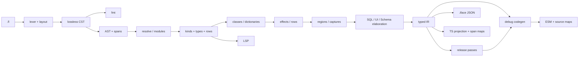
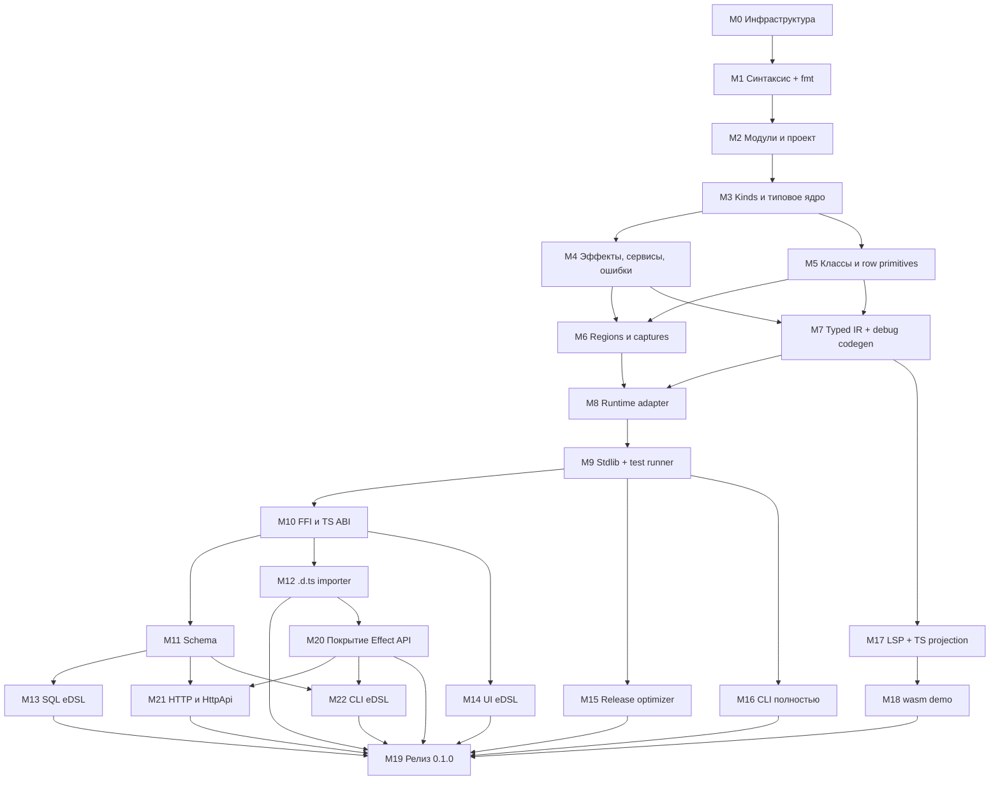

# Flick 0.1.0 — roadmap реализации

Цель — **один релиз `0.1.0`**, реализующий весь объём первой версии из
[`Flick спецификация ML языка с HKT и Effect.md`](./Flick%20спецификация%20ML%20языка%20с%20HKT%20и%20Effect.md)
(Flick 0.7, далее — «спека»). Промежуточных публичных релизов нет. Этапы ниже —
порядок работы внутри одной ветки разработки, а не версии семантики (спека §12
«Порядок реализации команд»). Всё, что спека относит к «за пределами первой
версии» (§13), в 0.1.0 не входит и здесь не планируется.

Ссылки вида `§7` указывают на разделы спеки. AC — acceptance criteria: каждый
пункт проверяется автоматическим тестом, если явно не сказано иное.

---

## 0. Как читать и как закрывать этап

### Структура этапа

Каждый этап `M<N>` содержит:

- **Объём** — что реализуется, со ссылками на спеку.
- **Артефакты** — модули/пакеты, которые появляются или меняются.
- **AC** — проверяемые критерии. Этап закрыт, когда все AC отмечены.

### Общий Definition of Done (для каждого этапа)

- [ ] `just check` зелёный: fmt, clippy `-D warnings` (включая `wasm32`), тесты.
- [ ] Каждое новое правило checker имеет минимум один **pass**- и один
      **fail**-fixture; fail-fixture фиксирует код `FLICK-…`, span и текст.
- [ ] Каждый новый код диагностики зарегистрирован в реестре и имеет текст для
      `flick explain` (короткое объяснение + пример исправления).
- [ ] Все поведенческие тесты рантайма проходят и в `debug`, и (после M15) в
      `release` профиле.
- [ ] Ни один изменённый файл не превышает 20 000 bytes (pre-commit guard);
      крупные части сразу разбиваются по модулям.
- [ ] Языковая документация в `docs/` обновлена для новых конструкций.

### Общие инварианты (проверяются на всех этапах)

Это сквозные контракты спеки. Любой этап, который их задевает, добавляет
регрессионный тест:

1. Pure `a -> b`, runtime `a ->{r; e} b` и `a ->{}` различаются в checker, IR и
   `.iface`; пустые rows не делают вызов чистым (§2, §4).
2. Порядок вычисления: строго слева направо, по стадиям каррирования (§4).
3. `task` холодный; `await` выполняет ровно один слой; нет скрытой memoization (§4).
4. Typed failure, defect и interruption не смешиваются (§7).
5. Captures/regions не стираются ни одним преобразованием, wrapper или `.iface` (§7).
6. JS `Number` семантика сохраняется бит-в-бит (NaN, ±Infinity, −0, округление) (§9).
7. Checker Flick — единственный источник истины по типам; TS-проекция, `.d.ts` и
   Content Mapper его не заменяют (§8, §11).

---

## 1. Архитектура реализации

### Раскладка репозитория (целевая для 0.1.0)

| Путь | Содержимое |
| - | - |
| `flick-core/` | Rust core: syntax, resolve, kinds/types, rows, classes, effects, regions, DSL elaboration, typed IR, optimizer, codegen, `.iface`, project model, diagnostics |
| `flick/` | CLI `flick` (все команды §12, включая `lsp --stdio`) |
| `flick-wasm/` | wasm-bindgen API для демо: `check` и compile preview |
| `runtime/` | npm-пакет runtime adapter на TS поверх Effect 4.0.5 (owners, scopes, concurrency, FFI adapters, Cause, entry runner, UI bridge, SQL driver adapter) |
| `stdlib/` | Стандартная библиотека: `.fl` модули + JS/TS adapters к Effect |
| `tools/dts-importer/` | Node helper на `typescript`, который читает `.d.ts` для `flick ffi import` и снимает поверхность Effect для линтера покрытия (M20) |
| `stdlib/Effect/surface.toml` | Манифест покрытия: каждый export закреплённого Effect с классификацией (M20) |
| `tests/` | fixtures checker (pass/fail), e2e-программы на Node, differential debug/release |
| `docs/` | Language reference, грамматика, каталог диагностик, руководства |

Модули `flick-core` выносятся в отдельные crates только при реальной потребности
(время сборки, wasm-граница). Заранее этого не делаем.

### Конвейер компиляции (§11)



На практике DSL elaboration (SQL/UI/codec) выполняется до type checking тела, а
результат проверяется общим checker. На схеме показана ответственность, а не
строгий порядок проходов.

### Решения реализации (не заданы спекой — фиксируем здесь)

| Вопрос | Решение по умолчанию | Где закрывается |
| - | - | - |
| Parser | Рукописный recursive descent + Pratt для операторов; lossless CST (trivia сохраняются) для `fmt` и LSP | M1 |
| Инкрементальность | Гранулярность — модуль: кеш по fingerprint исходника и `.iface` зависимостей; без query-фреймворка | M2, M16 |
| Spans | UTF-8 byte ranges (§12); LSP переводит в UTF-16 | M0 |
| Snapshot-тесты | `insta` для diagnostics, IR, JS-вывода | M0 |
| Node host | Node.js 24.18.0 (минимальная поддерживаемая версия), проверка в `doctor` | M8 |
| pnpm | Закреплённая версия через `packageManager` в шаблоне | M16 |
| Effect | Ровно 4.0.5, commit `81fc8d9c…` (§7, §11) | M8 |
| Покрытие Effect API | Каждый export `effect`, `effect/cli`, `effect/http`, `effect/http-api` классифицирован в манифесте; линтер в `just check` падает на неклассифицированном, устаревшем или изменившем сигнатуру export | M20 |
| Node-платформа Effect | Серверный HTTP, `Terminal`/`FileSystem` для CLI — через пакет platform-node, закреплённый на версии, совместимой с Effect 4.0.5; входит в capability check M8 | M21, M22 |
| PostgreSQL driver | `pg` (node-postgres) через FFI-binding в `stdlib` | M13 |
| React | React 19 + `react-dom/client` | M14 |
| `.d.ts` разрешение | npm-пакет `typescript` в Node helper, протокол JSON по stdio | M12 |
| npm scope пакетов | `@flick-lang/*` (runtime, stdlib) | M19 |

### Решения по пробелам спеки

Спека фиксирует семантику, но не задаёт ряд поверхностных деталей. Решения ниже
приняты; этап-владелец оформляет их в `docs/reference/` до начала работ.

| Пробел | Решение | Владелец |
| - | - | - |
| Комментарии | `//` строчный, `/* */` блочный с вложенностью, `///` doc-comment для `flick doc`. Внутри `sql { }` тоже `//` | M1 |
| Строки | JS-escapes `\n \t \r \\ \" \0 \u{…}` (только скобочная форма, одиночные surrogates запрещены); raw `r"…"` / `r#"…"#`; многострочные `"""…"""` с удалением общего отступа; интерполяции нет | M1 |
| Операторы | Фиксированная таблица, пользовательских операторов нет. От слабого к сильному: `\|>` (лев.), `\|\|` (прав.), `&&` (прав.), `== != < <= > >=` (неассоц.), `++` (прав.), `+ -` (лев.), `* / %` (лев., `%` = JS remainder), `**` (прав.), унарные `-` `not`, применение, `.field` / `M.x`. Bitwise — именованные функции `Number.bit_*` | M1 |
| Bool и `if` | `Bool` = JS boolean; литералы `true`/`false` (допустимы в паттернах); `if c then a else b` — выражение, `else` обязателен, цепочки `else if`, многострочная форма по отступам | M1 |
| Числовые литералы | Грамматика JS `NumericLiteral`: decimal, экспонента `1e-3`, `0x`/`0o`/`0b`, разделитель `_` по правилам JS (не в начале/конце, не двойной, не рядом с `.`/`e`/префиксом), BigInt-суффикс `n` (без дроби и экспоненты), legacy octal `010` запрещён. Отличие от JS: формы `.5` и `5.` запрещены — конфликт с доступом `.field` | M1 |
| Тесты | Без нового синтаксиса: модуль из test root экспортирует `tests : List Test`; `Test.test`, `Test.property`, `Test.group`, generators `Gen.*` — функции библиотеки | M9 |
| API платформы | `Platform.args`, env, stdout/stderr — модуль stdlib | M9 |
| `AppError` | Тип stdlib: `type error AppError = AppError { message : String; details : Option String }`; `App.fail : String ->{none; AppError} a`; runner безопасно печатает и выходит с кодом `1` | M8 |
| SQL table metadata | Блок `sql table Name "table" { col : sql_type [not null] [primary key] [default] [generated always] as T [via codec] }`; elaborates в библиотечные `Sql.table`/`Sql.column`, доступные и напрямую; генератор из миграций выдаёт тот же блок | M13 |
| FFI overrides | Importer пишет только `<Pkg>/Generated.fl`; пользовательский модуль `<Pkg>.fl` содержит обычные `foreign`-декларации с `reviewed "<pkg>@<ver> sha256:…"` и re-export; `ffi check` сверяет fingerprint | M12 |
| Shadowing и неоднозначность | Локальные связывания затеняют всё без диагностики. Top-level определение с именем из `import … exposing (name)` — ошибка `FLICK-R009`; имена из `exposing (..)` top-level затеняет молча. Два импорта по имени с разными сущностями — `FLICK-R010` сразу; конфликт между `(..)`-импортами — `FLICK-R010` только в месте использования. Re-export той же сущности не конфликт. Порядок `import` ни на что не влияет | M2 |
| HTTP | Без синтаксиса (спека §7 «Граница языкового ядра»): `Http.*` и `HttpApi.*` — библиотечные combinators; схемы endpoint'ов — `Schema a` из M11 | M21 |
| CLI eDSL | Спека §10 «CLI eDSL», грамматика в `docs/reference/grammar.md`. Блок `cli "name" { … }` с clauses `description`, `flag`, `arg`, `subcommand`, `handle`; elaborates в библиотечные `Cli.*` поверх `effect/cli`, доступные и напрямую. Parser блока уже разбирает форму clauses | M22 |
| Пакеты с модулями Flick | Пакет объявляет в своём `package.json` поле `"flick": { "iface-dir": "<dir>" }`; модуль `A.B` описан файлом `<dir>/A/B.iface`. Поле и файлы пишет `flick build`/`pack`, не пользователь. Установка — только pnpm (`flick install`/`add`), Flick читает установленное дерево; M2 смотрит прямые зависимости проекта | M2, M7, M16 |

---

## 2. Граф этапов



Параллельно можно вести: M5 с M4, M12 с M11, M13 с M14, M15/M16/M17 после M9,
M21 с M22 после M20. Номера M20–M22 добавлены позже остальных и идут до релиза M19.

---

## M0. Инфраструктура разработки

**Объём.** Скелет, на котором растут все остальные этапы: диагностика, тестовый
харнесс, e2e-запуск на Node, CI.

**Артефакты.** `flick-core::diagnostics`, `flick-core::source` (files, spans,
line index), `tests/` харнесс, `runtime/` с `package.json` и pinned Effect,
CI workflow.

**AC**

- [ ] Модель диагностики: стабильный код `FLICK-<area><number>`, severity, message,
      path, UTF-8 byte range, related spans, fix suggestions (§12).
- [ ] Реестр кодов с диапазонами по областям: syntax, resolve, kinds/types,
      effects, classes, regions, FFI, schema, SQL, UI, CLI/project. Тест проверяет
      уникальность кодов и наличие текста `explain` у каждого.
- [ ] Human renderer (с `--color auto|always|never`) и JSON renderer
      (versioned NDJSON, поле `schema-version`) — snapshot-тесты на оба.
- [ ] Fixture-харнесс: `tests/check/{pass,fail}/**/*.fl`; fail-fixture задаёт
      ожидаемые коды и spans внутри файла; harness сообщает diff.
- [ ] E2E-харнесс: компилирует `.fl` → ESM, запускает в Node, сравнивает
      stdout/stderr/exit code с ожидаемыми (`tests/run/**`).
- [ ] `runtime/` устанавливается через pnpm с Effect ровно `4.0.5`; тест падает,
      если резолвнутая версия иная.
- [ ] CI: `just check` + e2e на Linux; кеш cargo/pnpm.
- [ ] `flick --version` и `flick help` уже соответствуют формату §12.

---

## M1. Лексика, синтаксис, форматтер

**Объём.** Полная поверхностная грамматика первой версии (§3–§12): layout по
отступам; фигурные блоки `task`/`scope`/`provide`/`sql`/`ui`/records; `;` внутри
скобочных блоков. Lossless CST и `flick fmt`.

Конструкции: `module … exposing`, `import … as / exposing`, `Type(..)`;
сигнатуры с `forall`, constraints `=>`, стрелки `->`, `->{r; e}`, `->{}`,
row-хвосты `| r`, union `r1 + r2`, `none`, capture qualifiers `T^{s}`, `T^c`,
`T^(c + d)`; `let`, `let rec`, `rec { … }`, `fun x -> …`, `match … with`,
`try … with`, `task { }`, `await`, `scope s { }`, `provide layer { }`, `ignore`;
`type` (ADT, параметры), `type alias` (в том числе record), `opaque type`,
`opaque type alias`, `refined type … where`, `kind K = A | B`, `type error E = E T`, `service S = …`, `class … | c -> a =`,
`instance`, `deriving …`, `schema T …`, `codec s { … }`, `foreign pure|sync|async|effect … from …`
c metadata (`arity`, `this`, `catch`, `cancel signal`, nullable/retention),
`sql params { … }`, `ui { … }`. Литералы: Number, BigInt (`n`), String, Unit
`()`, tuples, List `[…]`, records `{ … }`, update `{ r with f = v }`.

**Артефакты.** `flick-core::syntax::{lexer, layout, cst, parser, ast}`,
`flick-core::fmt`, `docs/reference/grammar.md` (закрывает пробелы M1 из §1).

**AC**

- [x] `docs/reference/grammar.md` описывает лексику, keywords, операторы с
      приоритетами и всю грамматику; каждый пример спеки разобран как тест.
- [x] **Все** блоки ```` ```flick ```` из спеки извлекаются скриптом и разбираются
      без синтаксических ошибок (тест держит список и падает при новом примере
      без покрытия).
- [x] Layout: блоки функций и `match` по отступам; ошибки отступа дают
      диагностику с точным span, а не каскад.
- [x] Error recovery: один синтаксический сбой не скрывает следующие независимые
      объявления; parser не паникует на fuzz-входе (cargo-fuzz или proptest,
      ≥1 млн итераций в CI-nightly либо ограниченный прогон в обычном CI).
- [x] CST lossless: `print(parse(src)) == src` для всех fixtures.
- [x] `flick fmt`: идемпотентен (`fmt(fmt(x)) == fmt(x)`), сохраняет комментарии,
      не меняет AST (проверяется сравнением AST до/после на всём корпусе).
- [x] `flick fmt --check` возвращает `1` при отличиях и `0` без них;
      `--stdin --stdin-filepath` работает для редактора.
- [x] Нераспознанная конструкция вне первой версии (`do`, `let*`, JSX `<…>`)
      даёт отдельную диагностику «не входит в Flick 0.7», а не generic parse error.

---

## M2. Модули, имена, модель проекта

**Объём.** §11 «Модули и entry point», §12 «Имена файлов и конфигурация».

- Один `.fl` = один модуль; путь в source root ↔ имя модуля; test root отдельно.
- Явные exports; constructors только через перечисление или `Type(..)`;
  opaque скрывает representation; re-export сохраняет nominal identity.
- Запрет межмодульных циклов и циклических transparent aliases.
- `flick.toml` (`schema-version = 1`, `[project]`, `[build]`), поиск вверх от cwd,
  `--project <path>`.
- Package graph поверх установленного `node_modules` (пакеты с `.iface`).

**Артефакты.** `flick-core::resolve`, `flick-core::project`.

**AC**

- [x] Модуль `App.Users` обязан лежать в `src/App/Users.fl`; несоответствие и
      коллизия полного имени модуля — диагностики.
- [x] Импорт неэкспортированного имени, конструктора без `(..)`, неизвестного
      модуля — отдельные диагностики с span импорта.
- [x] Цикл импортов отвергается с перечислением цепочки модулей.
- [x] Циклический transparent alias отвергается; recursive nominal ADT внутри
      файла разрешён.
- [x] Shadowing и неоднозначность имён диагностируются детерминированно,
      независимо от порядка `import`.
- [x] `flick.toml`: неизвестный ключ, неверный `kind`, отсутствующий `entry` у
      `app`, неподдержанная `schema-version` → код выхода `2` с диагностикой.
- [x] `flick check` без аргументов проверяет `source-dir` и `test-dir`;
      `check <paths>` всё равно проверяет транзитивные imports.
- [x] Отсутствующий npm-пакет у импорта даёт диагностику с инструкцией
      `flick install` / `flick add`.

---

## M3. Kinds и типовое ядро

**Объём.** §4, §5 (без классов), §9 «Числовая модель».

- Kinds: `Type`, `ServiceRow`, `ErrorRow`, `CaptureRow`, `Row Type` (FieldRow),
  `Symbol`, `Region`, `Constraint`, пользовательские finite kinds; стрелки kinds;
  вывод kind из позиции.
- Встроенные типы и kinds из §5 (`Eff`, `Layer`, `Codec`, `Errors`, `Option`,
  `List`, `Ref`, …).
- Bidirectional checking; **обязательная полная сигнатура** над каждой именованной
  функцией, включая локальные, методы instances и partial application.
- Неявная квантификация свободных переменных сигнатуры; лексическое scoping
  внешних переменных во вложенных сигнатурах.
- Higher-rank: вложенный `forall` в аннотированных типах, predicative
  instantiation, skolem escape.
- Полиморфная рекурсия только с явным полным `forall`.
- Номинальные ADT, exact structural records, row polymorphism, unique labels,
  `{ r with f = v }` (тот же тип), projection литералом.
- Exhaustiveness и redundancy в `match`.
- `Unit`, `Never`, `none`; `Number`, `BigInt` (литерал `n`), без неявных coercions.
- Промежуточное выражение блока обязано иметь тип `Unit`, иначе — `ignore`.
- `let rec`, `rec { … }`; запрет рекурсивных значений с немедленным вычислением.
- Generalization: только доказанно pure построения (§5 «Generalization при
  наличии Ref»); runtime-результаты мономорфны; mutable containers инвариантны.
- `.iface`: следующая версия схемы с типами и kinds экспортов (раздел «types and
  kinds» в `docs/reference/iface.md`); checker импортёра берёт типы зависимостей
  только из `.iface`.

**Артефакты.** `flick-core::types::{kinds, ty, unify, rows, check, infer, generalize, exhaust}`.

**AC**

- [x] Применение конструктора с неверным kind отвергается в исходном коде (§13).
- [x] `Eff Unit Unit a` отвергается по kinds; `ServiceRow`/`ErrorRow`/`CaptureRow`
      не смешиваются.
- [x] Именованная функция без сигнатуры — ошибка; сигнатура в стиле
      «типы в заголовке `let`» — ошибка с подсказкой.
- [x] `apply_twice`, `render_twice` (§5) проходят; мономорфная реализация на месте
      `forall a. a -> a` отвергается (§13).
- [x] Skolem escape (полиморфный тип вытекает наружу) диагностируется.
- [x] Полиморфная рекурсия без явного `forall` отвергается; с ним — проходит.
- [x] `name`/`project_name` (§5) работают с открытыми строками; передача record с
      лишними полями в закрытый тип без хвоста отвергается (нет width subtyping).
- [x] Повтор label в record type/literal — ошибка; порядок полей не влияет на
      равенство типов.
- [x] Неисчерпывающий `match` — ошибка с примером непокрытого паттерна.
- [x] Пример `invalid` с `Ref.make None` (§5) отвергается; `make_empty`,
      `use_separate_cells`, `identity_again`, `fresh_cell`, `use_tasks` проходят;
      `capture_cell` не обобщает `a`; `use_logged_none` отвергается.
- [x] `1 + 1n` и `"a" ++ 1` отвергаются (нет неявного смешения Number/BigInt/String).
- [x] Отброшенный не-`Unit` результат в блоке — ошибка с fix «добавить `ignore`».
- [x] Рекурсивное значение с немедленным вычислением отвергается.
- [x] Время проверки линейно растёт на синтетических records в 200 полей и
      функциях в 2000 строк (бенчмарк в CI фиксирует бюджет, см. M19).

---

## M4. Эффекты, ошибки, сервисы, provide

**Объём.** §3, §4, §7 («Ожидаемые ошибки», «Сервисы», «Предоставление окружения»,
«Ошибка как данные»).

- Модальность `Pure` / `Runtime(r, e)` для каждой стадии стрелки и выражения.
- Прямые runtime-вызовы под `let`; вывод объединения rows; сигнатура — верхняя
  граница.
- Lift pure-тела в runtime-позицию как явный узел; обратное запрещено.
- `task { }` → `Eff r e a`, `await` снимает ровно один слой.
- Номинальные service/error identities с квалификацией пакета и модуля;
  нормализация повторов; `r1 + r2`.
- `type error E = E T` с проверкой `NoCapture` payload (финальная проверка — M6).
- `try … with`: вычитание ошибки только при полном покрытии варианта; guard или
  частичный pattern ошибку не снимают; rows handler добавляются.
- `Errors e` проекция; `from_result`.
- `service S = …` генерирует operations, `S.Impl`, требование `S`; `Layer ri e ro`;
  `Layer.succeed`; `provide layer { }` вычитает outputs и добавляет inputs/errors.
- Конфликт двух реализаций одного service key — ошибка (кроме явного override).

**Артефакты.** `flick-core::effects`, расширение `types::rows`, `flick-core::services`.

**AC**

- [x] `let user = Users.get id` даёт `User`, а не `Eff` (§13).
- [x] Runtime-вызов с пустыми rows (`->{}`) не принимается в позиции pure `->`.
- [x] `fun x -> normalize_name x` выводится pure, `fun x -> task { … }` — pure
      builder `Eff`, `fun x -> Users.get x` — runtime (§3).
- [x] `A -> B ->{R; E} C` и `A ->{R; E} (B -> C)` различаются; эффект первой
      стадии учитывается до вычисления второго аргумента.
- [x] Сигнатура уже, чем фактические rows тела → ошибка с перечислением лишних
      сервисов/ошибок; шире → проходит.
- [x] `await` от не-`Eff` — ошибка; `await` от `Eff r e (Eff r2 e2 a)` даёт
      `Eff r2 e2 a` (нет recursive flatten).
- [x] `load_optional`, `find_optional` (§7): итоговые rows совпадают со спекой;
      handler с guard не вычитает `NotFound`.
- [x] `from_result` с `Result String a` отвергается; с `Result NotFound a`
      проходит с singleton-строкой.
- [x] `application` (§7): после `provide UsersLive` остаются `{Config, Log}` и
      `{NotFound, ConnectError}`.
- [x] Передача обычного runtime-вызова как аргумента «provide-подобной» функции
      без `task` диагностируется как вычисленный до установки окружения
      (предупреждение с fix).
- [x] Service methods не являются class instances; `show user` не требует
      Context.

---

## M5. Классы типов, coherence, row primitives, deriving

**Объём.** §5 (классы, FD, coherence, termination), §5 «Структурность records»,
§10 «Минимальные возможности на уровне типов», §9 «Eq и Hash».

- Single- и multi-parameter classes, superclasses (ациклический граф), FD.
- Strict coverage, consistency FD, no overlap (heads после раскрытия aliases не
  унифицируются), no orphans, ownership: пакет класса или пакет nominal-конструктора
  первого параметра head.
- Структурное завершение instance resolution; бюджет 100 000 шагов и глубина 256,
  настраиваемые в `flick.toml`; превышение → диагностика с цепочкой.
- Dictionary elaboration; constraints внутри higher-rank `forall`.
- Compiler-owned structural instances для закрытых records; открытый хвост
  требует constraints.
- Row primitives: `HasField`, `Lacks`, `Project`, `Remove`, `UnionDisjoint`,
  `Map`, canonical labels; пользовательские instances для них запрещены;
  `Record.extend`, `Record.merge_disjoint`.
- `deriving Eq, Ord, Hash, Show` с согласованной семантикой полей.
- Проверка метода instance против сигнатуры класса после подстановки.

**Артефакты.** `flick-core::classes::{decl, coherence, solve, elaborate, derive}`,
`flick-core::types::row_prims`.

**AC**

- [ ] Отсутствующий или неоднозначный instance даёт понятную диагностику с
      местом требования и кандидатами (§13).
- [ ] `Functor Option` и `Functor (Eff r e)` проверяются; `map` работает с обоими (§13).
- [ ] `Collection UserSet User` + `Collection UserSet String` → нарушение FD.
- [ ] `empty_users` выводит `User` через FD без аннотации.
- [ ] Нарушение strict coverage (переменная определяемой части не в определяющей) → ошибка.
- [ ] `Show a => Show (List a)` + `Show (List Number)` → overlap-ошибка.
- [ ] Orphan instance (`Hash ExternalId` в чужом пакете) отвергается; nominal
      wrapper `LocalExternalId` проходит.
- [ ] `Convert String LocalEmail` из пакета `LocalEmail` отвергается (владение
      только первым параметром).
- [ ] Нестрого уменьшающийся recursive constraint отвергается; цикл superclasses
      отвергается.
- [ ] Искусственно дорогая задача упирается в бюджет и даёт диагностику, а не
      зависание или успех.
- [ ] Набор instances не зависит от порядка и формы `import` (тест с
      перестановкой импортов даёт идентичный результат и dictionary choices).
- [ ] Два transparent alias одной формы делят один structural `Eq`; попытка
      объявить для alias отдельный instance отвергается.
- [ ] `UnionDisjoint` отвергает повтор label; `Record.extend` требует `Lacks`;
      пользовательский `instance HasField …` отвергается.
- [ ] `deriving Hash` для record с `Ref` без witness → диагностика (§9).
- [ ] Метод instance с дополнительным constraint сверх класса отвергается.

---

## M6. Regions и captures

**Объём.** §7 «Ресурсы», «Статические regions и захваты», «Объём сильного
контракта», «Владелец fibers», §5 capture-аннотации в сигнатурах combinators.

- `scope s { }` / `scope { }` создаёт fresh region; `Scope s` передаётся
  лексически.
- Capture rows: `T^{s,t}`, `T^c`, `T^(c + d)`; qualifier — верхняя граница;
  intrinsic dependencies (`File s`, `List (File s)`).
- Вывод captures для локальных значений; обязательные captures в публичных
  сигнатурах и `.iface`.
- Проверка escape по всем путям из таблицы §7: результат, вложенные data,
  closure, `Eff`, opaque/existential, запись в Ref/cache, error payload/Exit,
  foreign retention.
- `NoCapture` для payload ошибок (даже при локальном recovery).
- Captures через partial application, records, dictionaries, `Unknown^{s}`.
- Mutable storage инвариантно по captures.
- `spawn owner supervisor task`: task и supervisor не захватывают более короткий регион.

**Артефакты.** `flick-core::regions::{infer, check, escape}`.

**AC**

- [ ] `bad_deferred` и `bad_callback` (§7) отвергаются с указанием захваченного
      значения и границы scope.
- [ ] `deferred_read` и `read_config` проходят.
- [ ] Scoped-handle не выходит через результат, callback, task, контейнер, error
      payload или запись во внешний Ref — по fixture на каждый путь (§13).
- [ ] Opaque/nominal wrapper вокруг `File s` не стирает зависимость от `s`.
- [ ] `type error Leak = Leak (File s)` отвергается по `NoCapture` даже при перехвате
      внутри того же scope.
- [ ] Curried `List.map_effect f` удерживает captures `f`; `Functor.map`
      сохраняет `c + d` (§5, §6) — проверено на сигнатурах stdlib (§13).
- [ ] Явный qualifier уже фактических captures отвергается; шире — принимается.
- [ ] `spawn` с task, захватывающей ресурс внутреннего scope, при owner внешнего —
      ошибка.
- [ ] Captures публичной функции сохраняются в `.iface` и проверяются у
      импортирующего модуля (cross-module fixture).

---

## M7. Typed IR и debug codegen

**Объём.** §8 «Генерация TypeScript», «ADT и pattern matching», «Эффектная
функция», «Представление значений», §11 Typed IR.

- Typed IR: явные стадии применения, модальность, dictionaries, captures,
  порядок вычисления, операции Effect, исходные spans.
- Debug (эталонный) lowering → ESM: pure функции — обычный JS; runtime-функции —
  `Effect.gen` / `yield*`; `task` — first-class Effect с отложенным телом; lift.
- ABI данных (§8): `Unit` = `undefined`; primitives; tuples и List — dense arrays;
  records — plain objects; ADT — `_tag` с квалифицированным constructor id и
  `_0`, `_1`…; `Option`/`Result` — native Effect.
- `try … with` → нативное typed recovery Effect (не JS `try/catch`).
- Pure self-tail recursion → loop, с сохранением порядка аргументов.
- Runtime-рекурсия через suspend, без eager построения цепочки.
- `==` → SameValueZero для Number; `Ord Number` total order; numeric
  `<`/`>` — JS-семантика.
- Source maps; `--emit ts` (исполняемый TS).
- `.iface` (versioned JSON, `docs/reference/iface.md`): к именам и identity
  (v0, M2), типам/kinds (M3), классам (M5) и captures (M6) добавляются data ABI,
  dictionary ABI, fingerprints и optimization summaries; запись в `dist/`.
  Версия 1 фиксируется в M19.

**Артефакты.** `flick-core::ir`, `flick-core::codegen::{js, ts, sourcemap}`,
`flick-core::iface`.

**AC**

- [ ] Pure функции компилируются в JS без `Effect` импортов и обёрток (snapshot +
      grep-тест на сгенерированном коде) (§13).
- [ ] `load_name` генерирует `Effect.gen` с `yield*` только на эффектных вызовах.
- [ ] `task` не выполняет тело при построении; два `await` выполняют его дважды
      (e2e со счётчиком) (§13).
- [ ] Сохранение task в переменную или `identity request` её не запускает (§13).
- [ ] `f x y` с runtime первой стадией: эффект `f x` наблюдается до вычисления `y`
      (e2e с логированием порядка).
- [ ] Аргументы и поля records вычисляются слева направо (e2e).
- [ ] Constructor id в `_tag` квалифицирован пакетом/модулем/типом; пользовательский
      ADT с тегом `"Some"` не совпадает с `Option`.
- [ ] Хвостовая self-recursion на 10⁶ итераций не переполняет стек.
- [ ] Number: NaN, ±Infinity, −0 и округление совпадают с эталонными JS-значениями
      (property-тест на случайных выражениях: Flick vs прямой JS) (§13).
- [ ] `==` на NaN даёт `true`, `+0 == -0` — `true`; `Number.strict_equal`,
      `Number.same_value` ведут себя как `===` и `Object.is`.
- [ ] Source map сопоставляет runtime-ошибку с `.fl` строкой (e2e со stack trace).
- [ ] `.iface` round-trip: write → read → write даёт идентичный JSON; несовместимая
      версия или изменённый data ABI зависимости → диагностика.
- [ ] `--emit ts` проходит `tsc --noEmit` на всём e2e-корпусе.

---

## M8. Runtime adapter

**Объём.** §7 целиком на стороне runtime, §11 «Runtime adapter», §12 «Запуск».
Пакет на TS поверх Effect 4.0.5 с capability matrix.

- Lexical owner и двухфазное закрытие strong scope: запретить новую работу →
  interrupt детей → join каждого → foreign quiescence → LIFO resource finalizers →
  Exit. Отдельная child group (не общий LIFO с ресурсами).
- Scoped `acquireRelease` (release без expected errors) и `bracket`
  (typed ошибка release).
- `parallel`, `parallel_all limit` (проверка positive finite integer),
  `parallel_results`, `parallel_exits`: fail-fast, отмена, ожидание cleanup,
  порядок результатов по входу. Реализация через child group, не `joinAll`.
- `spawn owner supervisor task`, `join`; supervisor получает полный `Failure`;
  defect supervisor → root reporter.
- `race_success`, `race_first`, `timeout` (`TimeoutError`), `timeout_option`.
- Opaque `Exit e a`, `Failure e`, `RawCause`; `Failure.primary`, `raw_cause`,
  `inspect`, `rethrow`; `CauseReport` инертный (без getters/`toString`/`toJSON`).
- Layer: построение до тела, sharing одной identity внутри сборки, независимость
  разных `provide`, restore окружения, finalizer с контекстом регистрации.
- Entry runner: `main`, закрытие root owner, коды выхода `0/1/130/143`,
  SIGINT/SIGTERM запускают тот же протокол; статус shutdown при задержке.

**Артефакты.** `runtime/src/{owner, scope, concurrency, race, cause, layer, entry}.ts`
+ тесты на vitest или `node:test`; codegen M7 переключён на adapter.

**AC**

- [ ] Typed handler выбирает recoverable ошибку ровно по таблице §7 «Сложный Cause»
      (6 случаев — 6 тестов), включая `[Fail(B), Fail(A)]` с handler только `A`.
- [ ] `Failure.rethrow` сохраняет исходный Cause (тест по identity/структуре).
- [ ] `RawCause.inspect` на payload с getter/`toString`/Proxy не вызывает их
      (тест со шпионом) и даёт placeholder.
- [ ] Typed failure, defect и interruption различаются в Exit и в коде выхода (§13).
- [ ] Scope освобождает ресурс при успехе, typed error, defect и interruption (§13).
- [ ] Ресурс, зарегистрированный **после** запуска ребёнка, освобождается только
      после join этого ребёнка (тест на порядок событий).
- [ ] Uninterruptible ребёнок задерживает закрытие; ресурс не освобождается раньше (§13).
- [ ] Async FFI, чей Promise игнорирует отмену: release ждёт фактического окончания
      Promise (quiescence) (§13).
- [ ] `parallel`: при сбое одной ветки остальные отменены и дождались cleanup;
      результаты в порядке входа; `parallel_all 0` и `parallel_all 1.5` отвергаются (§13).
- [ ] `parallel_results` возвращает `Result` по веткам, defect не маскируется.
- [ ] `spawn` без supervisor не компилируется; потерянный handle не теряет
      ошибку — supervisor её получает.
- [ ] `race_first`/`timeout` прерывают и ждут losers; loser failures не
      добавляются к результату.
- [ ] Ошибка построения Layer: тело не запускается; одна Layer identity
      строится один раз внутри одной сборки и дважды — в двух `provide`.
- [ ] Entry: `main`, завершившийся `AppError`, даёт код `1` после cleanup; SIGINT
      при успешном cleanup даёт `130`, при сбое cleanup — `1`.
- [ ] Тест-матрица фиксирует Effect 4.0.5; запуск с другой версией Effect
      отвергается с диагностикой (capability check).

---

## M9. Стандартная библиотека и тестовый runner

**Объём.** §6, §9 (стандартные типы), §12 «Тесты». Всё как библиотека над тем же
backend; специальные literals — только Number/BigInt.

- Prelude-классы: `Eq`, `Ord`, `Hash`, `Show`, `Functor`, `Foldable`,
  `Traversable`, `Applicative`/`Monad` с `bind`/`bind_eff` (§5), `Monad (Eff r e)`.
- `Option`, `Result` (+ `bind`/`map`), `List` (pure `map`, `map_effect`, folds,
  индексные traversals, без квадратичного `slice`), `NonEmpty`, `Chunk`,
  `Js.Array`, `String`, `Number` (`strict_equal`, `same_value`, checked ops),
  `BigInt` (checked деление), `Ref` (`make/get/set/modify`, без Eq/Hash),
  `Redacted` (runtime `make/reveal`), `BigDecimal` (`divide_to_scale` с rounding
  policies, `DecimalError`), `Duration` (checked constructors, `DurationError`),
  `HashMap`/`HashSet` + `EqHash` witness (`with`), loop/trampoline API.
- Concurrency/runtime API из M8 как source-модули с сигнатурами §6–§7.
- Сервисы: `Log`, `FileSystem`/`File.open_scoped`, `Events` (`queue`,
  `log_failures`), платформенный API (args, env, stdout/stderr).
- Тестовая библиотека: pure и effectful тесты, property tests с явными
  generators и `--seed`; раздельный учёт assertion / typed failure / defect /
  cleanup failure; каждый тест — собственный scoped owner.
- Синтаксис объявления тестов (закрывает пробел из §1).

**Артефакты.** `stdlib/`, `runtime/src/test/`, `flick test` (базовый).

**AC**

- [ ] Все сигнатуры stdlib из спеки (`List.map`, `List.map_effect`, `Ref.*`,
      `Codec.*`, `Failure.*`, `Redacted.*`, `from_result`, …) совпадают текстуально
      (тест сверяет `.iface` stdlib со списком сигнатур из спеки).
- [ ] `List.map` с runtime-callback отвергается; `List.map_effect` выполняет
      callback последовательно слева направо (e2e).
- [ ] `requests_for` не запускает запросы; `parallel_all 8` ограничивает
      одновременно активные ветки до 8 (e2e со счётчиком).
- [ ] `Ord Number.compare`: −Infinity < конечные < +Infinity < NaN; `-0` EQ `+0`;
      sort стабилен на массиве с NaN.
- [ ] `HashSet.with witness`: вставка и поиск используют один witness; union с
      другим witness требует явного rehash (иначе ошибка типов).
- [ ] `BigDecimal.divide_to_scale` для каждой rounding policy и деления на ноль —
      таблица тестов; `Exact` отвергает округление.
- [ ] `Duration.millis (-1)` / NaN / overflow → `Result DurationError`.
- [ ] `Redacted` в `Show`/логах маскируется.
- [ ] `flick test`: `--filter`, `--jobs N` (по умолчанию 1), `--seed` (выводится при
      провале), `--reporter human|json`; cleanup failure теста — провал теста.
- [ ] Отмена теста не пропускает cleanup; следующий запуск в `--watch` начинается
      после закрытия owners предыдущего.

---

## M10. FFI, ABI и TS-интерфейсы

**Объём.** §8 «FFI», «Одна сигнатура и явный режим», «Представление значений и
callbacks», «Подписки», «Higher-rank callback на FFI», «Публичные TypeScript
интерфейсы».

- `foreign pure|sync|async|effect … from <module|global> "<name>"` + metadata
  `arity`, `this`, `catch`, `cancel signal`, nullable/optional mapping,
  retention, variadic tail через List adapter.
- Контракты инициализации модуля: trusted pure static import vs runtime loading.
- Четыре callback families: pure, Effect, Promise, scoped event (owner, queue,
  supervisor, listener identity, reentrancy, late callbacks, snapshot).
- `JsValue` vs `Unknown`; runtime snapshot `JsValue -> Unknown` с лимитами размера
  и глубины, отказ от accessors/функций/циклов/неподдержанных prototypes.
- Копирование immutable data на недоверенной границе; opaque handles; unsafe-граница.
- Публичный TS façade (`--emit-dts`): pure-функции, runtime → `Effect<A, E, R>`,
  dictionary records, branded opaque, staged currying, opt-in Promise façade
  (`Promise<Result<A, Errors<E>>>` + `RuntimeFailure`); scoped exports только через
  owner adapter; непредставимый export — диагностика.

**Артефакты.** `flick-core::ffi`, `flick-core::codegen::dts`,
`runtime/src/ffi/{callbacks, snapshot, promise_facade}.ts`.

**AC**

- [ ] `foreign effect` откладывает вызов JS-фабрики до запуска (e2e со счётчиком) (§13).
- [ ] `foreign async`: Promise создаётся при выполнении, не при построении `task`.
- [ ] `throw`/rejection без `catch` → defect; с `catch` → typed error; mapping,
      кладущий scoped capability в payload, отвергается.
- [ ] `arity 0` принимает `()`; `now_millis (Log.info m)` сначала логирует.
- [ ] `hypot`, `now_millis`, `read_text`, `fetch_user` (§8) компилируются и работают.
- [ ] Callback adapters соблюдают результат, arity/`this`, reentrancy,
      окружение, отмену и lifetime своего семейства — по набору тестов на каждое
      семейство (§13).
- [ ] Scoped event: переполнение очереди отвергает событие и сообщает supervisor;
      late callback после начала закрытия не запускает задачу; снимается именно
      зарегистрированная функция.
- [ ] Callback с неизвестным retention не принимает scoped-handle (ошибка компиляции).
- [ ] Snapshot отвергает getter, функцию, цикл, Proxy-trap исключение (через
      mapping) и превышение лимитов; shared поддеревья принимает.
- [ ] `--emit-dts`: результат проходит `tsc --strict`; не содержит `any`;
      абстрактный HKT export без façade даёт диагностику.
- [ ] Promise façade: expected failure → `Result`, defect → rejection
      `RuntimeFailure` с безопасным report; импорт библиотеки ничего не запускает.
- [ ] Hover/диагностика не путают `Unit`, `Never` и пустые rows; TS ABI: `Unit` →
      `undefined`, пустые rows → `never`, foreign `void` нормализуется в `()` (§13).

---

## M11. Schema, codecs, exporters

**Объём.** §9 «Schema и стандартные типы данных» целиком.

- `refined type T = U where pred` (закрытый constructor, `T.parse`, `T.value`,
  compile-time проверка поддерживаемых констант).
- `deriving Schema`: primitives, literals, `Unit`, `Never`, records, tuples, ADT,
  `Option`/`Result`/коллекции, generics (функции от схем), HKT-параметры
  (higher-rank witness), рекурсия и взаимная рекурсия (lazy refs), refinements,
  opaque (witness владельца), phantom.
- `schema T args`, `codec s { field … }` DSL: каждое поле ровно один раз, конфликт
  wire-имён, `ignore_extra_fields`, `field`, `optional_field`, `option_as_null`,
  `option_as_nullish`, tagged Option, `on_missing`, `on_missing_effect`,
  transformations (pure/fallible/effectful), whole-record checks.
- `Schema a`, `PureCodec i a` (opaque сертификат), `Codec rd re i a`;
  `decode`/`encode`/`decode_result`/`encode_result`; `SchemaError` без живого input.
- Redacted: нет раскрывающего codec без opt-in.
- Targets: strict JSON Schema 2020-12 (`ExportError` с путём), Standard Schema V1
  (sync для PureCodec, Promise для Codec), Arbitrary (+ явные generators),
  redaction-aware diagnostic formatter.
- Interpreter baseline; `--schema-aot` / `schema-aot = true` opt-in; без JIT;
  registry инициализируется в entry point.

**Артефакты.** `flick-core::schema::{derive, codec_dsl, export}`,
`stdlib/Schema/*`, `runtime/src/schema/*`.

**AC**

- [ ] Deriving работает для generic (`Tree a`), higher-kinded (`PairOf f`),
      recursive и mutually recursive данных (§13).
- [ ] Неподдерживаемое поле (функция, `Ref`, ресурс) без witness даёт точную
      диагностику с путём поля (§13).
- [ ] Codec DSL: пропущенное поле, повтор поля, неизвестное поле, конфликт wire-имён —
      ошибки компиляции.
- [ ] Missing / null / undefined / defaults / extra keys проверяются независимо —
      по тесту на каждую строку таблицы политик §9 (§13).
- [ ] `on_missing` вызывает factory ровно один раз на decode; null не
      заменяется default.
- [ ] Effectful codec (`on_missing_effect`, effectful transformation) не получает
      `PureCodec`; попытка использовать его как `PureCodec` — ошибка типов (§13).
- [ ] Цикл в активном пути decoding → `SchemaError`, не зависание; shared поддеревья OK.
- [ ] `Number.json_finite` отвергает NaN/Infinity при decode и encode.
- [ ] `Redacted` поле без явной политики не получает раскрывающий JSON codec.
- [ ] Strict JSON Schema export отвергает непредставимый контракт с
      `ExportError` и путём (`Profile.session -> JSON Schema: scoped resource has no wire codec`);
      нет `{}`/`any` в выводе; результат валиден по мета-схеме 2020-12 (§13).
- [ ] AOT: unsupported node остаётся на interpreter с той же семантикой
      (differential-тест AOT vs interpreter); это отдельно от strict export (§13).
- [ ] Standard Schema V1 adapter: late validate после закрытия owner — контролируемая ошибка.
- [ ] `Email.parse` / `Email.value` работают; константа, нарушающая
      поддерживаемую проверку, отвергается при компиляции.

---

## M12. `.d.ts` importer

**Объём.** §8 «Прямой FFI и цена автоматизации», «Поддерживаемое подмножество
d.ts», «Диагностика и обновление пакетов»; CLI `ffi import`, `ffi check`.

- Node helper на `typescript` разрешает декларации установленного пакета.
- Поддерживаемое подмножество по таблице §8; три статуса на export:
  supported / needs policy / unsupported с именованной причиной.
- `any`/TS `unknown` → `JsValue` (strict mode — отказ); без тихого weakening.
- Overloads → отдельно именованные wrappers при однозначности.
- Генерация foreign-bindings тем же синтаксисом M10; generated-файл и reviewed
  overrides хранятся раздельно; provenance и версия зависимости в контракте.
- `ffi check`: fingerprints, совместимость overrides после обновления, обязательные policies.

**Артефакты.** `tools/dts-importer/`, `flick-core::ffi::import`, `flick ffi …`.

**AC**

- [ ] `lookup` из §8 с политикой `undefined -> None` и rejection → `JsError`
      импортируется ровно в показанный binding.
- [ ] `nextId(): number` импортируется как `Unit ->{} Number`, не pure.
- [ ] Отчёт покрытия перечисляет каждый выбранный export со статусом и причиной;
      нет неявного `any`, pure или cancellation (§13).
- [ ] Blocked export: использование — ошибка; независимые supported exports того
      же пакета доступны.
- [ ] Повторный `ffi import` после обновления пакета не перезаписывает reviewed
      overrides (§13).
- [ ] `ffi check` падает, если shape декларации изменился несовместимо с override
      или отсутствует обязательная policy.
- [ ] `--select <names>` ограничивает поверхность импорта.
- [ ] Корпус из ≥3 реальных пакетов (например, `date-fns` и два пакета с
      Promise/callback API) импортируется с ожидаемым snapshot-отчётом.

---

## M13. SQL eDSL (PostgreSQL)

**Объём.** §10 «SQL», «Что проверяется в SQL», «Данные и SQL-текст», «Граница
Schema и SQL».

- Opaque `Sql.Template dialect params result`, `Sql.Query dialect result`,
  внутренний `Sql.Expr scope phase nullability sql_type`.
- Table metadata в source: SQL types, nullable, keys, generated/identity/default,
  связь с pure codecs (синтаксис закрывает пробел из §1).
- `sql params { … }` elaboration в typed constructors с source spans;
  combinators без сахара.
- Subset §10: SELECT/FROM/WHERE/projection, INNER/LEFT JOIN, GROUP BY/HAVING +
  агрегаты с phases, ORDER BY, LIMIT/OFFSET, некоррелированные subqueries,
  EXISTS/IN, UNION/UNION ALL, INSERT/UPDATE/DELETE + RETURNING.
- Трёхзначная логика: `==` → SQL сравнение, `is_null`, `is_not_null`,
  null-safe equality; nullability как индекс, `Option` на выходе без вложенных Option.
- `Sql.bind` (pure), `Database.query : Sql.Query Pg a ->{Database; EncodeError, DbError, DecodeError} List a`;
  placeholders + массив параметров; identifiers отдельным каналом.
- Отображение типов: bigint → BigInt, decimal → BigDecimal, Number только через
  checked range.
- Raw unsafe API с явным result decoder.
- Driver adapter (`pg`): pool, отмена без отката, connection не возвращается в
  pool до drain/close.

**Артефакты.** `flick-core::dsl::sql`, `stdlib/Sql/*`, `runtime/src/sql/*`.

**AC**

- [ ] `balances` (§10) выводит `BalanceRow` с `balance : Option BigDecimal` из-за
      LEFT JOIN; с INNER JOIN — non-null; повторный LEFT JOIN не даёт `Option (Option a)` (§13).
- [ ] Отвергаются: `user.nmae`; сравнение `UserId` с `Date`; ссылка на alias
      соседнего завершённого запроса; неоднозначное имя; два результата с одним
      именем; неагрегированное поле без группировки; aggregate в WHERE;
      отсутствующее обязательное поле INSERT; запись в generated-always колонку;
      неизвестный параметр; неподходящий codec (§13).
- [ ] `Sql.bind` и построение запроса не выполняют I/O (тест: без Database сервиса
      запрос строится и печатается) (§13).
- [ ] Значения передаются только placeholders: e2e с payload `'; DROP TABLE …`
      сохраняется как данные.
- [ ] Runtime `String` не принимается в позиции identifier без `Identifier`.
- [ ] Ответ с неожиданным типом колонки → `DecodeError`; нарушение constraint →
      `DbError` с инертной диагностикой.
- [ ] E2E против PostgreSQL (контейнер в CI): select, join, group by, insert
      returning, update, delete, union, subquery.
- [ ] Отмена запроса: connection не возвращается в pool до drain/close (тест на pool).
- [ ] Время проверки запроса с 10 JOIN и таблицами по 50 колонок укладывается в
      бюджет M19; диагностика указывает span в `sql { }`, а не внутренности DSL.

---

## M14. UI eDSL (React adapter)

**Объём.** §10 «UI eDSL».

- `Ui r e` — чистое описание с отложенными handlers; captures сохраняются.
- `ui { … }` сахар и эквивалентные функции `Ui.*`.
- Props — exact records; spread только disjoint merge; key/ref — metadata.
- Children-контракты по таблице §10 (`List`, single, `Option`, named record, `NonEmpty (Tab r e)`, без children).
- `Ui.Handler snapshot r e` и обязательные policies `exhaust`, `latest`,
  `queue capacity`, `concurrent limit` (checked positive integers).
- Синхронный default-action decision; инертный event snapshot.
- Обязательный root supervisor; `Ui.run` живёт до закрытия root и cleanup;
  сбой supervisor → defect root.
- React cleanup синхронно закрывает приём событий; app-owned close task делает
  interrupt/join/quiescence/release.
- `Ui.text` безопасный канал; `SafeUrl`, `SanitizedHtml` opaque.
- Foreign React components через FFI pipeline как opaque renderer components.

**Артефакты.** `flick-core::dsl::ui`, `stdlib/Ui/*`, `runtime/src/ui/react/*`.

**AC**

- [ ] `save_button` (обе формы §10) компилируется в одинаковый IR.
- [ ] Неверный prop, опечатка, отсутствующее обязательное поле — ошибки (§13).
- [ ] Runtime-вызов (например, `Ref.get`) в render отвергается (§13).
- [ ] Handler без policy не компилируется (нет fire-and-forget).
- [ ] Кнопка, чей handler захватил file из закрытого scope, не может быть
      возвращена из scope (§13).
- [ ] `SelectProps` с `items : List User` и `on_change` для `Product` отвергается.
- [ ] `exhaust` игнорирует клики во время задачи; `latest` отменяет прежнюю и ждёт
      quiescence; `queue`/`concurrent` при переполнении отвергают событие и
      сообщают supervisor infrastructure defect (тесты в jsdom или happy-dom) (§13).
- [ ] Unmount: приём событий закрыт синхронно; ресурсы освобождаются только после
      join задач (тест на порядок событий) (§13).
- [ ] `Ui.text "<script>"` рендерится как текст; `String` не принимается вместо `SafeUrl`.
- [ ] E2E: пример-приложение собирается в ESM и монтируется в jsdom с реальным React 19.

---

## M15. Release optimizer

**Объём.** §8 «Оптимизация единственного Effect backend», «Профили», «Оптимизации
по образцу ReScript» — первый набор плюс «По явному ABI».

- Local inlining (budget по размеру/глубине), beta reduction, alias/constant
  propagation (точная JS Number/BigInt семантика).
- Arity analysis и worker-функции (`add$2`); partial application сохраняет currying.
- Pure self-tail recursion → loop (уже в debug) и сохранение cooperative yield в runtime-коде.
- SROA/устранение временных immutable records/tuples при ненаблюдаемой identity.
- DCE и ES modules для bundler; неиспользованный `task { … }` удаляется,
  выполненный `Log.info` — нет.
- Специализация dictionaries canonical instances → прямые вызовы.
- Unboxed nominal wrappers и различимые unions только по явному ABI; native
  Effect-типы ABI не меняют.
- Запрещённые преобразования из §8 (`(a+b)+c` reassociation, `x*0 → 0`,
  memoization task, слияние Layer, перенос lookup через provide, удаление
  Schema-проверки) отсутствуют и закреплены тестами.

**Артефакты.** `flick-core::opt::{inline, arity, sroa, dce, specialize, tailrec}`.

**AC**

- [ ] Differential-тестирование: весь e2e-корпус даёт идентичные stdout, порядок
      эффектов, Exit и коды выхода в `debug` и `release` (§13).
- [ ] Полное известное применение `add x y` вызывает worker; частичное — closure;
      если первая стадия runtime/частичная, uncurrying не применяется (тест с
      бросающей первой стадией).
- [ ] `sum_pair` в release не аллоцирует объект (snapshot JS).
- [ ] Специализированный dictionary вызывает метод напрямую; при двух разных
      dictionaries одного типа (`EqHash` witnesses) сохраняется выбранный.
- [ ] Набор negative-тестов на каждое запрещённое преобразование из §8.
- [ ] Number-корпус из M7 проходит в release бит-в-бит (§13).
- [ ] Бесконечный runtime-цикл в release остаётся прерываемым (тест на interruption).
- [ ] Размер и время: release-сборка e2e-корпуса не медленнее debug более чем на
      заданный в M19 бюджет; размер JS уменьшается (метрика публикуется в CI).

---

## M16. CLI: полный набор команд

**Объём.** §12 целиком. Команды из этапов выше доводятся до контрактов §12.

- Проект: `new`, `init` (без перезаписи, конфликты до записи), шаблоны `app`/`lib`
  с закреплёнными версиями compiler/runtime/Effect/pnpm.
- Сборка: `check` (`--watch`), `build` (`--profile`, `--emit js|ts`, `--emit-dts`,
  `--schema-aot`, `--out-dir`, `--watch` с сохранением последней успешной генерации),
  `run -- args` (`--entry`), `dev`, `test`, `fmt`, `clean` (`--cache`).
- Зависимости через pnpm: `install` (`--locked` → `--frozen-lockfile`,
  `--offline`), `add [--dev]`, `remove`, `update`, `deps [--why]`, `pack --out-dir`.
- Инструменты: `ffi import|check`, `schema export` (`json-schema-2020-12`,
  `openapi-3.1` после M21), `doc --out-dir`,
  `lsp --stdio`, `explain`, `doctor`, `inspect <module> --emit ast|typed-ir|js|ts|iface|mapping`.
- Общие флаги: `--project`, `--diagnostics human|json`, `--warnings-as-errors`,
  `--color`, `--quiet`/`--verbose`, `--help`, `help <command>`, `--version`.
- Кеш в `.flick/` с ключом из §12; генерации `.flick/run/<generation>/`;
  manifest артефактов для `clean`.
- `dev`: изоляция генераций, протокол shutdown перед заменой, остановка
  автоперезапуска при сбое cleanup.
- Коды выхода `0/1/2/3/130/143` и потоки stdout/stderr по §12.

**Артефакты.** `flick/src/commands/*`, `flick-core::project::{cache, generations, pnpm}`.

**AC**

- [ ] `check` и `build` не запускают `main`, не выполняют эффектную инициализацию
      foreign modules и не устанавливают зависимости (тест: foreign-модуль с
      side effect при импорте не срабатывает) (§13).
- [ ] `run`, `dev`, `test` всегда строят исполняемый JS, даже при `emit = "ts"` (§13).
- [ ] `dev`: при ошибке сборки работает старая версия; новая стартует только после
      join, quiescence и finalizers старой; сбой cleanup останавливает перезапуск
      и попадает в итоговый Cause (§13).
- [ ] Поздний `import()` в запущенной генерации не видит файлы следующей сборки (§13).
- [ ] Кеш различает эффективную конфигурацию, профили, emit-режимы, версии
      toolchain/runtime и dependency fingerprints: изменение любого из них —
      cache miss; cache miss не меняет результат (§13).
- [ ] `clean` сохраняет активные генерации, их locks и пользовательские файлы в
      общем output-каталоге (§13).
- [ ] `install --locked` без lockfile или при расхождении с manifest — код `2` (§13).
- [ ] Неверная версия pnpm обнаруживается **до** изменения manifest/lockfile,
      код `2` с инструкцией (§13).
- [ ] Несовместимые compiler/runtime/Effect блокируют компиляцию и запуск (§13).
- [ ] `--diagnostics json`: весь stderr — валидный versioned NDJSON, включая
      вывод приложения (`application-stderr`), тестов и pnpm
      (`package-manager-output`), без ANSI (§13).
- [ ] stdout `lsp --stdio` содержит только протокол; `test --reporter json` — только
      события тестов (§13).
- [ ] Коды выхода учитывают результат cleanup (матрица тестов на `0/1/2/3/130/143`) (§13).
- [ ] `pack`: tarball содержит ESM, `.iface`, заявленные `.d.ts`; отсутствующий
      export/`.iface` или несовместимый fingerprint отвергаются; импорт пакета
      ничего не запускает (§13).
- [ ] `doc` генерирует страницы с source-типами, kinds, constraints, эффектами,
      captures.
- [ ] `explain FLICK-…` работает для **каждого** зарегистрированного кода.
- [ ] `doctor` проверяет compiler, Node, pnpm, Effect ABI, adapters; отсутствие
      Content Mapper adapter не является ошибкой.
- [ ] Сценарии из §12 «Примеры работы» и базовый CI-набор проходят как e2e-скрипт.

---

## M17. LSP, TS-проекция, Content Mapper

**Объём.** §11 «Реализация compiler и editor», §12 `lsp`.

- `flick lsp --stdio`: diagnostics, hover (source-типы), go to definition,
  completion, rename собственных symbols, formatting.
- Один analysis result для исполняемого вывода и редакторной проекции.
- TS-проекция + span maps (`inspect --emit mapping`); cross-language rename
  только при точном mapping.
- Versioned Content Mapper adapter для typescript-go (интеграция не блокирует
  source checker).

**Артефакты.** `flick/src/lsp/*`, `flick-core::projection`, `editors/vscode/`
(минимальный клиент для ручной проверки).

**AC**

- [ ] Hover показывает source-типы (rows, captures, constraints), а не TS helpers (§13).
- [ ] Executable и editor outputs согласованы: для каждого e2e-модуля проекция и
      исполняемый код получены из одного analysis (тест сравнивает fingerprints) (§13).
- [ ] Diagnostics LSP совпадают с `flick check` (коды, spans в UTF-16 после конвертации).
- [ ] Definition работает между модулями и для импортированных `.iface`.
- [ ] Rename меняет все использования в проекте; rename с неточным mapping
      отклоняется, JS не меняется.
- [ ] Completion предлагает поля records (включая открытые строки), методы
      сервисов, конструкторы.
- [ ] Отклик hover/completion на модуле в 2000 строк укладывается в бюджет M19.
- [ ] Content Mapper adapter проходит smoke-тест на зафиксированной версии
      typescript-go (риск: внешний API — см. §4).

---

## M18. wasm-демо

**Объём.** Существующий `flick-wasm`: API для страницы демо без Node и файловой
системы. REPL в 0.1.0 не входит (спека §12 относит REPL к «После первой версии»).

**AC**

- [ ] `check(source) -> diagnostics JSON` и `compile(source, profile) -> { js, diagnostics }`
      для одного модуля со stdlib, встроенной в wasm.
- [ ] Вывод `compile` совпадает с `flick build` для того же модуля и профиля.
- [ ] `cargo clippy --target wasm32-unknown-unknown` без предупреждений;
      размер `.wasm` (release) ограничен бюджетом M19.

---

## M20. Покрытие Effect API и линтер

**Объём.** §7 «Граница языкового ядра»: retry, schedules, streams, queues,
cache, tracing — типизированная stdlib. Цель — обёртка или явное решение для
каждого публичного export закреплённого Effect, и проверка, что после
обновления Effect ничего не потеряно.

- Снимок поверхности: helper M12 читает `.d.ts` entrypoints `effect`,
  `effect/cli`, `effect/http`, `effect/http-api` и выдаёт список
  `Module.name` + нормализованный fingerprint сигнатуры.
- Манифест `stdlib/Effect/surface.toml`: каждый export ровно в одном статусе:
  - `wrapped "<Flick.Name>"` — типизированная обёртка в stdlib;
  - `language "<конструкция>"` — покрыт языком (`Effect.gen` → прямые вызовы,
    `Context.Tag` → сервисы, `Data.TaggedError` → `type error`,
    `Layer.provide` → `provide`, `Match` → `match`);
  - `excluded "<причина>"` — TS-only (`HKT`, `Types`, `Unify`, `Pipeable`,
    `Effectable`) или противоречит инвариантам (`unsafe*`, `Mutable*`,
    daemon fork без owner, `runSync` вне entry);
  - `pending "<этап>"` — временно, только с этапом-владельцем (M21, M22).
- Остальные entrypoints Effect (`ai`, `cluster`, `rpc`, `sql`, `workflow`, …)
  в 0.1.0 не оборачиваются: манифест помечает их модулями `excluded` целиком,
  чтобы новые entrypoints тоже требовали решения.
- Обёртки core по группам: `Effect` (комбинаторы, не заменённые языком),
  `Schedule`/retry/repeat, `Stream`/`Sink`/`Channel`, `Queue`/`PubSub`/
  `Deferred`/`Latch`/`Semaphore`, `Cache`/`ScopedCache`/`RcRef`/`Pool`,
  `Config`/`ConfigProvider`, `Clock`/`Random`/`DateTime`/`Cron`,
  `Logger`/`Metric`/`Tracer`, `FileSystem`/`Path`/`Terminal`/`Stdio`, `Tx*`,
  `Fiber*` (только через owner/supervisor), данные (`Array`, `Record`, `Order`,
  `Equivalence`, …). Уже сделанное в M8/M9 классифицируется, не переписывается.
- Обёртки соблюдают общие инварианты: captures в callbacks `Stream`/`Queue`
  не стираются (M6), нет скрытой memoization, typed failure/defect не смешиваются.
- `just effect-bump <version>`: новый снимок, отчёт added/removed/changed,
  обновление pin в runtime и capability check M8.

**Артефакты.** `tools/dts-importer` (режим `surface`), `stdlib/Effect/surface.toml`,
`stdlib/**` обёртки, тест-линтер в `just check`, отчёт покрытия в CI.

**AC**

- [ ] Линтер падает (fixture с подменённым снимком) на: неклассифицированном
      export; записи для несуществующего export; изменившемся fingerprint
      сигнатуры `wrapped`-записи; `wrapped`, указывающем на отсутствующий
      символ stdlib `.iface`; `pending` без этапа-владельца. Сообщение называет
      `Module.name` и причину.
- [ ] Для `effect` (core) ноль `pending`; новый entrypoint Effect без записи — ошибка.
- [ ] Каждый `wrapped` используется хотя бы в одном тесте stdlib (проверка
      статически по resolved-именам из `.iface` тестов).
- [ ] Foreign-binding каждой обёртки несёт provenance `effect@<ver>`; линтер
      сверяет его с закреплённой версией.
- [ ] `just effect-bump` на fixture-версии с добавленным, удалённым и
      изменённым export выдаёт ожидаемый отчёт и красный линтер до ревью.
- [ ] `Stream`, захвативший scoped-handle, не выходит из scope; `Schedule.retry`
      повторяет только typed failure, не defect (e2e).
- [ ] CI публикует счётчики по статусам и модулям.

---

## M21. HTTP и HttpApi

**Объём.** `effect/http` и `effect/http-api` как библиотека без синтаксиса.

- `effect/http`: `Headers`, `Cookies`, `Url`/`UrlParams`, `HttpMethod`,
  `HttpStatus`, `HttpBody`, `Multipart`, `Mime`, `Etag`; клиент (`HttpClient`,
  `HttpClientRequest`/`Response`, `FetchHttpClient` как Layer); сервер
  (`HttpServer`, `HttpRouter`, `HttpMiddleware`, `HttpServerRequest`/`Response`,
  `HttpStaticServer`) с Node-платформой.
- `Cookies`: typed `CookiesError` при parse/set, атрибуты (`secure`,
  `httpOnly`, `sameSite`, `maxAge` через checked `Duration`) — record с exact
  полями; значение `Redacted String` маскируется в `Show`/логах.
- `effect/http-api`: `HttpApi`, `HttpApiGroup`, `HttpApiEndpoint`,
  `HttpApiBuilder`, `HttpApiClient`, `HttpApiError`, `HttpApiMiddleware`,
  `HttpApiSecurity`, `OpenApi`, `HttpApiSwagger`/`HttpApiScalar` как Layers.
- Strict OpenAPI 3.1 export (§9 «Schema exporters»): схемы endpoint'ов идут
  через strict JSON Schema 2020-12 exporter M11, без best-effort приближения
  Effect; CLI `schema export <Module.api> --target openapi-3.1`.
  Схемы path/query/headers/body/success/error — `Schema a` из M11.
- Полнота handlers проверяется checker'ом: builder группы требует record с
  handler на каждый endpoint (row primitives M5), а не runtime-ошибкой.
- Клиент выводится из того же определения API, что и сервер.

**Артефакты.** `stdlib/Http/*`, `stdlib/HttpApi/*`, `runtime/src/http/*`;
`pending "M21"` в манифесте M20 закрыты.

**AC**

- [ ] Отсутствующий или лишний handler endpoint'а — ошибка компиляции с именем
      endpoint'а и группы.
- [ ] Неверное тело запроса → `HttpApiError` 400 с `SchemaError` без живого
      input; typed ошибка handler'а → объявленный статус (e2e на реальном Node-сервере).
- [ ] Клиент и сервер из одного `HttpApi` проходят round-trip каждого endpoint'а.
- [ ] Cookies: set → parse round-trip; невалидное имя/значение → `CookiesError`;
      `Redacted` cookie не печатается в логах.
- [ ] Остановка сервера закрывает приём, ждёт активные запросы и finalizers (§7
      протокол owner).
- [ ] OpenAPI 3.1 для примера API совпадает со snapshot и валиден по
      мета-схеме OpenAPI 3.1; нет `{}`/`any`; endpoint со scoped/opaque полем
      без wire codec → `ExportError` с путём `группа.endpoint -> поле`.
- [ ] Swagger и Scalar Layers отдают тот же документ, что `schema export`.
- [ ] Для `effect/http` и `effect/http-api` в манифесте ноль `pending`.

---

## M22. CLI eDSL

**Объём.** §10 «CLI eDSL»: `effect/cli` как библиотека `Cli.*` плюс блок
`cli "name" { … }`. Сахар — только форма записи: без него доступны те же
combinators. Parser блока уже есть; этап добавляет elaboration и runtime.

- Обёртки: `Command`, `Flag`, `Argument`, `Param`, `Primitive`, `Prompt`,
  `HelpDoc`, `Completions`, `CliConfig`, `GlobalFlag`, `CliError`, `CliOutput`.
- Блок: clauses `description e`, `flag name "alias"… : T [= default]`,
  `arg name : T [= default]`, `subcommand e`, `handle f`; help-текст — `///`
  над clause. Elaboration выводит exact record опций; handler — функция от
  этого record'а с собственными rows.
- Кратность по типу: `Bool`, `T`, `Option T`, `List T`, `NonEmpty T`; разбор
  через класс `Cli.Value` (instances stdlib, `deriving Cli.Value` для
  enum-ADT и refined types).
- Подкоманда видит только свои опции; rows команды — объединение rows handler
  и подкоманд.
- `Cli.run : Cli.Command r e -> List String ->{Platform | r; CliError | e} Unit`
  поверх `Platform.args` (M9); help, version и completions генерируются из того же описания.
- Prompt-режим через `Terminal` Node-платформы; отмена (SIGINT) по протоколу entry M8.

**Артефакты.** `flick-core::dsl::cli`, `stdlib/Cli/*`, `runtime/src/cli/*`,
`docs/reference/cli-dsl.md`; `pending "M22"` в манифесте M20 закрыты.

**AC**

- [ ] Примеры `greet`, `tool` и `main` из §10 (сахар и combinators) компилируются
      в одинаковый IR.
- [ ] Ошибки компиляции по списку §10: повтор имени, конфликт alias (включая
      `--help`/`-h`/`--version`/`--completions`), `Option` с default, `List` у
      `arg` не последним, тип без `Cli.Value`, default не того типа, команда без
      `handle` и подкоманд, `arg` рядом с `subcommand`, опечатка в поле record'а опций.
- [ ] Неверный ввод (`--times abc`, неизвестный флаг, нет обязательного arg) →
      `CliError` с текстом Effect CLI и кодом выхода `1` после cleanup (e2e).
- [ ] `--help` и completions (bash, zsh, fish) совпадают со snapshot.
- [ ] Handler, захвативший scoped-ресурс, не выходит из scope (M6).
- [ ] Для `effect/cli` в манифесте ноль `pending`.

---

## M19. Релиз 0.1.0

**Объём.** Сквозные примеры, производительность, документация, упаковка.

**AC**

- [ ] **Сквозной пример §13** (`UserId`, `to_view`, `load_view`, `load_two`,
      сервисы `Users`/`Log` с тестовой и внешней реализациями, Layers в `main`)
      проходит `check`, `test`, `run` в обоих профилях.
- [ ] **SQL-прототип §10**: typed table → LEFT JOIN → nullable projection → bind →
      Effect execution против PostgreSQL + все отрицательные примеры.
- [ ] **UI-прототип §10**: generic props → typed children → pure render → task
      callback → управляемое завершение + отрицательные примеры.
- [ ] Все пункты «Критерии проверки реализации» §13 отмечены и указывают на тесты
      (см. матрицу ниже); чекбоксы в спеке обновлены.
- [ ] Бюджеты производительности зафиксированы и проверяются в CI: время `check`
      на эталонном проекте, solver budget не достигается на stdlib, LSP latency,
      размер wasm, накладные расходы release vs debug.
- [ ] `docs/`: language reference (по разделам спеки), grammar, каталог
      диагностик, руководства «первое приложение», FFI, Schema, SQL, UI, CLI,
      HTTP/HttpApi, CLI eDSL.
- [ ] Линтер покрытия Effect зелёный: ноль `pending`, отчёт покрытия приложен к релизу.
- [ ] Бинарники `flick` для linux-x64, linux-arm64, macOS-arm64, windows-x64;
      npm-пакеты runtime и stdlib опубликованы с версиями, закреплёнными в шаблоне.
- [ ] `flick new my-app && cd my-app && flick install && flick run` работает на
      чистой машине с Node 24.18.0 и закреплённым pnpm.
- [ ] Версии: crates и npm-пакеты `0.1.0`, `LANGUAGE_VERSION = "0.7"`, тег `v0.1.0`.

---

## 3. Матрица трассировки критериев §13

| Критерий §13 (сокращённо) | Этапы |
| - | - |
| Неверный kind отвергается | M3 |
| Отсутствующий/неоднозначный instance — понятная диагностика | M5 |
| `Functor` для `Option` и `Eff r e` | M5, M9 |
| Pure → обычный JS без Effect-обёрток | M7 |
| `task` холодный, повторный запуск; `foreign effect` откладывает фабрику | M7, M10 |
| Сохранение/`identity` task не запускает | M7 |
| `let user = Users.get id` → `User`; стадии каррирования; `->{}` не pure | M4, M7 |
| Typed handlers ↔ native Cause; inert RawCause; rethrow | M8 |
| `provide` после установки окружения, учёт Layer | M4, M8 |
| Typed failure / defect / interruption не смешиваются | M8 |
| Scope освобождает ресурс при успехе/ошибке/отмене | M8 |
| `parallel` — отмена, ошибки, cleanup | M8 |
| Hover source-типы; Unit/Never/пустые rows не смешиваются | M10, M17 |
| Higher-rank callback; мономорфная реализация отвергается | M3, M5 |
| Number семантика в debug и release | M7, M15 |
| Deriving Schema generic/HKT/recursive; диагностика неподдержанного | M11 |
| JS-callback adapters по семействам | M10 |
| Scoped-handle не выходит; iface не стирает captures | M6 |
| Owner: children до release; quiescence; uninterruptible | M8 |
| `.d.ts` importer без неявного any/pure/cancellation | M12 |
| Оптимизации сохраняют currying, Number, ABI; debug ≡ release | M15 |
| Strict schema export vs AOT fallback | M11 |
| Strict OpenAPI 3.1 из `HttpApi` | M21, M16 |
| Schema политики missing/null/undefined/defaults/extra; PureCodec | M11 |
| SQL отрицательные примеры; LEFT JOIN nullability; pure build | M13 |
| UI: render, escaping handler, policies, supervisor, cleanup | M14 |
| Curried combinators сохраняют captures | M6, M9 |
| CLI: check/build не запускают; run/dev/test строят JS | M16 |
| `dev` изоляция генераций и shutdown | M16 |
| Кеш и `clean` | M16 |
| `install --locked`, проверка pnpm, несовместимый toolchain | M16 |
| NDJSON, stdout LSP/test reporter, коды выхода | M16 |
| `ffi import` overrides; `ffi check`, export, `.d.ts`, `pack` | M12, M11, M10, M16 |

---

## 4. Риски

| Риск | Влияние | Митигирующее действие |
| - | - | - |
| Content Mapper в typescript-go — внешний, нестабильный API | M17 может блокироваться извне | Adapter изолирован и версионирован; source LSP не зависит от него; при нестабильном API фиксируем commit typescript-go |
| Взаимодействие higher-rank + rows + captures + FD в одном solver | Сложность и время проверки | Начинать M6 только после стабилизации M3–M5; бенчмарки с M3; бюджет solver |
| Двухфазный scope и quiescence поверх Effect 4.0.5 | Тонкие гонки в runtime | Детерминированные тесты порядка событий; capability matrix; никакой wildcard-совместимости с Effect |
| Объём SQL subset и качество диагностик в DSL | Длинные непонятные ошибки | Diagnostic constraints с span в DSL-блоке; snapshot-тесты на тексты ошибок |
| Пробелы спеки (§1 этого документа) | Переделки синтаксиса | Закрывать дополнением в `docs/reference/` до начала этапа-владельца |
| Поверхность Effect ~5 500 exports (core ~4 500, cli/http/http-api ~1 000) | M20 растягивается, обёртки пишутся вручную | Генерация черновиков биндингов importer'ом M12; ручная работа только над сигнатурами; статусы `language`/`excluded` закрывают TS-only и небезопасное |
| Обновление Effect меняет API (особенно cli/http/http-api) | Тихо устаревшие обёртки | Линтер по fingerprint сигнатур; обновление только через `just effect-bump` с отчётом diff |
| Один релиз без промежуточных | Поздняя обратная связь | Внутренние dogfood-проекты на каждом этапе после M9 (сквозной пример §13 собирается с M9) |
