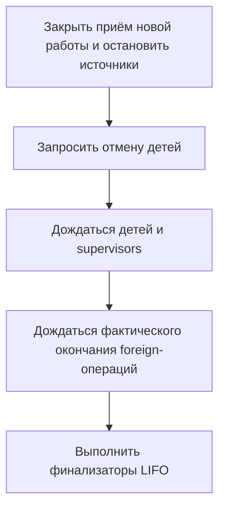
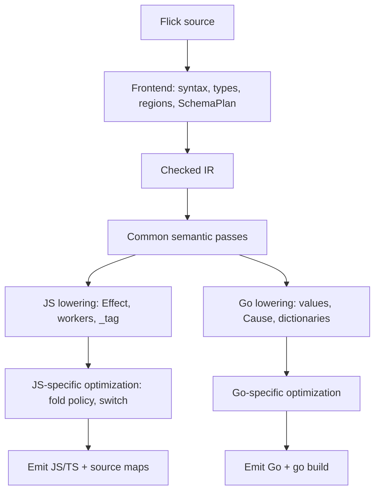

# Alternative backend

Статус: **владелец выбрал реализацию Go-backend**. Эта записка фиксирует решение и исследованный дизайн, но не является законченной спецификацией ABI или планом с обязательствами по срокам. Go-backend ещё не реализован. Выполнены два ручных Go-эскиза с `go run -race`; генерация Go из Flick и сравнительные benchmark не выполнялись. Текущий JS/Effect-target сохраняется. Ответы на вопросы раздела 16 и roadmap — в разделах 16–17; это проектные решения, а не реализованный backend.

Решения по вопросам §11 и план работ — в [ROADMAP-backend.md](ROADMAP-backend.md).

## 1. Цель и принятое решение

Направление владельца: получить что-то похожее на Go по эксплуатации и исполнению, при необходимости отказавшись от значительной части библиотеки Effect. Речь не о копировании синтаксиса Go.

Желаемый результат:

- самостоятельный executable для CLI и серверов, без отдельно установленного Node;
- автоматическое управление памятью;
- лёгкие конкурентные задачи и удобный системный I/O;
- прямой стиль эффектных вызовов;
- небольшая понятная стандартная библиотека вместо обязательного переноса всей экосистемы Effect.

**Принятое решение: реализовывать backend с генерацией Go.** Он позволяет использовать готовые GC, scheduler, goroutines, сеть и стандартную библиотеку. Задача превращается в реализацию представления значений и runtime-контракта Flick поверх существующей платформы, а не в написание этой платформы с нуля.

Go больше не предварительный кандидат: выбор направления сделан. Представление значений, точный ABI, первоначальная поверхность stdlib и детали runtime ещё требуют проектирования. Сравнения с VM, C/LLVM, Rust и другими платформами ниже сохраняются как история исследования, а не как открытый выбор target.

Отказ от зависимости на Effect не равен отказу от статической системы эффектов Flick. Строки сервисов и ошибок, классы типов и регионы можно сохранить при другом способе исполнения.

## 2. Что есть в текущем проекте

Основания для оценки по текущему коду:

- [flick-core](../../flick-core/src/lib.rs) — общее Rust-ядро CLI и LSP; синтаксис, разрешение имён, проверка типов и IR доступны как модули библиотеки.
- [IR](../../flick-core/src/ir/mod.rs) фиксирует разрешённые имена, словари классов, стадии вызовов, порядок вычисления, лямбды, match, задачи и scopes. Большую часть frontend не потребуется писать заново.
- Это высокоуровневое представление, не готовый машинный IR: размещение данных, окружения замыканий, ABI и представление приостанавливаемых вычислений ещё нужно определить. В IR есть и JS-специфичные детали: числовые литералы и режимы foreign-вызовов.
- [JS backend](../../flick-core/src/codegen/mod.rs) использует обычный JS для pure-кода и Effect для runtime-стадий. [Runtime](../../runtime/package.json) зависит от Effect и его платформенных адаптеров.
- В [конфигурации](../../flick-core/src/project/config.rs) уже есть `[build] effect = "none"`, а в [runtime/src/core](../../runtime/src/core/index.ts) — pure JS-адаптер без импорта Effect. **Это не альтернативный effectful-runtime:** режим запрещает runtime-стадии и допускает только ограниченный набор builtins. [Служебные stubs](../../runtime/src/core/stubs.ts) обеспечивают загрузку общих builtins, но не реализуют исполнение эффектов.
- [Действующие цели языка](../src/content/docs/spec/01-goals.md) всё ещё прямо фиксируют Effect-backend, числовую семантику JS и доступ к JS-экосистеме. Выбор Go задаёт новое направление разработки, но эта исследовательская записка сама по себе не переписывает спецификацию или работающий JS-target.

Граница для повторного использования frontend существует, но его полная независимость от JS/Effect прототипом не доказана.

## 3. VM, native и LLVM: рассмотренные объёмы работ

| Вариант | Что реализуем | Что он не решает автоматически |
| --- | --- | --- |
| Интерпретатор IR / собственная bytecode VM | Представление значений, вызовы, замыкания, инструкции и runtime | Память, эффекты, I/O и стандартную библиотеку; ускорение относительно V8 не гарантировано |
| Генерация Go | Lowering в исходники Go и небольшой адаптер runtime Flick | Семантику задач, ошибок, сервисов, scopes и отмены |
| Генерация C через Clang | Нативный ABI и код поверх собственного runtime; Clang проводит код через LLVM | GC, scheduler, задачи и платформенные адаптеры |
| Прямой LLVM backend | Нативный lowering, LLVM IR, object-файлы и линковку с runtime | Представление высокоуровневых значений, GC и исполнение эффектов |

Прототип native не обязательно сильно сложнее VM: можно использовать универсальное представление значений и готовый GC. Существенно дороже становится оптимизированный native с устранением boxing, специализацией полиморфизма и эффективными структурами данных.

VM имеет смысл ради независимости от JS, встраивания и контроля исполнения. Если конечная цель уже точно AOT-native, промежуточная VM не обязательна. Для проверки семантики интерпретатор существующего IR может быть полезен, но это не требование выбранного пути.

Если нужна только упаковка текущего приложения в один executable, стоит отдельно проверить сборку существующего JS через Bun. Это не новый backend и не независимость от JS/Effect; пригодность такой упаковки для приложений Flick здесь не проверялась.

## 4. Как сократить зависимость от Effect

### Сохранить ядро языка

Предлагается сохранить:

- типы, HKT, классы и словари;
- различие pure-, Sync- и runtime-вызовов;
- строки сервисов и ожидаемых ошибок;
- прямой стиль выполнения;
- отложенные вычисления `task` / `Eff` и явное исполнение через `await`;
- лексические scopes, регионы и контроль captures;
- запуск и ожидание задач, fail-fast parallel с отменой и ожиданием cleanup;
- различие ожидаемой ошибки, defect и внешней отмены.

Сервисы можно реализовать скрыто передаваемым окружением. Для этого не требуется универсальный механизм algebraic handlers или копирование всего Effect Context/Layer.

### Не ставить целью полный перенос библиотеки

Кандидаты на исключение из первоначального переносимого набора:

- весь публичный API `Effect.*` и точная совместимость с Effect `Cause` / `Exit`;
- сложные schedules, retry policies и execution plans;
- caching, tracing, metrics и весь набор observability-комбинаторов;
- полная библиотека Stream / Channel в первом срезе; принадлежность core и последующий порт — раздел 16.1;
- полный набор комбинаторов графа Layer; identity-based sharing и owned MemoMap сохраняются в поддерживаемом subset (раздел 16.5);
- JS/npm-интеграции, React и DOM.

Часть этих возможностей может оставаться расширением JS/Effect-target; часть может быть обычной библиотекой поверх нового runtime. Их отсутствие в native не требует удаления работающего JS API.

[Граница ядра в текущей спецификации](../src/content/docs/spec/07-errors-and-concurrency.md#the-boundary-of-the-language-core) уже относит retry, schedules, streams, queues, cache, tracing и HTTP к библиотеке. Но Layer sharing, full Cause и некоторые другие правила сейчас имеют явные контракты: их упрощение требует отдельного решения, а не молчаливой подмены поведения.

Собственная более простая модель ошибок не должна терять исходную ошибку или ошибки освобождения ресурсов. Аналогично, сокращение библиотеки не отменяет безопасный cleanup при отмене.

`deriving Schema` и codecs также нельзя незаметно убрать из языка: они входят в текущие цели. Для первого native-среза нужно явно определить поддерживаемую поверхность и диагностировать неподдерживаемые операции, не обещая полный паритет.

## 5. Рассмотренные target: Go, Rust, C, Zig, BEAM, JVM

История выбора: далее сохраняется сравнение альтернатив, после которого владелец выбрал Go. Go/Rust/C/Zig здесь рассматриваются как языки генерируемых исходников. BEAM/JVM — как платформы исполнения; начинать можно с генерации Erlang/Java, а не с прямой записи VM-байткода.

Оценки пригодности ниже — **[INFERENCE]**, архитектурное суждение применительно к Flick, а не результаты измерений.

| Target | Что получаем готовым | Основная оставшаяся работа | Когда выбирать |
| --- | --- | --- | --- |
| **Go** | GC, goroutines, scheduler, сеть, стандартную библиотеку, runtime внутри executable | Значения и ABI Flick, ошибки, сервисы, scopes, отмену и синхронизацию общей памяти | Выбран для CLI и серверов без собственного GC и scheduler |
| **Rust** | Нативную компиляцию, системные библиотеки, выбор async-runtime | Стратегию памяти для значений Flick с произвольным разделением, замыкания и интеграцию задач | Прежде всего как язык реализации собственного runtime |
| **C** | Простой низкоуровневый target, распространённый ABI, зрелые toolchains | GC, задачи, scheduler и значительную часть runtime | Если цель — собственная независимая native-платформа |
| **Zig** | Нативную компиляцию, C interop, инструменты кросс-компиляции | Почти тот же runtime, что для C; память и размещение значений остаются нашей задачей | Если есть конкретная польза от Zig toolchain; решающего преимущества для этой задачи пока не установлено |
| **BEAM** | GC, лёгкие изолированные процессы, messaging и OTP | Согласование общей изменяемой памяти, captures и ресурсов Flick с процессной моделью | Если продукт становится actor-first языком для сервисов |
| **JVM** | GC, virtual threads, Java-экосистему, профилирование и отладку | Представление значений, runtime-контракт Flick и интеграцию с Java API | Сильная альтернатива Go, если устраивает JVM как платформа |

### Go

Основной выигрыш — возможность не писать GC, scheduler и сетевой runtime. Обычные функции хорошо сочетаются с прямым стилем Flick, а goroutines дают основу конкурентного исполнения.

Отсутствие HKT в Go не блокирует backend: их проверяет Flick, а runtime-полиморфизм можно выразить словарями и стёртым представлением значений. При этом хороший Go API для всех высокоранговых типов Flick автоматически не получается. Стоимость boxing и необходимость специализации потребуют измерений.

Цена выбора — зависимость от Go toolchain/runtime и его модели представления данных. Это не путь к собственному LLVM backend, хотя общий контракт языка можно сохранить и для будущих реализаций.

### Rust, C и Zig

Rust не переносит свою систему владения на значения Flick автоматически. Можно использовать готовые библиотеки управления памятью и async-runtime, но связать их с семантикой Flick всё равно придётся. Поэтому Rust интереснее как язык реализации runtime, чем как первый язык генерируемого кода.

Для собственного native-runtime C — понятный промежуточный target. Его можно собирать Clang и использовать LLVM без прямой зависимости генератора на LLVM API. Runtime при этом может быть написан на Rust с C ABI.

Zig полезен своим toolchain и interop, но сам по себе не предоставляет требуемую Flick managed-платформу. Выбор Zig вместо C не устраняет главную работу над памятью и задачами.

### BEAM

BEAM хорошо подходит функциональным данным и actor-модели. Однако изоляция процессов — не то же самое, что goroutines с общей памятью: при отправке сообщения данные обычно копируются, с документированными исключениями.

Существующие общие `Ref`, идентичность значений и scoped-ресурсы нельзя просто перенести между процессами без определения нового представления и правил доступа. BEAM стоит выбирать ради actor-модели и OTP, а не только ради готового GC.

### JVM

JVM — серьёзный кандидат благодаря GC, virtual threads и инструментам эксплуатации. Она не требует переводить весь прямой код Flick в callback-based async.

Обычная JVM-сборка предполагает соответствующий runtime. GraalVM Native Image позволяет получить native executable, но добавляет отдельный toolchain, анализ достижимости и требования к интеграции библиотек. Это отдельный путь поставки, не автоматическое свойство JVM-target.

## 6. Предлагаемый Go-код: эффектные вызовы и cold Eff

Разделы 6–10 — **[INFERENCE]**, проектируемые решения, а не описание готового Go-backend. Выбран target, но приведённые `Run`, `Env`, `Cause`, `Exit` и ABI ещё не зафиксированы как реализация Flick.

Исходный пример:

```flick
load_name : UserId ->{Users, Log; NotFound} String
let load_name id =
  let user = Users.get id
  let name = normalize_name user.name
  Log.info name
  name
```

Предлагаемый lowering — обычный прямой Go-код:

```go
func loadName(r *Run, id UserID) (string, *Cause) {
    user, cause := r.Env.Users.Get(r, id)
    if cause != nil {
        return "", cause
    }

    name := normalizeName(user.Name)
    if cause := r.Env.Log.Info(r, name); cause != nil {
        return "", cause
    }
    return name, nil
}
```

`Run` несёт текущие сервисы, отмену и owner. В примере окружение конкретное; сервисы не становятся глобальными переменными. `provide` устанавливает производное окружение для своего тела.

Строки `Users, Log; NotFound` проверяет Flick; Go не обязан повторять эту систему типов. Но `Cause` должен различать **ожидаемую ошибку, defect и interruption**, сохраняя также ошибки cleanup. Обычного непрозрачного `error` с потерей этих различий недостаточно.

Чистая стрелка становится обычной `func(A) B`. Пустая `->{}` всё равно runtime-вызов: отсутствие сервисов и typed errors не отменяет state, I/O, defects и отмену. **Никакого `go` на каждую эффектную стрелку.** Sync-стадии сохраняются: выполняются сразу в нужном контексте и не имеют права приостанавливаться.

Холодный `Eff` можно представить функцией:

```go
type Eff[A any] func(*Run) (A, *Cause)

request := Eff[string](func(r *Run) (string, *Cause) {
    return loadName(r, id)
})
```

Создание `request` ничего не запускает. `await request` — вызов `request(currentRun)` с обработкой исхода. Два `await` исполняют тело дважды. `id` захватывается при создании; сервисы берутся при исполнении — как требует [нынешний контракт task](../src/content/docs/spec/04-computations.md#task-and-running-a-stored-value).

Последовательность эффектов в таком lowering — обычный стек вызовов, без необходимости строить Effect-объект на каждый вызов. Это свойство предлагаемого представления, не измеренный выигрыш в производительности.

## 7. Goroutines, Fiber и Owner

**Своя семантическая оболочка над goroutines, не свой scheduler.** Сейчас `FlickFiber` оборачивает Effect fiber: кооперативную задачу одного JS-потока. В Go задачи смогут работать параллельно на разных ядрах. Предлагается сохранить source API и lifetime-правила, а не внутреннее устройство Effect.

Публичный `Fiber.spawn owner supervisor task` можно сохранить: именно здесь появляется `go`. `Fiber` хранит результат/причину завершения, сигнал окончания и механизм запроса отмены. `Owner` учитывает детей, supervisors, внешнюю работу и финализаторы. GC, стеки и планирование остаются Go.

У handle — закрываемый `done` и отдельно сохранённый `Exit`:

```go
type Fiber[A any] struct {
    done   chan struct{}
    exit   Exit[A]
    cancel context.CancelFunc
}
```

Ожидание не должно одноразово «забирать» результат из channel. После закрытия `done` все ожидающие читают сохранённый исход. Сам `join` не требует новой goroutine.

Публичный [`Fiber.interrupt`](../../flick-core/src/types/builtins/Fiber.fl) означает запрос отмены **с ожиданием завершения**, не просто `cancel()`. Маски прерывания и fiber-local состояние — тоже обязанности обёртки: один `context.Context` их не реализует. Статический `Outlives` и обязательный supervisor остаются частью безопасного API, независимо от способа исполнения.

Закрытие scope должно сохранять нынешний порядок:



Это уже заложено в [owner.ts](../../runtime/src/owner.ts), включая защиту закрытия от прерывания. Поэтому `defer file.Close()` сам по себе не заменяет scope: ребёнок ещё может пользоваться файлом. Ошибка финализатора не должна затереть первоначальную ошибку; сбой supervisor нельзя молча потерять.

У Go здесь жёсткая граница: [CancelFunc не ждёт остановки работы](https://go.dev/pkg/context/?m=old#CancelFunc) и не убивает goroutine. Runtime-код должен наблюдать отмену, I/O-адаптеры — поддерживать её, длинные runtime-циклы — иметь точки проверки. Вытеснение scheduler даёт другим goroutines исполняться, но не означает отмену вычисления.

Если foreign-вызов игнорирует отмену, безопасный owner может ждать его завершения. Вернуться по timeout и одновременно освободить используемый им ресурс — не безопасная альтернатива.

## 8. Одна stdlib и пять конфигураций

Предлагается **общий контракт Flick + реализации runtime + платформенные модули**, а не пять копий stdlib.

Три независимых понятия: **backend** — JS или Go; **effect-runtime** — отсутствует, Effect или native; **host** — Node, браузер или ОС. Пять нужных сочетаний — профили сборки:

| Вариант | Backend | Effect-runtime | Host |
| --- | --- | --- | --- |
| Node, чистый | JS | Нет; только data/core helpers | Node |
| Node + Effect | JS | Effect | Node |
| Браузер, чистый | JS | Нет; только data/core helpers | Browser/worker |
| Браузер + Effect | JS | Effect | Browser/worker |
| Go | Go | Native runtime Flick | ОС |

Разделение библиотеки по ответственности:

- **Общее ядро данных:** типы, классы, `Option`, `Result`, коллекции, числовые и строковые контракты. Настоящие тела на Flick компилируются каждым backend; примитивам нужны разные реализации. Например, [Option.map](../../flick-core/src/types/builtins/Option.fl) уже написан на Flick.
- **Переносимый runtime API:** `Eff`, сервисы, scopes, `Fiber`, `Ref`, базовая конкурентность. Одинаковая семантика поверх Effect и Go; недоступен в режиме без effect-runtime.
- **Расширения платформы/backend:** Node-файлы, терминал и сигналы; browser DOM; нативные адаптеры Go; специфические возможности Effect. React — JS-зависимость, но не обязательно browser-only: SSR работает на сервере.

**Тип `Option` один на уровне Flick, а не `Node.Option` и `Go.Option`. Его машинное представление может отличаться.**

Техническая граница — общая декларация операции и выбираемая backend-реализация примитива. Сейчас общие `.fl` ещё содержат JS-пути и даже [from global "Math.PI"](../../flick-core/src/types/builtins/Float.fl): эту привязку потребуется отделить от переносимого API. Достаточно конкретных таблиц bindings; универсальный plugin-framework не нужен. Обычные алгоритмы на Flick не следует дублировать для каждого host.

В проекте уже есть часть механизма: [build/effects.rs](../../flick-core/src/build/effects.rs) выбирает `/core`, публикует `_core/`-варианты библиотек и запрещает несовместимые импорты через E008/P027. Общий исходник уже не означает взаимозаменяемый бинарный ABI: даже `Option`/`Result` pure- и Effect-сборок нельзя безусловно смешивать.

Для Go эту границу нужно продолжить: выбирать артефакты по backend/runtime и ABI, учитывать их в кэше; проверять доступность транзитивных импортов до исполнения. LSP должен видеть тот же target. Недоступный модуль — диагностика, не runtime-заглушка.

**Pure не равно «реализовано без зависимости на Effect».** Нынешний `none` — небольшой whitelist, а не вся чистая stdlib. Schema и refinements сейчас отвергаются в этом режиме, хотя часть их API чистая. Pure-режим запрещает runtime-стадии; это не запрет любого доверенного чистого JS FFI. Аналогично, выбор браузера сам по себе не означает наличие DOM: worker — отдельный случай host-возможностей.

## 9. Перенос stdlib Effect

**Не переносить Effect целиком и не переписывать всё пять раз.** Разделять по контракту, а не по тому, чистая ли у функции стрелка.

| Часть | Что делать для Go |
| --- | --- |
| Данные, коллекции, `Eq`/`Ord`/`Hash`/`Show` | Сохранить API и тела на Flick; заменить foreign-примитивы и представление данных |
| `Eff`, сервисы, scopes, `Fiber`, `Ref`, `Deferred`, `Queue`, `Semaphore` | Реализовать runtime-контракт поверх механизмов Go; channel не является автоматической заменой всему контракту Queue |
| Файлы, сеть, HTTP, время, crypto | Адаптеры к Go-библиотекам; SQL-драйверы и прочие внешние зависимости выбирать отдельно |
| Schema, codecs, refinements, deriving | Переиспользовать проверенные планы компилятора, но сделать нативную реализацию witnesses и преобразований |
| Layer и полные исходы ошибок | Для поддерживаемых API сохранить sharing, lifetime и diagnostic failures; иначе явно объявить API недоступным |
| Stream/Channel, `Sink`, `Schedule` | Core-контракт: эти типы входят в публичные сигнатуры Stream/Channel/HTTP; порт после первого среза, не JS-only расширение |
| `Scheduler`, `ExecutionPlan`, STM `Tx*`, observability и прочий большой хвост | Пока оставить расширением JS/Effect; отдельные порты — только при реальной потребности |
| JS/npm, React/DOM | Оставить JS-target; DOM отдельно от серверного React и общего UI-контракта |

Здесь есть реальные точки повторного использования, но и глубокие зависимости. Например, адаптер [Stream](../../runtime/src/effect/Stream.ts) опирается на Effect, а не содержит самостоятельную реализацию потока на Flick.

**Schema нельзя заменить одним `json.Unmarshal`.** Уже есть [SchemaPlan](../../flick-core/src/types/typing.rs), который описывает структуру типов. Но нужно сохранить refinements, рекурсию, правила missing/null, defaults, лишние поля и ошибки по путям. Сертификат `PureCodec` тоже не равен просто пустым строкам эффектов. Это отдельная существенная часть backend, а не небольшой JSON-helper.

Аналогично, [Layer.MemoMap](../../flick-core/src/types/builtins/Layer.fl) обещает построение и sharing сервисов, а не просто список функций инициализации. Под прежним именем нельзя молча сделать «почти то же самое». Первоначальная поверхность Layer и Schema зафиксирована в разделе 16.5, граница модулей — в 16.1; недоступность API должна быть явной, а контракт поддерживаемого API — одинаковым на обоих target.

## 10. Дополнительные риски Go-target

1. **Настоящий параллелизм.** [Ref](../../flick-core/src/types/builtins/Ref.fl) сейчас атомарен «потому что во время операции ничего другого не исполняется». Для Go нужны синхронизированные `get/set/modify`, owner-state и разделяемые сервисы. Атомарность одной ячейки не превращает цепочку операций в транзакцию. Регионы защищают lifetime, не отсутствие races; ограничение числа потоков не заменяет [синхронизацию памяти](https://go.dev/ref/mem).
2. **Скрытые globals.** В [sync.ts](../../runtime/src/sync.ts) текущий reader-context хранится в module-global. Буквально переносить это на goroutines нельзя. Контекст нужно передавать явно; mutex на `Ref` эту проблему не решает.
3. **Числа и строки.** [Текущий ABI](../src/content/docs/reference/codegen.md) — `Int` с 32-битной арифметикой, `Float`, `BigInt`, особые правила деления и равенства с NaN, включая `NaN == NaN` и `0 == -0`. Go-операторы не везде совпадут. [Строковый API](../../flick-core/src/types/builtins/String.fl) считает UTF-16 code units; Go `len(string)` считает байты, а обход по runes — кодовые точки. Это влияет и на семантику, и на стоимость операций.
4. **Неизменяемость данных.** Go slices/maps и операции с `math/big.Int` нельзя бездумно отдавать наружу как immutable значения Flick: backing storage и изменяемые receivers могут испортить разделяемое значение. Нужны корректные представления и правила FFI, а не копирование всего при каждом чтении.
5. **Stack safety и ленивость.** Растущий стек goroutine не заменяет нынешние tail-call loops. `Seq` тоже не стоит превращать в goroutine с channel на каждый генератор: это меняет lifetime и выполнение. В Go есть [iter](https://go.dev/pkg/iter/?m=old), но контракт Flick всё равно нужно сохранить. Особенно важно не путать окружения: cold `Eff` ищет сервисы при запуске, а lazy `Seq` с Sync-чтениями удерживает reader окружения построения.
6. **HKT, rank-polymorphism и каррирование.** Go generics не заменяют типовую систему Flick. Словари классов и представление полиморфных значений всё равно нужны; всеобщую мономорфизацию не следует делать обязательной. При оптимизации `f x y` нельзя перенести эффект первой стрелки за вычисление `y`. Каррирование и boxing также могут съесть ожидаемый выигрыш в производительности.
7. **Граница с Go и эксплуатация.** Обычные typed failures должны идти по каналу результата; Go panic — становиться defect на соответствующей границе задачи, а не убивать приложение из необёрнутой дочерней goroutine. Понадобится привязка stack traces к Flick-исходникам. Go также требует продуманного разбиения пакетов без import cycles; cgo-зависимости могут усложнить статическую сборку и cross-compilation. Native executable сам по себе не обещает ускорения относительно V8.

Минимальный runtime поверх Go всё равно включает ABI значений и вызовов, окружение сервисов, исходы задач, владельцев ресурсов и координацию отмены. Его объём ожидаемо меньше собственного GC и scheduler, но это ещё нужно подтвердить сквозной реализацией.

## 11. Что проверено при обсуждении

Выполнены два ручных Go-эскиза через `go run -race` на `go1.27.3 darwin/arm64`. Наблюдались успешные проверки:

- создание cold task не выполняет тело; повторные запуски исполняют его заново;
- один task использует текущее окружение сервисов при каждом запуске — A/B/A;
- interruption остаётся отдельным исходом; отменённый запуск не выполняет проверяемую сервисную операцию;
- ребёнок завершает cleanup до закрытия реального файла; запрос отмены сам по себе не равен ожиданию завершения;
- многократные и конкурентные ожидающие получают один сохранённый результат через `Exit` и `done`;
- cancel-and-wait дожидается завершения, а не только выставляет сигнал;
- ожидаемый failure, перехваченный в дочерней goroutine panic-defect и interruption различаются;
- синхронизированный `Ref.modify` не теряет обновления между goroutines.

Все проверки прошли. Это **ручные иллюстрации частей предлагаемого ABI/runtime**, не результат Flick → Go и не доказательство существования backend. Временные программы удалены после проверок. Полный Owner, masks, caller-side interruption у `join`, паритет stdlib и сравнительные benchmark не проверялись. Эти результаты не заменяют первый сквозной срез из раздела 15.


## 12. Ранее рассмотренный путь: свой runtime + LLVM

Необходимые части:

- представление строк, коллекций, ADT, записей и полиморфных значений;
- управление памятью, GC roots и взаимодействие с foreign-кодом;
- closure conversion и соглашение о вызовах, включая каррирование и словари;
- нативный lowering для ветвлений, match и приостанавливаемых вычислений;
- задачи, scheduler, I/O, таймеры и синхронизация;
- ошибки, отмена, владельцы ресурсов и финализаторы;
- object emission, линковка и средства диагностики/отладки.

LLVM решает оптимизацию низкоуровневого кода и генерацию машинных инструкций, но не проектирование managed-runtime Flick.

Первый вариант может использовать универсальный tagged `Value`, готовый GC и словари классов. Полная мономорфизация не обязательна для работоспособности. Устранение boxing и специализацию следует оправдывать измерениями, а не включать автоматически в первый backend.

Свой runtime не означает, что необходимо писать собственный GC с нуля. Проверка регионов Flick помогает защищать время жизни ресурсов, но не заменяет управление памятью обычных значений. Если конечная цель — самостоятельный AOT-native, разумно сравнить прямой LLVM с более простым генератором C поверх того же runtime.

## 13. Один проект или отдельный язык

Архитектурная рекомендация: **один репозиторий и один язык, отдельные backend/runtime.** Выбор Go сам по себе не утверждает все детали этой организации.

- Общие: frontend, типы, классы, регионы, IDE, семантика поддерживаемых конструкций и переносимая часть библиотеки.
- JS/Effect: текущий runtime, JS FFI, расширения Effect, web/UI-интеграции.
- Go-backend: отдельные crates/каталоги, свой lowering и платформенный адаптер; сначала экспериментальный статус реализации.

Не нужно заранее строить универсальную plugin-архитектуру или выносить frontend в новый опубликованный пакет. Второй конкретный backend покажет, какие границы действительно нужны. Отдельный репозиторий с зависимостью на нестабильное общее ядро добавляет синхронизацию версий, а форк ещё и дублирует сопровождение исправлений типов, регионов и IDE.

**Неподдерживаемая библиотека допустима; молчаливо отличающееся поведение поддерживаемого кода — нет.** Недоступный модуль должен давать понятную диагностику, а не runtime-заглушку. Переносимая программа должна иметь одинаковый контракт на обоих target.

Отдельный язык/проект честнее, если цель меняется на отказ от строк эффектов или регионов, горячий `task`, другую модель ошибок, отказ от structured concurrency либо другую базовую числовую семантику. Тогда текущий Flick можно оставить специально для Effect. Отличия такого уровня не стоит прятать за флагами одного target.

Предлагаемая граница ответственности: Flick определяет собственные правила исполнения, а Effect становится одной из реализаций наряду с Go-runtime. Выбор Go зафиксирован; соответствующие изменения действующей спецификации должны быть явными. Эта записка сама спецификацию и код backend не меняет.

## 14. Обсуждавшиеся оценки других направлений

**[INFERENCE]** Исторические приблизительные оценки для одного опытного разработчика, знакомого с компилятором и работающего постоянно. Для собственного native-runtime предполагается повторное использование GC и I/O-библиотек, сначала одна ОС/архитектура. Это не оценки выбранного Go-backend, не сроки обязательств и не оценки уже спроектированных задач.

| Результат | Ориентир |
| --- | --- |
| VM-прототип: функции, замыкания, ADT, match, базовые коллекции | Несколько недель |
| Полезная VM для CLI с памятью, ошибками, базовым I/O, эффектами и отменой | Несколько месяцев |
| Сквозной прототип Flick → LLVM → executable с функциями, замыканиями и ADT | 4–8 недель |
| Свой runtime + LLVM, полезный CLI-target с I/O, задачами, scopes и отменой | 4–8 месяцев |
| Зрелый собственный native-target с широкой библиотекой, несколькими платформами и отладкой | 9–18+ месяцев |

Широкая совместимость с Effect и JS/npm-библиотеками в эти оценки не включена. Это дополнительная работа, а не бесплатное следствие второго backend.

Эти диапазоны нельзя автоматически переносить на генерацию Go: там значительная часть системного runtime уже готова. Отдельная оценка Go-target имеет смысл после проверки вертикального среза. Ни собственная VM, ни LLVM, ни генерация Go сами по себе не гарантируют ускорения относительно текущего V8.

## 15. Первый сквозной Go-срез

Следующая проверка выбранного направления — провести настоящий код Flick через Go-target, а не снова выбирать между несколькими backend:

1. Провести checked IR через генерацию Go и `go build`, а не написать эквивалент программы вручную на Go.
2. Проверить ADT/match, захватывающее замыкание, каррирование и словарь класса. Для поддерживаемого поднабора сравнить поведение с JS-target.
3. Проверить, что создание `task` ничего не запускает, два `await` повторяют тело, а service lookup использует правильное окружение исполнения.
4. Выполнить реальный I/O со scoped-файлом или сокетом; проверить освобождение при успехе, ошибке и отмене.
5. Запустить параллельные задачи, вызвать ошибку одной ветви, дождаться завершения остальных и убедиться, что cleanup не опережает работу детей.
6. Проверить выбранный контракт общей памяти на разделяемом `Ref`, включая `modify`, и поведение поддерживаемой хвостовой рекурсии.
7. Запустить полученный executable без Node и JS/Effect-зависимостей. Явно проверить диагностику для неподдерживаемых платформенных импортов.

Это проверяет реальные риски выбранного runtime, а не только возможность собрать `hello world`. Производительность, память и размер executable следует сравнивать на одинаковом прикладном сценарии после подтверждения корректности.

## 16. Решения по открытым вопросам

Вопросы о границах реализации, остававшиеся открытыми после выбора Go, теперь имеют решения. Ниже — принятые проектные решения. Где речь идёт о ещё не написанном Go-runtime, это **[INFERENCE]**: конструкция, а не измеренный результат. Действующие контракты Flick они не отменяют. Принадлежность модуля к core, готовность первого Go-среза и host-реализация — три разные вещи.

### 16.1 Переносимый stdlib, `flick/effect` и JS-host

Сначала терминология, потому что слово «core» уже перегружено:

- `stdlib/Effect/surface/core` — **корневой entrypoint npm-пакета Effect**, а не «ядро Flick». По имени каталога принадлежность не определяется.
- **Core Flick** — общий контракт языка и библиотеки с одинаковой семантикой на всех backend. Принадлежность к core не означает готовность Go-порта или доступность в первом срезе.
- **`flick/effect`** — будущий optional пакет с pinned-поверхностью Effect. Его отсутствие на Go даёт диагностику, а не runtime-заглушку.
- **JS-host** — конкретные привязки Node/Browser/React/JS-типов; они вообще не входят в переносимый контракт.

Managed-surface snapshot Effect 4.0.5: 22 entrypoint, из них 8 managed (`core`, `cli`, `devtools`, `http`, `http-api`, `observability`, `reactivity`, `rpc`) — 5609 экспортов в 226 upstream-модулях/префиксах; 14 entrypoint исключены, включая `cluster` ([entrypoints.toml](../../stdlib/Effect/surface/entrypoints.toml)). **Cluster во Flick не открыт**: это excluded entrypoint upstream, а не реализованный API. Числа описывают инвентарь, а не объём Flick-stdlib.

| Семейство | Владение | Первый Go-срез | Комментарий |
| --- | --- | --- | --- |
| `Prelude`, `Instances`, `Record`, `String`, `Int`, `Float`, `Numeric`, `Bool`, `Option`, `Result`, `NonEmpty`, `List*`, `Seq`, `Monoids`, `Validation`, `Loop` | core | да | Примитивы и представление меняются по target, тела на Flick общие |
| `BigInt`, `BigDecimal`, `Duration`, `ByteSize`, `Redacted`, `Chunk*`, `EqHash`, `HashSet`, `HashMap` | core | частично | `EqHash` и базовые коллекции нужны рано; `BigDecimal`/`Chunk` могут позже |
| `Combiner`, `Reducer`, `Ordering`, `Order`, `Equivalence`, `Hash`, `Optic`, `Predicate`, `Filter`, `Function`, `Trie`, `HashRing`, `Graph*`, `JsonPointer`, `JsonPatch`, `Version`, `DateTime`, `Cron`, `Differ` | core | позже | Переносимые библиотечные контракты; текущий Effect FFI сам по себе не делает их JS-only |
| `Schema`, `Checks`, `Check`, `Codec`, `Json`, `JsonSchema`, `Net`, `Route`, `Gen`, `Arbitrary` | core | subset | `Net` здесь — адреса и DNS-record codecs, не сокеты; `Gen` и `Arbitrary` — разные API |
| `Ref`, `Layer`, `Scope`, `Context`, `Resource`, `Fiber`, `Failure`, `Exit`, `RawCause`, `Events` | core | да | Семантика исполнения и lifetime; `RawCause` остаётся непрозрачной диагностикой |
| `SynchronizedRef`, `SubscriptionRef`, `Deferred`, `Latch`, `Semaphore`, `PartitionedSemaphore`, `Queue`, `PubSub` | core | базовые | Перенос не равен подстановке Go channels/mutex (раздел 16.3) |
| `Schedule` | core-контракт | нет | Тип входит в сигнатуры Stream/Channel/HTTP; широкий порт — позже |
| `Channel*`, `ChannelSchema`, `Stream*`, `Sink` | core | нет | Платформенные операции — host; порт после первого среза |
| `Atom`, `Ui`, `Ui.Event`, `Form`, `Action` | core-контракт | нет | Общий UI-контракт остаётся core; нынешний renderer — React/Effect, Go React не обещан |
| `Ui.Dom`, `Ui.Server` | host | нет | DOM/SSR-привязки JS; `Ui.Server.to_html` не делает весь модуль переносимым |
| `Platform`, `App`, `Log`, `File`, `FileSystem`, `Path`, `PlatformError`, `Console`, `Terminal`, `Stdio`, `Clock`, `Random`, `Crypto`, `Config`, `ConfigProvider`, `Test`, `Flick.Debug` | core + host | частично | Общий API с per-host адаптерами; `File.node` — конкретный адаптер |
| `LogLevel`, `Logger`, `Metric`, `Tracer`, `Layer.Trace`, `ErrorReporter` | core-протоколы | частично | Базовые протоколы нужны HTTP/Channel; экспортёры — extension |
| Все `Http.*` | core + host | нет | Транспорт, listen и файлы зависят от host; контракт core |
| `Http.FetchClient` | JS-host | нет | Контракт именно Fetch; не заменять его под прежним именем |
| `Sql`, `Database`, `Cli`, `Cli.Prompt`, `Server` | core + host | нет | `Server` обслуживает `server fn` языка; драйверы/терминал — отдельные адаптеры |
| `Effect*`, `Cause`, `Scheduler`, `References`, `ExecutionPlan` | `flick/effect` | нет | Широкий Effect.* и runtime policies; `Eff` из Prelude сюда не входит |
| `Cache`, `ScopedCache`, `ScopedRef`, `RcRef`, `RcMap`, `Pool`, `Request`, `RequestResolver`, `LayerMap`, `LayerRef` | `flick/effect` | нет | Caching/resource-sharing/request batching — возможные поздние порты |
| `FiberHandle`, `FiberMap`, `FiberSet` | `flick/effect` | нет | Реестры supervised fibers; core `Fiber` — отдельно |
| `Tx*` (12 модулей) | `flick/effect` | нет | Полное STM-семейство; в core не входит |
| `Reactivity.Atom`, `Reactivity.AsyncResult` | `flick/effect` | нет | Raw upstream reactivity; core Atom владеет своими типами |
| `HttpApi`, `Rpc`, `Otlp`, `Prometheus`, `DevTools`, `Inspectable`, `Formatter` | `flick/effect` | нет | Framework/native-Effect API |
| `Js`, `Js.Array`, `JsError`, `RegExp`, `Runner.Node`, `Runner.Browser`, `Runner.Cloudflare` | JS-host | нет | JS-значения, JS regex-семантика, именованные hosts |

Перечисленные владельцем `Schema`, `Http`, `Ui`, `Stream`, `Cli`, `Channel`, `Ref`, `Clock`, `Database`, `EqHash`, `Fiber`, `Failure`, `Exit`, `Gen` остаются в целевой core-библиотеке. Отдельного builtin `Error` нет: ошибки — это языковой механизм `type error`, `ErrorRow` и `Errors e` в `Prelude`, плюс конкретные типы ошибок. `JsError` — не он.

Перенос потребует развязать реальные обратные зависимости, а не переставить строки реестра:

- `Stream.with_execution_plan` и `Stream.from_tx_subscription_ref` публично принимают `ExecutionPlan` и STM-ячейку ([Stream/Pipe.fl](../../flick-core/src/types/builtins/Stream/Pipe.fl), [Stream/Platform.fl](../../flick-core/src/types/builtins/Stream/Platform.fl)). При выносе extension эти интеграции переезжают вместе с callers; core иначе сохраняет зависимость.
- `Atom` реэкспортирует типы `Reactivity.Atom`, а compiler сам вставляет обращения к ним ([Atom.fl](../../flick-core/src/types/builtins/Atom.fl), [atoms.rs](../../flick-core/src/ir/lower/atoms.rs)). Нужны собственные shared type identities и primitive bindings в core.
- `server fn` добавляет `Rpc.ClientError` в тип клиентского вызова ([server_fn.rs](../../flick-core/src/types/server_fn.rs)). Нужен core wire-error, независимый от optional RPC.
- `Schedule` уже в сигнатурах Stream/Channel/HTTP retry; его вынос создал бы обратные зависимости, поэтому это core-протокол с поздним портом.

Точки реального cutover: `SOURCES`/`OnceLock` в [builtins.rs](../../flick-core/src/types/builtins.rs); loader и package closure ([load/mod.rs](../../flick-core/src/project/load/mod.rs), [packages.rs](../../flick-core/src/project/load/packages.rs)); managed-surface проверки, которые сейчас ищут только builtins ([effect_surface.rs](../../flick-core/tests/effect_surface.rs)); snapshot/bump tooling ([Surface.fl](../../tools/dts-importer/src/Surface.fl)); exports рантайма ([package.json](../../runtime/package.json)); compiler-inserted names, package identities, LSP и кэш builtins ([lsp/mod.rs](../../flick/src/lsp/mod.rs), [builtins.rs](../../flick/src/builtins.rs)); callers, fixtures, примеры и документация. Сейчас в этом документе ничего не переносится и не меняется.

### 16.2 Первый переносимый набор

Различать: ядро языка (syntax, types, class resolution, regions, checked IR) → core stdlib (общий контракт) → первый исполнимый Go-набор → host-привязки.

**Первый исполнимый Go-набор:**

- данные и классы: records/ADT/match, каррирование, словари, `List`, `Option`, `Result`, `Int`/`Float` с нынешней числовой семантикой, `String` в UTF-16 code units;
- исполнение: cold `Eff` (создание не запускает, каждый `await` выполняет заново), сервисы/`provide`, Sync-стадии, `Lift`;
- runtime: `Ref`, `Fiber`, `Failure`/`Exit`, `Deferred`, `Queue`, `Semaphore`;
- время и хост: `Clock`/sleep, базовый `Log`, реальный scoped I/O (файл и сокет);
- библиотека: subset `Layer` и `Schema` из раздела 16.5.

**Следующие core-порты:** `Stream`/`Channel`, `Http`, `Cli`, `Database`, полные `Gen`/`Arbitrary`, остальные коллекции и время. Это не JS-only расширения: они core, просто не входят в первый срез. `Ui` остаётся core-контрактом с нынешним JS renderer; React/DOM на Go не обещаются.

**Никогда не переносимое как core:** `Js*`, `RegExp` (JS flags/replacement), `Runner.*`, React/DOM-привязки, `FetchClient`.

Нынешний `effect = "none"` — whitelist из 16 builtins ([effects.rs](../../flick-core/src/build/effects.rs)), а не «вся чистая stdlib» и не будущий core. Недоступный на target модуль или primitive обязан давать диагностику до исполнения, а не stub и не молча урезанную семантику.

### 16.3 Совместный доступ к `Ref` и изменяемым значениям

Сейчас `Ref` в JS — собственный `Cell` с прямыми чтением/записью ([builtins.ts](../../runtime/src/builtins.ts)): атомарность операции следует из того, что во время неё ничего не исполняется. Для Go это свойство нужно построить явно. Правила контракта:

1. Каждая операция одной ячейки (`get`, `set`, `modify`) линейризуема: чтение видит либо состояние до, либо после операции, без промежуточного.
2. `modify` вызывает callback ровно один раз; запись происходит только после его успешного возврата. CAS-loop с повторным вызовом callback запрещён — это изменило бы наблюдаемое поведение.
3. Callback обычного `Ref.modify` чистый. Он не делает runtime-вызовов, не блокируется и не обращается рекурсивно к той же ячейке; нарушение — defect. Либо callback выполняется вне lock, либо критическая секция ограничена этим невытесняющим кодом.
4. `get` + `set`, несколько ячеек и несколько вызовов `modify` не образуют транзакцию. Потерянные обновления при гонке допустимы и документированы; для составной атомарности нужен отдельный примитив.
5. Вложенный изменяемый handle/foreign payload синхронизируется собственным контрактом. Блокировка внешней ячейки не защищает payload, выданный ранее через `get`, и не покрывает весь reachable graph.
6. Опубликованные immutable-значения неизменяемы, включая backing storage. Чтение `Ref` не означает deep copy, поэтому Go slices/maps/`math/big.Int` нельзя отдавать наружу как immutable без копии, передачи ownership или opaque handle.
7. Представление исключает torn/multiword чтения конструкцией, а не удачей: составное значение публикуется целиком под синхронизацией.
8. Разделять GC-managed ячейки и закрываемые ресурсы. Обычный `Ref` не вводит owner или свежий регион (`Ref.make : a^c ->{} Ref (a^c)`): ячейка с capture-free payload вправе пережить создавший её scope, и её время жизни ограничивает только инвариантность captures payload. Owner-scope и use-after-close как диагностируемая ошибка/defect относятся к scoped handles и ресурсам, зарегистрированным в scope, а не ко всем `Ref`.
9. Общая реализация сервиса или handle обязана объявлять share-safe операции либо сериализовать конкретные операции. Один неразборчивый mutex вокруг всех методов сервиса по умолчанию запрещён: методы могут ждать и повторно входить.
10. `SynchronizedRef` не подменяется обычным `Ref`: effectful-обновление удерживается до завершения задачи, обычное чтение не ждёт всей операции ([SynchronizedRef.fl](../../flick-core/src/types/builtins/SynchronizedRef.fl)).
11. Регионы, captures и инвариантность payload сохраняются; они про lifetime, а не про отсутствие races. Reader-контекст, env и owner-state не переносятся как module-global.
12. Видимость записей одной задачи для других требует happens-before через любой поддержанный примитив — mutex, channel, atomic. `join`/`interrupt`-ожидание — канонический способ для записей завершённой задачи, но не единственный: публикация через mutex/channel видна и до join. Без синхронизации «goroutine просто завершилась» видимости не гарантирует; обратное — невидимость без join — тоже не обещается ([Go memory model](https://go.dev/ref/mem)).

Будущие проверки реализации: `-race`-сценарии на потерянное обновление, гонку вложенного payload, однократность callback, use-after-close и гарантированную видимость записей задачи после `join`. Сейчас они не выполнялись.

### 16.4 Ошибки, defects, отмена и cleanup

Публичный полный API Cause не нужен, но терять причины нельзя. Минимум:

- `Exit e a`, `Failure e`, `RawCause` остаются непрозрачными. Внутри — упорядоченный список sealed reasons с kind `Fail`/`Die`/`Interrupt` и метаданными прерывания; это не дерево sequential/parallel cause.
- `Errors e` описывает только выбранную ожидаемую ошибку, а не все raw failures. Обычный `try ... with` получает первый `Fail`; `Fail` + `Interrupt` может восстановиться; `Fail` + `Die` блокирует typed recovery; только `Interrupt` не даёт typed error. Остальные строки таблицы действуют без изменений ([spec/07](../src/content/docs/spec/07-errors-and-concurrency.md)).
- `Failure.rethrow` восстанавливает исходный исход с порядком и классификацией; `Failure.inspect`/`RawCause.inspect` дают только inert-отчёт, без пользовательских getters/`toString`/`toJSON` и без живых ресурсов.
- Успешный `Exit` сохраняет captures результата. Успешное восстановление вправе поглотить вторичную диагностику (наблюдать её нужно до recovery), но не отменяет уже запрошенную отмену fiber.

Cleanup сохраняет исходную ошибку:

| Тело | Cleanup/release | Итог |
| --- | --- | --- |
| успех | успех | успех |
| успех | ошибка | ошибка cleanup; успех не возвращается |
| ошибка | успех | исходная ошибка |
| ошибка | ошибка | обе причины, исходная перед cleanup |

Scoped finalizer не имеет expected-error канала, его сбой — defect; lexical `bracket` допускает отдельную typed release error. Выполняются все зарегистрированные финализаторы, ресурсы — LIFO, даже если предыдущий упал. Неуспешный acquire не запускает release несуществующего ресурса.

Отмена кооперативна. `Fiber.interrupt` — запрос с ожиданием завершения; join не «забирает» результат, а сохраняет terminal `Exit` для всех ожидающих; отмена ожидающего не отменяет ребёнка. Закрытие scope: запретить новую работу → остановить источники → отменить детей → дождаться детей и supervisors → дождаться foreign quiescence → финализаторы LIFO → итоговый `Exit`, всё под маской. `context.CancelFunc` сам по себе не реализует ни ожидание, ни маски, ни fiber-local состояние. Scope не превращается в nursery: ошибки фоновых детей идут supervisor и `join`, а не в error row тела.

`parallel` при ошибке отменяет активные ветви и ждёт их; `race`/`timeout` ждут проигравших, но не обязаны добавлять их Exit к результату победителя. Сбор всех будущих ошибок не обещается.

### 16.5 Layer и Schema первого среза

**Layer.** Поддерживаются языковой блок `provide layer { ... }` и операции `Layer`: `empty`, `succeed`, `sync`, `effect`, `merge`, `override`, `provide_`, `provide_merge`, `build`, `make_memo_map`, `build_with_memo_map` ([Layer.fl](../../flick-core/src/types/builtins/Layer.fl)). Обязательные свойства:

- тело не начинается до успешного build; при failure частично приобретённые ресурсы закрываются, причины build и cleanup сохраняются;
- одна identity Layer разделяется внутри одного build; независимые `provide` строят независимые экземпляры;
- MemoMap синхронизирует и in-flight build: ожидающие получают общий `Exit`, включая failure/interruption; entry живёт, пока есть observers, и освобождается после последнего;
- `merge` строит независимые ветви конкурентно; пересечение выходов запрещено, `override` — явный second-wins;
- finalizer использует контекст регистрации; после `provide` внешнее окружение восстанавливается.

Недоступны на первом Go-срезе и диагностируются: `LayerMap`, `LayerRef`, `Layer.Trace`, `catch_*`/`tap_*`, dynamic constructors, `from_build`/`from_build_memo` с их отличной memoization.

**Schema.** Первый subset — интерпретатор существующего `SchemaPlan`, а не отдельный DSL и не `json.Unmarshal`: primitives, records, exact tuples, nominal ADT, `List`/`Option`/`Result`, parameter и higher-kinded witnesses, lazy recursion/mutual recursion, refinements. Операции: `Schema.validate`, `Codec.json`, чистые `decode_result`/`encode_result`, `transform`, `transform_result`, whole-value `check`, базовые `Check`. Field DSL сохраняет `field`/`option_as_null`/`optional_field`/`on_missing`/`ignore_extra_fields` и различия missing/null/tagged Option; `on_missing` вызывается ровно один раз только для отсутствующего ключа и не заменяет null или invalid; лишние ключи отвергаются по умолчанию; проверки действуют и на encode, и на decode; `SchemaError` содержит путь и сообщение, но не live input. `PureCodec` — сертификат синхронного чистого исполнения, не `Codec none none`.

Не поддерживаются в первом срезе: общие effectful codecs (`field_effect`, `on_missing_effect`, `transform_effect`), strict-export/`JsonSchema`, интерпретация `Arbitrary`, AOT/JIT. `Check.pattern` использует JS RegExp; Go `regexp` не является совместимой заменой. Opaque/function/`Ref`/resource leaves требуют явного witness или диагностики; активный цикл при декодировании — `SchemaError`, общие поддеревья допустимы.

### 16.6 Первая платформа и поставка

Первая проверяемая площадка — **darwin/arm64**: на ней ведётся разработка и первый запуск. **linux/amd64** — обязательный следующий gate до заявления серверной готовности; успешный cross-build не заменяет реальный запуск.

Обязательные требования к поставке:

- executable запускается без Node/npm/Effect и без Go toolchain у пользователя;
- сборка фиксирует версию Go toolchain и runtime ABI; первые host-адаптеры собираются с `CGO_ENABLED=0`, стандартным `go build`;
- артефакты явно разделены по OS/arch; запуск не требует скрытых загрузок;
- корректный exit status; `SIGINT`/`SIGTERM` приводят к cancel-and-wait и cleanup, а не к мгновенному выходу;
- stack traces привязаны к Flick-исходникам; TLS использует системные CA; конфигурация и внешние assets описаны явно.

Не следуют из выбора Go автоматически: universal static Linux, Windows, GUI/React, все SQL-драйверы, все архитектуры, portable CA bundle. SQL-драйвер выбирается отдельным gate вместе с портом `Database`, без автоматического cgo.

## 17. Roadmap Go-backend

### 17.1 Границы компилятора

Текущий конвейер: `project/load` → `types::check_typed` → `ir::lower` → (release, на клоне IR) `opt::optimize` → `codegen::js`. `.iface` и ABI считаются по **неоптимизированному** IR. Из групп оптимизатора семантически независимы `inline`, `sroa`, `specialize`, `fuse`, propagation/dead; JS-специфична политика точности `fold` («бит в бит как JS»), а release-добавки (worker-функции, прямые методы, `Effect.suspend`) уже живут в [codegen/js/release.rs](../../flick-core/src/codegen/js/release.rs).

Целевая граница:



- Общий frontend/IR/регионы/SchemaPlan остаются единственным источником типов и диагностик. Go-lowering не читает ide-only `Typing::types`; нужные типы обязаны быть в IR.
- Числовая семантика (`Int` с 32-битной арифметикой, деление на 0, `NaN`/`0 == -0`), UTF-16 строки и SameValueZero — контракт языка, а не деталь JS. Go обязан воспроизводить их явно, а не полагаться на операторы Go.
- JS-утечки IR закрываются до Go-эмиссии: литералы как JS-текст, JS-конвенции `Foreign` (`arity`, `this`, AbortSignal), `_tag`/`Typeof(JsClass)` в представлении. Исправление не должно менять текущий JS-выпуск.
- `Target` — новое ортогональное измерение (`js`/`go`), отдельное от нынешнего `Backend`, который означает effect-runtime (`effect`/`none`) в [config.rs](../../flick-core/src/project/config.rs). Target входит в availability-таблицы builtins/FFI, идентичность `.iface`, ключ [кэша](../../flick/src/cache.rs) и артефакты; LSP использует тот же target. Смешивать JS- и Go-пакеты в одной сборке нельзя.
- `Scheduler`/`ExecutionPlan`/`Tx*`/observability не нужны для первого среза; их отсутствие — diagnostics (по образцу E008/P027), не заглушка.

### 17.2 Этапы

| Этап | Результат | Наблюдаемый gate |
| --- | --- | --- |
| 0. Контракт | Ответы разделов 16.1–16.6, классификация семейств, список cutover | Документ согласован; каждый владельцем названный модуль имеет владение и очередь |
| 1. `flick/effect` cutover | Вынос optional API, развязка Atom/server-fn/Stream-интеграций, package-aware surface checks | Текущий JS-release байт-в-байт на corpus и stdlib; ни одного скрытого core → extension импорта |
| 2. Backend split | `Target`, availability-таблицы, per-target FFI, target в кэше и `Abi`, зеркальные диагностики | Go-проект без эмиссии получает понятные ошибки; JS-кэш инвалидируется один раз; LSP показывает те же diagnostics |
| 3. Go pure values | Компиляторная генерация Go: ADT/match, каррирование, словари, замыкания, числа/строки | `go build` проходит; поведение поднабора совпадает с JS-target |
| 4. Go runtime | Sync-стадии, cold `Eff`, сервисы/`provide`, scopes/owner, `Fiber`, `Ref`, `Failure`/`Exit`, scoped file/socket I/O, fail-fast `parallel` | Реальные сценарии раздела 15: inert task, A/B/A окружения, cancel-and-wait, cleanup при успехе/ошибке/отмене, `Ref.modify` под `-race`, запуск без Node |
| 5. Layer/Schema | Subset 16.5 нативно; MemoMap sharing; JSON codecs и paths | Diamond sharing, независимые provides, failed-build cleanup; round-trip, missing/null/default, extras, refinement, рекурсия; unsupported — диагностика |
| 6. Core-порты | Stream/Channel, HTTP, CLI, Database, остальные core-модули и host-адаптеры | Каждый порт проходит собственный контракт и JS-паритет на выбранном наборе |
| 7. Поставка и оптимизация | Реальный linux/amd64, сигналы, traces, измерения; target-specific оптимизации по профилю | Executable без JS/Node на обеих площадках; бенчмарки на одном сценарии оправдывают каждую специализацию |

### 17.3 Границы утверждений

Порядок этапов не требует переписывания всей stdlib до первого среза; этапы 1–2 не зависят от Go-эмиссии. Первый срез — вертикальный: checked IR → Go → executable, а не набор ручных Go-примеров. Производительность, размер executable и пользу оптимизаций (boxing, специализация, worker-подобные приёмы) следует измерять после корректности; заранее они не обещаются. Этот roadmap не меняет спецификацию, JS-target или код и не означает паритет Effect.

## 18. Внешние источники

- [Go FAQ](https://go.dev/doc/faq): цели платформы и модель конкурентности.
- [A Guide to the Go Garbage Collector](https://go.dev/doc/gc-guide): управление памятью и GC в штатном runtime.
- [Go Concurrency Patterns: Context](https://go.dev/blog/context): распространение сигналов отмены и deadlines.
- [Go context](https://go.dev/pkg/context/?m=old#CancelFunc): сигнал отмены не означает ожидание завершения работы.
- [Go Memory Model](https://go.dev/ref/mem): синхронизация общей памяти между goroutines.
- [Go Language Specification](https://go.dev/ref/spec): представление строк, функции, generics, panic/recover и ограничения пакетов.
- [Go iter](https://go.dev/pkg/iter/?m=old): push/pull iterators и обязанность завершать незаконченный iterator.
- [C? Go? Cgo!](https://go.dev/blog/cgo): граница Go/C и отдельные требования к памяти и сборке.
- [Rust: What Is Ownership?](https://doc.rust-lang.org/book/ch04-01-what-is-ownership.html): управление памятью через владение.
- [Rust Async Book: Why Async?](https://rust-lang.github.io/async-book/01_getting_started/02_why_async.html): inert futures и отсутствие встроенного async-runtime.
- [Clang: Assembling a Complete Toolchain](https://clang.llvm.org/docs/Toolchain.html): путь C → LLVM IR → object-файлы → линковка.
- [Zig Overview](https://ziglang.org/learn/overview/): модель явного управления, interop и toolchain.
- [Erlang Efficiency Guide: Processes](https://www.erlang.org/doc/system/eff_guide_processes.html): процессы, heap и копирование сообщений.
- [JEP 444: Virtual Threads](https://openjdk.org/jeps/444): лёгкие потоки JVM и прямой стиль I/O.
- [GraalVM Native Image](https://www.graalvm.org/latest/reference-manual/native-image/): AOT-сборка JVM-приложений в native executable.
