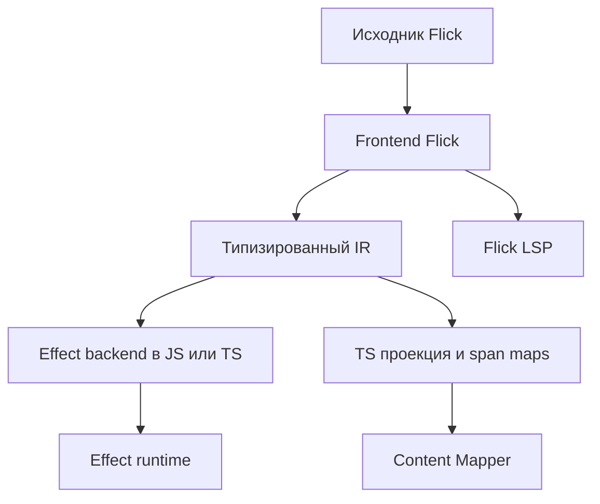

Один compiler core Flick формирует исполняемый код для единственного Effect backend и отдельную редакторную TS-проекцию. Checker Flick — источник истины для типов, эффектов и диагностики.



| Компонент | Ответственность |
| - | - |
| Parser и resolver | AST с исходными диапазонами, имена и модули |
| Kind и type checker | HKT, higher-rank, типы значений, эффекты вызовов и constraints |
| Row solver | Effect rows и record rows с разными kinds; наличие/отсутствие полей, projection, disjoint union, mapping и остаточные строки |
| Instance resolution | Выбор реализаций, неоднозначности и dictionary elaboration |
| Region и capture checking | Lifetime ресурсов, closure/task captures, допустимый выход и передача владельцу |
| TS importer | Поддерживаемые `.d.ts`, генерация FFI, overrides и отчёт покрытия |
| DSL elaboration | SQL/UI surface syntax в проверяемые библиотечные конструкции; opaque границы и source diagnostics |
| Typed IR | Явные вызовы и стадии, instances, captures, порядок, операции Effect и исходные диапазоны |
| Optimizer | Подходящие passes ReScript и специализация dictionaries при сохранении source-контрактов |
| Effect backend | Исполняемый JS/TS, генерация чистых участков, нативные операции Effect и source maps |
| Content Mapper | Виртуальная TS-проекция и отображение исходных диапазонов |
| Flick LSP | Hover, completion и диагностика в понятиях Flick |

Отправные точки интеграции — [Content Mappers в typescript-go](https://github.com/microsoft/typescript-go/pull/4712) и [ets-go](https://github.com/mikearnaldi/ets-go). Mapper позволяет связать исходный синтаксис с TS-представлением, но правила HKT, instances, effect inference и исходная семантика принадлежат compiler core.

Компиляция исполняемого кода и редакторная проекция должны опираться на общие результаты анализа. Mapper не следует превращать в цикл, где ещё строящаяся TS-программа должна сначала определить исходные типы, необходимые для её же генерации.

Формат родного интерфейса Flick — версионированный JSON `.iface`. Он содержит public types/kinds, rows и capture constraints, nominal identities, class/FD/instance heads, выбранные dictionaries, data ABI, dependency fingerprints и optimization summaries arity/purity/partiality. Недопустимое изменение ABI или несовместимая версия отвергаются с diagnostic. `.d.ts` — ограниченная TS-проекция, не источник истины. Hover показывает source types, а не внутренние TS helpers.

Runtime adapter первой версии закрепляет Effect 4.0.5, commit `81fc8d9c7855d0f31bf493f379ec7bc2a6150a6f`, и явную capability matrix. Обновление требует повторной проверки контрактов Cause, scopes, data ABI, Schema и FFI; wildcard compatibility не заявляется. Adapter локализует изменения API и реализует lexical owners/двухфазный shutdown поверх native Effect. Другой runtime backend не входит в архитектуру.

## Реализация compiler и editor Flick

Компилятор Flick пишется на **Rust**: parser, resolver, checker, typed IR, optimizer, JS/TS codegen и исходный LSP. Runtime adapters реализуются на TS/JS и используют Effect; исполняемый JS/TS и редакторную TS-проекцию генерирует Rust core. Content Mapper интегрируется отдельным versioned adapter; core checker не зависит от завершения проверки собственной TS-проекции.

Первый editor-набор: source diagnostics, hover, go to definition, completion и rename собственных symbols. Cross-language rename разрешён только при точном mapping; неподдерживаемый случай отклоняется, а не меняет произвольный JS. Исполняемый output и editor projection используют один analysis result.

## Модули и entry point Flick

Один `.fl` файл объявляет один модуль с явными exports; imports поддерживают alias и explicit exposing:

```flick
module App.Users exposing (User, load_user)

import App.Domain exposing (User, UserId)
import Effect.Log as Log
```

Экспорт типа не экспортирует его constructors автоматически; ADT constructors перечисляются явно либо через `Type(..)`. Opaque representation скрыта, re-export сохраняет nominal identity. Instances участвуют в canonical package graph независимо от import order. Межмодульные циклы и first-class/functor modules в первую версию не входят; внутри файла разрешены явно отмеченные recursive function groups и recursive nominal data. Transparent aliases должны быть ацикличны.

Top-level source initialization чистая. ESM — основной output; эффектная загрузка foreign module оформляется runtime-binding, а trusted pure module требует явного контракта. Приложение указывает один `main : Unit ->{; AppError} Unit`; нужные Layers предоставляются явно внутри него. Platform entry runner вызывает main и наблюдает итоговый Exit. Импорт библиотеки приложение не запускает.
