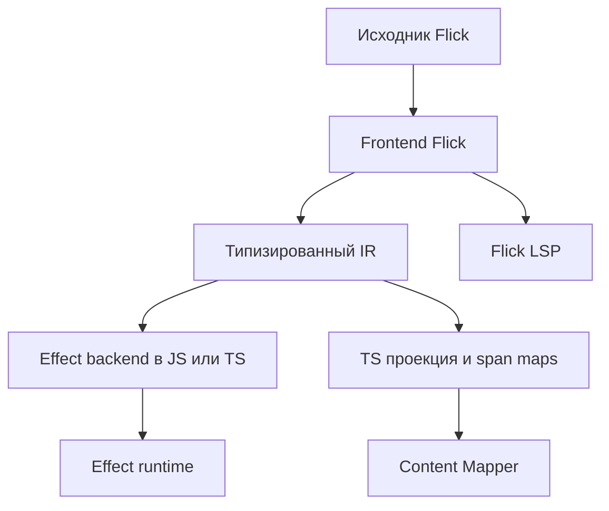

Общее ядро компилятора Flick формирует исполняемый код для Effect — единственной целевой среды выполнения — и отдельную TS-проекцию для редактора. Правила типов и эффектов, а также диагностику определяет проверяющий модуль Flick.



| Компонент | Ответственность |
| - | - |
| Синтаксический разбор и разрешение имён | AST с диапазонами исходного кода, имена и модули |
| Проверка киндов и типов | HKT, полиморфизм высших рангов, типы значений, эффекты вызовов и ограничения |
| Решение ограничений на строки | Строки эффектов и полей записей с разными киндами; наличие и отсутствие полей, проекция, объединение без пересечений, отображение и остаточные строки |
| Поиск экземпляров классов | Выбор реализаций, обнаружение неоднозначностей и преобразование с явной передачей словарей |
| Проверка регионов и захватов | Время жизни ресурсов, захваты замыканий и задач, допустимость выхода из области и передачи владельцу |
| Импорт TS | Поддерживаемые `.d.ts`, генерация FFI, переопределения и отчёт о покрытии |
| Преобразование DSL | Перевод синтаксиса SQL/UI в проверяемые библиотечные конструкции; границы непрозрачных типов и диагностика по исходному коду |
| Типизированное IR | Явные вызовы и стадии, экземпляры классов, захваты, порядок выполнения, операции Effect и диапазоны исходного кода |
| Оптимизатор | Применимые проходы оптимизации ReScript и специализация словарей с сохранением контрактов исходного языка |
| Генератор кода для Effect | Исполняемый JS/TS, код чистых участков, операции самого Effect и карты исходного кода |
| Content Mapper | Виртуальная TS-проекция и соответствие диапазонов исходного и сгенерированного кода |
| Flick LSP | Подсказки при наведении, автодополнение и диагностика в понятиях Flick |

Основой интеграции служат [Content Mappers в typescript-go](https://github.com/microsoft/typescript-go/pull/4712) и [ets-go](https://github.com/mikearnaldi/ets-go). Mapper связывает исходный синтаксис с TS-представлением, но правила HKT, экземпляров классов, вывода эффектов и семантику исходного языка определяет ядро компилятора.

Генерация исполняемого кода и редакторной проекции должна опираться на общие результаты анализа. Нельзя создавать циклическую зависимость, при которой TS-программа должна определить исходные типы, необходимые для генерации самой этой программы.

Собственный формат интерфейсов Flick — JSON `.iface` с указанием версии. Он содержит публичные типы и кинды, строки и ограничения на захваты, номинальные идентичности, заголовки классов, функциональных зависимостей и экземпляров классов, выбранные словари, ABI данных, отпечатки зависимостей и сводные данные для оптимизации: арность, чистоту и частичность. Недопустимое изменение ABI или несовместимая версия вызывают диагностическую ошибку. `.d.ts` — ограниченная TS-проекция, а не источник сведений о типах Flick. Подсказки при наведении показывают исходные типы, а не внутренние вспомогательные типы TS.

Адаптер среды выполнения первой версии закрепляет Effect 4.0.5, commit `81fc8d9c7855d0f31bf493f379ec7bc2a6150a6f`, и явную матрицу возможностей. Обновление требует повторной проверки контрактов Cause, областей владения, ABI данных, Schema и FFI; совместимость с произвольными версиями не заявляется. Адаптер изолирует изменения API и реализует лексических владельцев и двухфазное завершение работы средствами самого Effect. Другая целевая среда выполнения в архитектуре не предусмотрена.

<div id="реализация-compiler-и-editor-flick"></div>

## Реализация компилятора и инструментов редактора

Компилятор Flick пишется на **Rust**: синтаксический разбор, разрешение имён, проверка типов, типизированное IR, оптимизация, генерация JS/TS и LSP для исходного кода. Адаптеры среды выполнения реализуются на TS/JS и используют Effect; исполняемый JS/TS и редакторную TS-проекцию генерирует ядро на Rust. Content Mapper подключается через отдельный адаптер с указанием версии; проверяющий модуль ядра не зависит от завершения проверки собственной TS-проекции.

Первый набор возможностей редактора включает диагностику по исходному коду, подсказки при наведении, переход к определению, автодополнение и переименование символов Flick. Переименование между языками разрешено только при точном соответствии исходного и сгенерированного кода; неподдерживаемый случай отклоняется, а не меняет произвольный JS. Исполняемый код и редакторная проекция используют один результат анализа.

<div id="модули-и-entry-point-flick"></div>

## Модули и точка входа Flick

Один файл `.fl` объявляет один модуль с явными экспортами; импорты поддерживают псевдонимы и явный список доступных имён:

```flick
module App.Users exposing (User, load_user)

import App.Domain exposing (User, UserId)
import Effect.Log as Log
```

Экспорт типа не экспортирует его конструкторы автоматически; конструкторы ADT перечисляются явно либо через `Type(..)`. Представление непрозрачного типа скрыто, повторный экспорт сохраняет номинальную идентичность. Экземпляры классов участвуют в каноническом графе пакетов независимо от порядка импортов. Межмодульные циклы, модули как значения и модули-функторы в первую версию не входят; внутри файла разрешены явно отмеченные группы рекурсивных функций и рекурсивные номинальные типы данных. Прозрачные псевдонимы типов должны быть ацикличны.

Инициализация исходного модуля на верхнем уровне чистая. Основной формат
вывода — ESM; эффектная загрузка внешнего модуля оформляется эффектной
привязкой, а доверенный чистый модуль требует явного контракта.
Приложение задаёт один или несколько входных модулей через `entry` или
`entries`; каждый экспортирует `main`. Чистый вход имеет тип `Unit -> Unit`
и вызывается напрямую. Эффектный вход принимает и возвращает `Unit`,
не требует сервисов и может завершиться только `AppError`; его раннер
наблюдает итоговый `Exit`. Нужные слои и обработка остальных ошибок
предоставляются внутри `main`. Импорт библиотеки не запускает входы.
