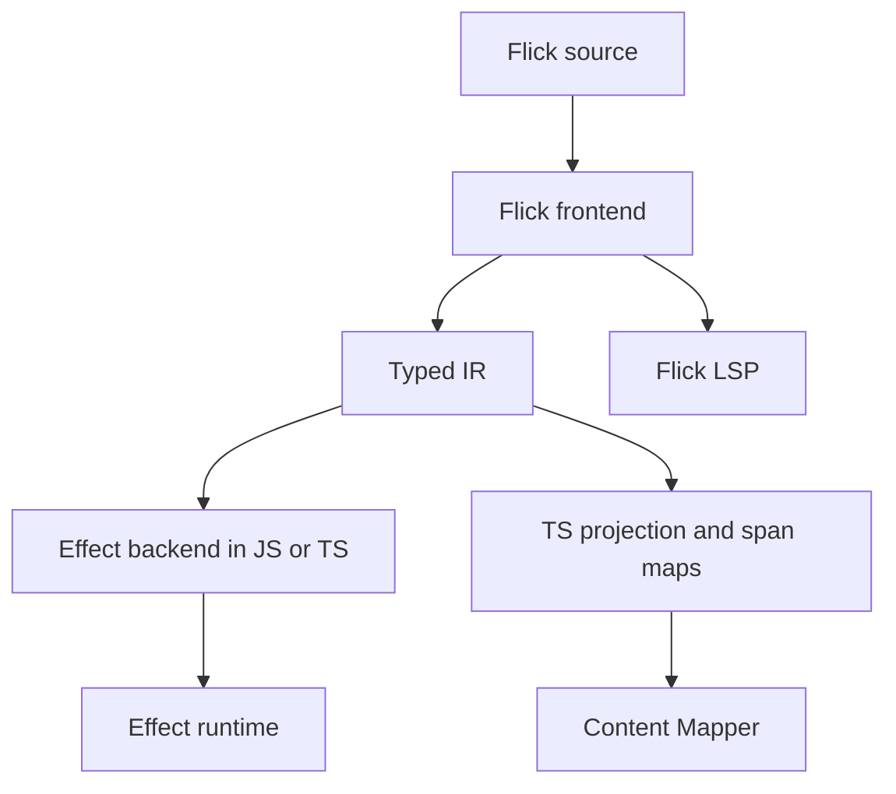

A single Flick compiler core produces executable code for the one Effect backend and a separate editor TS projection. The Flick checker is the source of truth for types, effects and diagnostics.



| Component | Responsibility |
| - | - |
| Parser and resolver | AST with source ranges, names and modules |
| Kind and type checker | HKT, higher-rank, value types, call effects and constraints |
| Row solver | Effect rows and record rows of different kinds; field presence/absence, projection, disjoint union, mapping and residual rows |
| Instance resolution | Choosing implementations, ambiguities and dictionary elaboration |
| Region and capture checking | Resource lifetimes, closure/task captures, permitted escape and handoff to an owner |
| TS importer | Supported `.d.ts`, FFI generation, overrides and a coverage report |
| DSL elaboration | SQL/UI surface syntax into checkable library constructs; opaque boundaries and source diagnostics |
| Typed IR | Explicit calls and stages, instances, captures, ordering, Effect operations and source ranges |
| Optimizer | Suitable ReScript passes and dictionary specialization while preserving source contracts |
| Effect backend | Executable JS/TS, generation of pure sections, native Effect operations and source maps |
| Content Mapper | Virtual TS projection and mapping of source ranges |
| Flick LSP | Hover, completion and diagnostics in Flick's own terms |

The starting points for the integration are [Content Mappers in typescript-go](https://github.com/microsoft/typescript-go/pull/4712) and [ets-go](https://github.com/mikearnaldi/ets-go). The mapper links the source syntax to a TS representation, but the rules for HKT, instances, effect inference and the source semantics belong to the compiler core.

Compiling executable code and the editor projection must rely on shared analysis results. The mapper should not turn into a cycle in which a TS program that is still being built must first determine the source types needed to generate that very program.

The format of Flick's native interface is a versioned JSON `.iface`. It contains public types/kinds, rows and capture constraints, nominal identities, class/FD/instance heads, chosen dictionaries, the data ABI, dependency fingerprints and optimization summaries of arity/purity/partiality. An invalid ABI change or an incompatible version is rejected with a diagnostic. `.d.ts` is a restricted TS projection, not a source of truth. Hover shows source types, not internal TS helpers.

The first version's runtime adapter pins Effect 4.0.5, commit `81fc8d9c7855d0f31bf493f379ec7bc2a6150a6f`, and an explicit capability matrix. An upgrade requires re-verifying the contracts of Cause, scopes, the data ABI, Schema and FFI; wildcard compatibility is not claimed. The adapter localizes API changes and implements lexical owners/two-phase shutdown on top of native Effect. A different runtime backend is not part of the architecture.

## Implementation of the Flick compiler and editor

The Flick compiler is written in **Rust**: parser, resolver, checker, typed IR, optimizer, JS/TS codegen and the source LSP. Runtime adapters are implemented in TS/JS and use Effect; the Rust core generates the executable JS/TS and the editor TS projection. The Content Mapper is integrated through a separate versioned adapter; the core checker does not depend on its own TS projection finishing type checking.

The first editor set: source diagnostics, hover, go to definition, completion and rename of own symbols. Cross-language rename is allowed only with an exact mapping; an unsupported case is rejected rather than changing arbitrary JS. The executable output and the editor projection use one analysis result.

## Flick modules and the entry point

One `.fl` file declares one module with explicit exports; imports support aliases and explicit exposing:

```flick
module App.Users exposing (User, load_user)

import App.Domain exposing (User, UserId)
import Effect.Log as Log
```

Exporting a type does not automatically export its constructors; ADT constructors are listed explicitly or through `Type(..)`. The opaque representation is hidden, and a re-export preserves nominal identity. Instances take part in the canonical package graph regardless of import order. Cross-module cycles and first-class/functor modules are not part of the first version; within a file, explicitly marked recursive function groups and recursive nominal data are allowed. Transparent aliases must be acyclic.

Top-level source initialization is pure. ESM is the primary output;
effectful loading of a foreign module is expressed as a runtime binding,
and a trusted pure module requires an explicit contract. An application
names one or more entry modules through `entry` or `entries`; each exports
`main`. A pure entry is `Unit -> Unit` and is called directly. A runtime
entry takes and returns `Unit`, requires no services and may fail only with
`AppError`; its runner observes the final `Exit`. Required layers and other
error handling belong inside `main`. Importing a library starts no entry.
