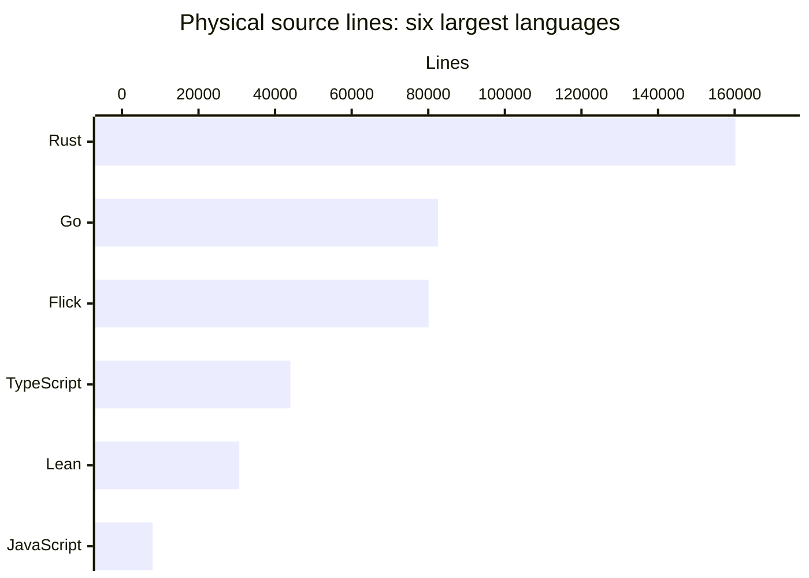
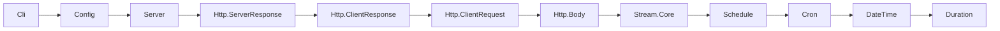

# By the numbers

This is a measured inventory of the **2026-11-10 working tree**, based on `main` at `6e9096fb`, not a release-size, performance, coverage, or executable-validation report. Uncommitted files are included; history measurements stop at that commit. See [architecture](overview/architecture.md) for what the measured components do and [lore](lore.md) for the changes behind the numbers.

## Current source size

The retained source set contains **2,931 files, 409,406 physical lines, and 14,867,419 bytes**. Five source files are untracked. Including retained documentation, configuration, fixtures, and assets gives **4,870 files and 20,041,614 bytes**, including 12 untracked files.

Physical lines include comments, blank lines, declarations, and test programs; they are not statements or comment-stripped SLOC. A final unterminated line counts once. Bytes are file-content bytes, not filesystem allocation or compressed distribution size.

| Language / syntax | Extensions | Files | Physical lines | Bytes |
| - | - | -: | -: | -: |
| Rust | `.rs` | 705 | 160,197 | 5,742,501 |
| Go | `.go` | 380 | 82,523 | 2,379,256 |
| Flick | `.fl` | 1,000 | 80,083 | 2,862,873 |
| TypeScript | `.ts`, `.mts` | 524 | 43,992 | 1,894,321 |
| Lean | `.lean` | 171 | 30,659 | 1,476,948 |
| JavaScript | `.js`, `.mjs` | 112 | 8,008 | 343,115 |
| CSS | `.css` | 8 | 2,414 | 89,892 |
| Astro | `.astro` | 20 | 634 | 45,031 |
| WIT | `.wit` | 1 | 401 | 17,382 |
| Nix | `.nix` | 2 | 218 | 5,956 |
| Shell | `.sh` | 1 | 87 | 3,144 |
| C | `.c` | 1 | 85 | 2,821 |
| HTML | `.html` | 2 | 46 | 2,205 |
| Tree-sitter Scheme queries | `.scm` | 3 | 44 | 1,416 |
| SQL | `.sql` | 1 | 15 | 558 |
| **Total** | | **2,931** | **409,406** | **14,867,419** |

These are extension-based buckets: an Astro file's embedded CSS/JavaScript stays Astro, and a Rust test's embedded Flick program stays Rust. Markdown code fences are documentation rather than additional source files.

## Source, tests, and configuration

These categories are disjoint; test/fixture classification takes precedence over every extension bucket.

| Retained file category | Files | Bytes |
| - | -: | -: |
| Non-test source | 1,833 | 11,452,066 |
| Tests and fixtures, all formats | 1,549 | 4,205,189 |
| Configuration and manifests | 350 | 1,152,343 |
| Documentation and licenses | 1,082 | 2,789,541 |
| Other data and assets | 56 | 442,475 |
| **Total** | **4,870** | **20,041,614** |

Of the 2,931 source files, **1,098 are test/fixture files: 37.5% by file count**. They contain 97,004 physical lines. The broader all-format test/fixture category is 31.8% of retained files. Neither number is execution coverage: inline Rust tests, doctests, and tests embedded in otherwise non-test files are not separated from their host file. Lean proof files are counted as Lean source, not automatically as tests.

The test rule matches a path component `test`, `tests`, `testdata`, `__tests__`, or `fixtures`; a filename containing `.test.` or `.spec.`; `*_test.go`, `tests.rs`, or `*_tests.rs`; or an expectation extension `.stdout`, `.stderr`, `.exit`, `.contains`, `.snap`, or `.hurl`.

For remaining files, source means the extensions in the language table plus `.h` (none survive the filter). Documentation means `.md`, `.mdx`, or a file named `LICENSE`/`NOTICE`. Configuration means `.toml`, `.json`, `.yml`, `.yaml`, `.lock`, `.mod`, `.sum`, or the names `.gitignore`, `.gitattributes`, `.dockerignore`, `justfile`, and `lean-toolchain`. Everything else is data/assets. Thus retained lockfiles and coverage manifests are configuration inputs, not source code.

## Directory size and file granularity

This table uses **source files only**, recursively, with the same exclusions. Test-file counts follow the filename/path rule above. Mean bytes and lines are arithmetic means, rounded; zero test files does not mean a component has no tests.

| Directory | Source files | Test/fixture source files | Physical lines | Mean lines/file | Mean bytes/file |
| - | -: | -: | -: | -: | -: |
| `flick-core/` | 414 | 71 | 97,831 | 236.31 | 8,556.57 |
| `flick/` | 151 | 77 | 28,476 | 188.58 | 6,664.60 |
| `flick-ir/` | 14 | 0 | 1,750 | 125.00 | 3,930.57 |
| `flick-pretty/` | 5 | 1 | 1,440 | 288.00 | 9,936.60 |
| `flick-wasm/` | 1 | 0 | 397 | 397.00 | 14,235.00 |
| `flick-model/` | 65 | 15 | 14,370 | 221.08 | 7,839.98 |
| `flick-plugin/` | 18 | 1 | 4,323 | 240.17 | 8,893.28 |
| `plugins/` | 49 | 8 | 10,730 | 218.98 | 7,618.06 |
| `packages/core/` | 24 | 0 | 3,675 | 153.12 | 5,083.92 |
| `packages/std/` | 204 | 0 | 24,578 | 120.48 | 4,810.84 |
| `packages/effect-ts/` | 298 | 60 | 26,334 | 88.37 | 3,836.30 |
| `runtime/` | 147 | 25 | 15,868 | 107.95 | 4,498.07 |
| `runtime-go/` | 368 | 72 | 82,089 | 223.07 | 6,436.10 |
| `formal/` | 171 | 0 | 30,659 | 179.29 | 8,637.12 |
| `docs/` | 106 | 13 | 7,098 | 66.96 | 3,005.93 |
| `tests/` | 714 | 714 | 41,741 | 58.46 | 1,973.94 |
| `tools/` | 85 | 18 | 6,906 | 81.25 | 3,434.46 |
| `examples/` | 79 | 18 | 9,382 | 118.76 | 4,017.43 |
| `editors/` | 14 | 4 | 808 | 57.71 | 2,083.00 |

Four source files sit outside the directories in this table: `.github/actions/setup-flick/install.mjs`, `.github/actions/setup-flick/install.test.mjs`, `flake.nix`, and `nix/package.nix`.

## Packages are not one interchangeable unit

| Manifest-defined unit | Count | Scope |
| - | -: | - |
| Cargo workspace members | 15 | `Cargo.toml`; includes the `tests/plugins/pairs/` fixture and the current uncommitted surface-tool relocation to `packages/effect-ts/tools/surface/` |
| Non-fixture Cargo workspace members | 14 | Same list, excluding `tests/plugins/pairs/` |
| Additional standalone Rust package | 1 | `editors/zed/Cargo.toml` |
| Explicit pnpm workspace members | 14 | Only entries under `packages:` in `pnpm-workspace.yaml`; excludes the root package and `minimumReleaseAgeExclude` entries |
| Go modules | 1 | `runtime-go/go.mod` |
| Shipped Flick library manifests | 2 | `packages/core/flick.toml`, `packages/std/flick.toml` |

Do not add these rows into a purported product-package total: examples, build tools, native components, and language libraries have different roles. Test project manifests are not additional shipped libraries.

## A bounded API-surface measurement

The 228 `.fl` files under `packages/core/src/` and `packages/std/src/` declare **219 public modules and nine private modules**. Among public modules:

- 45 explicit `exposing (...)` lists contain **1,043 named exposure entries**.
- 173 modules use `exposing (..)`, so their exports are **not enumerated by this measurement**.
- One public module has no `exposing` clause.

The measurement reads each module header, balances the exposure-list parentheses, and counts its top-level comma-separated entries. `Type(..)` is one entry, not a count of its constructors. Re-exported names are not deduplicated across modules. Therefore **1,043 is a measured partial exposure-list size, not the complete public API or a callable-function count**. Rust `pub use`, feature gates/macros, and TypeScript barrel exports were not resolved into an invented repository-wide symbol total. `packages/core/src/List.fl` and `packages/core/src/List/Core.fl` illustrate why exposure and implementation declarations differ.

## Explicit library import depth

Scanning those same 228 library files for column-zero `import Module.Name` declarations yields **357 distinct directed module-to-module edges**, no unresolved imported module names within that set, and no cycles. The longest explicit-import chain has **11 edges / 12 modules**:

The corresponding files are `packages/std/src/Cli.fl`, `packages/std/src/Config.fl`, `packages/std/src/Server.fl`, `packages/std/src/Http/ServerResponse.fl`, `packages/std/src/Http/ClientResponse.fl`, `packages/std/src/Http/ClientRequest.fl`, `packages/std/src/Http/Body.fl`, `packages/std/src/Stream/Core.fl`, `packages/std/src/Schedule.fl`, `packages/std/src/Cron.fl`, `packages/std/src/DateTime.fl`, and `packages/std/src/Duration.fl`.

Method: use declared public/private module names, deduplicate direct imports, find strongly connected components, then compute the longest path in the component DAG. Here every component is a singleton. This measures the **written library import graph only**: implicit Prelude/builtin visibility, qualified uses without an import, plugin expansion, foreign runtime imports, examples, Cargo dependencies, and JavaScript dependencies are outside the graph. It is not runtime call depth, compiler pass depth, or a verified project build order.

## Ninety-day Git activity

The window is **2026-08-13 00:00 UTC inclusive to 2026-11-11 00:00 UTC exclusive**: 90 calendar days including the generation day. Every commit reachable from `6e9096fb` falls inside it. The earliest reachable commit has committer time 2026-10-22 09:47:43 UTC; the latest is 2026-11-10 07:59:16 UTC.

There are **1,462 reachable commits: 1,275 non-merge commits and 187 merge commits**. Monthly counts are zero in the August/September portion, 672 in October, and 790 in November through this snapshot. These are commit counts, not unique changes or individual productivity statistics.

| UTC period | All commits | Merge commits | Added text lines | Deleted text lines |
| - | -: | -: | -: | -: |
| 2026-08-13–2026-10-18 | 0 | 0 | 0 | 0 |
| 2026-10-19–2026-10-25 | 277 | 30 | 232,247 | 39,737 |
| 2026-10-26–2026-11-01 | 524 | 38 | 400,793 | 206,188 |
| 2026-11-02–2026-11-08 | 646 | 119 | 209,049 | 101,273 |
| 2026-11-09–2026-11-10, partial | 15 | 0 | 76,832 | 39,487 |
| **Total** | **1,462** | **187** | **918,921** | **386,685** |

Commit periods use **committer timestamps normalized to UTC**, not author dates or merge dates substituted for branch commits. Churn sums `git log --no-merges --no-renames --numstat --format=@@%H 6e9096fb`, assigning each diff to its commit's period. Binary changes are omitted from line sums: there are 71 binary file-change records.

Unlike the working-tree inventory, churn deliberately covers **all historically tracked paths**, including documentation, generated files, vendored code, and deletions. Rename detection is disabled, so moved files add deletion/addition churn. It is not net code growth: the temporary pgx vendoring and later runtime package move account for substantial traffic; see [history](lore.md#replacement-and-extraction-not-just-addition).

### Bot coauthorship: a lower bound only

**11 of 1,462 commits (0.75%)** contain at least one `Co-authored-by:` line matching, case-insensitively, `[bot]`, `factory-droid`, `dependabot`, `renovate`, or `copilot`. There are 15 matching trailer occurrences because one commit repeats a trailer; the commit count deduplicates these.

This is only recorded bot **coauthorship**, not a measure of AI-written code, bot-authored commits, or total assisted work. Missing trailers are not evidence of unaided authorship. No individual contributor rankings or per-person statistics were computed.

## Inventory method and exclusions

1. Enumerate the deduplicated union from `git ls-files --cached --others --exclude-standard -z`. Read the actual working-tree bytes of each existing regular, non-symlink file, not the index/HEAD blob. Deleted tracked files are absent; nonignored untracked files are eligible.
2. Exclude `droid-wiki/` so generation does not count itself, and exclude private research notes.
3. Exclude a path when **any component** equals `.git`, `target`, `node_modules`, `vendor`, `dist`, `.flick`, `.lake`, `.astro`, `.cache`, `coverage`, `__pycache__`, or `.pnpm-store`. This also omits fixture directories literally named `dist` or `node_modules`; it is a stated path filter rather than a claim that all fixtures there are generated.
4. Exclude the known generated/parser-support files below. Keep their generator programs as source.
5. Classify by the rules above. For each source file, count `bytes.count(b"\n") + int(bool(bytes) and not bytes.endswith(b"\n"))`; sum raw byte lengths.

Explicit generated/parser-support exclusions:

- `editors/tree-sitter-flick/src/parser.c`, `editors/tree-sitter-flick/src/grammar.json`, `editors/tree-sitter-flick/src/node-types.json`, and everything under `editors/tree-sitter-flick/src/tree_sitter/`.
- `formal/Formal/Elab/PreludeSchemes.lean`.
- `runtime-go/flickrt/collate_tables.go`, `runtime-go/flickrt/datetime_intl.go`, `runtime-go/flickrt/grapheme_tables.go`, `runtime-go/flickrt/mime_types.go`, and `runtime-go/flickrt/unicode_tables.go`.

Generated expectations such as `.snap` and `.stdout` remain test data, and lockfiles remain configuration; neither contributes source lines. The generated-code exclusions are explicit, not a universal provenance detector. The filesystem was changing during wiki work, so this is one measurement sweep rather than an atomic filesystem snapshot. Later edits can legitimately change the numbers.

## Key source files

| Path | Why it matters to the measurement |
| - | - |
| `Cargo.toml` | Current Rust workspace membership |
| `pnpm-workspace.yaml` | pnpm membership, separate from dependency-age exceptions |
| `.gitignore` | Baseline ignored-output policy before the extra inventory exclusions |
| `packages/core/src/Prelude.fl` | Implicitly visible library surface omitted from the explicit-import edges |
| `packages/core/src/List.fl` | Explicit exposure list and implementation-part imports |
| `packages/std/src/Cli.fl` | Start of a longest measured explicit-import chain |
| `tools/go-collate/gen.mjs`, `tools/go-intl/gen.mjs`, `tools/go-unicode/gen.mjs` | Source generators retained instead of counting their generated Go tables |
| `formal/Formal/Elab/PreludeSchemes.lean` | Explicit generated-proof-input exclusion |

No compiler, runtime, browser, or Lean suite was run to produce these statistics. Inventory and Git metadata checks do not establish that this dirty checkout builds or passes tests.
