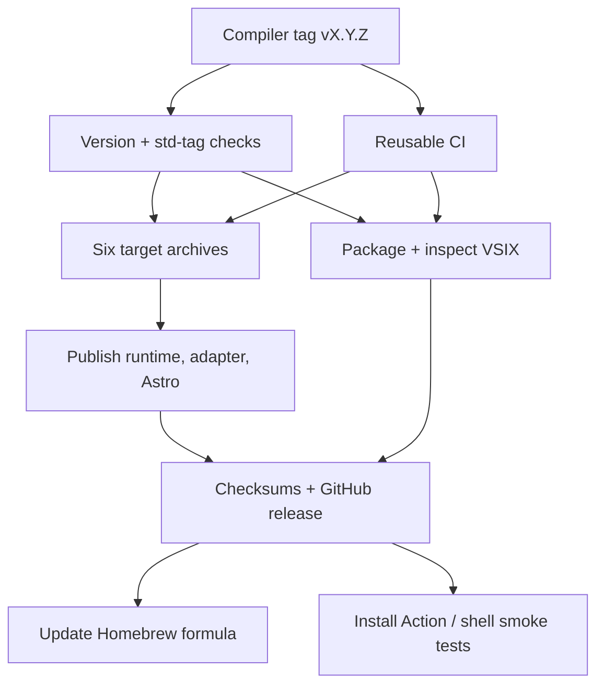

# Deployment and distribution

Active contributors: bondiano, Vassiliy Kuzenkov, chaoseternally — nonbot author names recorded on `origin/main` for workflows, installers, and Nix configuration.

Flick is distributed as compiler archives, npm runtime/integration packages, tagged source libraries, editor assets, a setup Action, and a Nix package. `.github/workflows/ci.yml`, `.github/workflows/release.yml`, `.github/workflows/packages.yml`, and `action.yml` define these paths; this is not a hosted application-service deployment.

## Snapshot and release authority

This page describes the dirty `main` checkout based at `6e9096fb`, not verified release artifacts or live CI status. Existing uncommitted source changes can affect behavior; inspect the intended release commit and manifests before publishing.

No release, tag, install, package publication, workflow dispatch, Nix build, or executable validation was performed for wiki generation. `AGENTS.md` requires an explicit request before committing, pushing, publishing, or merging.

## CI is a graph, not one local command

`.github/workflows/ci.yml` runs on pushes to `main`, pull requests, and reusable workflow calls. New PR runs cancel older runs for the same PR; normal push runs use commit-specific grouping.

| CI area | What it checks |
| - | - |
| Lint | PR budget-policy helper tests/ratchet, Zed build and locked tests, `just lint` |
| Setup Action | Node tests for `.github/actions/setup-flick/install.mjs` |
| Rust tests/features | `just unit`, Effect-surface coverage summary, separate `just feature-test` |
| JS/browser/language | `just e2e-js`, Go runtime tests, `just language`, bundle-size gate |
| Native integration | `just e2e-tests`, plus `just e2e-cases k/3` across three shards; JUnit artifacts |
| Plugins | `just wasm-plugins` |
| PostgreSQL | `just e2e-postgres` |
| Nix | Evaluate all supported systems, build/test package, smoke-check binary, check shell versions |
| Model/Lean | Separate `just model` and Lean `lake build --wfail` jobs |
| Extra Go platforms | Linux arm64, macOS, Windows portable cases/runtime/language tests; skipped for pull-request events |

Most Linux jobs use Ubuntu 26.04; release Linux archives deliberately build on Ubuntu 22.04. `just check` only composes lint and Rust/capability tests, and its unit step excludes `flick-model`. See [testing infrastructure](how-to-contribute/testing.md).

`.github/workflows/nightly.yml` runs at **02:17 UTC** or on dispatch. It reuses full CI, runs one million parser/formatter fuzz inputs, invokes the performance workflow, and summarizes failures/artifacts. `.github/workflows/perf.yml` is reusable and manually accepts a ref; measured and partial reports are retained with `perf.log`. These workflows are configured behavior, not evidence that a particular run passed.

## Compiler release tags

`.github/workflows/release.yml` triggers on `v*` tags; the documented compiler-release convention is `vX.Y.Z`.



The version gate compares the tag with:

- `flick/Cargo.toml`.
- `editors/zed/Cargo.toml` and `editors/zed/extension.toml`.
- `runtime/package.json`, `packages/effect-ts/package.json`, and `tools/astro-flick/package.json`.
- `editors/vscode/package.json` and `editors/tree-sitter-flick/tree-sitter.json`.
- Runtime/adapter pins in `flick/src/toolchain.rs`.

It also requires the repository tag **`std-vX.Y.Z`** to exist: a released compiler without an explicit std dependency fetches that implicit standard-library tag. This version gate enumerates specific manifests; it is not a generic assertion that every Rust workspace crate has the same version.

After version and CI gates, compiler builds use `--release --locked --features wasm-plugins` for:

| Platform | Archive targets |
| - | - |
| macOS | `aarch64-apple-darwin`, `x86_64-apple-darwin` |
| Linux GNU | `x86_64-unknown-linux-gnu`, `aarch64-unknown-linux-gnu` |
| Windows MSVC | `x86_64-pc-windows-msvc`, `aarch64-pc-windows-msvc` |

Unix archives are `.tar.gz`; Windows archives are `.zip`. The npm stage publishes `@flick-lang/runtime`, `@flick-lang/effect-ts`, and `@flick-lang/astro`, using the configured npm credential. The editor job packages a VSIX, rejects packaging warnings, inspects its contents/version, and tests that inspector.

The GitHub release attaches compiler archives/VSIX and `.sha256` files and explicitly sets the compiler release as latest. A later job updates the external Homebrew tap formula using archive hashes; installer jobs exercise pinned/latest setup and a failed missing-release install.

Record changes in `CHANGELOG.md` before a release. Review the workflow's external credentials and write permissions before operating it. Publication is staged across jobs and registries, not a single atomic transaction; later failure does not imply earlier npm publication was rolled back.

## Source-package tags and application artifacts

`.github/workflows/packages.yml` handles **`<package>-v<version>`** tags, for example `std-v0.1.0`. It requires `packages/<package>/flick.toml` and matching package version, builds the current compiler with WASM hosting, and runs `flick pack --out-dir dist` in that package.

`flick pack` checks compatibility with the compiler doing the packing. The package release attaches the resulting source archive and reports its SHA-256 in release notes. It sets `--latest=false` so a library release does not replace the compiler installer target.

These tags differ from compiler tags and npm version publication:

- A Flick source dependency can use `{ git, tag, subdir }` or `{ url, sha256 }`.
- `flick install` resolves/pins fetched sources in `flick.lock` and the package store.
- Project `[js.dependencies]` and npm lockfiles are a separate channel.
- Application packaging stages emitted modules/entries and npm metadata; `flick pack` does not itself publish the app.

For deployment of a generated application, select its JS/TS runtime or Go executable and runtime configuration as described by that application. Flick's own workflows do not define a universal hosting platform. See [project/package loading](systems/project-and-cli/project-loading-and-packages.md), [command lifecycles](systems/project-and-cli/commands-and-toolchain.md), and [runtime choices](packages/runtimes/index.md).

## Installers and setup Action

`action.yml` is a Node 24 Action backed by `.github/actions/setup-flick/install.mjs`. Its inputs are `version` (default `latest`), `repository`, `install-dir`, and `token`; outputs are the resolved release tag and directory added to `PATH`.

Example using the repository's documented version form:

```yaml
steps:
  - uses: actions/checkout@v7
  - uses: bondiano/flick-lang@v0.1.0
    with:
      version: v0.1.0
  - run: flick check
```

The Action ref chooses installer code; its `version` input independently chooses the compiler archive. Pin each deliberately. Node/pnpm/runtime dependencies for the checked project still need their own setup; this Action installs the compiler only.

The installer selects one of the six archive targets, resolves only compiler-shaped release tags, verifies the published digest **before extraction**, extracts the expected regular binary, confirms its printed version, and stages installation before adding it to `PATH`. A cached `<tag>/<target>` binary is rechecked with `--version` and reused without a new archive download/digest check; keep that cache trusted.

`docs/public/install.sh` supplies Unix installation with `FLICK_VERSION` and `FLICK_BIN_DIR` overrides, published-checksum verification, and extraction of the named `flick` binary. Homebrew uses release hashes in its formula. These integrity checks depend on trusted release metadata; they are not independent signatures. See [download trust](security.md#downloads-locks-and-local-caches).

## Nix package and development shell

`flake.nix` exports package/default package, overlay, checks, development shell, and formatter for **x86_64-linux**, **aarch64-linux**, and **aarch64-darwin**. This is narrower than the archive release matrix.

```sh
nix develop
nix build .#flick
nix profile install .#flick
```

`nix/package.nix` builds only the CLI with `wasm-plugins` using the Rust pin from `rust-toolchain.toml` and Cargo dependencies from `Cargo.lock`. The whole source checkout supplies embedded Go runtime sources and compiler fixtures; filters drop build/installed-package trees but retain checked-in `tests/check/projects/*/node_modules` fixtures.

The Nix check phase selects self-contained `flick-core` library/check/corpus/features/fuzz/projection/stdlib/transformer tests, plus an offline Effect-surface coverage test. It deliberately excludes Node-dependent constant evaluation, unstable sandbox timing ratios, and the full network/browser/database integration suite. A successful Nix build is not the same claim as full CI.

The dev shell includes compiler/editor aids, Node, pnpm, Go, just, machete, Nextest, and jq. Node/pnpm/Go remain tools needed by generated projects, not runtime dependencies automatically bundled into the compiler package.

## Static site and wiki automation

`.github/workflows/docs.yml` builds on main pushes, selected docs/grammar/workflow pull requests, and manual dispatch. It checks locale parity and documentation examples, runs `just docs`, validates links, and uploads `docs/dist`. Only non-PR runs deploy to the `github-pages` environment.

**Working-tree-only automation:** `.github/workflows/droid-wiki-refresh.yml` was untracked user work in this snapshot and was not modified by this task. Its proposed main-push flow restores prior `droid-wiki/` from a rolling `factory/droid-wiki` branch, generates with a read-permission job, passes pages/metadata through an artifact excluding video/images, then uses a separate write-permission job to update a PR against the repository default branch.

The optional `FACTORY_WIKI_PR_TOKEN` allows that PR to trigger downstream workflows; the fallback `GITHUB_TOKEN` does not trigger them in the same way. The proposed workflow reports publication failures as warnings. None of this establishes that the file is committed, enabled, or has its required credentials/branch rules.

## Key source files

| Source | Responsibility |
| - | - |
| `.github/workflows/ci.yml`, `.github/workflows/nightly.yml`, `.github/workflows/perf.yml` | Validation graph and extended measurements |
| `.github/workflows/release.yml`, `.github/workflows/packages.yml` | Compiler versus source-package publication |
| `action.yml`, `.github/actions/setup-flick/install.mjs` | Released compiler setup and integrity/version checks |
| `docs/public/install.sh` | Unix installer |
| `flake.nix`, `flake.lock`, `nix/package.nix` | Nix systems, pinned inputs, package/check/shell composition |
| `.github/workflows/docs.yml` | Static-site build/deploy |
| `.github/workflows/droid-wiki-refresh.yml` | Untracked working-tree-only wiki proposal |

For contributor checks rather than publication, use [development workflow](how-to-contribute/development-workflow.md) and [tooling](how-to-contribute/tooling.md).
