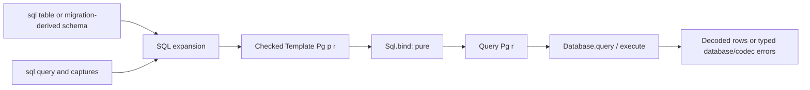

# Data, schemas, and SQL

Active contributors: bondiano, Vassiliy Kuzenkov. Non-bot authors on `origin/main` for schema/SQL APIs, derive plugins, and application examples.

Flick distinguishes a value's language type from the runtime witness that validates it and the codec that carries it across a wire or database. SQL templates add another typed description layer without performing I/O.

## Schema is not codec

`Schema a` witnesses values of `a`. `Schema.validate` returns `Result SchemaError a` from inert `Unknown` input. `Codec rd re i a` additionally describes a wire form `i`, with separate service requirements for decoding and encoding; `PureCodec i a` performs those operations without runtime execution.

`deriving Schema` is implemented by `plugins/derive/src/schema.rs`. It writes a `T$schema` companion (used as `T.schema`) from `Schema` combinators, with schema arguments for generic parameters. Local recursive references use lazy/named or recursive schemas; another module's type uses that module's witness.

Not every type is data with a wire form. The derive rejects functions, open records, captured capabilities, and unsupported runtime descriptions; GADT constructors that refine their result or carry dictionaries are rejected by this plugin's derives. `Schema.opaque` can explicitly describe a value with no exportable wire contract.

`Codec.json` chooses the schema's canonical JSON form. Options, literal enums, tagged variants, and redacted values have explicit policies; a redacted value has no implicit JSON policy. `Codec.json_schema` exports JSON Schema 2020-12 **or returns `ExportError`** when the contract is not representable exactly. `Codec.standard` and `Codec.standard_async` adapt validation to Standard Schema V1.

### Record codec blocks

`codec T.schema { label = field "wire" codec; ... }` names every field and its wire policy. The derive plugin checks duplicate source labels/wire names during expansion. It then reads checker facts for the schema's closed record and field codec results to diagnose missing/extra fields and mismatched decoded types.

This is not an unrestricted plugin-side unifier: `plugins/derive/src/codec.rs` compares available exact type facts and skips the comparison when types remain unknown. Normal checking still validates the generated combinator calls. An effectful field yields a general `Codec`, not a silently pure one.

`plugins/derive/src/form.rs` and `plugins/derive/src/url.rs` generate form and URL witnesses. `packages/std/src/Form.fl` and `packages/std/src/Route.fl` supply the corresponding combinators; routes connect to [typed HTTP APIs](http-rpc-and-server-functions.md#typed-http-apis) and browser navigation.

### Refined values

A refined type validates construction through its parse companion. The first-party refined plugin additionally reports `FLICK-D006` when a known constant provably fails the available check. In this working tree, the compiler provides enum literals or read-only resolved predicate syntax; `plugins/refined/src/predicate.rs` interprets supported predicates.

The interpretation is deliberately partial: known `Checks.email`, `Checks.non_empty`, and `Checks.positive`, plus a subset of constant/lambda/unary/binary/conditional syntax. Unknown syntax or uncertain arithmetic produces no compile-time verdict. Enum literals travel through interfaces; arbitrary predicate syntax is obtained for the current module, not generally imported from another module. Runtime validation is still required. See [plugin fact boundaries](../packages/plugins.md#post-check-facts-not-a-second-type-checker).

## SQL templates and tables

| Value | Purpose |
| - | - |
| `Sql.Table name columns` | Table description, with each column's type, nullability, and write policy |
| `Sql.Template Sql.Pg params row` | Checked PostgreSQL query shape, with named parameters not yet bound |
| `Sql.Query Sql.Pg row` | Query with parameter values attached |
| `Database` | Runtime service that actually executes queries/statements |

`sql table Users "users" { ... }` emits the row type and `Users.table`. SQL attributes determine `NonNull`/`Nullable` and `Required`/`Defaulted`/`Generated`. A `via` codec connects a custom Flick value to the SQL base type; compatible literal enums need no codec.

Expression blocks such as `sql p { from u in Users; where u.name == p.name; select u.id }` infer parameter and result records. `$name`, `$name.field`, and `$(expression)` capture program values; these travel beside the SQL text as placeholders. Supported template splicing supplies subqueries to constructs such as `is_in` and `exists`; it is not arbitrary string interpolation.

The plugin resolves table/column aliases and checks grouping, placement, required writes, and generated columns. Its generated, non-executed type-witness function uses `Sql.Derive` combinators to delegate type relationships to the ordinary checker. `Sql.Param` and `Sql.Numeric` supply type-dependent parameter kinds/casts/numeric behavior.

Nullability is visible in result types: a left-joined alias makes columns `Option`, without repeatedly nesting `Option` for repeated nullable joins. The query language is a checked PostgreSQL subset, not a general SQL parser or live database schema verifier.

`Sql.bind`, `Sql.text`, and `Sql.template_text` do no database I/O. Raw SQL is a separate escape hatch: `Sql.unsafe_text` is explicitly unchecked; `Sql.identifier` validates identifier syntax, `Sql.ident` quotes it, and `Sql.param` still parameterizes data. Do not transfer checked-template guarantees to arbitrary raw text.

## Migrations and transaction ownership

`sql migration version "name" { DDL }` contributes to the module's collected schema in written order. The plugin applies its supported DDL subset, generates remaining table descriptions, publishes table metadata for other imported blocks, and emits `migrations`. Unsupported syntax is `std/Q010`; a statement that cannot apply is `std/Q013`. This is compile-time schema construction, not execution against PostgreSQL.

`Database.Migrate.run` performs runtime migration under `Database.transaction`, taking a PostgreSQL advisory lock and recording steps in `flick_migrations`. It checks increasing versions and rejects a database version newer than the provided steps.

`Database.transaction` documents nested savepoints and rollback on failure/interruption. A lost commit answer can produce `DbError` with code `"commit_unknown"`: callers must not infer that every failed transaction call definitely made no writes. Pool ownership, cancellation, and backend execution are covered by [runtimes](../packages/runtimes/index.md), not by the SQL syntax checker.

## Modification entry points and checks

| Change | Start here | Regression surface |
| - | - | - |
| Schema derivation or exported representation | `plugins/derive/src/schema.rs`, `packages/std/src/Schema.fl`, `packages/std/src/Codec.fl` | `plugins/derive/tests/`, schema/codec check and run fixtures |
| Record field codec rules | `plugins/derive/src/codec.rs` | `plugins/derive/tests/codec.rs` and checker facts |
| Refined constant diagnostics | `plugins/refined/src/lib.rs`, `plugins/refined/src/predicate.rs` | Accepted/rejected constants and unknown-predicate fallbacks |
| Query syntax/type witnesses | `plugins/sql/src/query/` | `plugins/sql/tests/query.rs`, `tests/check/pass/sql/`, `tests/check/fail/sql/` |
| Column types/DDL/schema evolution | `plugins/sql/src/dialect.rs`, `plugins/sql/src/ddl/`, `plugins/sql/src/migration.rs` | `plugins/sql/tests/table.rs`, `plugins/sql/tests/migration.rs` |
| Runtime migrations/transactions | `packages/std/src/Database.fl`, `packages/std/src/Database/Migrate.fl` | `tests/postgres/` plus backend execution checks |

Apply the plugin, typing, and runtime validation rows as appropriate, including `just wasm-plugins` for SDK/host changes and `just e2e-postgres` for database execution. Conduit-impacting changes also need its API/e2e checks. No database service was started for these wiki pages.

## Key source files

| Path | Purpose |
| - | - |
| `plugins/sql/src/lib.rs` | SQL collect/publish/expand/check integration |
| `plugins/sql/src/query/mod.rs` | Query aliases, captures, nullability, and type witnesses |
| `plugins/sql/src/table.rs` | Table declarations and column policies |
| `packages/std/src/Sql.fl` | Public pure query/template API and raw escape hatch |
| `packages/std/src/Sql/Derive.fl` | Generated-query typing combinators |
| `flick-core/src/types/facts.rs` | Available exact types, fields, constants, and refinement facts |
| `tests/check/pass/sql/templates.fl` | Checked template/subquery examples |
| `examples/conduit/server/src/Conduit/Server/Schema.fl` | Application schema and migration declarations |

Return to [application features](application-features.md) for complete examples.
