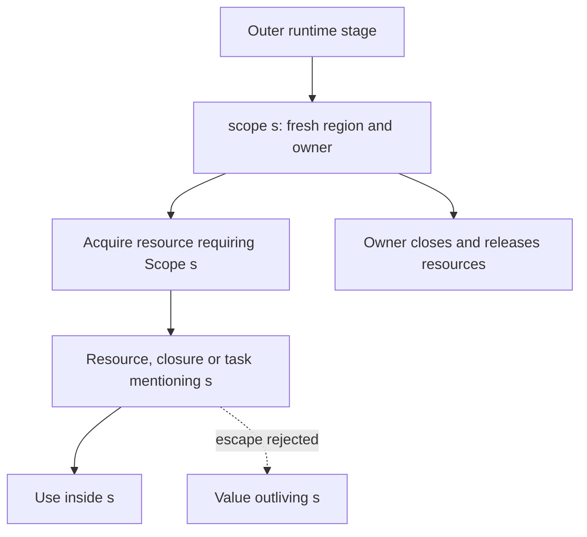

# Effects and regions

Active contributors: bondiano, Vassiliy Kuzenkov. Non-bot authors on `origin/main` for effect/region checking, services, handlers, and layer APIs.

Flick signatures distinguish pure calculation from execution, expose recoverable failures, and track how long resources and captured capabilities remain usable. These contracts connect every [application surface](application-features.md).

## Reading a signature

| Form | Meaning |
| - | - |
| `a -> b` | A pure function stage; it cannot make a runtime call |
| `a ->{} b` | A runtime stage with empty service/error bounds, not a pure arrow |
| `a ->{r; e} b` | A runtime stage requiring at most services `r` and errors `e` |
| `Eff r e a` | Deferred work returning `a`, requiring `r`, and failing with `e` |
| `Layer inputs errors outputs` | A description of how to build services |
| `T^{s}` | A value whose hidden captures may include region `s` |

An arrow is a stage, not merely a marker on the whole curried function. Applying an earlier pure arrow need not execute the later runtime stage. `task { body }` checks `body` against the task's own rows rather than executing it where the task is constructed. Top-level module initialization is pure, so an effectful call there is rejected; constructing a deferred task is different.

`flick-core/src/types/effects.rs` records each runtime call's requirements. `flick-core/src/types/effects/solve.rs` solves `actual ⊆ declared`: inferred rows grow to the least solution, and written bounds report missing services or errors. A pure function can be lifted where a runtime one is expected, but a runtime function cannot satisfy a pure arrow.

Service and error rows are sets of identified types, not ordered lists. Row variables and unions allow reusable higher-order functions. Record rows use related machinery but closed records do **not** have width subtyping: an extra field does not silently disappear (`flick-core/src/types/rows.rs`).

## Services, implementations, and layers

A `service` names operations and their complete signatures. Calling `S.op` adds `S` at each runtime arrow of that operation. The service is identified by module and name, not by the shape of an object. Unlike a class method, its operation does not invoke instance search.

The checker supplies `S.Impl`, the record of operation implementations, and `S` as a service tag. A program can supply the record directly with `provide S impl { body }`, or build it as `Layer.succeed S impl` and compose layers.

`provide layer { body }` removes the layer's outputs from the body's requirements and adds its construction inputs and errors. `Layer.merge` combines non-overlapping services; `Layer.override` explicitly permits replacement. `Layer.provide_` supplies one layer's dependencies, while `Layer.provide_merge` retains those dependencies in the output. Acquisition performed while building a layer belongs to the provide's owner.

The composition root in `examples/first-slice/src/App/Main.fl` provides `users_live` and `log_live` only at `main`; domain operations in `examples/first-slice/src/App/Users.fl` retain their abstract requirements. Tests can supply different implementations without changing the domain code.

## Errors and algebraic handlers

`type error` introduces a typed failure. `try body with ...` subtracts an error only when an unguarded pattern covers every value of it. A guarded or partial arm does not justify deleting the error from the row. Effects performed by a recovery arm become requirements of the enclosing stage.

The same construct handles declared operations:

| Operation class | What its handler arm returns |
| - | - |
| `tail` (the default) | The result of the operation; execution continues after the call |
| `abort` | The result of the whole handler; the abandoned body does not continue |
| `control` | The handler's result, with the remaining computation available as `resume` |

An effect leaves the body's row only when unguarded exhaustive arms cover all its operations. Otherwise unhandled calls continue outward. A `return` arm handles normal completion. `resume` carries the handler's region, so it cannot escape its arm; the continuation's execution contract also belongs to the runtime, not only this static lifetime check.

`tests/check/pass/effects/handler_arms.fl` contains accepted examples of all three classes, partial handlers, records supplied to services, and operations mixed with typed-error recovery. `tests/check/fail/effects/handler_arms.fl` pins rejected cases.

## Regions and structured lifetime

`scope s { body }` introduces a rigid, fresh region and supplies `Scope s` to acquisitions. The optional name `s` is both the type-level region and its value-level owner. Returning a value whose type mentions that fresh region is rejected when the scope ends.

Resources can also be hidden in closures, partial applications, containers, and tasks. Capture qualifiers preserve these dependencies even when the ordinary result type does not display a handle. The region checker solves capture bounds alongside effect rows; `Outlives captures owner` constrains retained work. A concrete region cannot be erased merely by hiding it under an abstract bound.

`Scope.add_finalizer` retains work under the owner. `spawn`, `parallel`, and retained finalizers require `Detached r`: a row with a `control` operation cannot simply travel into work running apart from the installing handler. Handle that control effect inside the child/task instead. `Detached` is distinct from the absence of `Async`; tail effects can still declare suspension.

These are language-level lifetime contracts, not a claim that arbitrary foreign code obeys them. FFI retention declarations and runtime cleanup implementations must match them; see [runtimes](../packages/runtimes/index.md).

## Modification entry points and validation

| Change | Start here | Independent evidence to retain |
| - | - | - |
| Runtime-arrow bounds or row inference | `flick-core/src/types/effects.rs`, `flick-core/src/types/effects/solve.rs` | Accepted/rejected `tests/check/pass/effects/` and `tests/check/fail/effects/` |
| Service operations or provider typing | `flick-core/src/types/services.rs`, `flick-core/src/types/handlers.rs` | Service implementation records and layer input/output/error rows |
| Operation handlers | `flick-core/src/types/handle.rs` | Coverage, forwarding, continuation lifetime, emitted execution behavior |
| Scope/capture ownership | `flick-core/src/types/regions/` | `tests/check/fail/regions/escape.fl`, `tests/check/fail/regions/provide_escape.fl`, accepted capture fixtures |
| Public service construction API | `packages/std/src/Layer.fl`, `packages/std/src/Scope.fl` | Source-level checking plus runtime cleanup behavior |

For semantic changes select the types/effects/regions and runtime rows of `docs/agents/validation.md`: checker regressions, `just model`, `just language`, and the applicable runtime/e2e gates. Update Lean when the modeled contract changes; `formal/README.md` states the narrower model assumptions. This wiki-only work changes none of those contracts and did not run these suites.

## Key source files

| Path | Purpose |
| - | - |
| `flick-core/src/types/handlers.rs` | Tasks, error recovery, and service provision |
| `flick-core/src/types/handle.rs` | Operation coverage and handler-region checks |
| `flick-core/src/types/regions/scopes.rs` | Fresh scopes, owner inference, and escape rejection |
| `flick-core/src/types/regions/solve.rs` | Hidden capture and outlives constraints |
| `flick-core/src/types/classes/detached.rs` | Restriction on control effects in separate work |
| `packages/std/src/Scope.fl` | Scope ownership and finalizer API |
| `examples/mtl/src/App/Main.fl` | Application of higher-kinded capability abstractions |

For class constraints rather than runtime requirements, continue to [modules and classes](modules-and-classes.md).
