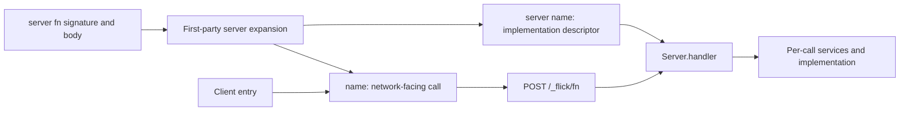

# HTTP, RPC, and server functions

Active contributors: bondiano, Vassiliy Kuzenkov. Non-bot authors on `origin/main` for network application APIs and examples.

Flick provides three levels of network programming: raw HTTP handlers, shared typed endpoint/procedure descriptions, and named `server fn` calls. They share [codecs](data-and-schema.md) and [effect/region contracts](effects-and-regions.md), but have different wire and trust boundaries.

## Raw HTTP client and server

`Http.Client.HttpClient` is a service; `Http.FetchClient.layer` supplies a fetch-backed implementation. Request/response modules describe methods, headers, bodies, and decoding. Client combinators transform requests/responses, filter statuses, retry selected failures, and instrument calls.

On the server, a handler is a function from `Http.ServerRequest.ServerRequest` to `Http.ServerResponse.ServerResponse`, with explicit service/error rows. `Http.Router` combines method/path routes; path parameters are supplied through its `RouteContext` service. `Http.Middleware` composes ordinary handler-to-handler functions for logging, tracing, CORS, compression/decompression, query parsing, and trusted-proxy header handling.

`Http.Server.serve` starts a scoped server. Its API documents stopping acceptance, waiting for requests/finalizers up to a graceful timeout, and then interrupting remaining work. The running `Server s` belongs to region `s`; constructing routes or responses does not itself open a listener.

Middleware configuration remains an application responsibility. For example, `x_forwarded_headers` takes explicit proxy CIDRs; the existence of a middleware function does not mean forwarded headers are trusted by default.

## Typed HTTP APIs

`HttpApi.Endpoint label handler` retains the handler type, including decoded path/query/header/payload parts, success, requirements, and declared errors. Endpoints form groups, groups form an API, and the resulting closed record determines the handlers needed when serving it. Missing/extra handlers are type errors, not runtime registration guesses.

The same endpoint description supports `HttpApi.call` and strict OpenAPI 3.1 export. Declared errors have both status and codec. A handler cannot silently widen its recoverable errors beyond those described by the endpoint. OpenAPI export can fail when a wire contract has no exact exportable representation.

Two authoring styles use the same API:

- Call `HttpApi.endpoint`, `with_path`, `with_payload`, `with_success`, and related combinators.
- Declare a local parameter-free record of endpoint types and `deriving HttpApi`. `plugins/derive/src/http_api.rs` emits `T$endpoints`/`T$api`, surfaced as `T.endpoints`/`T.api`.

`HttpApi.Derive` describes methods, `Created` success, typed error `Problem` instances, and `Authed`/`MaybeAuthed` endpoints. A guarded group must keep its endpoints consistently guarded or optionally guarded; unrelated public endpoints belong in a different group.

The derive still relies on compiler rules:

- `flick-core/src/types/wire.rs` chooses an exact `PureCodec Json T`: a compatible value named after `T` in snake case, the type's JSON companion, a Prelude type codec, or the JSON codec of its schema.
- `flick-core/src/types/route_template.rs` and record constraints connect route-template parameters to the path record. A path may use a route constructor with type placeholders rather than an unchecked handwritten string.

`examples/conduit/contract/src/Conduit/Api.fl` is the large end-to-end example; its codecs and route types are shared with client and server.

## RPC

`Rpc.Rpc label handler` describes a procedure. Payload, success/stream elements, and declared errors have codecs; a `Rpc.Group` determines the exact handler record. Middleware runs on decoded payload/headers. Authentication constructs a per-call service, and `authenticated` removes that service from the group's outer requirements.

The public module exposes HTTP, WebSocket, and Node-only TCP transports. Serializations include NDJSON (the default), JSON, JSON-RPC variants, and binary framing. Streaming timing depends on the serialization: a single JSON document does not deliver elements with NDJSON's incremental behavior. `Rpc` is explicitly unstable in its module documentation.

This is a library surface, not a special compiler RPC syntax. Do not infer every transport's availability on every runner or backend from the existence of its type declaration; see [runtimes](../packages/runtimes/index.md).

## Server functions

`server fn name args = body` requires a signature directly above it. The first-party derive plugin emits:

| Companion | Role |
| - | - |
| `name$impl` | The implementation under the original signature |
| `name$procedure` | Name and schema-backed description of what crosses the network |
| `name` | The call available to application code |
| `name$server` | The implementation exposed by `server name` |

Several parameters travel as one tuple. The server entry explicitly serves implementations with `Server.handler`; calls use POST/NDJSON at `Server.path`, currently `"/_flick/fn"`. Declaring the function is not automatic deployment or authorization.

Listing `Server.Unauthorized` among the function's errors produces a `Server.Guarded` descriptor. It must pass through `Server.authenticated`, which checks headers and supplies a per-call service before exposing ordinary `Server.Function` descriptors. Authentication logic is supplied by the application; the error name itself is not a credential check.

### Client/server reachability is bounded

`Server.Server` marks server-only work. Client entries (`target = "client"`) reject detected reachability to it with `FLICK-E009`, and interfaces retain reachability paths across imports.

The implementation in `flick-core/src/types/server.rs` follows value-name references and requirements visible in types/interfaces. Its source explicitly notes that a path reached **only through higher-order arguments or class dictionaries** is not followed by that name walk. Treat this as a compiler boundary with documented limitations, not a complete information-flow or secret-exfiltration proof.

## Modification entry points and validation

| Change | Start here |
| - | - |
| HTTP handler/client signatures | `packages/std/src/Http/Client.fl`, `packages/std/src/Http/Router.fl`, `packages/std/src/Http/Server.fl` |
| Endpoint derivation and codec selection | `plugins/derive/src/http_api.rs`, `plugins/derive/src/endpoint.rs`, `flick-core/src/types/wire.rs` |
| RPC grouping, transport, authentication | `packages/std/src/Rpc.fl` and its selected runtime binding |
| Server syntax/companions | `plugins/derive/src/server_fn.rs`, `packages/std/src/Server/Derive.fl` |
| Client/server rejection | `flick-core/src/types/server.rs` and project entry validation |

Use `plugins/derive/tests/server_fn.rs`, `tests/check/pass/server/server_fn.fl`, `tests/check/fail/server/`, `tests/check/fail/http/handlers.fl`, and `tests/run/stdlib/server/server_fn.fl` as entry points. Runtime/network changes need emitted-program tests; Conduit contract/auth/routing changes need `just conduit-api` and relevant browser e2e checks. Those checks were not run for this documentation-only change.

## Key source files

| Path | Purpose |
| - | - |
| `packages/std/src/HttpApi.fl` | Typed endpoints, groups, API serving/calling, OpenAPI |
| `packages/std/src/HttpApi/Derive.fl` | Type-level endpoint vocabulary and authentication contracts |
| `packages/std/src/Rpc.fl` | Procedure descriptions, streaming, transports, grouping |
| `packages/std/src/Server.fl` | Guarded functions, authentication, and mounted server handler |
| `plugins/derive/src/server_fn.rs` | Generated server function declarations |
| `flick-core/src/types/server.rs` | Static server reachability and explicit limits |
| `examples/conduit/server/src/Conduit/Server/Routes.fl` | Complete application route assembly |

For the shared extension protocol behind derives, see [plugins](../packages/plugins.md).
