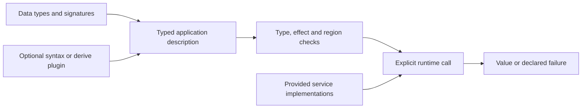

# Language and application features

Active contributors: bondiano, Vassiliy Kuzenkov. These are non-bot author names from `git log origin/main` for the checker, first-party plugins, and application examples.

Flick combines explicit types, effect requirements, scoped resources, and typed application descriptions. This section follows what a program can express and where each contract is implemented; the [compiler pages](../systems/compiler/index.md) own the compilation machinery.

## Feature map

| Capability | Read next | Main source boundary |
| - | - | - |
| Pure and runtime functions, typed errors, services, handlers, resource lifetimes | [Effects and regions](effects-and-regions.md) | `flick-core/src/types/effects.rs`, `flick-core/src/types/regions/` |
| File and inline modules, contracts, parameterized modules, classes, dictionaries, conversions | [Modules and classes](modules-and-classes.md) | `flick-core/src/types/module_contract.rs`, `flick-core/src/types/classes/` |
| Choosing an application surface and a complete example | [Application features](application-features.md) | `examples/`, `packages/std/src/` |
| Schemas, wire codecs, refinements, SQL templates and migrations | [Data and schema](data-and-schema.md) | `plugins/derive/src/`, `plugins/sql/src/` |
| HTTP clients and servers, typed APIs, RPC, server functions | [Network services](http-rpc-and-server-functions.md) | `packages/std/src/Http/`, `packages/std/src/HttpApi.fl`, `packages/std/src/Rpc.fl` |
| Reactive views, component setup, event policies, server rendering | [User interfaces](user-interfaces.md) | `packages/std/src/Ui.fl`, `packages/std/src/Atom.fl`, `plugins/ui/src/` |
| Command descriptions, option records, prompts, application configuration | [Command-line applications](command-line-applications.md) | `packages/std/src/Cli.fl`, `plugins/cli/src/` |
| Logs, metrics, tracing, exporters | [Observability](observability.md) | `packages/std/src/Tracer.fl`, `packages/std/src/Metric.fl`, `packages/std/src/Otlp.fl` |
| Authoring extensions and understanding post-check facts | [Plugin SDK and host](../packages/plugins.md) | `flick-plugin/`, `flick-core/src/plugin/` |

## The common design

Most application APIs first build a pure description. A `Sql.Template` does not contact PostgreSQL; a `Cli.Command` does not run its handler; a `Ui` does not dispatch an event; an HTTP endpoint description does not listen on a socket. Execution happens through a runtime arrow at an explicit call, with its service and error rows.

Plugins do not replace the ordinary checker for their generated Flick code. Their extra checks consume bounded facts, not unrestricted access to the checker. IR and emit hooks are a different, more trusted extension boundary; see the [plugin contract](../packages/plugins.md#build-hooks-are-a-different-trust-boundary).

## Scope and evidence

These pages describe the current working tree, including uncommitted plugin/fact changes, not a clean release. Names such as `@flick-lang/effect-ts` in standard-library foreign declarations are binding identities, not proof that an application selected the Effect adapter. Backend availability and binding remapping belong to [runtimes](../packages/runtimes/index.md).

A file-name census at generation time found 124 Rust files under `flick-core/src/types/`, of which 14 have a `tests` path component or a `tests.rs`/`_tests.rs` name. This is a layout count, not a test-coverage ratio: many ordinary source files contain inline tests, and fixture/execution suites live elsewhere. The history query above has two distinct non-bot author names; it does not merge aliases into people.

## Changing a capability

Begin at the owning feature page's modification entry points. A syntax change can also affect formatting, diagnostics, editor grammars, and English/Russian site documentation. A semantic change must account for the reference model and Lean contracts; neither backend agreement nor a model theorem establishes Rust compiler correctness. Follow [patterns and conventions](../how-to-contribute/patterns-and-conventions.md) and `docs/agents/validation.md`.

## Key source files

| Path | Purpose |
| - | - |
| `packages/core/src/Prelude.fl` | Builtin types, kinds, runtime descriptions, and compiler-recognized identities |
| `flick-core/src/types/mod.rs` | Checker entry points and feature integration |
| `flick-core/src/plugin/first_party.rs` | Standard plugin heads, derives, watched calls, and diagnostic ownership |
| `packages/std/src/Layer.fl` | Constructing and supplying service implementations |
| `examples/first-slice/src/App/Main.fl` | Small example of layering, typed errors, and concurrent work |
| `formal/README.md` | Exact formal results and their implementation limits |
