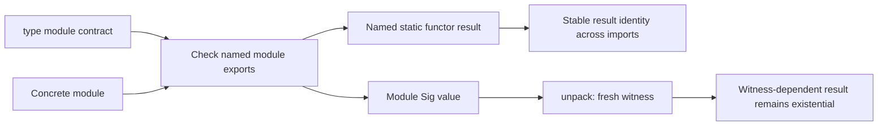

# Modules, classes, and conversions

Active contributors: bondiano, Vassiliy Kuzenkov. Non-bot authors on `origin/main` for module contracts, classes, and type conversion/checking.

Flick separates file visibility, nominal identities, structural contracts, and class evidence. These tools let applications share a vocabulary without making every implementation globally interchangeable.

## Files, exports, and inline modules

One `.fl` file is a module. Its path under the source/test root determines its expected dot-separated name, and `exposing` defines its exported interface. Without `exposing`, a module exports nothing. Exporting a type does not automatically export constructors; opaque representations remain private. Re-exporting an imported entity preserves its original identity.

`private module` restricts file-module imports to its package, while a public facade may re-export selected names. Project loading enforces the package boundary; see [project and CLI](../systems/project-and-cli/index.md) for discovery, dependency, and cache mechanics.

An inline `module Child exposing (...) = ...` creates a child namespace in the same file. It sees the parent's **earlier** declarations, including private ones; the parent sees only the child's exposed members. Imports inside it remain local. It is not a separately importable file path and is emitted within the parent's runtime module.

Two restrictions matter when reorganizing code:

- Importing an inline child from another file is `FLICK-R018`, not a way to bypass visibility.
- A named static functor application inside an inline child is currently rejected with `FLICK-R019`; place the application in a file module.

These are implemented in `flick-core/src/project/load/checking_inline.rs` and the surrounding project loader, not solely by syntax.

## Structural module contracts and static functors

`type module Sig = ...` describes required exports. An abstract `type Key` hides the representation; `type Key = String` requires an equality. A concrete argument can export more than the contract requires.

A file-module functor header such as `module App.Make(K : App.Contracts.Policy) ...` uses only the contract's members and equalities. `module Chosen = App.Make(App.Argument)` applies it to a **named module known at compile time**.

Each named application creates a distinct result identity, including its abstract result types. Reimporting that same result preserves identity. Therefore two applications with the same underlying representation are not automatically interchangeable. Convert through exported operations when changing policies intentionally.

Contracts can require classes/services either abstractly by shape or by manifest identity, such as `class Eq = Prelude.Eq`. A class or service is nominal: matching method/operation signatures does not equate two declarations. Abstract nominal requirements work for static functors, but `pack` requires the manifest form.

## Packed modules and existential witnesses

`pack Argument as Sig` creates a value of `Module Sig`. `unpack packed as K in ...` opens a fresh lexical witness for abstract types. It is not a static functor argument.

If a value depending on that witness leaves the unpack, its type is existential, for example `exists K : Sig. K.Key`. `unpack value as K, item in ...` opens both the hidden module and its carried value. Separate openings have separate abstract witnesses; an exported existential binding requires an explicit type. The TypeScript facade represents an exported existential value as `unknown`, not a fabricated structural type.

Contract diagnostics distinguish missing members (`T060`), value/equality mismatches (`T061`), nominal identity mismatches (`T062`), abstract nominal packing (`T063`), escaping/unannotated witnesses (`T064`), invalid dictionary requirements (`T065`), and ambiguous supplied dictionaries (`T066`). They are reported with the `FLICK-` prefix.

## Classes and dictionary evidence

Classes describe overloaded operations and constraints; instances provide dictionaries. Superclasses, method defaults, higher-kinded parameters, and functional dependencies support reusable abstractions. Functional dependencies improve what can be inferred, but are also coherence obligations, not arbitrary conversion hints.

The checker enforces no-overlap/no-orphan rules, coverage/context restrictions, and a budgeted instance search. It owns primitive record constraints such as `Record.HasField`, `Record.Lacks`, and disjoint row union; programs cannot replace those with arbitrary instances. Structural `Eq`, `Ord`, `Hash`, and `Show` evidence for records/tuples also has compiler-owned behavior.

A class dictionary can be supplied explicitly, including named superclass fields. A module contract may declare a value `equality : Eq.Dict Key` and `instance Eq Key from equality`. This installs **local evidence**, not a global instance. Given evidence takes precedence; otherwise local module evidence takes precedence over global lookup.

Deriving has two owners: compiler-owned structural/class derivation in `flick-core/src/types/classes/derive.rs`, and SDK plugin derivation for `Schema`, `Url`, `Form`, `HttpApi`, and `Cli.Value`. See [plugins](../packages/plugins.md) before extending either path.

## Data shapes and conversions

Records are structural, with row-polymorphic field operations but no width subtyping for closed records. Ordinary variants, opaque/unboxed types, and GADT constructors preserve different representation and abstraction contracts. Literal enums are `untagged type` declarations whose distinct constructors are all strings or all `Int` literals; the runtime representation is the literal. This does not make an enum identical to its base type.

`into` uses an explicit `Into a b` constraint. The target comes from context, rather than a functional dependency selecting a universal target. `tests/check/pass/classes/into.fl` demonstrates numeric widening and user-defined nominal conversions.

`@implicit` is narrower than general instance search:

- Its instance has no quantified variables or context and relates two different ground types.
- Its two-parameter class has exactly one pure method of shape `a -> b`.
- A mismatch must have settled nominal source and target types, and exactly one matching implicit candidate.
- It inserts one conversion at a value boundary; it does not search chains, traverse record fields, or erase capture constraints.

Invalid declarations report `FLICK-C014`. `flick-core/src/types/report/coercions.rs` performs insertion. Do not confuse this with `flick-core/src/types/convert.rs`, which converts **type syntax** into checked types and kinds.

## Modification entry points and validation

| Change | Start here |
| - | - |
| Module syntax, headers, inline declarations | `flick-core/src/syntax/parser/decl_modules.rs`, `flick-core/src/resolve/syntax.rs` |
| Contract requirements and member equality | `flick-core/src/types/decls_contracts.rs`, `flick-core/src/types/module_contract.rs` |
| Packed witness opening/closing | `flick-core/src/types/module_contract/checker.rs` |
| Named application/inline integration | `flick-core/src/project/load/checking_core.rs`, `flick-core/src/project/load/checking_inline.rs` |
| Class admissibility, coherence, lookup | `flick-core/src/types/classes/declare.rs`, `flick-core/src/types/classes/coherence.rs`, `flick-core/src/types/classes/solve.rs` |
| Value coercions | `flick-core/src/types/report/coercions.rs` |

Use `flick-core/src/project/load/checking_tests_contracts.rs` for cross-file contract regressions and `tests/check/pass/classes/`/`tests/check/fail/classes/` for class/conversion contracts. Check emitted behavior, not only acceptance. The semantic validation gates include the reference model and applicable Lean changes: `formal/Formal/Modules.lean` models a limited module boundary, not source-level module soundness or Rust lowering correctness.

## Key source files

| Path | Purpose |
| - | - |
| `docs/src/content/docs/reference/modules.md` | User-facing module syntax, identity, and diagnostic rules |
| `flick-core/src/types/module_contract.rs` | Structural matching and nominal checks |
| `flick-core/src/types/classes/mod.rs` | Class evidence and compiler-owned constraint families |
| `flick-core/src/types/report/coercions.rs` | Unique one-step ground coercions |
| `flick-core/src/types/rows.rs` | Structural row equality and closed-record rules |
| `flick-core/src/types/enums.rs` | Literal enum validation |
| `tests/check/pass/classes/implicit.fl` | Accepted implicit-conversion boundaries |
| `formal/README.md` | Module/class proof scope and limitations |

Runtime services are separate from class dictionaries; continue with [effects and regions](effects-and-regions.md).
