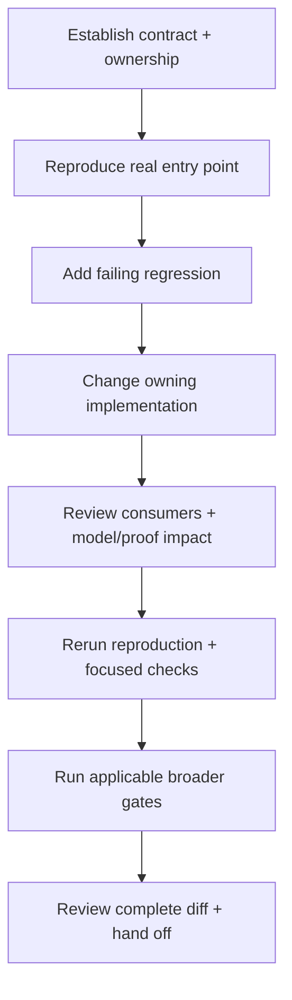

# Development workflow

Active contributors: bondiano, Vassiliy Kuzenkov — nonbot author names recorded on `origin/main` for contributor guidance and `justfile`.

A change is complete when the reported entry point behaves as intended, its regression asserts the right contract, and all affected layers have been considered. The authoritative workflow is `docs/agents/compiler-workflow.md`, with checks selected from `docs/agents/validation.md`.

## 1. Establish scope before editing

Read `AGENTS.md`, any more local instructions, and `CONTRIBUTING.md`. Inspect branch/status and the relevant diff; uncommitted source and other worktrees are not disposable setup.

Write down:

1. The input and entry point: single-file checking, a project build, LSP edit/query, browser compilation, or execution.
2. The actual result and the independently justified expected result.
3. The layer that owns the rule and the consumers that can observe it.
4. Owned files, interface changes, and any other agents' responsibilities.

The source organization is explained in [architecture](../overview/architecture.md). Start from the real caller rather than assuming a parser/checker unit reproduces a project or editor issue.



## 2. Pin the bug before repairing it

Use the nearest existing harness. A checker rejection belongs in an annotated `tests/check/fail/` fixture when its code and span matter; execution belongs in `tests/run/` or the shared-language project under `tests/language/`. Project/cache, LSP, and CLI lifecycle failures need their corresponding integration callers.

Confirm that the new test fails for the intended reason. Include a nearby accepted case and useful boundary/rejected cases so the change cannot pass merely by rejecting everything or suppressing diagnostics.

`flick-core/tests/corpus.rs` already requires named codes for `flick fail CODE` blocks and rejects unrelated error codes. That guards documentation examples, but it does **not** pin spans or exact diagnostic multiplicity. Use [checker fixtures](testing.md#checker-fixtures-and-diagnostic-contracts) for those guarantees.

## 3. Implement at the owning boundary

| Change | Contracts to carry along |
| - | - |
| Syntax | Parsing/recovery, lossless tree, formatting, safe fixes, source corpus, TextMate/tree-sitter grammars, diagnostics, both site locales |
| Types/effects/regions/classes | Accepted and rejected cases, code/span/fix stability, dictionaries/lowering, model and formal statements where their contract changes |
| IR/optimization/code generation | Evaluation order, stages, debug/release equivalence, JS/TS declarations, portable Go execution |
| Project/packages/caches | Existing projects, locked/offline behavior, positive reuse **and** invalidation, output ownership |
| Runtime/resource behavior | Success, typed failure, defect, interruption, overlapping work, finalizer order, exactly-once cleanup |
| Plugins/FFI | Host grants, offline snapshots, SDK/WASM boundaries, origin mapping, policy and provenance; do not mistake structural checks for semantic proofs |
| IDE/browser | Open/edit/query/close, stale results, UTF-16 positions, startup/cancellation, explicit execution and sandbox boundaries |

Use `Host`-backed project facilities rather than introducing native filesystem assumptions into shared compiler code. Keep Cargo capabilities independently usable: a workspace build unifies features and does not establish that minimal consumers work. See [patterns](patterns-and-conventions.md), [project loading](../systems/project-and-cli/project-loading-and-packages.md), and [compiler internals](../systems/compiler/index.md).

## 4. Select checks by behavior

Run the smallest regression while developing, then every applicable row of `docs/agents/validation.md`. For executable-code changes, the repository workflow asks for `just check` plus the relevant integration gates before handoff.

```sh
# From the checkout root; direct Cargo calls use this checkout's std.
export FLICK_STD_PATH="$PWD/packages/std"
cargo test -p flick-core --test check
just check
```

This is an illustrative checker loop, not sufficient validation for every change. `just check` is `lint` plus `test`; it omits the separately selected model, Lean, end-to-end, browser, and service-dependent gates.

- Broad compiler/runtime transitions need `just e2e` and `just model`, plus Lean when its contract is affected.
- Runtime changes additionally use the relevant package checks, `just go-test`, `just conformance`, `just conformance-rt`, and `just language` as applicable.
- Cargo-capability changes need `just feature-check`, `just feature-test`, and `just wasm`.
- SQL that reaches PostgreSQL needs `just e2e-postgres`; affected Conduit behavior needs `just conduit-api` and `just conduit-e2e`.
- Performance/size changes require comparable before/after measurements and the relevant budget/ratchet checks. Never equate a threshold with a measurement.

Exact suite behavior and prerequisites are in [testing](testing.md); measurement tools are in [tooling](tooling.md).

### Formal gate

Read `formal/README.md` and the affected files under `docs/formal/`. A contract change requires coordinated reference-model/translation/examples and Lean changes, then:

```sh
just model
cd formal && lake build --wfail
```

When Prelude schemes change, run `just formal-schemes`, inspect the generated diff, and rerun both gates. Do not add `sorry`, extra axioms, or narrower premises to conceal a broken guarantee. A model proof does not prove the Rust compiler or runtimes correct; see [formal scope](../systems/formal-model.md).

### Documentation scope

Public site content is executable documentation: check its corpus, paired locales/source hashes, site tests, production build, and links as directed by `docs/agents/validation.md`. Interactive event policy stays in Flick; TypeScript supplies browser/compiler interoperability.

Wiki-only Markdown changes do not alter the compiler/site/formal contract. For these pages, source/path/link review and whitespace validation are appropriate; compiler/runtime suites were intentionally not run.

## 5. Review and hand off

Review the whole intended diff, generated files, and snapshots; do not bulk-accept observed output. `cargo insta review` is a review aid, not authority to change expected behavior. Run `git diff --check`, preserve unrelated changes, and use Conventional Commits if a commit is explicitly requested.

A useful handoff contains:

```text
Task and owned files:
Input, expected behavior, and changes:
Affected guarantees and model/proof impact:
Exact checks and outcomes:
Unrun checks, blockers, and required follow-up:
Remaining risks:
```

A missing tool, unavailable service, or unrun suite is incomplete validation, not a pass. This workflow page describes the dirty `main` snapshot at `6e9096fb`; re-check moving source before changing it.

## Key source files

| Source | Responsibility |
| - | - |
| `AGENTS.md` | Ownership, regression, diagnostic, semantic, and commit rules |
| `docs/agents/compiler-workflow.md` | Full implementation/handoff loop |
| `docs/agents/validation.md` | Required behavior-based checks |
| `justfile` | Recipe composition and local std selection |
| `flick-core/Cargo.toml`, `flick-wasm/Cargo.toml` | Compiler capability boundaries |
| `formal/README.md`, `formal/lean-toolchain` | Proof scope and pinned Lean environment |

Return to [contributor guides](index.md) or use the [debugging runbook](debugging.md) when the failing layer is unclear.
