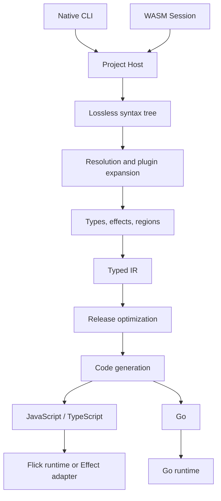

# Architecture

Flick shares a Rust compiler between the native CLI and a WebAssembly browser interface. Checked modules become explicit typed IR, then JavaScript, TypeScript, or Go output backed by runtime libraries.

## Compiler boundaries

`Host` in `flick-core/src/project/mod.rs` abstracts file access and plugin access. Project checking loads module interfaces, while the single-file `check` function in `flick-core/src/lib.rs` takes imported names on trust. These are different validation entry points.

`flick-core/src/syntax/mod.rs` exposes the lossless parser. `flick-core/src/types/mod.rs` checks signatures, kinds, rows, instances, effects, and regions. `flick-core/src/ir/mod.rs` lowers syntax plus checker metadata into the types exported by `flick-ir/src/lib.rs`. IR makes application stages, dictionary arguments, foreign adapters, and source spans explicit.

`flick-core/src/build/mod.rs` assembles generated artifacts, runners, interfaces, and optional declarations. `flick-core/src/codegen/mod.rs` selects runtime behavior through its options; its header comment describes the Effect backend, but it also supports Flick's own runtime.

## Runtime boundaries

The JavaScript runtime is under `runtime/src/`. `packages/effect-ts/src/` is a separate Effect adapter with bridge support. Go output uses `runtime-go/`. Do not infer current backend defaults from older documentation: inspect `flick-core/src/project/config.rs` and the [runtime pages](../packages/runtimes/index.md).

## Browser and editor boundaries

`Session` in `flick-wasm/src/lib.rs` retains analysis for an edited module. Compiler byte offsets cross the browser API as UTF-16 positions. The native LSP is under `flick/src/lsp/`; both consume shared queries in `flick-core/src/ide/`.

`docs/src/playground/` supplies the browser UI and worker interop. See [browser tools](../systems/browser-tools.md) for execution isolation. The [measured snapshot](../by-the-numbers.md) contains 160,197 physical Rust lines, 82,523 Go, 80,083 Flick, 43,992 TypeScript, and 30,659 Lean lines. Rust implements the compiler, Flick implements library and interactive UI code, TypeScript implements runtime/browser interop, Go implements a runtime, and Lean states formal results. These counts include comments, blanks, and test files, with the exclusions documented on the statistics page.
