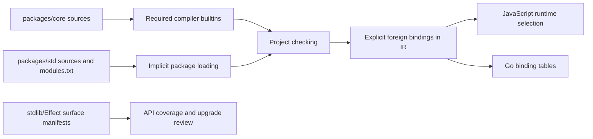

# Core and standard libraries

Active contributors: bondiano, Vassiliy Kuzenkov — author names recorded on `origin/main`, excluding bots.

The library surface is written largely in Flick. `packages/core/` defines compiler-required language items and basic APIs; `packages/std/` is the implicit application library; `stdlib/Effect/` records upstream API classifications rather than containing an alternative standard-library implementation.

## Loading and runtime boundaries

`flick-core/src/types/builtin_sources.rs` fixes the core's dependency order. `@lang` declarations in `packages/core/src/Prelude.fl` identify compiler-recognized types such as `Eff`, `Layer`, `Schema`, `ServiceTag`, `Ui`, lists and references. These are not ordinary replaceable module names.

`flick-core/src/implicit_packages.rs` currently lists `std`. `packages/std/src/modules.txt` is its dependency-ordered module inventory. `flick-core/src/types/builtins.rs` accepts host-installed implicit packages, then native `FLICK_STD_PATH`, then embedded sources when enabled. `flick-core/build.rs` embeds package sources and Go tables for the browser path; disabling `builtin-docs` strips documentation comments, not arbitrary source text.

Many declarations still name `@flick-lang/effect-ts` foreign exports. That spelling alone does not determine the native program's selected runtime: code generation/build selection maps supported bindings to Flick's own runtime or the optional adapter. Go uses `packages/std/src/go/*.txt` to map foreign module/export pairs to runtime symbols. See [runtimes](runtimes/index.md) for implementation and bridge capability limits.

## Core families

| Sources | Responsibility |
| - | - |
| `packages/core/src/Prelude.fl`, `packages/core/src/Instances.fl` | Primitive/compiler-known types, classes, constructors and builtin instances. |
| `packages/core/src/Record.fl`, `packages/core/src/Enum.fl`, `packages/core/src/TypeEq.fl` | Typed structural operations, enum support and equality evidence. |
| `packages/core/src/Int.fl`, `packages/core/src/Float.fl`, `packages/core/src/Numeric.fl`, `packages/core/src/String.fl` | Scalar operations and conversions. |
| `packages/core/src/Option.fl`, `packages/core/src/Result.fl`, `packages/core/src/Fail.fl`, `packages/core/src/Validation.fl` | Optional/results, typed failure and accumulating validation. |
| `packages/core/src/List.fl`, `packages/core/src/List/`, `packages/core/src/NonEmpty.fl` | Dense immutable-array lists and core/slice/search/transform implementations; prepending, tail and concatenation copy. |
| `packages/core/src/Seq.fl`, `packages/core/src/Monoids.fl` | Restartable lazy sequences and algebraic combinations; infinite sequences require a terminating consumer. |
| `packages/core/src/Ref.fl`, `packages/core/src/CallSite.fl`, `packages/core/src/Flick/Debug.fl` | Runtime mutable cells, source-location evidence and debugging hooks. |

`Ref.make` is effectful, preventing fresh cells from being generalized; its capture bound applies to both the current value and later writes. `Seq` and list operations expose explicit capture/retention contracts where callbacks or values can be retained.

## Standard-library map

This is a family map, not a claim to explain every export. The complete current list and ordering live in `packages/std/src/modules.txt`; inspect each module's signature and documentation before changing a contract.

| Family | Entry points and supporting directories |
| - | - |
| Process/application and resources | `packages/std/src/Platform.fl`, `packages/std/src/App.fl`, `packages/std/src/File.fl`, `packages/std/src/Resource.fl`, `packages/std/src/Events.fl`, `packages/std/src/Runner/`. |
| Effects, services and ownership | `packages/std/src/Effect.fl` and `packages/std/src/Effect/`; `packages/std/src/Layer.fl`, `packages/std/src/Layer/Trace.fl`, `packages/std/src/Context.fl`, `packages/std/src/Scope.fl`, `packages/std/src/Fiber.fl`, `packages/std/src/LayerMap.fl`, `packages/std/src/LayerRef.fl`, `packages/std/src/Request.fl`, `packages/std/src/RequestResolver.fl`. |
| Failures, scheduling and supervision | `packages/std/src/RawCause.fl`, `packages/std/src/Failure.fl`, `packages/std/src/Exit.fl`, `packages/std/src/Cause.fl`, `packages/std/src/ErrorReporter.fl`, `packages/std/src/Schedule.fl`, `packages/std/src/Scheduler.fl`, `packages/std/src/ExecutionPlan.fl`, fiber handles/maps/sets and references. |
| Values and collections | Chunk façade plus `packages/std/src/Chunk/`; hash maps/sets/rings, trie, equality/hash/order/combiner/reducer/filter/optic/formatting APIs; bytes, decimal/bigint, regex, version, JSON pointer/patch and the `packages/std/src/Graph/` types/build/query/algorithm/walk split. |
| Concurrency and cached resources | Deferred, latch, semaphores, queues, PubSub, synchronized/subscription refs, cache/scoped cache/scoped ref, reference-counted resources/maps and pools under `packages/std/src/`. |
| Transactions | `packages/std/src/Tx.fl` and `Tx*` collection modules. Operations require `Tx.Transaction`; `atomically` supplies it and commits or retries the combined changes. |
| Schemas, codecs, data and tests | `packages/std/src/Generic.fl`, `packages/std/src/Schema.fl`, `packages/std/src/Codec.fl`, `packages/std/src/Codec/Derive.fl`, `packages/std/src/Open.fl`, `packages/std/src/Json.fl`, `packages/std/src/Js.fl`, `packages/std/src/Js/Array.fl`, `packages/std/src/Check.fl`, `packages/std/src/Checks.fl`, `packages/std/src/Gen.fl`, `packages/std/src/Arbitrary.fl`, `packages/std/src/JsonSchema.fl`, `packages/std/src/Test.fl`. |
| Time, randomness and security-related values | Duration/date-time/cron/clock/random plus `packages/std/src/Crypto.fl`, `packages/std/src/Jwt.fl`, `packages/std/src/Redacted.fl`. A library category is not a security guarantee. |
| Platform, configuration and observability | Path/filesystem/terminal/stdio/console/process, platform errors, config/providers, logs/logger/levels, metrics/tracer, OTLP, Prometheus and devtools. |
| Streams, sinks and channels | `packages/std/src/Stream.fl`, `packages/std/src/Stream/`, `packages/std/src/Sink.fl`, `packages/std/src/Channel.fl`, `packages/std/src/Channel/`, `packages/std/src/ChannelSchema.fl`. |
| Reactive UI, forms and routes | `packages/std/src/Reactivity/`, `packages/std/src/Atom.fl`, `packages/std/src/Ui.fl`, `packages/std/src/Ui/`, `packages/std/src/Form.fl`, `packages/std/src/Action.fl`, `packages/std/src/Route.fl`. UI values describe views; handler constructors choose event concurrency policies. |
| HTTP and application protocols | `packages/std/src/Http/` separates request/response values, client/fetch, routing/middleware/server/static/platform/multipart/codecs/tracing. `packages/std/src/HttpApi.fl` and `packages/std/src/HttpApi/`, `packages/std/src/Rpc.fl`, `packages/std/src/Server.fl`, `packages/std/src/Server/Derive.fl` build higher-level contracts. |
| Database and CLI | `packages/std/src/Sql.fl`, `packages/std/src/Sql/Derive.fl`, `packages/std/src/Database.fl`, `packages/std/src/Database/Migrate.fl`; `packages/std/src/Cli.fl`, `packages/std/src/Cli/Prompt.fl`. Syntax/derivation implementations also involve [plugins](plugins.md). |

Important examples of the abstraction boundary: `Layer inputs errors outputs` describes service construction and sharing; `Scope.run` introduces a fresh lexical owner; `Schema a` witnesses runtime values rather than proving an arbitrary foreign object immutable. `Ui` construction runs no event handler. These contracts connect to the [formal model](../systems/formal-model.md), but the proofs do not cover every library combinator.

## What remains under `stdlib/`

`stdlib/Effect/snapshot.json` records the pinned upstream public surface. `stdlib/Effect/surface/entrypoints.toml` classifies wrapped and wholly excluded entrypoints. Per-export TOML manifests are grouped under `core/`, `cli/`, `http/`, `http-api/`, `rpc/`, `process/`, `reactivity/`, `observability/` and `devtools/`.

For example, `stdlib/Effect/surface/core/Effect.toml` maps upstream names to Flick wrappers with declaration fingerprints. These manifests also classify language-provided, type-only or excluded APIs; they are not evidence that every upstream export is implemented on every backend. `tools/dts-importer/src/Surface.fl` extracts snapshots and `tools/dts-importer/src/Bump.fl` reports upgrade changes. `packages/std/explain/` contains package-owned diagnostic explanations, separate from the compiler's explanation registry.

## Changing these libraries

1. Preserve explicit stages, error/service rows, capture qualifiers and callback-retention contracts; foreign functions are a trust boundary.
2. Add a new std module to `packages/std/src/modules.txt` after its dependencies. Core ordering is separately hard-coded in `flick-core/src/types/builtin_sources.rs`.
3. For a binding change, review JS implementations, own-runtime/bridge selection, Go mapping tables and independent run/language cases. An export manifest entry is not an implementation test.
4. For Effect upgrades, regenerate/review snapshots and pins with `just effect-bump <version>` and the coverage workflow; do not reclassify missing APIs merely to make a gate green.
5. Validate affected compiler/library execution with `just e2e-tests`, `just language` and relevant runtimes; semantic contract changes also require `just model` and Lean. Keep the English/Russian public reference aligned.

## Key source files

| Source | Why read it |
| - | - |
| `flick-core/src/types/builtin_sources.rs`, `flick-core/src/types/builtins.rs` | Required core versus supplied/embedded implicit packages. |
| `packages/core/src/Prelude.fl`, `packages/std/src/modules.txt` | Language items and std inventory/order. |
| `packages/std/src/Layer.fl`, `packages/std/src/Scope.fl`, `packages/std/src/Tx.fl` | Three distinct ownership/construction boundaries. |
| `packages/std/src/go/http.txt` | Concrete example of backend foreign-symbol mapping. |
| `stdlib/Effect/surface/entrypoints.toml`, `stdlib/Effect/snapshot.json` | Upstream scope/classification inputs. |
| `tools/dts-importer/src/Bump.fl` | Upgrade report and pin rewrite ownership. |

Snapshot inventory: 531 tracked files across `packages/core/`, `packages/std/` and `stdlib/`, including manifests and explanations. None are in test-named paths; tests live primarily in compiler, runtime and language harnesses elsewhere, so that 0% path ratio is not a coverage statement. The inspected `packages/std/src/Checks.fl` and binding-selection machinery include uncommitted work.
