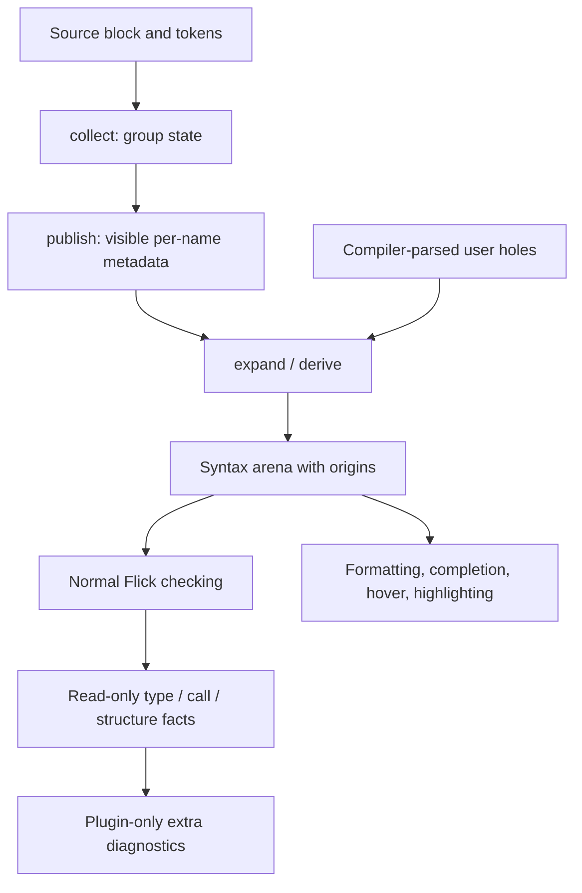

# Plugin SDK and host

Active contributors: bondiano, Vassiliy Kuzenkov. Non-bot authors on `origin/main` for `flick-plugin/`, `plugins/`, and `flick-core/src/plugin/`.

Plugins extend source syntax, derives, diagnostics, editor services, file loading, and selected build stages. The Rust SDK and versioned WIT interface let first-party native plugins and externally loaded WebAssembly components speak the same logical protocol.

## Layout and first-party capability ownership

| Path | Purpose |
| - | - |
| `flick-plugin/src/` | Public data structures, `Plugin`/`Compiler` traits, builders, diagnostics, guest glue |
| `flick-plugin/macros/src/` | Compile-time `flick!` quotation and splicing |
| `flick-plugin/wit/plugin.wit` | Component interface, currently `flick:plugin@0.2.0` |
| `flick-core/src/plugin/` | Expansion, rendering/splicing, source mapping, reach grants, diagnostic placement |
| `flick/src/plugins/` | Native CLI's external component host, persistent cache, network snapshots |
| `plugins/cli/src/` | `cli` clauses, command shape, `Cli.Value` derives, editor support |
| `plugins/derive/src/` | Schema/URL/form/HTTP API derives, `codec`, `server fn` |
| `plugins/refined/src/` | Constant parse rejection from refinement facts |
| `plugins/sql/src/` | Tables, checked queries/templates, DDL/migrations, metadata publication |
| `plugins/ui/src/` | `component` sugar, policy bounds, serializable atom keys, component structure warnings |

The five crates are combined as the linked `std` plugin by `flick-core/src/plugin/first_party.rs`. Standard heads are `cli`, `server`, `codec`, `sql`, and `component`; they are available without an explicit plugin import. `std` also provides Schema/URL/form/HTTP API and CLI value derives, and watches nine configured name patterns.

Core `ui { ... }`, language type/effect/region rules, wire-codec selection, and foreign component application are **not** moved wholesale into a plugin. See the [feature map](../features/index.md) for user-facing capabilities.

At generation time this SDK + five first-party crates + core integration scope contained 83 Rust files; 10 had a `tests` path component or `tests.rs`/`_tests.rs` name. Inline tests and external fixture suites make that a layout census, not a coverage percentage. The `origin/main` history query has two distinct non-bot author names, without identity alias merging.

## Block expansion protocol

A `Block` carries its head, text/tokens, expression/declaration position, module, documentation, optional preceding signature, and byte spans. The plugin parses its own DSL and asks `Compiler` to parse embedded Flick expression/type/pattern/declaration/body holes.

It returns an `Arena` of syntax nodes: children precede references to them, each node has an origin, and the root identifies the generated expression or declaration group. SDK `Builder` constructs that arena. `flick!(builder, ...)` compiles quoted Flick-shaped code when the Rust plugin builds; `#value`, `#(expression)`, and collection splices insert holes/nodes/names/literals without concatenating untrusted source text.

The core renders and reparses the generated syntax, splices it into the checked tree, and maps diagnostics back to original holes/blocks. This is not permission for an ordinary expansion to bypass type/effect checks. `collect` state and `publish` metadata support group/cross-module knowledge; SQL uses them for table schemas. `Compiler.in_scope` is an editor query, not an unrestricted type search during expansion.

## Post-check facts, not a second type checker

The current working tree separates three channels:

| Channel | Data | Current consumers and limits |
| - | - | - |
| `check(block, state, facts)` | Types of generated `_` positions, exact qualified/alias-expanded type when known, closed-record fields | SQL and record codecs; no exact comparison when unresolved/error types remain |
| `check_calls(calls, state)` | Resolved watched name, module-file spans, argument types/fields/constants, optional refinement/binding facts | Refined parse checks, UI policy bounds, serializable atom placement |
| `check_structure(block, structure)` | Source-hole line/complexity/nesting measurements and configured thresholds, independent of generated wrappers | Component structure diagnostics |

`FactType.exact` is absent for unknown/error-containing types; these are textual facts, not a plugin handle to unify arbitrary types. Constants are numbers, text, or booleans, not arbitrary runtime values or `BigInt` constants.

Refinements are either enum literals or an `ExpressionFact` arena with resolved references and supported syntax/`Unknown` nodes. The compiler supplies syntax; `plugins/refined/src/predicate.rs` owns interpretation. An unsupported or uncertain predicate does not become a false claim of successful compile-time validation. Local predicates and cross-module enum-literal facts have different availability.

Serializable atoms have a separate `Binding` fact: enclosing module/binding/span, whether its scheme is constrained, whether the reference occurs in a function, and applied argument count. `flick-core/src/types/ui.rs` produces those facts; `plugins/ui/src/calls.rs` decides whether the key is safe. These facts do not authorize the plugin to rewrite the binding after checking.

Ordinary plugin diagnostics are package-qualified, for example `std/Q010`. The standard plugin's migrated codes keep their existing compiler identity: `U001`, `U003`, `D006`, `T036`, `T037`, and `T038` (shown with `FLICK-`). `flick-core/src/plugin/mod.rs` maps them, places byte spans, and preserves safe/unsafe fixes.

**Snapshot caveat:** read-only predicate syntax and the separate structure hook are uncommitted API work in this checkout. The current SDK and WIT both declare `0.2.0`; components built for the older interface must be rebuilt, not assumed compatible. Keep Rust traits, WIT, conversion glue, guest exports, and native/WASM host implementations aligned.

## Host API, grants, and cache inputs

The project `Host` in `flick-core/src/project/mod.rs` supplies source reads, component loading, cached results, and an optional `Outside`. Plugins receive a narrower `Compiler` interface; by default, filesystem/environment/network reach is denied.

Project configuration `[plugins.<package>]` grants:

- `fs-read`: named project-relative files/directories; lexical absolute/parent paths are rejected.
- `env`: exact environment-variable names.
- `net`: HTTP(S) host grants, optionally with a specific port.
- `disable`: selected syntax heads/derive classes the project will not let the plugin handle.

`flick-core/src/plugin/reach.rs` and `flick-core/src/plugin/reach/granted.rs` record accessed answers and hashes. Cached results are reusable only while the relevant file/environment/publication/literal/snapshot inputs agree. Native persistent caching in `flick/src/plugins/cache.rs` additionally keys files by the binary fingerprint and call hash.

HTTP responses are snapshotted under `.flick/plugin-snapshots/<package>/`. The native host replays an existing snapshot even online; deleting a snapshot is an explicit way to request a fresh answer. Missing offline answers report `FLICK-P039`, while denied access reports `FLICK-P038`. The language server uses offline network behavior.

Snapshot keys include method, URL, and body, but not headers. Snapshot files retain method/URL/status/response body, not request headers. **This does not make their contents non-sensitive**: URLs and responses can contain secrets, and header-dependent requests can share a key. Review data before committing snapshots.

The native HTTP adapter refuses redirects, applies a 30-second timeout and 16 MiB response-body limit. Grants describe the host-mediated API; they are not proof that a linked native plugin is sandboxed from all in-process capabilities.

## Native versus external components

First-party `Native
` implementations run in-process behind panic catching. External components run in Wasmtime when `wasm-plugins` is enabled; the host validates the advertised interface version and hashes component bytes for identity.

Each component call gets a fresh instance with 1,000,000,000 fuel and 64 MiB memory limit. The component is compiled lazily once per process; all-cache-hit runs need not compile it. Only compiler imports are linked, not general WASI filesystem/network access.

Guest crates use the SDK's `guest` feature and `flick_plugin::export!(...)`. `flick-plugin/src/guest.rs`, `flick-plugin/src/wit.rs`, and `flick-plugin/src/wit_arena.rs` bridge public Rust values and WIT types. The macro crate is an authoring aid, not the Wasmtime host.

The browser compiler has linked first-party implementations but is not the native CLI's arbitrary component loader. Host-specific external access remains a separate capability; see [browser tools](../systems/browser-tools.md).

## Build hooks are a different trust boundary

Packages declare file extensions with `load = [...]` and opt into `hooks = ["ir", "emit"]` separately from block expansion.

| Hook | Contract |
| - | - |
| `load` | Convert a declared non-Flick source file into module declarations |
| `ir` / `transform` | Rewrite project `flick-ir::Program` CBOR after effect checks and before optimization |
| `emit` | Replace output artifacts after generation |

IR rewrites are structurally validated, including the set of project modules, but source typing/semantics are not re-proved. `flick/src/commands/build/hooks.rs` emits `FLICK-P048` to state that behavior after rewriting is the plugin's responsibility; invalid IR is `FLICK-P047`.

Emit hooks enforce a source-map relationship: changing existing mapped JavaScript without changing its map (or removing that map) is `FLICK-P046`. That check does not prove the plugin's JavaScript correct or safe. Neither WIT sandboxing nor source expansion checking transfers a language soundness guarantee to arbitrary IR/artifact rewrites.

## Modification entry points and validation

| Change | Required implementation surfaces |
| - | - |
| SDK fact/hook/type | `flick-plugin/src/lib.rs`, `flick-plugin/src/exports.rs`, `flick-plugin/wit/plugin.wit`, guest/conversion glue, `flick/src/plugins/wasm.rs`, core `Expander`/native wrappers |
| Syntax generation or origins | `flick-plugin/src/builder.rs`, `flick-plugin/macros/src/`, `flick-core/src/plugin/render.rs`, `flick-core/src/plugin/splice.rs` |
| Grants, snapshots, invalidation | `flick-core/src/plugin/reach/`, `flick/src/plugins/outside.rs`, plugin/project cache tests |
| First-party check | Owning crate in `plugins/`, `flick-core/src/plugin/first_party.rs`, expected diagnostic code/span/fix |
| Whole-build rewrite | `flick/src/commands/build/hooks.rs`, `flick-ir/` structural validation |

Use the SDK tests in `flick-plugin/tests/`, first-party tests in `plugins/cli/tests/`, `plugins/derive/tests/`, and `plugins/sql/tests/`, plus core expansion tests and `tests/plugins/pairs/`. The validation matrix calls for `cargo test -p flick --test plugins`, relevant SDK/core/plugin units, `just wasm-plugins`, and `just e2e-tests`. Cover native and WASM diagnostics, permissions, offline replay, and changed-input invalidation. No compilation or plugin execution was performed for this wiki-only work.

## Key source files

| Path | Purpose |
| - | - |
| `flick-plugin/src/exports.rs` | Complete plugin trait and default hooks |
| `flick-plugin/wit/plugin.wit` | Component ABI schema |
| `flick-core/src/plugin/source.rs` | Source-hole parsing and visible module information |
| `flick-core/src/plugin/expansion/check.rs` | Type fact remapping and source-structure hook |
| `flick-core/src/types/facts.rs` | Solved types/constants/refinement fact production |
| `flick-core/src/types/expression_fact.rs` | Read-only resolved predicate syntax |
| `flick-core/src/plugin/first_party.rs` | Standard dispatcher, watched names, preserved diagnostic codes |
| `flick/src/plugins/wasm.rs` | Component version/loading/budgets and host calls |
| `flick/src/commands/build/hooks.rs` | IR/emit validation and trust notices |

Return to [application features](../features/application-features.md) for the user-facing facilities these extensions implement.
