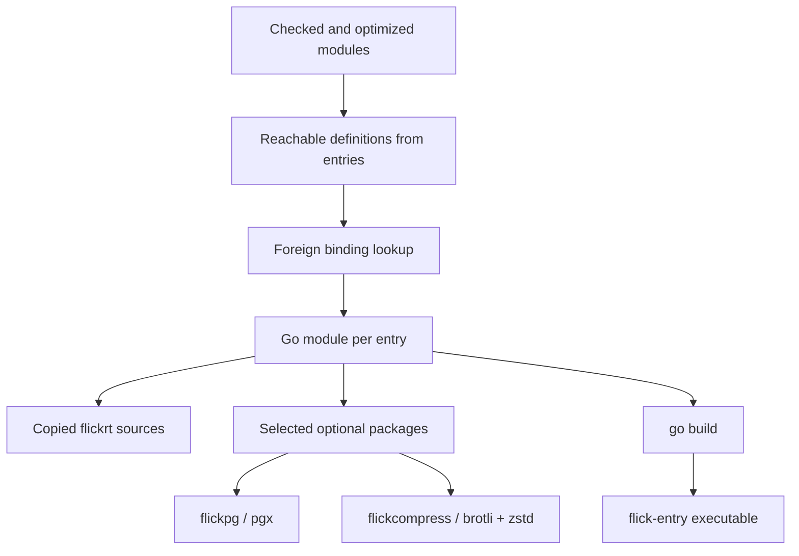

# Go execution runtime

Active contributors: bondiano, Vassiliy Kuzenkov (non-bot authors on `origin/main` for `runtime-go/`).

The Go target emits a standalone application backed by `flickrt`, with fibers implemented as goroutines. Optional PostgreSQL and compression packages register themselves only when reachable bindings need them. This is a separate execution implementation, not an Effect-to-Go translation or the TypeScript bridge.

## From checked program to executable

`flick-core/src/codegen/go/mod.rs` emits one `package main` with a source file per Flick module. Top-level functions take arguments directly; curried wrappers are produced where values require them. Module initialization runs in dependency order. Values use static Go type `flickrt.Value` rather than monomorphized application-specific Go structs.

`flick-core/src/build/go.rs` writes a Go module under `<out-dir>/go/<entry>/` and names the executable `flick-<entry>` (`.exe` for Windows). Release emission uses the shared optimizer. Source `//line` directives refer to Flick locations. The CLI completes the `go build` step.

`flick-core/build.rs` embeds non-test `.go` files from `runtime-go/flickrt/` into the compiler, plus optional runtime packages and their module lists. Every generated program receives the base runtime sources; reachability selects application definitions and optional packages, rather than physically copying only the base runtime files it calls.

The generated module has no external requirements when no optional package is reached. When one is reached, `flick-core/src/build/go.rs` filters requirements using that package's `modules.txt` and copies the pinned sum evidence. The repository's development `runtime-go/go.mod` itself includes all optional dependencies; do not confuse it with every generated application's dependency footprint.

## Value ABI and fiber context

`runtime-go/flickrt/value.go` defines:

| Flick concept | Go representation |
| - | - |
| General value | `Value = any`. |
| Function stage / class-polymorphic function | `Fn` / `Poly`, both receiving `*Fiber`. |
| ADT | `*Data` with `Tag` and `Fields`. |
| Record | Runtime `Record`. |
| List or tuple | `[]Value`. |
| Int / Float / BigInt | `int32` / `float64` / `*big.Int`. |
| String / Unit | WTF-8 string / `UnitType{}`. |

Tags mirror JavaScript constructor identities using the high 48 bits of FNV-1a over the qualified constructor id. Option and Result use the native cross-target constructor names, but their Go object layout is not a JS object's layout. The runtime's string and Unicode files preserve language behavior instead of assuming Go byte indexing matches JavaScript UTF-16.

`runtime-go/flickrt/fiber.go` defines `Eff func(*Fiber) Value`, run cold by `Run`. A fiber carries a linked service environment and owner; derivations share fiber state. State contains interruption identity, an atomic sticky request, signal channel, mask depth, test-clock coordination, and optional control-handler coroutine state.

Each child in `runtime-go/flickrt/concurrency.go` has a goroutine, completion channel, value/cause, and observers. Cancellation is cooperative at `Check`, effect execution, and runtime waits. Closing the signal channel does not forcibly terminate arbitrary Go code.

`runtime-go/flickrt/cause.go` and `runtime-go/flickrt/failure.go` keep typed failures, defects, and interruption distinct. Runtime panic/recover transports failure internally; an ordinary panic is not automatically a declared typed error.

## Lexical resource and concurrency protocol

`runtime-go/flickrt/owner.go` synchronizes owner admission, child tracking, hooks, pending foreign work, and finalizer registration with a mutex. Closing runs hooks, interrupts and awaits children/supervisors, settles foreign operations, and only then runs finalizers last-first. Finalizers retain registration evidence but use the closer's masked execution state. Cleanup failures join the body's outcome.

`AcquireRelease` and `Bracket` implement acquisition/release ownership; adding a finalizer once finalization has started runs it immediately. `within`/region operations connect compiler-selected lexical owners to execution. Layers in `runtime-go/flickrt/layer.go` have separate construction/memoization logic that must stay aligned with [native layers](owned-runtime.md#concurrency-and-service-construction).

Parallel groups and races interrupt and join outstanding children rather than leave goroutines detached. Limits and Result/Exit conversion are language contracts, not simply calls to `sync.WaitGroup`. Go can execute branches simultaneously, unlike JS interleaving: changes to shared collections, resource state, and test-clock bookkeeping need concurrency-specific scrutiny.

`runtime-go/flickrt/foreign.go` runs asynchronous Go FFI in a separate goroutine with a `context.Context`. Interruption cancels that context, fails the waiting fiber, and registers the still-running call with its owner. The owner waits for completion before releasing resources. A host call that ignores context cancellation can therefore delay shutdown indefinitely.

`runtime-go/flickrt/platform.go` runs main under a root owner, handles SIGINT/SIGTERM, flushes output, and exits after cleanup. Codes match the JS convention: 0 success, 1 failure/defect/failed cleanup or supervision, and 130/143 for signal-only interruption with successful cleanup.

## Standard modules and target limits

`flick-core/src/codegen/go/foreign.rs` maps known foreign module/export pairs through the implicit packages' Go tables, currently under `packages/std/src/go/`. A `*` prefix marks a runtime target that needs the fiber first. That table, the Flick declaration, and the Go function must agree on arity, dictionaries, currying, and effects.

The Go runtime is broad: streams/channels/sinks, transactional references and queues, schemas/codecs, files/processes/networking, CLI, HTTP/API, and observability live alongside data/effect support. It is not merely a portable arithmetic subset. For example, `runtime-go/flickrt/tx.go` validates versioned journals under a commit mutex because parallel goroutines must not observe half a commit.

Nevertheless, arbitrary npm APIs and React UI do not become available. Only reached bindings with Go mappings or supported sibling Go FFI compile; unsupported constructs are diagnostics rather than JS-style fallback stubs. Browser/UI code generally stays on the JS target.

For local `foreign` modules such as `./clock.mjs`, emission looks for `clock.go` beside the source module. The current adapter rejects `catch`, receiver (`this`), optional/variadic argument adaptation, and adapted callbacks for this local Go route. Async receives a context first; non-async modes receive the fiber first.

Go implements `tail`, `abort`, and coroutine-based `control` handlers in `runtime-go/flickrt/handle.go`; the JS build's `P012` control-handler restriction is therefore not a language-wide prohibition. A controlling operation must run in its handler's fiber.

## Optional native integrations

### PostgreSQL

`runtime-go/flickpg/pg.go` registers a pgx-backed pool through `flickrt.RegisterPg`. `flick-core/src/codegen/go/main_file.rs` selects the package when the program reaches the SQL `pgLayer` binding.

`runtime-go/flickrt/sql_db.go` owns the database service and resource protocol; `flickpg` implements pool acquisition, statement execution, metadata, and SQLSTATE errors. It sends text parameters/results, preserves NULL, supports acquire and statement timeouts, and configures pgx CancelRequest handling with a five-second deadline delay before connection cutoff.

Interrupted queries discard connections instead of returning them for reuse. Cancellation does not undo writes already committed outside a transaction. Pools close with their provide scope. Driver tests in `runtime-go/flickpg/pg_test.go` skip without `FLICK_PG_TEST_URL`, so a green ordinary Go suite alone does not establish live database behavior.

### Compression

`runtime-go/flickcompress/compress.go` registers `br` and `zstd` compressors. It is selected for the reachable compression middleware binding, keeping those dependencies out of other generated programs. Zstd explicitly runs with encoder concurrency one; base middleware behavior is in `runtime-go/flickrt/http_compression.go`.

## Modification and validation

For a new standard operation, change the Flick signature, the relevant `packages/std/src/go/` table, and the runtime together; add independently expected portable cases to `tests/language/` or `tests/run/`. When adding an optional package, update selection, registration, `modules.txt`, and pinned module metadata. Do not make every application require an unrelated driver.

Run `just go-test` (`go vet ./...` then `go test ./...` under `runtime-go/`), plus `just language`, `just conformance`, and relevant compiled-program cases. Live SQL changes require `just e2e-postgres` with the documented service prerequisites. Shared execution-contract changes also require the [model/formal gate](../../systems/formal-model.md). No compilation or runtime suites were run for this wiki-only work.

## Key source files

| Source | Responsibility |
| - | - |
| `flick-core/src/codegen/go/mod.rs` | Whole-program emission and reachable program contract. |
| `flick-core/src/codegen/go/foreign.rs` | Standard mappings and sibling Go FFI restrictions. |
| `flick-core/src/codegen/go/main_file.rs` | Optional package and timezone imports. |
| `flick-core/src/build/go.rs` | Artifact layout and generated dependency filtering. |
| `runtime-go/flickrt/value.go` | Values, function ABI, and tags. |
| `runtime-go/flickrt/fiber.go` | Cold tasks, evidence, cancellation checkpoints. |
| `runtime-go/flickrt/owner.go` | Synchronized lexical ownership and cleanup. |
| `runtime-go/flickrt/concurrency.go` | Goroutine children, supervision, joins, and races. |
| `runtime-go/flickrt/foreign.go` | Context cancellation and pending host work. |
| `runtime-go/flickpg/pg.go` | Optional pgx driver. |
| `runtime-go/flickcompress/compress.go` | Optional brotli/zstd registration. |

Return to [execution runtimes](index.md), or follow [compiler internals](../../systems/compiler/index.md) for lowering and target selection.
