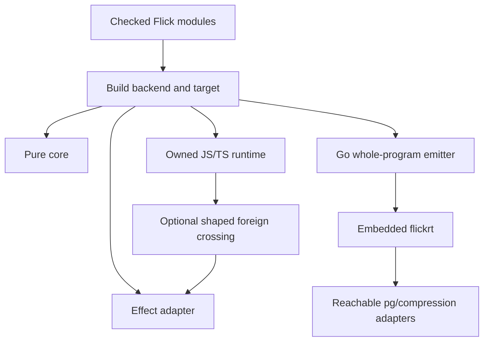

# Execution runtimes

Active contributors: bondiano, Vassiliy Kuzenkov (non-bot authors on `origin/main` for `runtime/`, `packages/effect-ts/`, and `runtime-go/`).

Flick has three execution implementations, not one interchangeable JavaScript library: the Flick-owned TypeScript runtime, an optional Effect adapter, and a Go runtime embedded into generated programs. Backend selection, foreign-binding routing, and resource ownership jointly determine what a program actually runs.

## Choose the correct entry point

| Configuration or entry point | Execution |
| - | - |
| Native project defaults | `Build::default` selects `Backend::Rt`: generated JS/TS uses `@flick-lang/runtime/rt`. |
| `[build] effect = "effect"` | Generated JS/TS uses `@flick-lang/effect-ts` and its Effect implementations. |
| `[build] effect = "none"` | Only the restricted pure surface builds; imports use `@flick-lang/runtime/core`. This is not a smaller asynchronous runtime. |
| `--emit go` | Whole-program Go emission and the `flickrt` runtime; no JavaScript interpreter or Effect npm runtime. |
| Browser compiler `Session::artifacts` | Explicitly selects `Backend::Effect`, independently of native project defaults. |

The authoritative native default is `flick-core/src/project/config.rs`. The statement in `README.md` that JS effects run on Effect “for now,” the Effect-only header of `flick-core/src/codegen/mod.rs`, and the two-choice comment on `Build.effect` are stale descriptions of that default. Conversely, `flick-wasm/src/lib.rs` really does still request Effect: do not apply the native default to the playground.

This wiki records the **2026-11-10 working tree**, not a verified release. In particular, runtime policy and export tables have uncommitted relocations into the packages that own them. A source link to the base commit may show their former compiler-owned locations.

## Package boundaries and reading paths

- [Owned runtime](owned-runtime.md): data ABI, generator driver, cancellation, owners, layers, atoms, and React/DOM integration in `runtime/src/`.
- [Effect adapter and compatibility surface](effect-adapter.md): Effect execution, bridges, shared UI ownership, host adapters, and the Rust surface linter in `packages/effect-ts/`.
- [Go runtime](go-runtime.md): goroutine fibers, generated executable layout, standard-module mappings, PostgreSQL, and compression in `runtime-go/`.
- [Libraries](../libraries.md) describes the Flick-facing `packages/core/` and `packages/std/` APIs; [effects and regions](../../features/effects-and-regions.md) describes their static contracts.

The `effect` segment in an import such as `@flick-lang/runtime/rt/effect/Fiber` is an API-family name, not evidence that the owned runtime imports Effect. `runtime/test/package-boundary.test.ts` explicitly checks that `runtime/package.json` has no runtime dependencies and source files do not import `effect` or `@effect/*`. React remains an optional peer for UI paths.

## Standard modules are a routing contract

Many declarations in `packages/std/src/`, including `packages/std/src/Scope.fl` and `packages/std/src/Fiber.fl`, name `@flick-lang/effect-ts` in their foreign bindings. That spelling does **not** force all callers onto Effect. `flick-core/src/build/effects.rs` applies the policy in `packages/effect-ts/compiler-bindings.json`; JS foreign emission then selects a native export or a bridge.

The current policy has 120 source/core/RT routes and 16 core-only builtins. The export inventories contain 2,051 specifier/export rows, 10 root stubs, and 38 bridge-stub/override rows. These are rows, not unique APIs or evidence of complete implementation. `tools/rt-exports.mjs` derives the inventories from built runtime exports; some exported functions deliberately throw or require Effect-side ABI ownership.

An installed adapter enables fallback, not universal compatibility:

1. `flick/src/commands/build/backend.rs` enables it for a project declaring `@flick-lang/effect-ts` in collected JS dependencies or root `package.json` dependencies; compilation without a project assumes availability.
2. `flick-core/src/build/effects.rs` checks both module routing and individual exports. With a bridge available, listed stubs and ABI overrides run on the adapter.
3. `flick-core/src/codegen/js/bridge.rs` emits conversions from signature-derived shapes, including nested callbacks and runtime values.
4. UI selection may move the opaque atom/view/registry family together; inert UI constructors can remain shared.

Without the adapter, missing native capabilities do not become implemented. A retained stub can throw, and an unsupported external import can still require its package. `effect = "none"` has separate compile-time restrictions, including `E008`; JS `control` handlers have the separate Go-only `P012` restriction in `flick-core/src/build/effects.rs`.

## Shared execution expectations

All three implementations distinguish success, typed failure, defects, and interruption. Owners stop admitting children, run closing hooks, interrupt and await children/supervisors, wait for tracked foreign work, and only then release resources in reverse registration order. Cancellation is cooperative: a blocking host operation may ignore cancellation, and cleanup waits rather than release resources beneath it. The pages above explain implementation-specific limits.

The contract is described in `docs/formal/runtime.md`. The model and Lean cover stated abstractions, not proof of either TypeScript implementation, Go, host drivers, or generated code. See [formal model](../../systems/formal-model.md).

## Scope measurements

Working-tree counts include `.ts`, `.go`, and `.rs` in the stated roots, excluding build/dependency outputs. “Test files” means `.test.ts`, `_test.go`, or files under a `tests/` directory; support files are not uniformly classified, so this is a file ratio, not coverage.

| Roots | Code files | Test files / code files |
| - | -: | -: |
| `runtime/src/`, `runtime/test/` | 147 | 24 / 147 (16.3%) |
| `packages/effect-ts/src/`, `packages/effect-ts/test/`, `packages/effect-ts/tools/` | 297 | 55 / 297 (18.5%) |
| `runtime-go/` | 373 | 72 / 373 (19.3%) |

`git log origin/main --format=%cn -- <domain>` has respectively 2, 1, and 2 distinct non-bot committer identities after excluding the GitHub merge-service identity. The contributor bylines use author identities instead; neither count establishes current maintainership.

## Changing execution behavior

Start from an independently expected result under `tests/run/` or `tests/language/`, then cover native execution, Effect crossings, and Go where supported. Preserve cancellation propagation, finalizer order, supervision, and failure combination, not merely matching stdout. Do not remove a gap marker or accept two matching backends as proof without checking the contract.

The relevant checks in `docs/agents/validation.md` include `pnpm -C runtime typecheck`, `pnpm -C runtime lint`, `pnpm -C runtime test`, the equivalent adapter commands when affected, `just go-test`, `just conformance`, `just conformance-rt`, and `just language`. Contract changes additionally require model/Lean work. These are modification guidance, **not checks run for this wiki-only change**.

## Key source files

| Source | Responsibility |
| - | - |
| `flick-core/src/project/config.rs` | Native build defaults and backend/target enums. |
| `flick-wasm/src/lib.rs` | Explicit browser compiler backend. |
| `flick/src/commands/build/backend.rs` | Optional adapter availability. |
| `packages/effect-ts/compiler-bindings.json` | Package-owned module routing and UI-family policy, compiled by `flick-core/build.rs`. |
| `flick-core/src/build/effects.rs` | Core restrictions and per-export RT selection. |
| `flick-core/src/build/bridge_select.rs` | One opaque UI implementation per build. |
| `flick-core/src/codegen/js/foreign.rs` | Foreign wrapper target and bridge selection. |
| `tools/rt-exports.mjs` | Generated export/stub inventories. |
| `docs/formal/runtime.md` | Execution contract and conformance cases. |

For the preceding pipeline, continue with [compiler architecture](../../systems/compiler/index.md) and [project/CLI integration](../../systems/project-and-cli/index.md).
