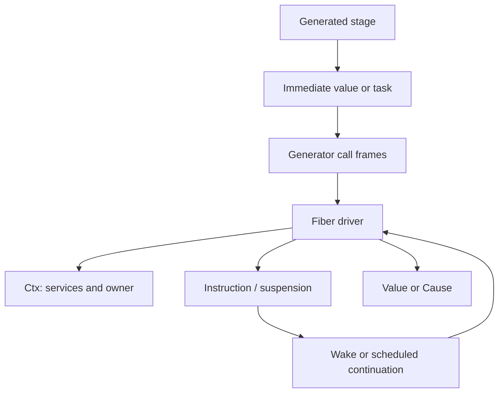

# Flick-owned JavaScript runtime

Active contributors: bondiano, Vassiliy Kuzenkov (non-bot authors on `origin/main` for `runtime/`).

`@flick-lang/runtime` owns pure data, a generator-based execution kernel, native standard-module implementations, and UI integration without importing Effect. It is the native project default, but it does not implement every adapter capability. See [backend selection](index.md) before interpreting an import or runtime error.

## Layout and ABI

| Area | Purpose |
| - | - |
| `runtime/src/core/` | 16 TypeScript files for plain data, lists, sequences, primitives, and load-safe stubs used by pure builds. |
| `runtime/src/rt/` | 99 TypeScript files for the driver, owners, causes, handlers, layers, schemas/codecs, atoms, UI, and `effect/`-named compatibility modules. |
| `runtime/src/ui/` | Five shared UI files: inert nodes/handlers, React tree conversion, DOM mounting, and safe markup helpers. |
| `runtime/src/tags.ts`, `runtime/src/internal.ts` | Constructor identities and shared low-level utilities. |

These are working-tree source counts, not public API counts. `runtime/package.json` exports the root and `/rt`, `/core`, subpath modules, and selected shared UI helpers. Its optional React peers are not needed for non-UI imports.

The data ABI in `runtime/src/core/data.ts` is intentionally plain:

- ADTs have `_tag` and positional `_0`, `_1`, … fields; records are objects and tuples/lists are dense arrays.
- `Unit` is `undefined`. Option uses `None`/`Some` with `value`; Result uses `Success`/`Failure` with `success`/`failure`.
- Equality is structural with SameValueZero number semantics and runtime equality hooks; arbitrary class instances without a hook retain identity semantics.
- Constructor tags are shared with generated code through `runtime/src/tags.ts`.

`runtime/src/core/stubs.ts` lets pure builtin modules load even when their declarations mention runtime helpers; invoking those effectful helpers throws. The compiler's pure-build restrictions are the normal safety boundary, not these stubs.

## Driver and evidence

`runtime/src/rt/fiber.ts` keeps generator frames on the heap. Yielding a generator is a call; returning one is a tail call; yielding an `Instruction` asks the driver to suspend or change execution context; another yielded value can complete immediately. `runtime/src/rt/types.ts` exposes a type-only `EffectValue` union, not the Effect library's `Effect` type.

`Ctx` is an immutable linked evidence stack with service tags, implementations, the active owner, and optional host context from a bridge. `runtime/src/rt/handle.ts` resolves operations against that evidence. `Under` changes the evidence for a computation; synchronous entry via `runIn` cannot be treated as an arbitrary asynchronous runner.

The driver checks interruption before each step and yields execution after a 2,048-operation budget. A plain JS function between driver steps is not preemptible. `FLICK_STRESS` enables deterministic seeded scheduling perturbations; the stress tool is an adversarial test aid, not production scheduling semantics.

`runtime/src/rt/cause.ts` represents failure as ordered reasons: `Fail`, `Die`, and `Interrupt`. `Raise` carries the cause without requiring a JS `Error` stack. `combine` deduplicates equivalent reasons; `concat` preserves repeats. Handler-unwind `Signal`s are internal control flow, not ordinary typed errors to catch indiscriminately. Although kernel machinery supports control-related operations, the current JS build gate still diagnoses source `control` handlers as Go-only.

## Owners, resources, and cancellation

`runtime/src/rt/owner.ts` implements lexical resource ownership. Its close protocol is explicit:

| Phase | Work |
| - | - |
| C0 | End admission of new children. |
| C1 | Run closing hooks, such as stopping event/fiber groups. |
| C2–C3 | Interrupt children, await them and their supervisors, then revisit hooks they added. |
| C4 | Wait until tracked foreign promises and newly added hooks are settled. |
| C5 | Run finalizers last-added-first, masked, with their registration evidence. A finalizer added after finalization starts runs immediately. |
| C6 | Combine cleanup causes with the body outcome. |

The scope body restores the caller's interruptibility; closing is masked. `acquireRelease` masks acquisition through finalizer registration. `bracket` restores interruptibility for use, then masks release. `within` directs an operation to the lexical owner chosen by lowering rather than always the dynamically innermost owner.

`fiberSpawn` registers both child and watcher before execution can interleave. The supervisor sees child failure, including shutdown interruption; a supervisor failure is collected as a defect that can fail the root/test. `fiberJoin` preserves the original cause.

`foreignAsync` starts with an `AbortSignal`, tracks the promise, and aborts the signal when interrupted. A rejection is a defect unless `catch` supplies an error mapping. Aborting does not forcibly stop JavaScript work: an owner waits for an ignored signal's promise to settle before releasing resources. A promise that never settles can therefore hold shutdown indefinitely; `runtime/src/rt/entry.ts` emits a delayed shutdown notice, not a hard cleanup deadline.

The entry runner handles SIGINT/SIGTERM through the same cleanup path. It sets 0 for success, 1 for typed failure/defect/cleanup or supervisor failure, and 130/143 for a signal-only interruption with successful cleanup.

## Concurrency and service construction

`runtime/src/rt/concurrency.ts` starts branches immediately until they suspend. `parallelAll` enforces a positive finite integer bound, preserves input order, stops admitting new work on failure, interrupts running branches, and awaits them. `parallelResults` captures typed failures but still propagates defects/interruption; races stop and await losers. A timeout is therefore not a promise that cleanup finishes by its deadline.

`runtime/src/rt/layer.ts` builds services into owners. Layer identity drives memoization; nested provides inherit a parent memo map, while sibling top-level provides build independently. Shared entries hold resources until their last observer closes. Adapter hooks exist for host layers, but the native implementation itself does not import Effect.

Native schemas/codecs, collections, schedules, queues/deferreds, file helpers, and testing are exported through `runtime/src/rt/index.ts` and `runtime/src/rt/effect/`. A directory named `effect` does not imply full parity with the [Effect surface](effect-adapter.md).

## UI ownership and lifecycle

`runtime/src/ui/react/nodes.ts` builds inert `Ui` descriptions without touching the DOM or running handlers. `runtime/src/ui/react/handlers.ts` defines policies; `runtime/src/rt/ui/bridge.ts` snapshots the event and decides `preventDefault` synchronously, then schedules its task. Concurrent, exhaust, queue, and latest policies have separate overlap behavior. Ordinary event tasks belong to the root and may outlive the element; setup-owned actions are interrupted when their instance is released.

`runtime/src/rt/atoms/registry.ts` maintains dependencies and subscriptions with iterative invalidation. Observed nodes recompute on changes; unobserved ones recompute when read. `runtime/src/rt/ui/views.ts` connects this registry to React subscriptions, stateful setup, loading boundaries, and mount/watch work.

`runtime/src/rt/ui/react.ts` owns mounted roots: teardown stops event admission, unmounts React, and interrupts/awaits root work. `runtime/src/ui/dom.ts` hydrates marked SSR containers and preserves textarea drafts entered before startup.

Native server rendering exists in `runtime/src/rt/ui/server.ts`, but streaming markup is a deliberate absent export and native server-state serialization currently writes an empty atom list. Route links, stream queries, and serializable atoms also have adapter fallbacks. Several neighboring comments still mention missing schemas broadly despite native schema code now existing; inspect the actual absent export and bridge table instead of generalizing from those comments.

## Modification and validation

Keep data equality/hash behavior and constructor ABI aligned with codegen and [Go](go-runtime.md). When implementing a missing native export, update the route policy if needed, rebuild with `pnpm -C runtime build`, regenerate inventories with `node tools/rt-exports.mjs`, and review whether an ABI override must remain. Run `node tools/rt-exports.mjs --check` after generation.

Relevant tests include `runtime/test/rt-kernel.test.ts`, `runtime/test/rt-owner.test.ts`, `runtime/test/rt-layer.test.ts`, `runtime/test/rt-atoms.test.ts`, and `runtime/test/package-boundary.test.ts`; bridge/UI integration tests also live in the adapter package. Follow [runtime-wide validation](index.md#changing-execution-behavior) for cancellation and semantic changes. No executable source or formal contract was changed for this wiki.

## Key source files

| Source | Responsibility |
| - | - |
| `runtime/src/core/data.ts` | Plain value ABI, equality, ordering, and hashing. |
| `runtime/src/rt/fiber.ts` | Driver, frames, evidence, suspension, and interruption. |
| `runtime/src/rt/cause.ts` | Failure algebra and handler-unwind signals. |
| `runtime/src/rt/owner.ts` | Close phases, resources, supervision, foreign promises. |
| `runtime/src/rt/concurrency.ts` | Parallel groups, races, and timeouts. |
| `runtime/src/rt/layer.ts` | Service construction and scoped memoization. |
| `runtime/src/rt/atoms/registry.ts` | Reactive graph and subscription lifecycle. |
| `runtime/src/rt/ui/react.ts` | Mounted-root execution and teardown. |
| `runtime/src/rt/ui/bridge.ts` | Event scheduling and action ownership. |
| `runtime/src/ui/dom.ts` | React DOM mounting and draft-preserving hydration. |

Continue with [bridge ownership](effect-adapter.md) or [application features](../../features/application-features.md).
