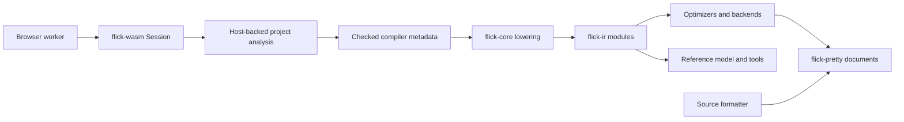

# IR, pretty printing and browser bindings

Active contributors: bondiano, Vassiliy Kuzenkov — author names recorded on `origin/main`, excluding bots.

Three small crates define reusable boundaries around the compiler: `flick-ir` is the explicit backend data model, `flick-pretty` is the shared layout engine, and `flick-wasm` exposes shared project checking to browser JavaScript.

## `flick-ir`: explicit, serializable decisions

`flick-ir/src/lib.rs` re-exports the data model without depending on `flick-core`. Modules contain source-ordered items and labels; expressions carry spans and selected type-constructor metadata. Applications, stage lifts, dictionaries, foreign adapters, constructor representations, handlers and operation classes are explicit so consumers do not repeat source typing decisions.

| Module family | Boundary |
| - | - |
| `flick-ir/src/expr.rs`, `flick-ir/src/handler.rs`, `flick-ir/src/dict.rs`, `flick-ir/src/instance.rs` | Expressions, patterns/items, operation arms and dictionary/instance structure. |
| `flick-ir/src/stage.rs`, `flick-ir/src/op.rs` | Pure, Sync and Runtime execution; function/effect-result lifting and operation classes. |
| `flick-ir/src/foreign.rs`, `flick-ir/src/data.rs` | Host binding modes, copies/adapters and data representations. |
| `flick-ir/src/num.rs`, `flick-ir/src/float.rs`, `flick-ir/src/span.rs` | Numeric semantics/serialization and source identity. |
| `flick-ir/src/program.rs`, `flick-ir/src/validate.rs` | Versioned whole-program serialization and structural validation. |

The **IR format version is `0.5.0`**, distinct from the crate package version. `Program` records compiler identity, file names and modules; construction remaps file IDs into the program's file table. Optional `json` and `cbor` features supply wire forms. Before 1.0 readers accept their own minor version; after 1.0 compatibility is by major version.

Deserialization checks version compatibility. The separate `validate` function checks form: duplicate modules, bound locals, accepted global module references and valid file IDs. It is explicitly **not a type checker**, and successful decoding alone does not establish those structural checks or semantic safety. Plugin-pass callers must enforce the appropriate boundary.

## `flick-pretty`: documents before output

`flick-pretty/src/lib.rs` exports `DocumentArena`, immutable `Copy` document handles, `Documentable`, `docvec!`, indentation and cursor-observer types. The implementation follows the strict document/group layout approach: a group stays flat when it fits; otherwise its direct breaks become lines, while nested groups decide separately.

- `flick-pretty/src/arena.rs` owns nodes, document slices and copied strings with arena lifetime. Dropping the arena releases the whole document graph.
- `flick-pretty/src/document.rs` defines text, optional/forced/flexible breaks, nesting, groups, zero-width output and cursor marks.
- `flick-pretty/src/print.rs` lays documents out at a requested width with spaces or tabs and lazy indentation.
- Layout width counts extended grapheme clusters; observed output columns also track UTF-16. Zero-width output affects observation even though it consumes no layout width.

Formatter cursor positions and backend source markers therefore depend on this crate, not only the visible whitespace of generated text.

## `flick-wasm`: retained single-module analysis

`flick-wasm/src/lib.rs` builds with wasm-bindgen for `wasm32-unknown-unknown`. `Session` stores text, source maps and project `Analysis`; `update` reanalyzes only when text differs. This is last-text reuse, not an incremental parser or a multi-file virtual workspace.

| Public API | Contract |
| - | - |
| `compiler_version()` | Compiler version string. |
| `Session.update(source)` | JSON diagnostic events for the source, including browser positions. |
| `Session.emit(profile)` | JSON JS/declarations/files/entry and diagnostics; `release` selects release, every other profile selects debug. Output fields are null on errors. Declaration omissions are separated as `dts_diagnostics`. |
| `Session.hover(at)`, `Session.complete(at, dotted)` | Shared IDE queries using UTF-16 offsets. |
| `format(source)`, `explain(code)` | JSON formatted text/diagnostics and diagnostic-explanation text. |
| `positions`, `utf16_offset`, `byte_offset` | Rust-side public helpers translating diagnostic/related-note/fix ranges and byte/editor offsets. |

Its `Demo` Host supplies only `/Main.fl`; imported library modules come through core/embedded std, not arbitrary filesystem reads. Emission explicitly selects `Backend::Effect`, absent Effect bridge and JS plus declarations, rather than the native project's backend default. A `main` export gets the normal generated runner.

`flick-wasm/Cargo.toml` disables core defaults and enables `embedded-std` plus `ide`; `ide` transitively enables `typescript` and `diagnostic-fixes` in the inspected `flick-core/Cargo.toml`. Native project loading, terminal rendering, publication artifacts and source maps are separate capabilities. Cargo workspace feature unification can hide accidental requirements, so test/build this consumer separately. The current manifest has no crate-local `server-builtins` feature: do not infer a reduced server-module surface from older feature descriptions.

The [browser tools](../systems/browser-tools.md) own request cancellation, worker lifetimes, linking and program isolation; the WASM API does not execute user programs itself.

## Changing these boundaries

- An IR representation change must update all backends, optimizers, plugin consumers, model translation, serialization fixtures and the format version when an older reader could misinterpret it. Run `cargo test -p flick-ir`, compiler IR round trips and the execution/model gates selected by the change.
- A pretty-printer change must cover width/breaking/Unicode/cursor behavior, then parser/formatter corpus and affected generated JS/TS/Go snapshots. Preserve source positions as well as text.
- A browser-API change must update the worker protocol, UTF-16/fix handling and shared IDE behavior. Use `just wasm`, `just e2e-js` and `just bundle-size`; capability changes require isolated feature checks/tests.
- `just wasm` currently enforces a 5,303,140-byte raw-WASM limit. This is a budget, not a measurement of this checkout. `just docs-wasm` creates the browser glue with the pinned wasm-bindgen CLI.

## Key source files

| Source | Why read it |
| - | - |
| `flick-ir/src/lib.rs`, `flick-ir/src/program.rs` | Public model and wire compatibility. |
| `flick-ir/src/validate.rs` | Structural-validation limits. |
| `flick-pretty/src/lib.rs`, `flick-pretty/src/print.rs`, `flick-pretty/src/tests.rs` | Layout API, implementation and inline tests. |
| `flick-wasm/src/lib.rs`, `flick-wasm/Cargo.toml` | Actual browser API, Host and enabled capabilities. |
| `flick-core/Cargo.toml`, `justfile` | Transitive capabilities and separate WASM build/size gate. |

Snapshot inventory: 23 tracked files across these three crates; none have test-named paths, but tests are embedded in source and compiler integration suites. The path ratio is not a coverage measure. This page describes source inspection, not a successful build. Continue with the [compiler](../systems/compiler/index.md) for lowering and backend internals.
