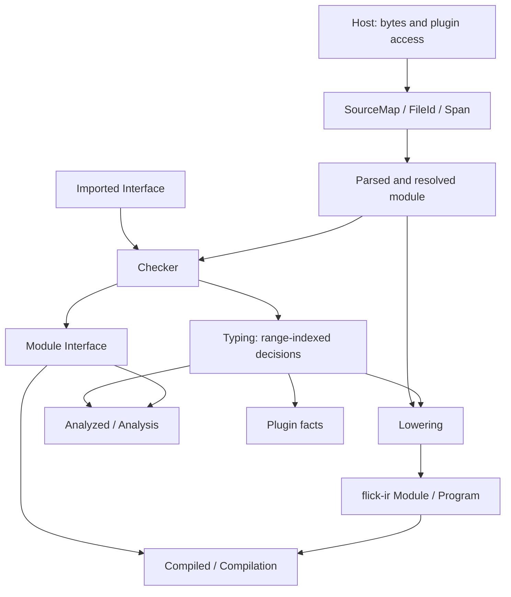

# Shared data models

Active contributors: bondiano, Vassiliy — non-bot author names on `origin/main`; names may be aliases.

Flick's main data contracts separate source identity, importable declarations, checker decisions, executable representation, and editor snapshots. Reusing the right contract avoids re-inferring semantics in a backend or mistaking an editor result for an executable build.

This is working-tree documentation. Plugin fact/structure APIs and their host conversions include pre-existing uncommitted changes; they must not be assumed present in the base commit.

## Model index

| Model | Role | Public definition / re-export |
| - | - | - |
| `SourceFile`, `SourceMap` | Text/display paths and compilation-local file allocation | `flick-core/src/source.rs` |
| `FileId`, compiler `Span` | File index and half-open UTF-8 byte range | `flick-ir/src/span.rs`; re-exported by `flick-core/src/source.rs` |
| `Entity`, `Export`, `Interface` | Defining identity and importable module contract | `flick-core/src/iface.rs:16-141` |
| `Type`, `TypeDef`, `Instance` | Checker/import type vocabulary | `flick-core/src/types/ty.rs`, `flick-core/src/types/env.rs` |
| `Typing` | Checked decisions keyed by module-local source range | `flick-core/src/types/typing.rs` |
| IR `Module`, `Item`, `Expr` | Explicit backend representation | `flick-ir/src/expr.rs`; re-exported by `flick-ir/src/lib.rs` and `flick-core/src/ir/mod.rs` |
| `Program` | Versioned modules plus source-file table | `flick-ir/src/program.rs:15-55` |
| `Host`, `Project` | I/O/plugin boundary and manifest context | `flick-core/src/project/mod.rs:68-115` |
| `Compiled`, `Compilation` | Lowered modules and their source-library/dependency context | `flick-core/src/project/load/mod.rs:179-208` |
| `Analyzed`, `Analysis` | Retained source/editor state and diagnostics | `flick-core/src/project/load/ide.rs` |
| SDK `Block`, `Arena`, `Fact`, `CallSite` | Plugin inputs, generated syntax, and read-only checker evidence | `flick-plugin/src/lib.rs` |

## Source identity and position encodings

`SourceMap::add` allocates a `FileId` from insertion order. `SourceFile` stores a string display path, text, and line-start offsets; the display path need not be an OS-native `PathBuf`. A `FileId` is an index **within the associated source map**, not a persistent repository identity.

Compiler `Span` contains `file: FileId`, `start: u32`, `end: u32`. Its range is half-open `start..end`, measured in UTF-8 bytes. `SourceFile::line_col` returns zero-based line and byte column. `SourceMap::add_bytes` stores invalid UTF-8 lossily and returns `FLICK-S001` for the first bad sequence. Definitions: `flick-ir/src/span.rs` and `flick-core/src/source.rs`.

| Boundary | Encoding / ownership |
| - | - |
| Compiler diagnostics and IR spans | File ID plus UTF-8 bytes |
| `Typing::Range` | `(u32, u32)` bytes in the current module; no file field |
| Native LSP positions | Zero-based line and UTF-16 code units, converted by `flick/src/lsp/protocol.rs` |
| Browser query offsets | UTF-16 offsets, converted by `flick-wasm/src/lib.rs` |
| TypeScript Content Mapper | Negotiates UTF-8, in `flick/src/mapper.rs` |
| Emitted source maps | Version 3 mapping format with UTF-16 columns, in `flick-core/src/codegen/sourcemap.rs` |
| Plugin SDK `Span` | Start/end bytes only; the operation determines its source coordinate space |

`SourceMap` is source storage; an emitted `.map` is a different model. Plugin-block spans normally count from `Block.text`; `Signature` has its own text coordinate space; `CallSite` and its diagnostics count in the module's own file. Never add a compiler file ID or a block offset to SDK spans without the host's origin mapping.

## `Interface`: what importers can rely on

`Entity` is `(defining module, Namespace, name)`. Its defining module does not change when another module re-exports it. `Namespace` distinguishes values, types, and constructors. `Export` adds declaration form, optional parent, checked type scheme/definition, blocked-foreign reason, and declaration range. Schemes can be absent in an interface produced before successful checking.

`Interface` contains more than exported names:

- Module privacy and hidden members used to explain rejected imports.
- Types/kinds and transitive instances; importing fewer ordinary names does not hide instances.
- Export docs/source hints for declaration generation and editor navigation.
- Maker/server reachability, emitted target inventory, dependency-interface fingerprints.
- Optional compiled ABI: constructor tags/fields, dictionary exports, and value summaries.

Definitions are in `flick-core/src/iface.rs:71-228`; export construction is in `flick-core/src/types/exports.rs`; build ABI construction is in `flick-core/src/build/abi.rs`.

The `.iface` JSON envelope requires **schema 11, exact compiler package version, and the requested module name**, in `flick-core/src/iface.rs:271-314`. `fingerprint` strips dependency fingerprints, source hints, docs, and declaration offsets before hashing the remaining serialized contract, in `flick-core/src/iface.rs:231-246`. This 64-bit incremental key is not an authenticity or collision-resistance guarantee.

## `Typing`: record decisions once

`Typing` is transient checker metadata, not the published interface or a full typed copy of the CST. Its `declarations: Arc<Interface>` includes every top-level entity, while the separate exported interface is the import boundary.

| Decision family | Representative fields | Consumer |
| - | - | - |
| Resolved identities / binders | `names`, `type_names`, `binders`, `packs` | Lowering and editor navigation |
| Calling stages and adaptation | `runtime`, `sync`, `stages`, `lifts`, `coercions` | Explicit IR calls and conversions |
| Runtime evidence | `dicts`, `givens`, `dictionary_constructors`, `instances` | Dictionary passing and construction |
| Representation / operators | `abis`, `numeric`, `identity_eq`, `values` | Backend ABI and typed arithmetic |
| Effects and lexical ownership | `handled`, `provided_ops`, `owners` | Handlers, service operations, resource owner selection |
| Foreign/UI/schema metadata | `foreigns`, `ui_components`, `makers`, `servers`, `wire_codecs` | Adapters, target/UI checks, codec lowering |
| Plugin observations | `wildcards`, `call_sites` | Solved `Fact`/`CallSite` inputs to plugin checks |
| IDE-only retention | `types`, `signature_types`, `fields`, `refined`, `aliases` | Hover, completion, navigation |

The fields and feature gates are defined in `flick-core/src/types/typing.rs`. `finish_typing` settles pending types, owners, and ordered dictionaries. Removing IDE retention does not remove the semantic metadata lowering needs. Lowering consumes the checked module and `Typing`; it must not guess runtime stages from spelling.

## IR and its persistence envelope

`flick-ir` depends on serialization libraries, not `flick-core`. `flick-core/src/ir/mod.rs` re-exports it; `flick-core/src/ir/lower/mod.rs` constructs it from accepted source.

| IR element | Contract | Source |
| - | - | - |
| `Module` | Name, source-ordered items, top-level labels | `flick-ir/src/expr.rs:13-29` |
| `Item` / `ItemKind` | Spanned values, destructuring, foreign bindings, constructors, services, refined checks, instances | `flick-ir/src/expr.rs:31-62` |
| `Expr` | Kind, span, optional simple type-constructor metadata; not a full inferred type on every node | `flick-ir/src/expr.rs:64-71` |
| `ExprKind::App` | Explicit stage and `arg_first` ordering for pipes | `flick-ir/src/expr.rs:125-132` |
| `Stage`, `Lift` | Pure / Sync / Runtime and recursive stage/result lifting | `flick-ir/src/stage.rs` |
| `Dict`, `Handler`, `Foreign`, `Shape`, `Adapter` | Dictionary evidence, operation arms, and host calling/adaptation shapes | `flick-ir/src/dict.rs`, `flick-ir/src/handler.rs`, `flick-ir/src/foreign.rs` |
| `Program` | `ir_version`, compiler identity, source filenames, modules | `flick-ir/src/program.rs:18-55` |

`Program::new` remaps compilation file IDs into its own file table. The IR format version is **0.5.0**, separate from crate version 0.1.0. JSON/CBOR readers enforce format-version compatibility: the same minor before 1.0, the same major after 1.0. Decoding does not itself invoke `validate`.

`flick-ir/src/validate.rs` performs structural checks such as valid file IDs, local binding/global references, and duplicate modules. It is **not a type/effect checker**. IR transform hooks must not be described as preserving the language contract merely because the transformed file decodes and validates. See [typed IR](../systems/compiler/typed-ir-and-optimization.md) and [plugin trust boundaries](../packages/plugins.md).

## Host, compilation, and analysis

`Host` requires `read(absolute path)` and `display(path)`. Optional methods expose plugin loading, expansion-cache reads/writes, and an `Outside` provider. Defaults reject plugin loading, miss the cache, ignore cache saves, and expose no outside-world provider. These are host policies, not a statement that all compiler callers use disk.

`Project` holds root path, parsed `Config`, manifest `FileId`, and optional workspace manifest path. Its source/test root methods normalize configured paths. Definitions: `flick-core/src/project/mod.rs:68-115`.

| Result | Contains | Important distinction |
| - | - | - |
| `Compiled` | Module/path/file/package/test identity, imports, IR, all declarations, exported interface, optional expansion | A cleanly checked and lowered module |
| `Compilation` | Compiled modules, source-library directories, native JS dependency requirements | Build-oriented graph, not diagnostics/source storage |
| `Analyzed` | Identity, user-facing CST, `Arc<Typing>`, interface, editor blocks, optional expansion, inline-namespace flag | Editor-visible modules can exist despite diagnostics |
| `Analysis` | Analyzed modules, a `Compilation`, diagnostics | Needs its associated `SourceMap` for text/locations |

Definitions: `flick-core/src/project/load/mod.rs:179-208` and `flick-core/src/project/load/ide.rs`.

`analyze` retains build IR when successful. The cached editor entry point **`analyze_with` intentionally returns a compilation with no modules**, while retaining analysis metadata. `analysis_fingerprint` hashes the modules actually present; an editor result is not evidence of a complete executable build. This matters to the [LSP/projection consumers](../systems/project-and-cli/language-server-and-ide.md).

## Plugin SDK models

The SDK has its own serializable syntax/fact vocabulary; it does not expose mutable checker internals.

| SDK model | Relationship to the compiler | Source |
| - | - | - |
| `Block`, `Token`, `Signature`, `Hole` | Plugin DSL input and user syntax parsed by the host's `Compiler` callbacks | `flick-plugin/src/lib.rs:43-125` |
| `NodeId`, `Node`, `Arena` | Generated expression/type/pattern/declaration nodes; children precede parents; each node retains an origin | `flick-plugin/src/lib.rs:127-128`, `flick-plugin/src/lib.rs:293-313` |
| `FactType`, `FactField`, `Fact` | Solved type display, optional exact type/literal base, optional closed-record fields | `flick-plugin/src/lib.rs:384-426` |
| `Structure`, `Nesting` | Written-source lines/complexity/nesting plus configured thresholds, excluding generated wrappers | `flick-plugin/src/lib.rs:401-419` |
| `Argument`, `CallSite`, `Binding` | Resolved watched call, argument types/constants, enclosing binding facts | `flick-plugin/src/lib.rs:437-515` |
| `Refinement`, `ExpressionFact` | Literal set or read-only resolved predicate expression arena; not a compiler verdict | `flick-plugin/src/lib.rs:448-489` |
| `Published` | Opaque plugin-owned metadata addressed by module/name | `flick-plugin/src/lib.rs:545-552` |
| SDK `Artifact` | Output-relative path and text, distinct from a source/IR node | `flick-plugin/src/lib.rs:315-320` |

`Plugin` implements collection/expansion and optional derives, checking, editor, loading, IR-transform, and emission hooks, in `flick-plugin/src/exports.rs`. `Compiler` supplies syntax-hole parsing, visible metadata, and grant-checked file/environment/network access, in `flick-plugin/src/lib.rs:554-618`. Default outside-world callbacks deny access.

Core integration adapts these types through `flick-core/src/plugin/source.rs` and `flick-core/src/plugin/expansion/check.rs`. Solved facts originate in `flick-core/src/types/facts.rs`; predicate syntax facts in the uncommitted `flick-core/src/types/expression_fact.rs`. Linked plugins use the Rust trait; guest/host conversions mirror **`flick:plugin@0.2.0`** in `flick-plugin/wit/plugin.wit`, `flick-plugin/src/guest.rs`, and `flick/src/plugins/wasm.rs`.

## Changing a shared model

| Change | Review together |
| - | - |
| Span/encoding | Diagnostics, generated origins, source maps, LSP, WASM, Content Mapper |
| Interface/export type | `.iface` version, round trips, importer invalidation, docs, API diff, declarations |
| Typing/IR decision | Lowering, traversal/substitution, optimizer, both emitters, model translation |
| Plugin field/hook | SDK, WIT, guest/host conversions, native wrapper, cached identity, diagnostics |
| Analysis retention | Incremental reuse/invalidation, IDE queries, projection consumers |

These are integration obligations, not proofs that implementations agree. Follow `docs/agents/validation.md`; source-only restoration of an unchanged semantic contract and a change to that contract have different model/Lean requirements. No such contract was changed by this reference. Return to the [reference index](index.md).
