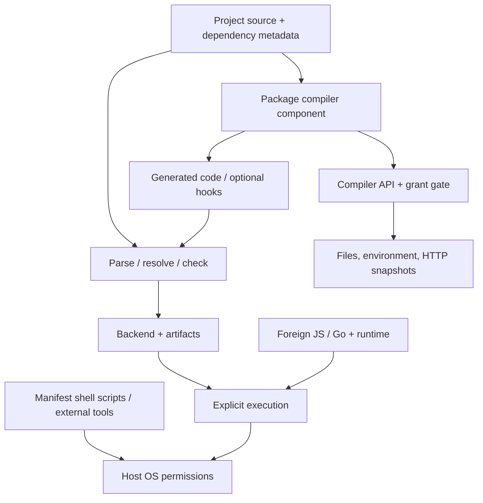

# Security and trust boundaries

Active contributors: bondiano, Vassiliy Kuzenkov — nonbot author names recorded on `origin/main` for plugin reach/hosting, FFI, browser execution, and dependency fetching.

Flick separates checking, compiler extensions, foreign code, browser execution, and downloaded toolchain/package inputs, but each boundary has explicit trust assumptions. This page explains the implementation in `flick/src/plugins/`, `flick-core/src/plugin/reach.rs`, `flick-core/src/ffi/`, `docs/src/playground/`, and the installers; it is **not a security audit or a claim that security is proved**.

## Scope and snapshot

Descriptions use the dirty `main` working tree based at `6e9096fb`. In particular, component selection/resource handling includes pre-existing uncommitted edits. Do not infer that a published compiler implements every inspected detail.

The model and Lean work covers stated language/runtime contracts, with explicit limits. It does not prove the Rust compiler, Wasmtime integration, JavaScript/Go runtimes, foreign implementations, installers, or browser sandbox secure. See [formal scope](systems/formal-model.md).

## What checking does and does not execute

Ordinary checking/building is distinct from executing an application's entry point, but a project can still invoke compiler plugins and their granted outside access. Dependency installation invokes package/toolchain adapters. Manifest `[scripts]` run trusted shell steps; generated Node/Go applications and foreign implementations run with their host process's authority.

`--offline` is not a universal OS or network sandbox. Plugin HTTP, package installation, std preparation, and Go/pnpm subprocesses have different control paths. Use an external isolation boundary when handling untrusted projects or artifacts; do not assume Flick's type/effect checks restrict the operating-system permissions of these tools.

## Compiler plugin host

The inspected native CLI loads package-provided components through optional Wasmtime support. A build without `wasm-plugins` reports the unavailable host rather than silently executing the package through another route. Internal first-party plugin support is a separate implementation boundary.

`flick/src/plugins/wasm.rs` checks the imported `flick:plugin` SDK version, identifies component bytes with SHA-256, lazily compiles the component, and uses a fresh instance for each call:

| Control | Implemented boundary |
| - | - |
| Fuel | **1,000,000,000** units per call |
| WASM memory | **64 MiB** configured through `StoreLimits` |
| Imports | Unknown imports trap; the host supplies the compiler's WIT interface, not unrestricted WASI filesystem/network |
| Failures | Fuel, memory-growth, and other traps become plugin failures |

These are component execution controls, not an aggregate native-process RSS limit, a wall-clock guarantee for every host operation, or proof that returned code is correct. Host compilation and compiler processing are different resource consumers.

### Permissions and outside data

`Grants` in `flick-core/src/project/config.rs` selects readable paths, environment variables, and network hosts. `flick-core/src/plugin/reach.rs` and its native gate implementation check requests and record hashes of answers used by cached results. Workspace grants can be inherited; paths remain relative to the member project root.

`flick/src/plugins/outside.rs`:

- Reads explicitly granted files/environment variables through the host.
- Replays a saved HTTP answer before trying the network.
- Uses snapshot-only HTTP for an offline adapter; CLI `--offline` or the presence of `CI` selects it, and LSP always selects it.
- Does not follow HTTP redirects, uses a 30-second request timeout, and limits response bodies to 16 MiB.
- Stores fetched responses below status 500 under `.flick/plugin-snapshots`, grouped by plugin.

Grant denial and missing offline responses are different failures (P038/P039). Offline HTTP does not disable granted local file/environment reads.

Snapshots preserve method/URL, status, and body; caches and traces can retain source-derived or outside data. Treat them as potentially sensitive and review before committing/sharing. Input hashing supports reproducible reuse; it does not make secret-bearing responses safe to publish.

### Generated code and hooks

Ordinary expanded source goes through compiler checks, with origin mapping for diagnostics. An IR hook is different: `flick/src/commands/build/hooks.rs` checks structural validity and module-name preservation, but P048 explicitly places rewritten behavior outside Flick's checks. Emit hooks can replace artifacts, subject to source-map consistency checks.

Structural IR validation is not type/effect/region preservation or semantic equivalence. Trust the hook author and review output. Run-generation builds skip emit hooks; do not assume every command follows ordinary publication hooks.

See [plugin host](systems/project-and-cli/plugin-host.md) for grant/snapshot/cache details and [plugins](packages/plugins.md) for the SDK and first-party language features.

## Foreign-interface assertions

The TypeScript declaration importer describes shapes, not the implementation's purity, cleanup, interruption, or callback lifetime. `flick-core/src/ffi/import.rs` requires missing contracts to be stated rather than inferred:

| Assertion | What remains trusted |
| - | - |
| `mode = "pure"` | The synchronous foreign implementation really is pure |
| `catch = "JsError"` | The boundary converts throws/rejections; this does not certify other behavior |
| `undefined = "none"` | The author's intended nullable-result interpretation |
| `cancel = "signal"` | The foreign API actually honors the supplied AbortSignal |
| `retention = "call"` / `"owner"` | The foreign API obeys the declared callback lifetime |
| `strict = true` | Rejecting `any`/`unknown` narrows accepted declarations, not arbitrary runtime behavior |

Unsupported/needs-policy exports remain blocked; review them explicitly rather than widening everything to `JsValue`. `flick ffi check` compares generated text or reviewed export-shape fingerprints/provenance against installed declarations. It detects drift, not malicious or incorrect implementations with unchanged declarations.

Handwritten foreign code, JS/Go runtime packages, and the Node declaration helper remain trusted code. Language effects/regions depend on truthful foreign contracts. See [foreign interface](systems/project-and-cli/foreign-interface.md).

## Browser compiler and program execution

The site's compiler runs in a persistent worker; user programs run in a different disposable worker or sandboxed iframe. `docs/src/playground/compiler.ts` owns the queue and handoff, while `docs/src/playground/compiler.worker.ts` holds the WASM session.

- Canceled queued compilation is not dispatched. Canceling an already-running synchronous WASM call discards its result rather than preempting Rust.
- Ordinary program runs use a worker that can be terminated without destroying the compiler session. A worker's separation from the DOM does **not** mean browsers forbid it from making network requests.
- `docs/src/playground/loader.ts` and `docs/src/playground/runtime.ts` expose selected bundled runtime imports, not arbitrary npm resolution or Node filesystem/database access.
- UI preview uses `sandbox="allow-scripts"` without same-origin permission, a restrictive CSP (`default-src 'none'` plus selected script/style/image allowances), and parent/frame source/shape checks.
- `docs/src/playground/frame.ts` requires an opaque origin and accepts a program once from its parent. Preview state persists until replaced/closed.
- Shared/draft source is bounded, checked on restoration, and **not automatically run**. `docs/src/playground/drafts.ts` limits source/decompression to 64 KiB.

Import allowlisting, CSP, iframe origin policy, worker cancellation, and message validation are distinct controls. None is a blanket proof of confinement, termination, or safety for arbitrary browser content. Preserve each boundary when changing startup, linking, sharing, or previews; see [browser tools](systems/browser-tools.md).

## Downloads, locks, and local caches

| Input | Integrity/reuse mechanism | Trust assumption or limitation |
| - | - | - |
| URL source archive | Manifest SHA-256 checked before storing; tree identity/checksum in lock | The manifest's intended digest/source must be trusted |
| Git source dependency | Tag resolved to commit; lock/store record source/tree identity | Tags/maintainers and initial resolution are trust inputs |
| Compiler archive | Published `.sha256` verified by setup Action and shell installer | Archive and digest come from the same trusted release channel; not an independent signature |
| Homebrew compiler | Formula carries release archive SHA-256 | Tap/release authority remains trusted |
| Setup Action cache | Reused installed binary must print the expected version | Cached hits do not redownload/recheck archive bytes; local cache integrity matters |
| Nix build | `flake.lock`, `Cargo.lock`, pinned Rust, sandboxed selected build/checks | Pinning/reproducibility does not establish source correctness or security |
| Build cache | Labeled input key, manifest-owned outputs | The 128-bit paired FNV key is for performance reuse, not hostile-collision resistance |

`flick/src/fetch/download.rs` implements source download verification; `flick-core/src/project/lock.rs` and `flick-core/src/project/store.rs` supply locks/store selection. `--locked` prevents lock changes; warm offline inputs are required rather than magically available.

The setup Action validates tag/repository forms, restricts release redirects, drops request headers across redirects, verifies the archive digest before extraction, extracts the expected regular binary, and checks its version before installation. `docs/public/install.sh` also verifies the archive digest and extracts the named binary. These controls do not independently authenticate a compromised publisher.

The compiler-binary cache prefix uses package version plus executable size/mtime, not an executable cryptographic digest. Shared cache/store directories are trusted local state, not a boundary against another process that can modify them. See [cache ownership](systems/project-and-cli/caches-and-artifacts.md) and [distribution](deployment.md).

## Contributor handling checklist

- Review project scripts, package/plugin components, grants, foreign policy, and planned subprocess/network effects before running an unfamiliar checkout.
- Keep credentials out of fixtures, captured HTTP responses, trace paths, URLs, and public reports. Optional token-count tooling can transmit source when provider credentials are used.
- Preserve browser import restrictions, preview CSP/origin/message checks, and refusal to auto-run shared code.
- For changes, test denial, offline misses, resource traps, invalidation, and stale/canceled work as applicable; do not merely test the happy path.
- Report boundary limitations precisely. A green test, generated binding, hash match, model result, or Lean theorem is not a general security certification.

No adversarial test, executable suite, or security audit was run for this wiki-only page.

## Key source files

| Source | Responsibility |
| - | - |
| `flick/src/plugins/wasm.rs`, `flick-plugin/wit/` | Component imports, SDK compatibility, fuel/memory controls |
| `flick-core/src/plugin/reach.rs`, `flick-core/src/plugin/reach/granted.rs` | Grant gate and recorded outside inputs |
| `flick/src/plugins/outside.rs`, `flick/src/commands/build/hooks.rs` | Snapshots/HTTP and rewrite responsibility |
| `flick-core/src/ffi/mod.rs`, `flick-core/src/ffi/import.rs`, `flick-core/src/ffi/check.rs` | Policy assertions, generation, drift |
| `docs/src/playground/compiler.ts`, `docs/src/playground/frame.ts`, `docs/src/playground/runtime.ts` | Worker/iframe/linking boundaries |
| `flick/src/fetch/download.rs`, `flick-core/src/project/lock.rs` | Source verification and pins |
| `.github/actions/setup-flick/install.mjs`, `docs/public/install.sh` | Compiler download integrity |
| `formal/README.md` | Exactly what model/proof claims do and do not cover |

For operational triage rather than trust analysis, use the [debugging runbook](how-to-contribute/debugging.md).
