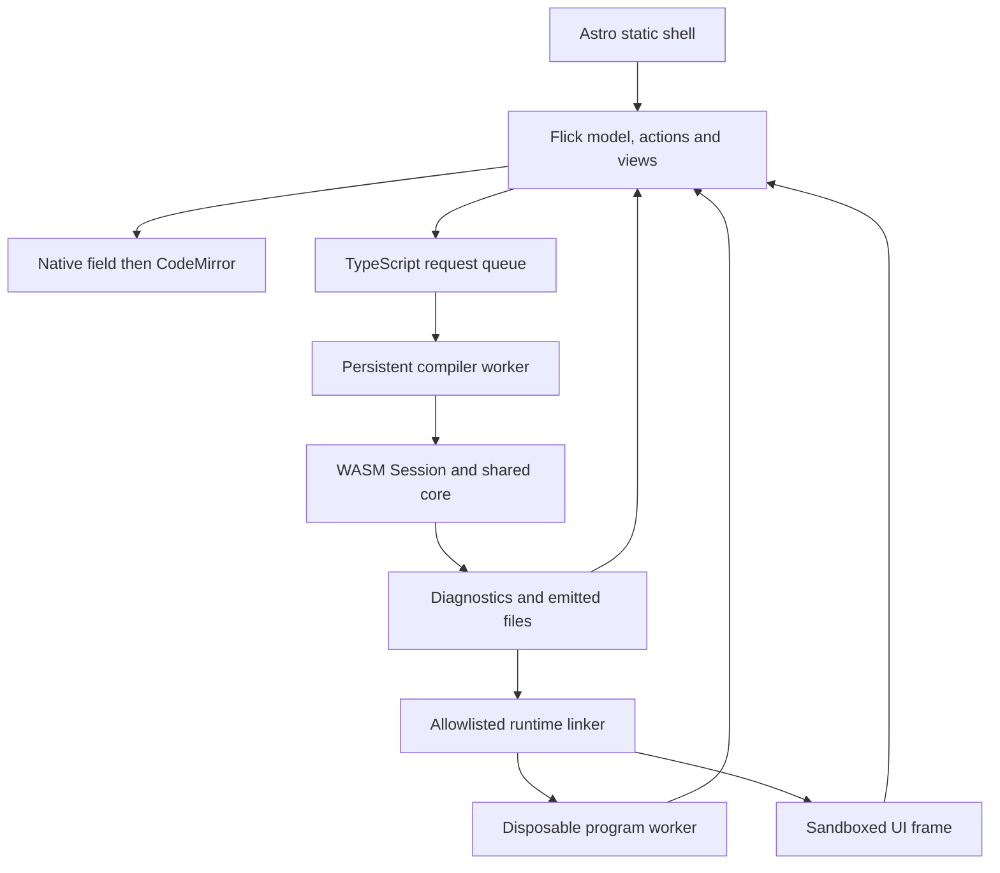

# Browser tools and editor integrations

Active contributors: bondiano, Vassiliy Kuzenkov — author names recorded on `origin/main`, excluding bots.

The documentation site is also a compiler client and a Flick UI application. Astro owns static pages, Flick owns interactive state and event policies, and TypeScript connects those programs to the browser, compiler worker and editor.

## Layout and ownership

| Area | Responsibility |
| - | - |
| `docs/src/content/docs/` | English learning/reference pages and Russian counterparts under `ru/`; the specification's original is Russian. |
| `docs/src/content/i18n/ru.json`, `docs/src/content.config.ts` | Starlight messages and content schemas, including translation `source_hash`. |
| `docs/src/pages/`, `docs/src/components/` | Locale landing pages, 404, navigation, table of contents, server-rendered widget shells, diagrams and highlighted samples. |
| `docs/src/routeData.ts`, `docs/src/styles/` | Plain-text browser/social titles and pagination labels; shared tokens, landing/playground styling and code themes. |
| `docs/src/widgets/` | Search, theme/search controls, copy buttons, the compiler-backed homepage example, shared UI elements and checked samples. |
| `docs/src/playground/` | Single-module editing, checking, generated output, execution, saved/shared source and lessons. |
| `docs/src/error-translations/` | Russian diagnostic explanations; generated reference pages come from these plus the compiler registry and English explanations. |
| `editors/vscode/`, `editors/tree-sitter-flick/`, `editors/zed/` | Desktop clients, lexical grammars and packaging. |

`docs/astro.config.mjs` builds a static Starlight site under `/flick-lang`, registers `@flick-lang/astro`, reuses the VS Code TextMate grammar, and splits CodeMirror into a separately loaded chunk. `docs/astro.sidebar.mjs` supplies section labels; `docs/scripts/parity.mjs` checks locale pairing. `docs/scripts/errors.mjs` generates public diagnostic pages rather than treating those pages as their own source of truth.

## Playground flow

`docs/src/playground/Playground.fl` mounts the UI while startup work loads independently. `docs/src/playground/State.fl` holds source, revision, profile, diagnostics, generated output, execution and lesson state. `docs/src/playground/Actions.fl` checks edits and rejects stale answers; emission is requested when generated-code tabs need it. `docs/src/playground/View.fl`, `docs/src/playground/Toolbar.fl`, `docs/src/playground/Editor.fl`, `docs/src/playground/Results.fl` and `docs/src/playground/Lesson.fl` render those states.

`docs/src/components/Playground.astro` renders `initial_view` on the server. Startup adopts text typed before hydration; `docs/src/playground/editor.ts` progressively opens CodeMirror and retains the native field if loading fails. `docs/src/playground/codemirror.ts` supplies editing, completion, hover and diagnostic marks. Shiki loads independently in `docs/src/playground/highlight.ts` and returns text plus allowlisted CSS classes, not arbitrary highlighted HTML.

`docs/src/playground/compiler.ts` serializes requests into one persistent worker. Canceled queued requests are removed before dispatch; canceling an active synchronous WASM call discards its response rather than interrupting Rust. `docs/src/playground/compiler.worker.ts` retains one `Session`, updating it before checks, hover, completion or emission. Offsets are UTF-16 at this boundary; see the [support crates](../packages/support-crates.md).

## Execution and persistence boundaries

- `docs/src/playground/loader.ts` links generated relative modules into module URLs and creates facades for runtime namespaces. It is a linker for compiler-shaped output, not a general npm resolver.
- `docs/src/playground/runtime.ts` allows selected bundled Effect-adapter subpaths, excludes Node HTTP-server adapters, and installs a minimal `process` object for arguments, environment and stream messages. Missing packages fail explicitly.
- Ordinary runs use `docs/src/playground/worker.ts`; stopping terminates that disposable worker, not the compiler. UI imports select an iframe instead.
- `docs/src/playground/frame.ts` requires an opaque origin and accepts a program once from its parent. The parent uses `sandbox="allow-scripts"`, a restrictive CSP and source/shape checks for returned messages. A mounted preview persists until replaced/closed. This documents the implemented boundary, not a security audit or a claim that all browser workers prohibit networking.
- `docs/src/playground/drafts.ts` stores local drafts and gzip/base64url source in URL fragments, enforcing a 64 KiB source/decompression bound. Restoring shared code checks it; it does not automatically run it.
- `docs/src/playground/lesson.ts` checks the first exercise's diagnostics, emitted declaration shape and execution output, with facts in `docs/src/playground/lesson-check.ts`.

The browser emitter currently selects the Effect backend explicitly. Do not substitute the native project default when reasoning about this page.

## Widgets and desktop editors

`docs/src/widgets/Search.fl` owns queries/results and uses a latest-event policy. `docs/src/widgets/browser.ts` loads production Pagefind in main-thread mode (`noWorker: true`), extracts plain-text excerpts and returns at most twelve hits. This workaround concerns Pagefind, not program isolation. `docs/src/widgets/Controls.fl` owns theme/search events; `docs/src/widgets/Copy.fl` owns clipboard feedback. `docs/src/widgets/Hero.fl` constructs honest/missing-effect examples and calls the same compiler bridge. `docs/src/widgets/Elements.fl` supplies fixed icons and validated links.

Desktop clients launch `flick lsp --stdio`, whose implementation belongs to [project and CLI](project-and-cli/index.md):

| Integration | Boundary |
| - | - |
| VS Code | `editors/vscode/extension.js` starts `vscode-languageclient`; `flick.path` chooses the executable. Package defaults enable two-space indentation, format-on-save and semantic highlighting. Bundling/VSIX checks live in `editors/vscode/scripts/`. |
| Tree-sitter | `editors/tree-sitter-flick/grammar.js` is intentionally token-level: brackets nest, other tokens are flat. `editors/tree-sitter-flick/src/scanner.c` handles nested comments and raw/multiline strings. It is not the compiler's layout parser. |
| Zed | `editors/zed/src/lib.rs` chooses explicit LSP binary settings, then worktree `PATH`, then a release matching the extension version, with complete installed releases as an offline fallback. Query/config files live in `editors/zed/languages/flick/`. |

Both lexical grammars leave precise semantic distinctions to the language server.

## Changing this subsystem

Keep interaction state/policies in Flick and browser/compiler primitives in TypeScript. Preserve typed text across startup, stale-result suppression, explicit execution of shared code, preview message checks and package allowlisting. Grammar changes must update both editor grammars and their fixtures.

For executable browser changes, use `just e2e-js` and `just bundle-size`; these exercise the WASM build, site tests, chunk budgets and browser tests. `pnpm -C docs test` covers linking, highlighting, examples, hydration and content contracts. Site content changes also need the documentation corpus, locale parity, `just docs` and the links checker from `docs/agents/validation.md`. Use `just tree-sitter` for grammar regeneration/tests and `just zed` for the Zed launcher. These are modification instructions, not checks run for this wiki.

## Key source files

| Source | Why read it |
| - | - |
| `docs/src/playground/Playground.fl`, `docs/src/playground/Actions.fl` | Startup, event ownership and stale-work handling. |
| `docs/src/playground/compiler.ts`, `docs/src/playground/compiler.worker.ts` | Queue, cancellation, compiler protocol and execution selection. |
| `docs/src/playground/runtime.ts`, `docs/src/playground/frame.ts` | Package/execution and iframe boundaries. |
| `docs/src/components/Header.astro`, `docs/src/components/Playground.astro` | Server shells and client mounting. |
| `docs/src/widgets/browser.ts` | Search, preferences and clipboard ports. |
| `editors/tree-sitter-flick/grammar.js`, `editors/vscode/syntaxes/flick.tmLanguage.json` | Lexical highlighting sources. |
| `editors/zed/src/lib.rs`, `editors/vscode/extension.js` | Desktop server selection/startup. |

Snapshot inventory: 919 tracked files under `docs/src/` and `editors/`; 5 (0.5%) are in test-named paths. This path heuristic includes generated reference/grammar files, misses inline tests and excludes the important `docs/test/` and `docs/e2e/` suites; it is not coverage. Source was inspected in the dirty working tree. See [developer tools](developer-tools.md) for the Astro compiler plugin and size gates.
