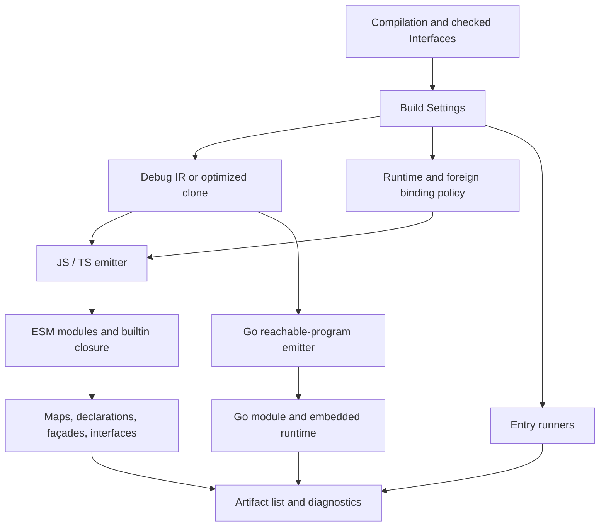

# Code generation and builds

Active contributors: bondiano, Vassiliy Kuzenkov

Code generation translates explicit IR into target source; build assembly supplies module paths, interfaces, runtime policy, and entry runners. JavaScript/TypeScript are module-oriented ESM outputs, while Go builds reachable application programs.

## Boundary and artifact flow

`flick-core/src/codegen/mod.rs` defines `Options` and `Output`. Options provide callbacks for module paths, package identity, foreign imports, and interfaces, plus target/profile/runtime choices. `flick-core/src/build/mod.rs` supplies those callbacks from `Compilation` and returns `Artifact { path, contents }` values plus diagnostics. Writing files and invoking external build tools belong to the caller.

Sources: `flick-core/src/build/mod.rs`, `flick-core/src/build/go.rs`, and `flick-core/src/codegen/go/mod.rs`. Build emission can return artifacts alongside errors; callers must inspect diagnostics before treating a build as successful.

## JavaScript and TypeScript execution

`flick-core/src/codegen/js/mod.rs` emits expressions into a current statement list. When a later operand needs statements, earlier operands are spilled into constants so source evaluation remains left to right. Names, constructor tags, foreign imports, dictionaries, handlers, and exports have dedicated helpers under `flick-core/src/codegen/js/`.

`flick-core/src/codegen/js/function.rs` follows per-parameter stages and dictionary parameters. Runtime selection changes the implementation:

| Choice | Emission behavior |
| - | - |
| Pure computation | Ordinary JavaScript values/functions |
| Effect adapter | Runtime stages use Effect machinery, including `Effect.gen` |
| Flick RT | Runtime calls yield/return values, generator objects, or instructions driven by the kernel; Sync stages run at once |

Flick RT's seam is `flick-core/src/codegen/js/kernel.rs`. A generator's tail runtime call can replace its frame; a body with no yields may need no generator frame. A Sync call uses the runtime's in-context execution path. Do not infer that every effectful arrow always emits the same generator shape.

Tail-call analysis is shared in `flick-core/src/codegen/tail.rs`. It requires full applications with appropriate dictionary arguments and jumpable stages; it also finds mutually tail-recursive groups. Backend eligibility differs between pure-only and direct-call modes. This is not a blanket guarantee for arbitrary recursion.

The header of `flick-core/src/codegen/mod.rs` describes the older Effect-only case; current `Options.rt` and `flick-core/src/codegen/js/kernel.rs` are necessary to understand both modes. Runtime implementations are covered in [runtimes](../../packages/runtimes/index.md).

## Runtime and foreign binding policy

`Settings.backend` selects RT, Effect, or the no-effects core route. `flick-core/src/build/effects.rs` maps package specifiers, checks no-effects availability, and chooses RT-native versus bridge exports. A relative `.mjs` foreign binding can use a sibling `.rt.mjs` on RT; relative import rewriting and `[build] ui` replacement are in `flick-core/src/build/mod.rs`.

`EffectBridge` distinguishes absent, available, and available-with-UI adapter states. Native `flick-core/src/build/bridge_select.rs` follows references through builtin IR and source modules to choose one owner for opaque UI values/registries. It deliberately considers source-library exports too. Mixing native and adapter opaque values under incompatible registries would violate the ABI. WASM builds use the bridge value supplied in settings rather than this native selection module.

**Working-tree change:** binding lists now belong to packages. `flick-core/build.rs` reads `packages/effect-ts/compiler-bindings.json` for module routing, and `runtime/rt_exports.txt` plus `runtime/rt_stubs.txt` for export and stub inventories, compiling each into build-output Rust constants. The former compiler-local text tables are deleted in this checkout. Change package metadata and its generating tools, not generated `bindings.rs`.

The no-effects path reports `FLICK-E008` for forbidden runtime/library dependencies and refined-schema construction. `control` handlers are a separate target restriction: `compiled_module` calls `control_on_js` only when the backend is **not RT**. RT has its own control-handler path; a comment in the checking helper saying “Go only” is not the full current build contract. Sources: `flick-core/src/build/effects.rs`, `flick-core/src/build/mod.rs`, and `flick-core/src/codegen/js/kernel.rs`.

## Module outputs and public ABI

`flick-core/src/build/mod.rs` maps `A.B` to module paths and puts builtin modules under `_flick/`. It emits the transitive builtin import closure, module code, entry launchers named `flick-<entry>.js` or `.ts`, and requested extras. Library no-Effect builds can live under `_core/`.

| Artifact | Contract and source |
| - | - |
| JavaScript / TypeScript module | Code plus re-exports; `flick-core/src/codegen/js/mod.rs` |
| Source map | Version 3, node-start mappings, UTF-16 columns; `flick-core/src/codegen/sourcemap.rs` |
| `.iface` | Closed interface, ABI summaries, dependencies, target metadata; `flick-core/src/build/abi.rs` |
| `.d.ts` | Checked public type projection; `flick-core/src/codegen/ts.rs` |
| Promise façade | Supported runtime exports projected to Promise consumers; `flick-core/src/codegen/ts.rs` and `flick-core/src/build/mod.rs` |
| Entry runner / optional schema AOT module | Starts `main`, optionally installs compiled decoders; `flick-core/src/build/mod.rs` |
| `package.json` | ESM/package entry metadata and runner side effects; `flick-core/src/build/mod.rs` |

Interfaces and ABI summaries come from reference lowering, not optimized bodies. Publication finalizes ABI/backend availability before computing dependency fingerprints. That keeps debug/release optimization choices from inventing different public contracts. Source: `flick-core/src/build/mod.rs`.

TypeScript projection can refuse a Flick type with a reason rather than emit `any`. Higher-kinded variables and unsupported open/region-sensitive shapes need concrete façades or another supported projection. Do not assume every accepted Flick export has a faithful TypeScript form. Sources: `flick-core/src/codegen/ts.rs` and `flick-core/src/codegen/ts/native.rs`.

`build-artifacts`, `source-maps`, and `typescript` independently gate output families. The public build API returns `FLICK-F004` for unavailable TypeScript capabilities; the lower-level JS emitter asserts its TypeScript precondition. Source: `flick-core/src/build/mod.rs` and `flick-core/src/codegen/js/mod.rs`.

## Go is a whole-program backend

`flick-core/src/codegen/go/mod.rs` builds one `package main`, with module code in separate files and `flickrt` beside it. Expressions have Go type `flickrt.Value`; top-level functions take their arguments at once and acquire curried wrappers where needed. Module initialization runs in dependency order instead of relying on Go variable initialization cycles.

Only reachable code from the selected entry or test suites is compiled. Unsupported reachable forms produce diagnostics, not runtime stubs. `flick-core/src/build/go.rs` assembles `go/<entry>/`, embeds runtime sources and required optional packages, resolves sibling `.go` FFI files, and supplies `//line` locations. No entry is an error because this path builds applications, not arbitrary library output.

`flick-core/build.rs` collects non-test Go runtime files and optional package metadata at compiler build time. A runtime source change therefore can require rebuilding the Rust compiler to affect generated Go artifacts. The CLI later invokes `go build`; see [project and CLI](../project-and-cli/index.md).

## Making changes

Trace the checked metadata through lowering before adjusting generated text. Preserve left-to-right effects, dictionary order, import/package identity, source locations, and both runtime policies. For build metadata changes, test publication fingerprints and consumers as well as local code emission.

Select checks from `docs/agents/validation.md`: IR/codegen work needs `cargo test -p flick-ir`, `cargo test -p flick-core --test ir_round_trip`, relevant backend tests, `just e2e-tests`, `just e2e-cases`, and `just language`. Runtime changes add runtime/conformance checks; capability changes add `just feature-check`, `just feature-test`, and `just wasm`. Tests and builds were not run for this prose-only generation.

## Key source files

| Source | Role |
| - | - |
| `flick-core/src/codegen/mod.rs` | Target options, output, labels, bridge state |
| `flick-core/src/codegen/js/mod.rs` | ESM generation and order-preserving statement emission |
| `flick-core/src/codegen/js/kernel.rs` | Flick RT calling convention |
| `flick-core/src/codegen/js/foreign.rs` | Foreign calls and runtime adapters |
| `flick-core/src/codegen/ts.rs` | TypeScript projection and refusal reasons |
| `flick-core/src/codegen/go/mod.rs` | Reachable whole-program Go emission |
| `flick-core/src/build/mod.rs` | Artifact orchestration and publication |
| `flick-core/src/build/effects.rs` | Backend binding routes and restrictions |
| `flick-core/src/build/bridge_select.rs` | Build-wide opaque UI ownership |
| `flick-core/build.rs` | Embedded source and binding-policy generation |

Snapshot: **60 Rust files**, **3:57 test-named/other files**, **10 files containing `#[test]`**, and **2 human committer-name strings**. See the [measurement method](index.md#snapshot-method) and [interface contract](interfaces-and-helpers.md).
