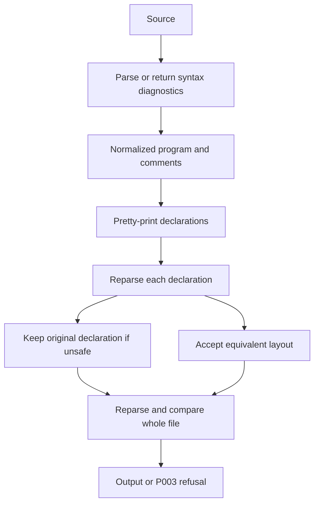

# Formatting and diagnostics

Active contributors: bondiano, Vassiliy Kuzenkov

The formatter reuses parsed syntax and verifies its output before returning it. Diagnostics provide stable codes, byte spans, related locations, and optional lazy edits to native and browser consumers.

## Canonical layout with a refusal path

`flick-core/src/fmt/mod.rs` formats each declaration as a `flick-pretty` document with a target width of **100 columns** and two-space indentation. Output depends primarily on code and width, but intentional trailing separators, multiline pipelines, blank lines, and comments preserve selected author choices.

Formatting is not a blind token rewrite:

`flick-core/src/fmt/mod.rs` verifies both normalized structure and comment order. A declaration whose layout would change meaning, or cannot place a line comment safely, is retained in its original form. The entire output is checked again; a mismatch returns `FLICK-P003` rather than unsafe output.

`flick-core/src/fmt/program.rs` normalizes only formatter-permitted differences in the trivia-free AST, such as statement separators, an optional first variant pipe, and equivalent empty effect-row spellings. This is a structural safety check, not a general semantic equivalence proof.

Dropping redundant outer `forall` is narrower than ordinary normalization: explicit quantification can change polymorphic recursion or shadowing. The formatter makes that decision in `flick-core/src/fmt/foralls.rs`; do not broaden it just to make an AST comparison pass.

## Comments and plugins

Comment attachment is tracked separately in `flick-core/src/fmt/comments.rs`; an AST without trivia cannot prove comments were preserved. New formatting forms must retain leading, trailing, and blank-line behavior.

`format_with` accepts a plugin lookup. `flick-core/src/fmt/plugins.rs` lets a plugin supply layout pieces while the shared formatter handles Flick code in its holes, including nested blocks. Unknown/unformatted plugin bodies remain as written with indentation adjusted. A plugin layout failure produces `FLICK-P036` and causes the formatting call to fail; it is not silently accepted as canonical output. The plugin heads must also be available during verification reparses.

See [plugins](../../packages/plugins.md) for expansion and host execution, and [support crates](../../packages/support-crates.md) for the pretty-printing engine.

## Diagnostic model and consumers

`flick-core/src/diagnostics/model.rs` defines:

| Field/type | Meaning |
| - | - |
| `Code` and `Severity` | Stable diagnostic identity and Error/Warning/Note classification |
| `span: Option` | Primary UTF-8 byte range; absent for location-free project/CLI failures |
| `Related` | Additional spans and explanatory messages |
| `Fix` | Suggested message, edits, and an internal safe-to-apply flag |
| `Edit` | Replacement text over a source span |
| `incomplete` | Internal marker for diagnostics relying on an error type |

Code declarations and their explanation text are in `flick-core/src/diagnostics/codes.rs`. `Diagnostic::unnecessary` marks particular unused/dead-code diagnostic codes so editors can dim them. Preserve codes and spans when changing wording or internal inference.

The `diagnostic-fixes` capability removes `Fix` storage and serialization, but not primary diagnostics or `Edit` as a shared type. `with_fix`, `with_safe_fix`, and `did_you_mean` take factories that are not evaluated when fixes are disabled. This avoids paying to construct discarded suggestions and keeps capability-minimal builds working. Sources: `flick-core/src/diagnostics/model.rs` and `flick-core/src/diagnostics/suggest.rs`.

The suggestion helper uses optimal-string-alignment distance, a bounded candidate radius, and deterministic name-order tie breaking. A suggestion is not automatically safe for batch application; `with_safe_fix` is an explicit stronger promise. Source: `flick-core/src/diagnostics/suggest.rs`.

## Rendering and position encodings

`flick-core/src/diagnostics/render/json.rs` emits schema-version **1** diagnostic events. The CLI renderer returns newline-delimited JSON; other hosts can consume the shared event iterator. Events include code, severity, message, path, byte range, related locations, and fixes when enabled. The JSON fix form contains messages/edits, not the model's `safe` field.

Human rendering is separately gated by `terminal-diagnostics` in `flick-core/src/diagnostics/render/human.rs`. Browser and LSP consumers convert compiler offsets to their external position encodings; never change core spans to UTF-16 merely because an editor uses it. Sources: `flick-core/src/source.rs` and [project and CLI](../project-and-cli/index.md).

With syntax errors, `types::beside_syntax_errors` suppresses diagnostics overlapping error nodes and some incomplete inference consequences. This reduces cascades while preserving independent errors elsewhere. It does not authorize suppressing a primary rejection or lowering invalid code. Source: `flick-core/src/types/mod.rs`.

## Making changes

- Add parser/formatter regressions for narrow and wide layouts, trailing separators, comments, fragments, plugin bodies, and idempotence. Do not relax normalized comparison to permit an unexplained mismatch.
- For checker failures, use annotated cases under `tests/check/fail/` to pin codes and spans. A Markdown failure fence is not a span-sensitive regression.
- Review whether edits are merely suggestions or genuinely safe. Test them against changed offsets, comments, Unicode, and syntax errors.
- Preserve primary diagnostics in builds without `diagnostic-fixes` and JSON operation without terminal rendering.

Validation is selected by `docs/agents/validation.md`: parser/formatter changes need `cargo test -p flick-core --test corpus` and relevant unit tests; diagnostic changes also need tests for the originating checker/project behavior. Capability changes need `just feature-check` and `just feature-test`. No formatter/compiler suites were run for this documentation-only task.

## Key source files

| Source | Role |
| - | - |
| `flick-core/src/fmt/mod.rs` | Public formatting API and reparse safeguards |
| `flick-core/src/fmt/program.rs` | Allowed structural normalization |
| `flick-core/src/fmt/comments.rs` | Comment placement |
| `flick-core/src/fmt/foralls.rs` | Quantifier-preserving rewrite rules |
| `flick-core/src/fmt/plugins.rs` | Plugin layout and shared hole formatting |
| `flick-core/src/diagnostics/model.rs` | Diagnostics, safe fixes, and lazy construction |
| `flick-core/src/diagnostics/codes.rs` | Stable codes and explanation registry |
| `flick-core/src/diagnostics/render/json.rs` | Versioned structured diagnostics |
| `flick-core/src/diagnostics/suggest.rs` | Deterministic spelling suggestions |

Snapshot: **23 Rust files**, **5:18 test-named/other files**, **8 files containing `#[test]`**, and **2 human committer-name strings**. See the [measurement method](index.md#snapshot-method) and [syntax internals](syntax-and-resolution.md).
