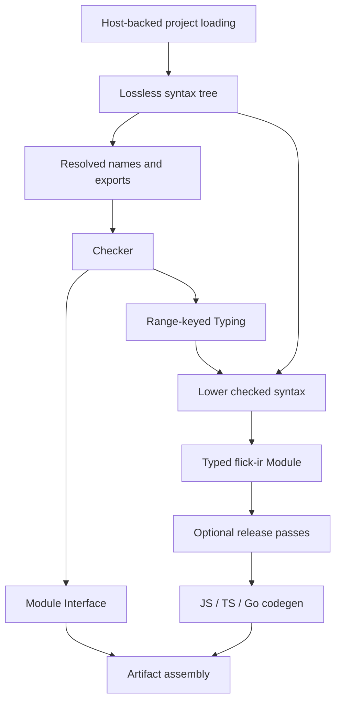

# Compiler internals

Active contributors: bondiano, Vassiliy Kuzenkov

Flick's compiler is a shared Rust library: source is parsed and resolved, checked into module interfaces plus typing metadata, lowered to explicit IR, and emitted for JavaScript, TypeScript, or Go. This section explains the boundaries inside `flick-core/src/lib.rs`, including the formatter and tools that consume those same representations.

## Purpose and entry points

The native CLI and browser compiler share `flick-core`. The library's `check` function checks one source file and takes unavailable imported names on trust; it is not a whole-program check. It also performs builtin deriving and watched-call checks, and delegates files containing inline modules to project checking. Whole projects use the `Host`-backed APIs in `flick-core/src/project/mod.rs`; see [project and CLI](../project-and-cli/index.md).

The project loader coordinates plugin expansion, dependency interfaces, checking, and optional lowering. `flick-core/src/project/load/checking_core.rs` lowers only a clean module when compilation was requested, then restores generated-code diagnostics, IR spans, and interface locations to user source. Do not bypass that coordination by calling the single-file checker before a build.

The diagram follows `flick-core/src/syntax/mod.rs`, `flick-core/src/resolve/mod.rs`, `flick-core/src/types/mod.rs`, `flick-core/src/ir/mod.rs`, `flick-core/src/opt/mod.rs`, and `flick-core/src/build/mod.rs`. Expansion and dependency scheduling belong to the project layer, not a separate universal pass after checking.

## Reading map

| Topic | What to read here |
| - | - |
| [Syntax and resolution](syntax-and-resolution.md) | Losslessness, layout, recovery, namespaces, imports, and generated-code boundaries |
| [Type checking](type-checking.md) | Bidirectional checking, rows, classes, regions, module contracts, and `Typing` |
| [Typed IR and optimization](typed-ir-and-optimization.md) | Explicit stages and dictionaries, evaluation order, desugaring, and release passes |
| [Code generation and builds](code-generation-and-builds.md) | Runtime selection, target differences, declarations, source maps, and artifacts |
| [Formatting and diagnostics](formatting-and-diagnostics.md) | Reparse safeguards, comments, stable codes, spans, and lazy fixes |
| [Interfaces and helpers](interfaces-and-helpers.md) | `.iface`, API diffs, source positions, constant evaluation, builtin sources, and Markdown examples |

## Contracts that cross phases

1. **Lossless source and stable locations.** Tokens cover the original bytes; compiler spans are UTF-8 byte ranges. Editor positions and source-map columns require conversion. Sources: `flick-core/src/syntax/cst.rs`, `flick-core/src/source.rs`, and `flick-core/src/codegen/sourcemap.rs`.
2. **Checking decides meaning.** Lowering reads `Typing` for resolved identities, dictionaries, stage selection, lifts, and coercions. A backend must not infer these again from surface spellings. Sources: `flick-core/src/types/typing.rs` and `flick-core/src/ir/lower/expr.rs`.
3. **Application stages are observable.** A runtime arrow with empty rows is not a pure arrow. `Pure`, `Sync`, and `Runtime` affect when work happens and how calls are emitted. Sources: `flick-core/src/types/effects.rs`, `flick-core/src/types/ty.rs`, and `flick-ir/src/stage.rs`.
4. **Release preserves debug behavior.** Rewrites must preserve evaluation order, defects, service lookup boundaries, and runtime calls. Sources: `flick-core/src/ir/mod.rs`, `flick-core/src/opt/mod.rs`, and `flick-core/src/opt/walk.rs`.
5. **Interfaces are an importer contract.** They preserve defining-module identity through re-exports, closed types, instances, and build ABI. Schema/compiler mismatches are rejected. Source: `flick-core/src/iface.rs`.

The reference calculus and Lean results cover narrower, stated contracts. They do not establish correctness of these Rust phases or emitted programs; see [formal model](../formal-model.md).

## Capability boundaries

`flick-core/Cargo.toml` enables the full compiler by default but gates IDE support, build metadata, source maps, TypeScript, diagnostic fixes, native project adapters, terminal rendering, and builtin documentation separately. `ide` enables TypeScript and fixes; `embedded-std` is separate from the default list. `flick-core/src/lib.rs` and `flick-core/src/build/mod.rs` keep shared analysis usable without native filesystem adapters.

Unsupported TypeScript output requests produce `FLICK-F004` through the build API rather than silently producing JavaScript. Disabling diagnostic fixes must leave primary diagnostics unchanged. Minimal builds need isolated checks, because Cargo workspace feature unification can hide missing gates. Sources: `flick-core/src/build/mod.rs`, `flick-core/src/diagnostics/model.rs`, and `CONTRIBUTING.md`.

## Making changes

Start with the relevant subpage, reproduce the behavior through its real CLI/browser/editor entry point, and add a regression before changing implementation. Syntax changes reach formatting, grammars, fixtures, diagnostics, and both site locales. Semantic changes also require a model/proof impact decision. `AGENTS.md`, `docs/agents/compiler-workflow.md`, and `docs/agents/validation.md` are the governing workflow.

The compiler subpages list focused checks. Executable changes still require the broader applicable gates; a passing unit test is not evidence that emitted programs work. See [testing](../../how-to-contribute/testing.md) and [patterns and conventions](../../how-to-contribute/patterns-and-conventions.md).

## Snapshot method

Measured on 2026-11-10 in the dirty working tree: this compiler scope has **285 Rust files**, of which **34 are test-named and 251 are other files**, a file-count ratio of **34:251**. **62 files contain `#[test]`**; this overlaps both categories. These are layout measurements, not test coverage.

Scope: the directories discussed here, `flick-core/src/lib.rs`, the helper files on [interfaces and helpers](interfaces-and-helpers.md), and `flick-core/build.rs`. Project/FFI/IDE/plugin implementation and separate crates are excluded. A test-named file has stem `tests`, ends in `_tests`, or is under a `tests` directory; embedded tests, fixture files, and integration harnesses are not comprehensively counted by that rule.

Bylines use the most frequent author-name strings from `git log origin/main -- <scope>`, excluding bots. Committer counts use distinct `%cn` strings on the same branch, excluding `[bot]` accounts and GitHub's platform committer; they are not identity-normalized people counts or an ownership guarantee. This scope has **2 human committer-name strings**. Subpage figures use the same method.

Uncommitted details in this snapshot include shared syntax/plugin structure facts, plugin expression facts, and package-owned compiler binding metadata. They are described as working-tree behavior, not as a released interface.

## Key source files

| Source | Role |
| - | - |
| `flick-core/src/lib.rs` | Public modules and single-file checker |
| `flick-core/src/project/load/checking_core.rs` | Project-to-compiler coordination and clean-lowering gate |
| `flick-core/src/types/typing.rs` | Checker-to-lowering metadata |
| `flick-core/src/ir/mod.rs` | Typed IR contract and shared-crate re-exports |
| `flick-core/src/build/mod.rs` | Artifact assembly from compiled modules |
| `flick-core/Cargo.toml` | Independently selectable compiler capabilities |
| `docs/agents/validation.md` | Required checks by affected behavior |
