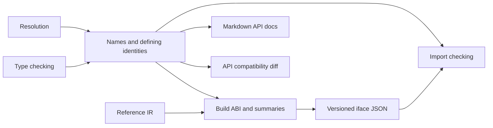

# Interfaces and compiler helpers

Active contributors: bondiano, Vassiliy Kuzenkov

Compiler helpers make checked information reusable outside code emission: module interfaces support imports and API comparison, source maps preserve positions, and documentation tooling reuses syntax and diagnostics. Constant/numeric helpers also define semantics shared by checking and optimization.

## Interfaces are more than an export list

`flick-core/src/iface.rs` defines `Interface`, `Export`, `Entity`, and compiled ABI structures. An entity's identity is its defining module, namespace, and name, even when another module re-exports it.

An interface can contain exported type schemes and definitions, private/hidden-member information, documentation, transitive instances, makers/server reachability, source hints, compiled targets, ABI summaries, and dependency fingerprints. Instances are visible to importers regardless of which ordinary names they expose.

Sources: `flick-core/src/resolve/mod.rs`, `flick-core/src/types/exports.rs`, `flick-core/src/build/abi.rs`, and `flick-core/src/iface.rs`.

The current `.iface` schema version is **11**. `iface::read` requires that version, the exact compiler package version, and the requested module name. It rejects a mismatched file rather than attempting approximate compatibility. `Type::Meta`, skolems, and error markers are not valid exported closed types. Sources: `flick-core/src/iface.rs` and `flick-core/src/types/ty.rs`.

Compiled ABI includes constructor identities/tags and fields, GADT dictionary fields, instance dictionary exports, and value summaries used by importers/backends. Schema changes need an `IFACE_VERSION` decision and round-trip tests, not only a Rust struct update. Source: `flick-core/src/iface.rs`.

## Fingerprints and API diffs

`iface::fingerprint` hashes a serialized interface with a 64-bit FNV-style hash. It removes dependency fingerprints, source locations, declaration offsets, and docs before hashing; those do not change importer semantics. It retains ABI and other contract-bearing content. This is an incremental compatibility key, not a cryptographic authenticity check. Source: `flick-core/src/iface.rs`.

`flick-core/src/api_diff.rs` compares modules' public exports and their own instances:

- Additions require a minor bump; removals or changed public shapes require a major bump.
- No changes require a patch bump.
- Before version 1.0, a breaking bump advances the minor version.
- Synthetic names containing `$` are excluded from ordinary public export comparison.
- Instance contexts are canonicalized; removing a constraint is treated as a nonbreaking addition, while strengthening/changing a context can break users.

The comparison normalizes shape rather than comparing source positions or documentation. It does not execute implementations or prove behavioral compatibility. Module contracts also reuse API-shape comparison from `flick-core/src/types/module_contract.rs`. CLI workflows are described in [project and CLI](../project-and-cli/index.md).

## Source storage and encoding

`flick-core/src/source.rs` stores display paths as strings so sources also work in WASM. `SourceMap` assigns `FileId`s and keeps a line-start index; `SourceFile::line_col` returns zero-based line and **byte** column.

`add_bytes` stores invalid UTF-8 lossily but reports `FLICK-S001` at the first invalid sequence. Normal compiler spans are UTF-8 byte ranges; editors must convert them. Version 3 source maps separately convert source/generated columns to UTF-16 in `flick-core/src/codegen/sourcemap.rs`. Do not interchange those encodings.

## Constant and numeric semantics

`flick-core/src/consteval.rs` recognizes literal-based expressions, parentheses, simple single-expression blocks, prefix/binary operations, and constant conditionals. `None` means the helper cannot supply a result: it is not proof the expression is invalid, false, or effectful.

The evaluator uses IEEE-754 numeric operations, SameValueZero Float equality, UTF-16 string ordering, and bounded `i128` storage for compile-time BigInt values. Checked BigInt arithmetic can refuse an overflowing compile-time result even though a runtime BigInt can be larger. This is a folding limitation, not a language range bound.

`flick-core/src/numeric.rs` connects `flick_ir::Num` to lang items, chooses default numeric types, parses integer forms, formats floats, and supplies wrapping `Int` arithmetic. An unconstrained integral literal defaults to `Int`; a fractional one to `Float`. `Int` division/remainder by zero yields zero.

Use typed arithmetic when the numeric kind is known: `flick-core/src/opt/fold.rs` special-cases `Int` before calling generic constant operations. The current `consteval::binary` implementation also returns zero for BigInt division/remainder by zero; its older module comment describing a runtime `RangeError` is not the implemented branch. Keep tests and language contracts ahead of stale comments when changing arithmetic.

## Builtin sources and implicit packages

`flick-core/src/types/builtin_sources.rs` embeds core Flick modules in dependency order. `flick-core/src/types/builtins.rs` checks them with the same checker and combines them with implicit packages supplied by the host, found at `FLICK_STD_PATH` on native builds, or embedded under `embedded-std`. The package list in `flick-core/src/implicit_packages.rs` is currently `["std"]`.

Implicit package installation is process-global and one-time through `OnceLock`; callers must configure it before first use rather than expect later projects to reset the builtin universe. Sources: `flick-core/src/types/builtins.rs` and `flick-core/src/types/env/shared.rs`. Application/session integration belongs to [project and CLI](../project-and-cli/index.md) and [browser tools](../browser-tools.md).

`flick-core/build.rs` creates embedded-source tables and Go runtime/package tables. Without `builtin-docs`, `flick-core/src/builtin_source.rs` lexically removes embedded `DocComment` tokens, not user documentation or string contents. It refuses builtin CLI blocks whose documentation is runtime help unless that help is preserved first. The same source module has unit tests through `flick-core/src/lib.rs`.

The small timing helper in `flick-core/src/clock.rs` measures native work for logs; on wasm32 it runs the closure but returns `Duration::ZERO`. Browser zero timings are not performance measurements.

## Documentation and fenced examples

`flick-core/src/doc.rs` builds a Markdown page per interface and extracts adjacent `///` comments, including constructor documentation. Public types retain kinds, constraints, effect/error rows, and captures through shared type display functions. Published interface docs also feed declarations generated without the original source.

`flick-core/src/markdown.rs` extracts closed Flick fences, compiles hidden `#` / `# ` lines without their prefix, and tracks offsets back to the containing page. `Block::restore` maps non-overlapping edits back while retaining hidden-line status; untouched lines retain their original bytes.

| Fence mode | Current role |
| - | - |
| Default | Check normally |
| `keep` | Check, but preserve an intentional long spelling against safe-fix rewriting |
| `ignore` | Parse-only example, with reviewed restrictions/reasons in the corpus harness |
| `fail T010` | Expect named diagnostic codes |

The extractor can represent an empty code list, but **the current site corpus rejects a `fail` fence that names no code**, requires every named code to occur, and rejects unexpected error codes. This enforcement is in `flick-core/tests/corpus.rs`, not the extraction helper. Named fences still do not pin exact spans; use annotated checker fixtures for that.

## Making changes

- An interface addition reaches serialization, publication fingerprints, importer invalidation, docs, API comparison, and possibly TypeScript output. Test both reuse and invalidation of changed contracts through project callers.
- Numeric behavior must agree across constants, typed IR folding, emitted JS/Go, runtimes, and the applicable model contract.
- Source/example rewrite changes need Unicode, CRLF, hidden lines, multiline replacements, and unchanged-line preservation tests.
- Embedded builtin changes must preserve ordering, lang-item identities, reduced-capability builds, and runtime-help behavior.

Relevant prescribed checks: interface/helper unit tests; `cargo test -p flick-core --test corpus docs_examples_check` for example tooling; `cargo test -p flick-core --test ir_round_trip` and `just language` for numeric lowering changes; and `just feature-check` / `just feature-test` for builtin capability changes. Choose additional gates using `docs/agents/validation.md`. No executable checks were run for this prose-only task.

## Key source files

| Source | Role |
| - | - |
| `flick-core/src/iface.rs` | Versioned interface schema, read/write, and fingerprint |
| `flick-core/src/api_diff.rs` | Public API comparison and version bump classification |
| `flick-core/src/source.rs` | Shared source files and byte positions |
| `flick-core/src/consteval.rs` | Literal expression evaluation |
| `flick-core/src/numeric.rs` | Numeric kinds, defaults, and typed `Int` operations |
| `flick-core/src/doc.rs` | Interface-based API documentation |
| `flick-core/src/markdown.rs` | Fence extraction and edit restoration |
| `flick-core/tests/corpus.rs` | Actual documentation-example acceptance rules |
| `flick-core/src/builtin_source.rs` | Build-time builtin-doc stripping |
| `flick-core/src/implicit_packages.rs` | Implicit package inventory |
| `flick-core/src/clock.rs` | Native timing / WASM zero duration |

Snapshot: **11 Rust files**, **1:10 test-named/other files**, **8 files containing `#[test]`**, and **2 human committer-name strings**. Counts cover the helper files and `flick-core/src/consteval/`, not the cross-linked type/build modules or corpus harness. See the [measurement method](index.md#snapshot-method) and [compiler overview](index.md).
