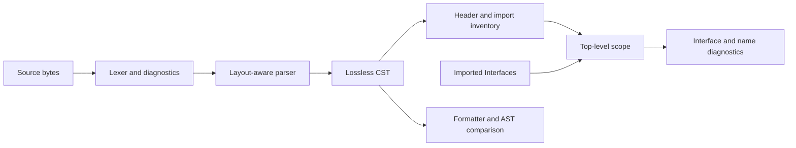

# Syntax and resolution

Active contributors: bondiano

Flick parses into a lossless concrete syntax tree, then resolves module-level identities and exports against imported interfaces. Formatting, plugin fragments, diagnostics, and editor queries reuse that syntax rather than maintaining independent parsers.

## Layout and representations

`flick-core/src/syntax/lexer/mod.rs` emits tokens covering every byte, including whitespace and comments. A malformed literal remains a token with a diagnostic, so its contents do not become a cascade of unrelated tokens. Generated-code lexing separately permits compiler companion names such as `Owner$member`.

The recursive-descent parser uses Pratt operators and resolves indentation with a context stack in `flick-core/src/syntax/parser/mod.rs`. It does not insert a stream of indentation tokens: contexts decide whether a line continues an expression, separates statements, or ends a block. A virtual `LayoutSep` lets individual grammar routines stop at the same boundary. Bracket contexts suppress ordinary line-break significance.

| Representation | Responsibility |
| - | - |
| Raw tokens | Byte coverage and lexical diagnostics; `flick-core/src/syntax/lexer/mod.rs` |
| Parser events | Start/token/finish events built into a tree; `flick-core/src/syntax/parser/build.rs` |
| CST `Node` / `Element` / `Token` | Source-preserving structure and token ranges; `flick-core/src/syntax/cst.rs` |
| Trivia-free AST view | Structural comparison without layout trivia; `flick-core/src/syntax/ast.rs` |
| `ModuleSyntax` | Header, imports, inline imports, functor applications, plugin heads; `flick-core/src/resolve/syntax.rs` |
| `Interface` | Resolved exports and entity identities; `flick-core/src/iface.rs` |

The central losslessness invariant is `tree.text(source) == source`. A node's `range()` covers its non-trivia tokens; it is not necessarily the full range of attached comments. The distinction matters for fixes and declaration formatting. Source: `flick-core/src/syntax/cst.rs`.

The parsing flow is implemented in `flick-core/src/syntax/parser/mod.rs`; scope construction and exported identities are in `flick-core/src/resolve/mod.rs` and `flick-core/src/resolve/scope.rs`.

## Fragments, plugins, and recovery

`flick-core/src/syntax/parser/fragment.rs` exposes expression, body, type, pattern, declaration, and declaration-list parsers. They retain the original file offsets and surrounding layout information. Plugin holes and generated declarations use these routines; replacing them with a parse of an isolated substring can change indentation semantics and locations.

`parse_with_heads` also supplies imported plugin heads and allows the formatter's declaration layout to be parsed in context. Generic plugin-block parsing is under `flick-core/src/syntax/parser/plugin.rs`; plugin expansion itself is described in [plugins](../../packages/plugins.md).

Parsing returns a tree plus diagnostics, rather than aborting at the first error. After parsing, `flick-core/src/syntax/validate.rs` checks surface restrictions. The parser has a depth bound of 200 in `flick-core/src/syntax/parser/mod.rs`. Later, `types::beside_syntax_errors` filters type diagnostics touching error nodes and incomplete guesses; it does not make an invalid tree eligible for code generation. Sources: `flick-core/src/types/mod.rs` and `flick-core/src/project/load/checking_core.rs`.

## Resolution rules and limits

`flick-core/src/resolve/mod.rs` collects declarations, checks duplicates and alias cycles, constructs scope, computes exports, checks references, and adds unused/dead-name diagnostics. Resolution works with three namespaces: values, types, and constructors. An `Entity` names the module that defines it, so re-exporting a value does not create a new identity. Source: `flick-core/src/iface.rs`.

`flick-core/src/resolve/scope.rs` checks qualifiers, exposed-name conflicts, shadowing, visibility, and ambiguity by identities and names, not import order. Tests for a new import rule should therefore include reordered imports.

Important cases from `flick-core/src/resolve/syntax.rs`:

- A module header with no `exposing` list exports nothing.
- `inline_imports` are dependency-loading/cache inputs, not names automatically in scope for the enclosing module.
- Static module applications retain their functor and arguments for project-level elaboration.
- Plugin heads have their own import exposure information.

If an import interface is unavailable, the resolver takes its possible names on trust; the project loader owns the missing-import diagnostic. This avoids reporting the same missing module once for every reference, but means resolver success alone does not prove a complete program. Source: `flick-core/src/resolve/mod.rs`.

`resolve::Module.generated` marks the boundary between user and generated code, or is `NO_GENERATED`. Name lookup and lowering keep generated locals on the appropriate side of that boundary. Keep it when changing expansion; see `flick-core/src/ir/lower/mod.rs`.

## Working-tree crosscutting helper

In this snapshot, `flick-core/src/syntax/structure.rs` is an uncommitted shared helper for function lints and plugins. It measures source-body lines, branch complexity, and nesting against `types::Thresholds`. Nested named functions are excluded from the surrounding function's branch/depth traversal; `else if` avoids an extra nesting increment. Its metrics are a compiler lint contract, not a general complexity score.

## Making changes

- Add tokens and node forms in `flick-core/src/syntax/kind.rs`, grammar behavior in the appropriate parser routine, and surface restrictions in `flick-core/src/syntax/validate.rs`.
- Preserve token coverage and test malformed, incomplete, deeply nested, multiline, and comment-bearing inputs.
- Update AST comparison and formatting when a new node can reach `flick-core/src/fmt/`; see [formatting and diagnostics](formatting-and-diagnostics.md).
- For new declarations or import forms, update `flick-core/src/resolve/defs.rs`, `flick-core/src/resolve/uses.rs`, and `flick-core/src/resolve/syntax.rs` as needed. Test accepted and rejected exports, aliases, namespace collisions, and private access.
- Account for editor grammars, English/Russian examples, IDE spans, and safe fixes under `docs/agents/compiler-workflow.md`.

Focused validation: `cargo test -p flick-core --test corpus`, relevant syntax/formatter unit tests, and `just tree-sitter` when its grammar changes. These are prescribed checks, not checks run while generating this page.

## Key source files

| Source | Role |
| - | - |
| `flick-core/src/syntax/lexer/mod.rs` | Byte-covering lexer and generated-code mode |
| `flick-core/src/syntax/parser/mod.rs` | Layout contexts, parse orchestration, depth bound |
| `flick-core/src/syntax/parser/fragment.rs` | Shared parsers for plugin holes and declarations |
| `flick-core/src/syntax/cst.rs` | Lossless representation and ranges |
| `flick-core/src/resolve/mod.rs` | Resolution orchestration |
| `flick-core/src/resolve/scope.rs` | Imports, exports, conflicts, and ambiguity |
| `flick-core/src/resolve/syntax.rs` | Module syntax inventory |
| `flick-core/src/syntax/structure.rs` | Shared lint/plugin body measurements, uncommitted |

Snapshot: **31 Rust files**, **4:27 test-named/other files**, **8 files containing `#[test]`**, and **1 human committer-name string**. See the [measurement method](index.md#snapshot-method) and [compiler overview](index.md).
