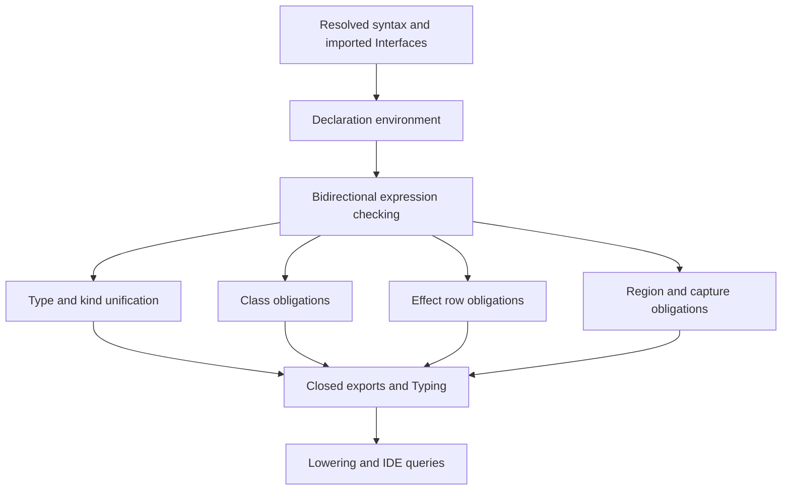

# Type checking

Active contributors: bondiano, Vassiliy Kuzenkov

The checker reads resolved concrete syntax against imported interfaces. It returns diagnostics, fills the module's public interface, and records the decisions that lowering and IDE queries need in `Typing`.

## Entry point and state

`check_typed` in `flick-core/src/types/mod.rs` is the main typed-checking API. `check` returns only diagnostics; `check_with_evidence` also exposes class evidence. Project elaboration can use `check_typed_with_module_dictionaries` to supply static module arguments' local dictionaries.

The checker owns a per-module environment, type-unification store, kind store, local bindings, current execution stage, class constraints, region state, and output metadata. `run_in` initializes these, checks the module, reports holes, records watched calls, fills exports, and finishes typing. Sources: `flick-core/src/types/mod.rs`, `flick-core/src/types/env.rs`, and `flick-core/src/types/unify.rs`.

`flick-core/src/types/toplevel.rs` declares types and classes, registers instances and schemas, pairs signatures with definitions, and checks top-level items. Top-level declarations are order-independent: an unsigned value is inferred when needed. Recursion must be explicit with `let rec` or a `rec` group; values cannot silently become recursive.

This is a map of cooperating stores, not a claim that constraints are solved only once in a fixed global order. Generalization itself settles rows and attempts class solving; module checking also has final passes. Sources: `flick-core/src/types/generalize.rs` and `flick-core/src/types/toplevel.rs`.

## Types, kinds, and inference

`flick-core/src/types/ty.rs` defines named types, applications, function arrows, exact records and rows, unions, `forall`, capture qualifications/bounds, and existential module witnesses. Metavariables, skolems, and error markers are internal; interface types must be closed.

`flick-core/src/types/infer.rs` checks bidirectionally. Expected types flow into lambdas, branches, and literals so higher-rank signatures reach callbacks; other expressions synthesize a type. `flick-core/src/types/unify.rs` tracks levels: deeper unconstrained variables may generalize, while a shallower variable cannot capture a deeper rigid skolem. Instantiation is predicative; binding a metavariable to a polymorphic type is a distinct mismatch.

`flick-core/src/types/rows.rs` unifies record/service/error rows with unique, order-insensitive labels. Closed records are exact: extra fields do not constitute width subtyping. Row tails and unions represent open structure. Kinding and syntax-to-type conversion live in `flick-core/src/types/kinds.rs` and `flick-core/src/types/convert.rs`.

Generalization depends on how a value was computed. A value produced by a runtime call stays monomorphic, including one produced through `->{}`. A class dictionary can turn a constrained binding into work deferred to each use, which is why dictionary passing matters to this rule. Source: `flick-core/src/types/generalize.rs`.

## Effects, stages, and regions

Each expression is checked at an execution stage. Calls add service/error requirements, constrained to fit the stage's declared upper bounds. Module initialization starts pure; `effect = "none"` disallows runtime calls. A pure function may fill a runtime-function position via a recorded lift; a runtime function cannot fill a pure position. Source: `flick-core/src/types/effects.rs`.

Do not confuse the checker-local `effects::Stage` state with the emitted `flick_ir::Stage` enum. The latter is `Pure`, `Sync`, or `Runtime`; the former also tracks obligations, source sites, scopes, and return context. Sources: `flick-core/src/types/effects.rs` and `flick-ir/src/stage.rs`.

For Flick's own runtime, `Options::stages_by_class` derives direct-call information from written closed rows and operation classes. `Effects.sync` participates in type equality; `Effects.direct` is execution metadata and does not. Solving a row later must not silently change the calling convention a function was compiled with. Sources: `flick-core/src/types/ty.rs` and `flick-core/src/types/typing/stages.rs`.

`scope s` introduces a deeper rigid region, and hidden captures of closures/tasks are tracked in qualifications such as `T^{s}`. Capture, outlives, service-owner, and escape constraints live under `flick-core/src/types/regions/` and are solved alongside rows after inference. A type that does not mention a resource can still hide it in a closure. See [effects and regions](../../features/effects-and-regions.md) for the language-facing contract.

## Classes and module evidence

`flick-core/src/types/classes/` owns superclass constraints, functional dependencies, coherence, structural/row primitives, and the instance solver. Evidence is explicit `Dict` data, not a backend search. Resolution limits default to **100,000 steps** and **depth 256** per definition; exhausting them produces a diagnostic, not successful resolution. Sources: `flick-core/src/types/classes/mod.rs` and `flick-core/src/types/mod.rs`.

`flick-core/src/types/module_contract.rs` compares module requirements with an actual `Interface`: required names, kinds, equalities, value types, nominal identity, and shapes can each fail. It also works with opened existential witnesses and local dictionaries. GADT schemes and branch equalities are under `flick-core/src/types/gadt/`; their assumptions must not escape the branch that establishes them.

See [modules and classes](../../features/modules-and-classes.md) for user-facing module and dictionary forms.

## Metadata is part of the boundary

`Typing` in `flick-core/src/types/typing.rs` is keyed largely by `(start, end)` source ranges. It records resolved names/binders, per-application runtime and Sync status, parameter stages, lifts, conversions, numeric choices, dictionaries, foreign adapters, constructor/instance data, handlers, schema/wire choices, and editor data. A block and its sole expression can share a range; lowering tracks consumed metadata to avoid applying a lift or dictionary abstraction twice. Source: `flick-core/src/ir/lower/expr.rs`.

`flick-core/src/types/lang.rs` maps compiler-recognized `@lang` identities to builtin entities. User modules cannot claim these marks. New compiler/library hooks should use lang items rather than hard-coded spelling comparisons.

Plugin integration consumes checked facts and watched-call sites through `flick-core/src/types/facts.rs` and `flick-core/src/types/watched.rs`. In this dirty snapshot, the new `flick-core/src/types/expression_fact.rs` exposes a read-only expression description with resolved global references; unsupported syntax becomes `Unknown`. The prior checker-local refinement file is absent, so do not use it as an extension point. See [plugins](../../packages/plugins.md).

## Where specialized rules live

| Concern | Source family |
| - | - |
| Patterns, irrefutability, coverage, GADTs | `flick-core/src/types/patterns.rs`, `flick-core/src/types/irrefutable.rs`, `flick-core/src/types/exhaust.rs`, `flick-core/src/types/gadt/` |
| Calls, records, operators, numeric defaults | `flick-core/src/types/calls.rs`, `flick-core/src/types/records.rs`, `flick-core/src/types/settle.rs` |
| `do`, applicative groups, comprehensions, interpolation, postfix `?` | `flick-core/src/types/do_notation.rs`, `flick-core/src/types/applicative_do.rs`, `flick-core/src/types/comprehension.rs`, `flick-core/src/types/interpolation.rs`, `flick-core/src/types/question.rs` |
| Services and handlers | `flick-core/src/types/services.rs`, `flick-core/src/types/handlers.rs`, `flick-core/src/types/handle.rs` |
| FFI, schemas, wire formats, server and UI rules | `flick-core/src/types/ffi.rs`, `flick-core/src/types/schemas/mod.rs`, `flick-core/src/types/wire.rs`, `flick-core/src/types/server.rs`, `flick-core/src/types/ui.rs` |
| Diagnostics and lints | `flick-core/src/types/report.rs`, `flick-core/src/types/lints/`, `flick-core/src/types/signature_lints.rs`, `flick-core/src/types/sugar_lints.rs` |

## Making changes

Add accepted and rejected cases with independently expected types/diagnostics. Preserve range metadata when changing syntax traversal; compare emitted stages and dictionary order, not only acceptance. New exported type forms also affect interface serialization, API comparison, TypeScript projection, and possibly the model.

Focused checks from `docs/agents/validation.md`: `cargo test -p flick-core --test check`, relevant checker unit tests, `just model`, and `just language`. When a formal contract changes, update the model and Lean contract together and run `cd formal && lake build --wfail`. Explain unchanged proof scope for a bug fix restoring an existing rule. These checks were not run for this prose-only generation.

## Key source files

| Source | Role |
| - | - |
| `flick-core/src/types/mod.rs` | APIs, options, limits, checker state, diagnostic filtering |
| `flick-core/src/types/toplevel.rs` | Declaration scheduling and recursion |
| `flick-core/src/types/infer.rs` | Bidirectional expression rules |
| `flick-core/src/types/unify.rs` | Metavariables, skolems, levels, and mismatches |
| `flick-core/src/types/typing.rs` | Metadata consumed by lowering and editors |
| `flick-core/src/types/effects.rs` | Stage requirements and row bounds |
| `flick-core/src/types/regions/mod.rs` | Region/capture state and obligations |
| `flick-core/src/types/classes/mod.rs` | Class constraints and evidence |
| `flick-core/src/types/module_contract.rs` | Structural module matching |

Snapshot: **124 Rust files**, **14:110 test-named/other files**, **21 files containing `#[test]`**, and **2 human committer-name strings**. See the [measurement method](index.md#snapshot-method) and [IR boundary](typed-ir-and-optimization.md).
