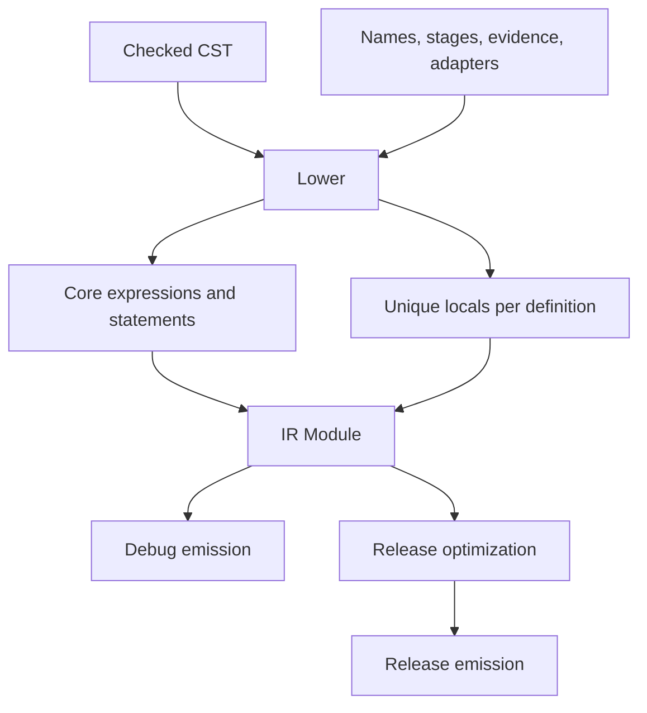

# Typed IR and optimization

Active contributors: bondiano, Vassiliy Kuzenkov

Lowering turns accepted syntax plus checker metadata into an IR whose calling conventions and runtime evidence are explicit. Release optimization rewrites that IR under the observable behavior of debug lowering; it does not rerun type inference or execute runtime programs.

## Why another representation?

The CST preserves what the user wrote; the backend needs what the checker decided. `flick-core/src/ir/mod.rs` re-exports the representation from `flick-ir`, while `flick-core/src/ir/lower/mod.rs` builds it. The separate representation crate is covered in [support crates](../../packages/support-crates.md).

`ir::lower` takes a checked `resolve::Module` and `Typing`, and returns either an IR module or lowering diagnostics. Its precondition is an error-free module, not merely a recovered parse tree. The project loader enforces that boundary in `flick-core/src/project/load/checking_core.rs`.

The IR makes these decisions explicit:

| Decision | Evidence |
| - | - |
| Resolved global/local/constructor identity | `Typing.names`; `flick-core/src/types/typing.rs` |
| Pure, Sync, or Runtime application/parameter stages | `flick-ir/src/stage.rs`; `flick-core/src/ir/lower/expr.rs` |
| Class dictionaries and assumed dictionary parameters | `flick-core/src/ir/lower/mod.rs` |
| Lifts and unique conversions | `flick-core/src/ir/lower/expr.rs` |
| Foreign calling mode and argument/result adapters | `Foreign` re-exports in `flick-core/src/ir/mod.rs` |
| Source spans, labels, scope owners, handler operations | `flick-core/src/ir/lower/mod.rs` and `flick-core/src/ir/lower/handle.rs` |

Children and application stages have an explicit evaluation order: children left to right, with a stage after its argument. Surface forms such as pipes must retain their intended ordering through lowering; code generation spills operands when statement-producing expressions would otherwise reorder work. Sources: `flick-core/src/ir/mod.rs` and `flick-core/src/codegen/js/mod.rs`.

## Lowering flow and hygiene

`flick-core/src/ir/lower/mod.rs` renames locals apart within each top-level definition. User and generated local bindings retain separate visibility through the generated-code boundary. Fresh names and capture-safe substitution are prerequisites for inlining; they are not cosmetic output choices.

`flick-core/src/ir/lower/expr.rs` tracks whether a range's lift/coercion or dictionary abstraction was consumed already, because a block and its only expression may share a range. It also lowers packed modules to records of the runtime values the checker selected. Do not attach metadata a second time just because two syntax nodes visit the same bytes.

Desugaring is divided by construct under `flick-core/src/ir/lower/`: `do_notation.rs`, `applicative_do.rs`, `comprehension.rs`, `interpolation.rs`, `question.rs`, `ranges.rs`, `handle.rs`, `wire.rs`, and numeric/pattern/lambda helpers. Keep the checker choice and lowering implementation paired when adding a new sugar.

## Release pass order

`opt::optimize` in `flick-core/src/opt/mod.rs` performs:

1. Default-method devirtualization and numeric specialization.
2. Two rounds of module constant propagation, known-instance method devirtualization, small-function inlining, sequence/list fusion, and expression simplification.
3. Removal of unused private top-level items while preserving exports.

Each simplification walks children first, folds literals, beta-reduces, reduces known matches, and simplifies blocks with flattening, scalar replacement, propagation, and dead binding removal. Its local fixed-point loop is capped at eight passes. These bounds describe current implementation choices, not promises that every optimization opportunity is exhausted.

| Pass | Main boundary |
| - | - |
| `flick-core/src/opt/devirt.rs` | Known dictionaries, defaults, and constructors |
| `flick-core/src/opt/specialize.rs` | Numeric copies whose methods can become operators |
| `flick-core/src/opt/inline.rs` | Known full applications and beta reduction |
| `flick-core/src/opt/fuse.rs` | Supported `Seq`/`List` producer-consumer loops |
| `flick-core/src/opt/sroa.rs` | Temporary record/tuple decomposition |
| `flick-core/src/opt/fold.rs` | Literal operators, selected builtin methods, constant branches |
| `flick-core/src/opt/walk.rs` | Usage, strict usage, droppability, substitution, renaming |

Cross-module specialization/inlining uses `Generics`, a lookup for a value's dictionary parameters and body. `flick-core/src/build/mod.rs` supplies eligible bodies and preserves the export boundary; `opt::names_only` checks whether a copied body names only accessible entities. Do not clone arbitrary private implementation references into an importing module.

Release worker functions and direct exports of canonical instance methods are backend optimizations in `flick-core/src/codegen/js/release.rs`, not additional type-checker facts.

## Safety rules and numeric behavior

`flick-core/src/opt/walk.rs` distinguishes an arbitrary read from a **strict use**, which is evaluated exactly once whenever the enclosing expression is. Branch bodies, closures, handlers, tasks, and lazy generators cannot be treated as unconditional uses. The propagation pass moves a non-atomic value only when it is droppable and has one total use and one strict use.

Droppability is conservative. Runtime calls stay; constructing an unevaluated task may be droppable even though running the task is not. Operators must be total, and `BigInt` exponentiation is excluded because it can throw for a negative exponent. Source: `flick-core/src/opt/walk.rs`.

The optimizer contract explicitly forbids arithmetic reassociation, `x * 0` rewrites, running/memoizing tasks, merging layers, moving service lookup across `provide`, or dropping runtime calls. Source: `flick-core/src/opt/mod.rs`. These restrictions protect evaluation order and defects as well as ordinary successful results.

`flick-core/src/opt/fold.rs` uses typed `Int` arithmetic from `flick-core/src/numeric.rs` and shared constant operations from `flick-core/src/consteval.rs`. `Int` is wrapping 32-bit arithmetic with zero for division/remainder by zero. Float equality follows the language's SameValueZero behavior, and strings compare by UTF-16 order. A host Rust calculation is not automatically a valid compile-time replacement.

## Inspecting and changing IR

`flick-core/src/ir/print.rs` provides a readable test/debug rendering. IR round-trip tests and representation-crate tests guard serialization and structure, but runtime equivalence still needs execution tests.

For a new expression or pass:

- Record typing decisions before lowering rather than rediscovering them from names.
- Update traversal, usage, substitution, renaming, printing, and both backend matches where the new IR form participates.
- Pin expected output/behavior independently, including dead branches, unused results, partial applications, shadowing, dictionaries, and throwing expressions.
- Compare debug/release on JS/TS and supported portable Go cases. Backend agreement alone can preserve the same defect.

Prescribed checks from `docs/agents/validation.md`: `cargo test -p flick-ir`, `cargo test -p flick-core --test ir_round_trip`, relevant lowering/optimizer unit tests, `just e2e-tests`, `just e2e-cases`, and `just language`. Execution-contract changes also need a [formal scope](../formal-model.md) decision. No compiler tests were run for this documentation-only task.

## Key source files

| Source | Role |
| - | - |
| `flick-core/src/ir/mod.rs` | IR public surface and evaluation-order contract |
| `flick-core/src/ir/lower/mod.rs` | Checked-module lowering, dictionaries, fresh names |
| `flick-core/src/ir/lower/expr.rs` | Expression metadata and desugaring |
| `flick-core/src/opt/mod.rs` | Release schedule, propagation, dead code |
| `flick-core/src/opt/walk.rs` | Shared rewrite safety predicates |
| `flick-core/src/opt/fold.rs` | Typed constant folding |
| `flick-core/src/build/mod.rs` | Cross-module body lookup and optimized clones |
| `flick-core/tests/ir_round_trip.rs` | IR persistence regression harness |

Snapshot: **35 Rust files**, **7:28 test-named/other files**, **7 files containing `#[test]`**, and **2 human committer-name strings**. See the [measurement method](index.md#snapshot-method) and [code generation](code-generation-and-builds.md).
