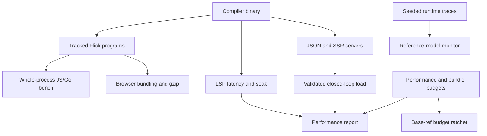

# Developer tools and measurement harnesses

Active contributors: bondiano, Vassiliy Kuzenkov — author names recorded on `origin/main`, excluding bots.

`tools/` contains compiler integrations, a Flick-written declaration importer, generated Go compatibility data and focused correctness/performance harnesses. These are separate entry points with different prerequisites; a budget, sampled benchmark or generated oracle is not a universal correctness guarantee.

## Compiler and content integrations

| Tool | Flow and boundary |
| - | - |
| `tools/astro-flick/` | Published `@flick-lang/astro` registers `flickVite`. Imported `.fl` files are built by the native compiler; Vite resolves their generated runtime and host imports normally. |
| `tools/content-mapper/` | Small npm launcher delegates inherited stdio to `flick content-mapper`, selected by `FLICK_BIN` or `PATH`. Projection semantics remain in the compiler/CLI. |
| `tools/dts-importer/` | A compiled Flick CLI reads TypeScript declaration shapes, extracts upstream surfaces and prepares Effect upgrades. JavaScript provides TypeScript compiler primitives. |

`tools/astro-flick/vite.mjs` asks `flick build --inputs` for the dependency inventory and source-state key, hashes file/profile/key into an output directory, builds JS, and watches source/configuration roots. Only concurrent SSR/client transforms share an in-flight promise; persistent compilation caching belongs to the CLI. `tools/astro-flick/index.mjs` optionally writes adjacent `.d.fl.ts` declarations for editors; declaration failures warn rather than making type convenience a build requirement. `tools/astro-flick/test/vite.test.mjs` tests invalidation and actual imported output.

`tools/dts-importer/index.mjs` starts the compiled Flick program. With no arguments it is the stdin JSON interface used by `flick ffi import`; CLI subcommands are `import`, `surface` and `bump`:

- `tools/dts-importer/src/Import.fl` accepts `{"root","package"}`, resolves declarations and emits export shapes/fingerprints and nominal-name ambiguity information.
- `tools/dts-importer/src/Shape.fl` classifies supported types, preserves named objects as opaque handles and emits an `other` shape for unsupported/deep forms; it does not silently turn every TypeScript object into a Flick record.
- `tools/dts-importer/src/Ts.fl`, `tools/dts-importer/src/ts.mjs` and its declarations expose opaque TypeScript handles/primitive queries. `tools/dts-importer/src/JsonText.fl` writes the protocol.
- `tools/dts-importer/src/Surface.fl` extracts entrypoints and selected module exports; `tools/dts-importer/src/Bump.fl` reports additions/removals/fingerprint changes and capability gaps, then updates snapshot/version pins. Its inspected uncommitted change pins the adapter's version test along with package/capability/toolchain files.

The production FFI importer decides what these shapes mean; see [project and CLI](project-and-cli/index.md). The importer package pins TypeScript 5.9.3 independently of the documentation site's TypeScript.

## Compatibility data generators

These tools deliberately obtain expected data from Node/V8/ICU or the pinned Effect package, then write tables/corpora consumed by `runtime-go/flickrt/`. They verify a chosen compatibility contract; they are not independent proofs that the upstream behavior is ideal or that all inputs are covered.

| Directory | Generated contract/output |
| - | - |
| `tools/go-arbitrary/` | Schema-linked generation/checking/shrinking examples in `runtime-go/flickrt/testdata/arbitrary_links.txt`. |
| `tools/go-cli/` | Bash/Zsh/PowerShell completion outputs plus CLI parsing/help/error parity corpora. |
| `tools/go-collate/` | `runtime-go/flickrt/collate_tables.go` and collation corpus: CLDR 48 root data, parsed tailoring rules and locale probes. `tools/go-collate/root.mjs`, `tools/go-collate/rules.mjs`, `tools/go-collate/tailor.mjs` and `tools/go-collate/corpus.mjs` separate those stages. Downloads/cache are outside the repository. |
| `tools/go-dates/` | V8 date-parsing corpus in UTC and America/New_York. |
| `tools/go-encoding/` | Effect INI/TOML/YAML parse results and errors. |
| `tools/go-glob/` | Effect filesystem-glob behavior against a constructed tree, including links, dotfiles and exclusions. |
| `tools/go-intl/` | `runtime-go/flickrt/datetime_intl.go`: accepted/resolved zone names and date/time patterns for a fixed locale set. Reads Go zoneinfo and Node ICU. |
| `tools/go-mime/` | `runtime-go/flickrt/mime_types.go`, with source/version/license attribution from Effect's MIME data. |
| `tools/go-path/` | Node Windows-path and file-URL corpora with a fixed synthetic working directory. |
| `tools/go-unicode/` | Unicode normalization/case data and grapheme/display-width tables/corpora, using Node ICU, `Intl.Segmenter` and Effect display width. |

Run generators intentionally after reviewing their upstream/toolchain inputs; review generated diffs and matching Go tests. Do not regenerate expected outputs merely because a runtime regression disagrees.

`tools/rt-exports.mjs` is a different generator: it imports built local runtime modules and writes export/stub manifests used by compiler binding selection. The inspected uncommitted version writes `runtime/rt_exports.txt`, `runtime/rt_stubs.txt` and `packages/effect-ts/rt_bridge_stubs.txt`; `--check` compares without rewriting. Availability, absent-stub detection and explicit bridge overrides are distinct from semantic conformance.

## Measurement and runtime harness map

| Tool | What it measures/checks |
| - | - |
| `tools/bench/` | Release JS/Go builds of startup, lists, strings, JSON and hashmap programs; one warm-up then median whole-process time, with matching checksums. Startup overhead remains included. |
| `tools/fusion-bench/` | Handwritten generator-chain versus fused-loop analogue; checks equal output before timing. This is not an end-to-end compiler benchmark. |
| `tools/lsp-bench/` | JSON-RPC client, first/repeated open, hover and hover-after-edit p50/p95. `soak.mjs` cycles same and distinct documents and samples Linux `/proc` RSS. |
| `tools/load/` | Closed-loop HTTP GETs with fresh IDs and decoded-body validation; concurrency levels, warm-up, repeated medians, soak, optional Linux RSS and multiple client threads. |
| `tools/perf/` | Compiler corpus timing, LSP latency/RSS, Go JSON throughput/binary size/RSS and SSR throughput/RSS; writes measured/partial results and failures to `target/perf.json` and `target/perf-errors.json`. |
| `tools/bundle-size/` | Builds tracked programs, bundles/minifies with Rolldown, checks gzip budgets, disallowed retained modules and release versus debug size; source-map attribution helps explain retained code. |
| `tools/stress/` | Rebuilds selected runtime fixtures and varies `FLICK_STRESS` seeds, records `FLICK_TRACE`, and runs the model trace monitor. JS/Go are default targets; own-runtime cases can be selected explicitly. Not an exhaustive schedule search. |
| `tools/language-rt/` | Compares own-runtime language-test reports with Effect using the same seed and explicit gaps; rejects named gaps that now pass or match no test. |
| `tools/tokens/` | Counts hand-written Conduit/reference application sources using `o200k_base`; optional provider credentials send source to token-counting services. Downloads pinned reference archives, never executes their source. |

### Load and budget interpretation

`tools/load/json/src/Load/Json.fl` exercises schema decoding and request-specific JSON. `tools/load/ssr/src/Load/Server.fl`, `tools/load/ssr/src/Load/Page.fl` and `tools/load/ssr/src/Load/Client.fl` exercise request-local atom registries, rendering/streaming and suspended hydration. `tools/load/browser.mjs` checks request IDs, task handover, an answered click and browser errors. `tools/load/startup.mjs` measures spawn to first HTTP 200; `tools/load/bundle.mjs` bundles the SSR client.

The default load client is `fetch`; `--client http` uses direct keep-alive HTTP/1 with gzip/deflate/Brotli decoding and no redirect following. `tools/perf/index.mjs` chooses direct HTTP for Go JSON and fetch for SSR. Historical fetch-limited throughput is not directly comparable to direct-client measurements; see `tools/load/README.md`. Do not overlap measurements with builds or tests.

`tools/perf/budgets.json` stores thresholds/tolerance, not results. Null RSS budgets report without enforcing a limit. Lower-is-better metrics fail above `budget × (1 + tolerance)`; higher-is-better metrics fail below `budget × (1 - tolerance)`. `tools/perf/ratchet.mjs` compares these and `tools/bundle-size/programs.mjs` against a base ref (`origin/main` by default in `just ratchet`); loosening a limit needs a new adjacent reason. Added/removed budgets are reported rather than automatically rejected.

`tools/bundle-size/programs.mjs` also owns documentation chunk budgets; `docs/scripts/chunks.mjs` checks built site chunks. The separate raw-WASM gate lives in `justfile`, described with the [support crates](../packages/support-crates.md).

## Changing and running tools

- Read the relevant `justfile` recipe and package scripts first: `just bench`, `just perf`, `just bundle-size`, `just ratchet`, `just stress`, `just language`, `just effect-bump <version>` and the load recipes coordinate prerequisites differently.
- Integration tests: `pnpm -C tools/astro-flick test`, `pnpm -C tools/dts-importer test`, `pnpm -C tools/load test`, `pnpm -C tools/bundle-size test`; performance helpers have `tools/perf/index.test.mjs` and `tools/perf/ratchet.test.mjs`. Compiler/runtime prerequisites still apply.
- Native/compiler integration needs a chosen `FLICK_BIN`; many generators require built adapter packages and the pinned Node/Effect inputs. Linux-only RSS/CPU-affinity recipes are not portable host measurements.
- Review network and write effects before running generators, upgrade tools or token counting. No credentialed token API calls are required for normal compiler testing.
- Preserve independent expected results, fail on wrong bodies/transport errors, and report exact host/client settings. Never label a threshold as an observed measurement or loosen one to conceal a regression.

## Key source files

| Source | Why read it |
| - | - |
| `tools/astro-flick/vite.mjs`, `tools/content-mapper/bin.mjs` | Compiler process and dependency/projection integration. |
| `tools/dts-importer/src/Main.fl`, `tools/dts-importer/src/Shape.fl`, `tools/dts-importer/src/Bump.fl` | Import protocol and upgrade ownership. |
| `tools/go-collate/root.mjs`, `tools/go-unicode/gen.mjs` | Representative upstream data provenance. |
| `tools/load/index.mjs`, `tools/load/client.mjs`, `tools/load/README.md` | Correctness-checked load methodology and client distinction. |
| `tools/perf/index.mjs`, `tools/perf/ratchet.mjs`, `tools/bundle-size/programs.mjs` | Report semantics and budget policy. |
| `tools/stress/index.mjs`, `tools/language-rt/index.mjs` | Runtime/model evidence and explicit gap handling. |
| `tools/tokens/index.mjs`, `tools/rt-exports.mjs` | Source disclosure and generated binding-manifest boundaries. |

Snapshot inventory: 117 tracked files under `tools/`; 35 (29.9%) are in test/testdata-named paths. This includes fixture data, excludes inline tests and measures no behavioral coverage. Descriptions use the dirty working tree; no benchmarks, generators or network tools were run. See [browser tools](browser-tools.md) and [libraries](../packages/libraries.md) for their consumers.
