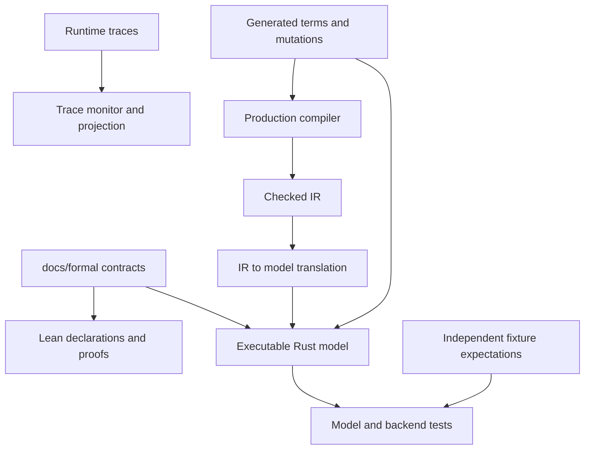

# Reference model and formal guarantees

Active contributors: bondiano, Vassiliy Kuzenkov — author names recorded on `origin/main`, excluding bots.

Flick separates an executable Rust reference model, mathematical contracts and Lean proofs. They provide independent semantic evidence; none is a proof that the production Rust compiler, generated JavaScript, Go runtime or foreign libraries implements the whole language correctly.

## Three related artifacts

| Location | Role |
| - | - |
| `docs/formal/core.md` | λFlick terms, typing and evaluation after surface elaboration. |
| `docs/formal/regions.md` | Capture sets, owners, scope, outlives constraints and handler/work lifetime obligations. |
| `docs/formal/runtime.md` | λRT ownership, closing, interruption, causes, layer memoization and atomic references. |
| `docs/formal/elaboration.md`, `docs/formal/modules.md` | Dictionary passing/sugar and the separate nominal/module-witness boundary. |
| `docs/formal/ts-holes.md` | Catalog distinguishing core rejections, FFI boundary handling and trusted-binding hypotheses. |
| `flick-model/src/` | Executable checker, small-step evaluator, IR translation, generated programs and runtime-trace checking. |
| `formal/Formal/` | Lean core calculus, separate λRT development and dictionary-elaboration proofs. |

The arrows indicate implementations and test relationships, not mechanically proved refinement between the artifacts.

## Executable model

`flick-model/src/check/` follows the declarative rules through expression/pattern checking, unification, row inclusion, generalization, dictionary checking and region constraints. The inference algorithm can reject a declaratively derivable term when it does not make the necessary guess; the source comment explicitly does not claim completeness. `flick-model/src/check/runtime.rs` types intermediate machine configurations for preservation tests.

`flick-model/src/eval/` implements evaluation with frame stacks, a store, handler state and region work. Runs distinguish a value, expected raise, defect, stuck form and exhausted fuel. `flick-model/src/syntax.rs`, `flick-model/src/types.rs`, `flick-model/src/decls.rs` and `flick-model/src/subst.rs` define the model rather than reusing the production checker.

`flick-model/src/translate/` turns checked compiler IR into model globals and explicit dictionary records. Unsupported nodes become `Term::Stuck`: unreachable unsupported code can remain in an otherwise executable program. `flick-model/src/native/` implements a selected foreign surface; those steps are trusted under the foreign-binding hypothesis, not separately verified runtime implementations. `flick-model/src/run.rs` loads/compiles a file, adds builtin declarations, checks the translated user modules and drives exported `main`.

`flick-model/src/generate/` builds terms type-first from shrinkable choice sequences, prints Flick source, mutates terms and generates lifetime/TypeScript-hole cases. `flick-model/tests/props.rs` compares checkers and checks reached states. Its stated limits include excluded incompleteness forms; TypeScript-hole cases are checked rather than executed when foreign natives are unavailable. `flick-model/tests/run.rs` uses the selected `tests/run/model.txt` corpus and independently stored `.stdout`, not every program in the repository.

`flick-model/src/rt/monitor.rs` replays recorded ownership events and identifies a disallowed transition. `flick-model/src/rt/project.rs` compares meaningful per-owner observations rather than requiring equal fiber IDs or identical global scheduling. `flick-model/examples/rt_trace.rs` exposes this tooling to the stress/conformance harnesses. Monitoring sampled traces is not exhaustive interleaving verification of either runtime.

## What Lean establishes

`formal/Formal.lean` imports the development; `formal/lean-toolchain` pins Lean 4.29.1 and the project uses no Mathlib.

| Family | Result and important premises |
| - | - |
| Core typing/effects | `T1` gives progress/preservation over reachable modeled configurations with typed roots and initial freshness premises. `T2a` constrains pure steps; `T2b` constrains root effects and raised errors. `T3` concerns generalization and monotonically extended store typing. |
| Regions and handlers | `T4` constrains live work's reachability; `T4_3` establishes liveness of the answering handler. `T1_regions` removes the dead-region blocked outcome, not waiting for unfinished children or every possible stuck non-tail detached operation. |
| Runtime contract | `formal/Formal/RT/T5.lean` proves R1–R4, R6 and R7 for every modeled interleaving under library assumptions `Hyp` and answering-provide liveness `G11`. R5 and R8 are cause-algebra results. λRT's core is an abstract parameter. |
| Dictionary elaboration | `T6a` preserves typing against an abstract target. `T6b` gives equal observations for suitably typed fillings of one skeleton with equivalent derived dictionaries, under coherence/simulation premises; it does not equate arbitrary elaborations with independently chosen types. |
| Concrete core target | `T6a_core` and `T6b_core` instantiate that interface with dictionary records, regions and the core's own run, subject to signature/body hypotheses. |
| Witnesses and smaller contracts | `formal/Formal/Elab/Witness/` supplies one concrete program satisfying the hypotheses together. `formal/Formal/RecordHandler.lean` covers record tail handlers/known layer chains; `formal/Formal/Elab/CallSite.lean` covers caller-site propagation. |
| Source module boundary | `formal/Formal/Modules.lean` models stable/distinct named identities, manifest matching and packed-witness elimination equations; it does not prove arbitrary source-module progress/preservation or the serialized/runtime ABI. |

`formal/Formal/RT/Hyp.lean` assumes finalizer order/exactly-once behavior, late registration, atomic acquisition registration, branch joining, identity-based memoization, cause operations, atomic reference modification and foreign-call tracking. These are theorem parameters, not discharged proofs about Effect or Go. The stronger answering-handler liveness premise is explicit as `G11`; matching it to the concrete runtime remains an implementation obligation.

## Proof limits to preserve in explanations

- Lean uses de Bruijn terms and type variables, and does not check kinds. Core records have fixed ordered fields, not the production row solver's entire record language.
- Exhaustiveness is a declarative shapes premise, not a proof of the compiler's exhaustiveness algorithm. Primitive/foreign bindings and root implementations require hypotheses.
- Some source capture refinements are not modeled. Reader/UI-instance regions and lease internals are not independently formalized; production regressions still matter.
- λRT proves safety of steps that occur, not eventual Promise settlement, fair scheduling, delivery of interruption, process survival or general termination. It abstracts masking and does not prove the internals of every queue, transaction, HTTP or UI API.
- T6's source subset and sugar are narrower than the full parser. Its concrete witness uses an eager finite representation of `Seq`, not a proof of lazy/infinite sequence behavior. Its observations compare terminating runs, not divergence.
- The core sees module lowering products. The existential-module reference tests explicitly rely on source checking for witness typing and then test lowered execution.

`formal/README.md` is the detailed map and qualification list. `formal/Formal/Axioms.lean` pins `#print axioms` output for T1 and major T6 results with `#guard_msgs`; only standard Lean axioms are expected there. This is stronger than merely searching for `sorry`, but still says nothing about unmodeled implementation code.

## Changing this subsystem

For a semantic contract change, update the relevant `docs/formal/` contract, reference checker/evaluator/translation/generator, independent fixtures and Lean statements/proofs together. A compiler fix restoring an unchanged contract may need only a regression; explain why proofs are unaffected.

Run `just model` (includes ignored selected-corpus tests) and `cd formal && lake build --wfail`. Prelude-scheme changes also require `just formal-schemes`, generated-diff review and both gates again. Never add axioms, proof gaps or narrower premises to hide an implementation failure. Backend/runtime changes also require the [runtime](../packages/runtimes/index.md) and [validation](../how-to-contribute/patterns-and-conventions.md) obligations.

## Key source files

| Source | Why read it |
| - | - |
| `flick-model/src/check/mod.rs`, `flick-model/src/eval/mod.rs` | Executable statics/dynamics and declared limitations. |
| `flick-model/src/translate/mod.rs`, `flick-model/src/native/mod.rs` | Translation gaps and trusted native boundary. |
| `flick-model/tests/props.rs`, `flick-model/tests/run.rs` | What generated/corpus evidence actually checks. |
| `formal/Formal/Soundness.lean`, `formal/Formal/T43Main.lean` | Core safety and answering-handler liveness. |
| `formal/Formal/RT/T5.lean`, `formal/Formal/RT/Hyp.lean` | Runtime theorem and explicit assumptions. |
| `formal/Formal/Elab/T6a.lean`, `formal/Formal/Elab/Coherence.lean`, `formal/Formal/Elab/CoreRun.lean` | Dictionary typing/coherence and concrete target. |
| `formal/Formal/Modules.lean`, `formal/Formal/Axioms.lean` | Separate module model and axiom guard. |

Snapshot inventory: 249 tracked files under `formal/`, `flick-model/` and `docs/formal/`; 13 (5.2%) are in test-named paths. This excludes inline tests and does not measure theorem or implementation coverage. No model tests or Lean build were run to write this page.
