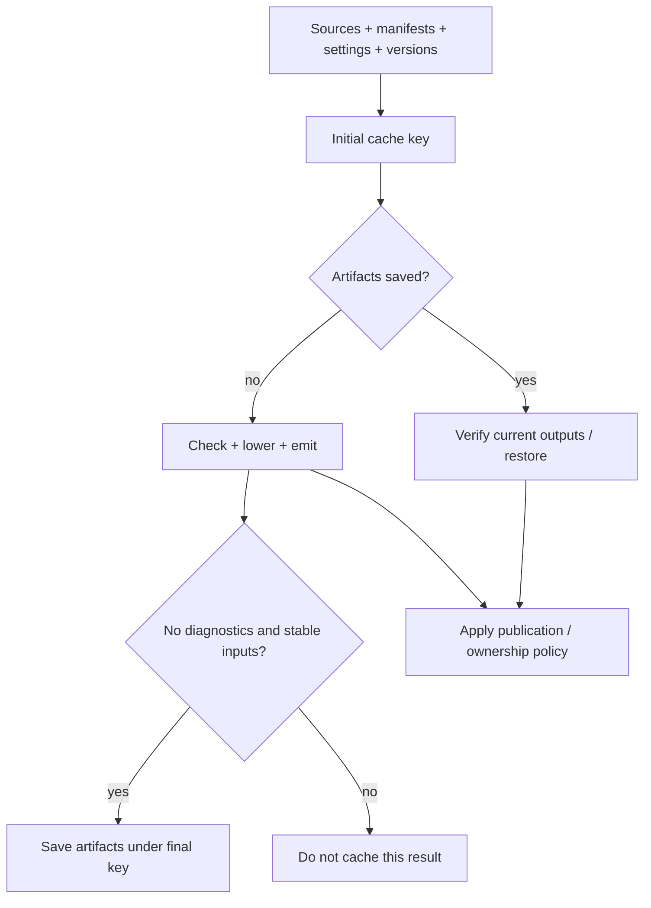

# Caches and artifact ownership

Active contributors: Vassiliy Kuzenkov, bondiano

Flick has separate caches for builtins, checked libraries, plugin calls, editor modules, and emitted artifacts. They have different invalidation rules; clearing the project build cache does not clear every reuse layer.

## The reuse layers

| Layer | Location/lifetime | What identifies reusable data | Implementation |
| - | - | - | - |
| Builtin interfaces | User-cache `builtins-…` files | Compiler binary fingerprint, implicit sources/Go binding tables, class-derived-stage mode | `flick/src/builtins.rs` |
| Checked/lowered source libraries | User-cache `packages/` | Compiler/implicit-package salt, effective configuration, source identity, dependency keys, stage mode | `flick/src/package_cache.rs`, `flick-core/src/project/load/precompiled.rs` |
| Plugin calls | User-cache `plugins/`; editor also retains calls | Compiler binary prefix plus call-key SHA-256; core validates recorded outside inputs | `flick/src/plugins/cache.rs`, `flick-core/src/project/load/plugins/results.rs` |
| Editor module analysis | In-memory `ModuleCache` per context | File/text, configuration, import interfaces, virtual parameters/contracts, watcher identities, lowering mode | `flick-core/src/project/load/checking.rs`, `flick-core/src/project/load/checking_core.rs` |
| Build/test artifacts | Project `.flick/cache/` | Labeled settings, roots, effective configuration, versions, source/manifest/plugin inputs | `flick/src/cache.rs`, `flick/src/commands/test.rs` |
| Fetched source store | User cache or `FLICK_STORE` | Tree checksum recorded in `flick.lock` | `flick-core/src/project/store.rs`, `flick/src/fetch/download.rs` |

The compiler binary fingerprint is its package version plus executable size and modification time, not a cryptographic digest of the executable, in `flick/src/toolchain.rs`. Cache failures generally fall back to recomputation in the individual adapters.

## Build-cache inputs

`flick/src/cache.rs` constructs a conservative inventory. It includes selected roots; project source/test modules; sibling roots for explicit outside-project modules; manifest and lock files; workspace configuration; installed source-package metadata; path-library sources and plugin components; plugin-readable files; HTTP snapshots; and hashed values of granted environment variables.

`flick-core/src/project/cache.rs` sorts labeled, length-prefixed parts and produces a 128-bit key using two FNV-1a hashes. The labels and lengths avoid concatenation ambiguity. This is a performance cache key, not an authenticity or hostile-collision guarantee.

The build path is in `flick/src/commands/build.rs` and `flick/src/commands/build/cached.rs`. Fresh build caching requires both checking and emission diagnostic lists to be empty, so even warnings or notes prevent that write. The initial and final keys must match, and `read_unchanged` compares the bytes actually read by compilation with disk before saving. A file saved mid-build must not make old artifacts appear to belong to new source text.

### Cache-hit behavior

An unchanged output file is not rewritten. A deleted/modified generated text file can be restored from cached artifacts. Go executable reuse also checks a stamp over executable bytes and relevant Go environment/toolchain fields; otherwise publication rebuilds it. See `flick/src/cache.rs` and `flick/tests/build_command/cache.rs`.

Schema-AOT builds bypass build-artifact reuse, and `--emit-ir` skips artifact-cache loading because cached artifacts do not carry the required IR, in `flick/src/commands/build.rs` and `flick/src/commands/build/cached.rs`.

## Package and editor caches are different

`flick/src/package_cache.rs` hashes path-library module names/texts, while fetched libraries use their locked checksum as identity. `flick-core/src/project/load/precompiled.rs` combines dependency keys transitively and skips saving packages with expanded plugin blocks, whose plugin identity would otherwise be absent from the package key.

Saved IR spans are normalized to file zero and moved back to the current source file when reloaded. Compilation re-reads saved module text and checks its stored hash before using those spans; a changed fetched store entry reports `FLICK-P034`. This relies on treating fetched sources as immutable, not as editable working copies.

The editor's `ModuleCache` instead retains parse trees and module checking outputs. Comparable import interfaces omit declaration positions and docs; re-export locations are refreshed on reuse. Unloaded entries are dropped. In the current working tree, watcher plugin identities also invalidate modules without blocks when their checker plugin changes, in `flick-core/src/project/load/checking_core.rs`.

## Publication and cleanup

`flick-core/src/project/cache.rs` defines the artifact manifest; `flick/src/cache.rs` records each successful output directory and its owned files. Publication removes obsolete files previously owned by that output, leaves unrelated files alone, and avoids writing unchanged bytes.

`flick/src/commands/clean.rs` removes manifest-listed output files, the test build, and unused run generations. `clean --cache` also removes the project's build cache. It does not purge the shared builtin/package/plugin caches or the fetched source store.

Live run generations are protected by ownership locks and recorded process liveness, including orphaned children, in `flick/src/commands/run.rs`. Generation builds are not recorded as normal published outputs and skip emit hooks in `flick/src/commands/build/cached.rs`. See [command lifecycles](commands-and-toolchain.md#run-and-dev-lifecycles).

## Limits worth preserving in documentation

- The input inventory is conservative, not a precise compiler dependency graph; changes unrelated to the selected entry can miss the cache. See `flick/src/cache.rs`.
- `library_files` explicitly does not inspect fetched-library loader-extension declarations. Its comment records that changes to files loaded by those extensions do not affect the build key until the lock changes. This is a current limitation, not a supported hot-reload guarantee.
- Path-library identity for the package cache hashes `.fl` modules. Do not assume arbitrary foreign file bytes are part of that particular key; build-artifact inventories separately track foreign inputs.
- Successful semantic compilation does not make filesystem publication atomic. `write_artifacts` writes files individually and can stop on an I/O error, in `flick/src/commands/build.rs`.

## Modification and validation

Add a new build input in both the cache inventory and the exposed input inventory as needed: `flick/src/cache.rs` and `flick/src/commands/inputs.rs`. Keep fresh and cached publication paths aligned through `flick/src/commands/build/cached.rs`. A cache change needs a positive reuse test and invalidation after its input changes, not only a cold-build test.

Regression anchors: `flick/tests/build_command/cache.rs`, `flick/tests/build_inputs.rs`, `flick/tests/build_command.rs`, `flick/tests/package_cache.rs`, and `flick/tests/builtins_cache.rs`, plus the unit tests in `flick/src/cache.rs`. Relevant CLI integration checks and `just e2e-tests` are required for executable changes; none were run for this documentation.

## Key source files

| Source | Responsibility |
| - | - |
| `flick/src/cache.rs` | Input inventory, artifact cache, Go stamps, ownership manifest |
| `flick-core/src/project/cache.rs` | Labeled key format and manifest model |
| `flick/src/commands/build/cached.rs` | Cache-hit publication and output recording |
| `flick/src/package_cache.rs` | Native persistent package-cache adapter |
| `flick-core/src/project/load/precompiled.rs` | Package keys, saved interfaces/IR, span relocation |
| `flick-core/src/project/load/checking.rs` | Incremental module/parse cache |
| `flick/src/builtins.rs` | Builtin-interface reuse |
| `flick/src/commands/clean.rs` | Manifest-led cleanup |

Related: [project loading](project-loading-and-packages.md), [plugin snapshots](plugin-host.md), and [section overview](index.md).
