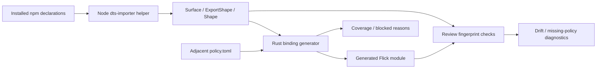

# Foreign interface

Active contributors: bondiano

`flick ffi` generates a supported subset of bindings from installed npm declaration files and checks generated/reviewed bindings for drift. It makes contracts missing from `.d.ts` explicit rather than assuming that declared JavaScript types establish purity, cancellation, or callback lifetime.

## Boundaries and data flow

`flick/src/commands/ffi.rs` invokes the installed Node helper or `FLICK_DTS_IMPORTER` override with a JSON package/root request. `flick-core/src/ffi/mod.rs` parses the returned `Surface`: package/version/declaration provenance, export shapes, signatures, and per-export SHA-256 fingerprints. The TypeScript reader belongs to `tools/dts-importer/`; this page documents its Rust boundary rather than reimplementing its type checker.

## Import workflow

`flick ffi import <package> --out <directory>` writes a package-derived module directory containing `Generated.fl`. Under a project source root, the output directory contributes the module prefix; `module_part` converts npm package names into capitalized Flick components, in `flick/src/commands/ffi.rs` and `flick-core/src/ffi/mod.rs`.

`flick-core/src/ffi/import.rs` classifies each selected export:

| Status | Result |
| - | - |
| Supported | A foreign binding, signature, provenance, and relevant metadata |
| Needs policy | `foreign blocked` with the missing contract |
| Unsupported | `foreign blocked` with the unsupported shape/reason |

Importing a package broadly can leave blocked exports beside usable ones. An explicitly selected blocked export reports F005, while missing names and helper/policy failures produce diagnostics from `flick/src/commands/ffi.rs`. The coverage report is part of the import result, not proof of full-package support.

`flick-core/src/ffi/convert.rs` maps supported primitives, arrays, tuples, optional parameters, opaque handles, callbacks, and nullable results. `flick-core/src/ffi/enums.rs` handles supported literal-union enums. Some unsupported trailing optional parameters can be omitted with report notes. Classes need handwritten constructors/methods; overloaded functions with indistinguishable arities are refused in `flick-core/src/ffi/import.rs`.

## Policy contracts

Policies sit beside the generated module. The allowed fields and values are defined and validated by `Policy::parse` in `flick-core/src/ffi/mod.rs`.

| Field | Accepted value | Contract supplied by the author |
| - | - | - |
| `mode` | `pure` | Trust the synchronous call as pure |
| `catch` | `JsError` | Convert throws/rejections into typed errors |
| `undefined` | `none` | Interpret nullable/undefined results as Option |
| `cancel` | `signal` | Pass an AbortSignal for async interruption |
| `retention` | `call` or `owner` | State how long JavaScript can retain a callback |
| `strict` | Boolean | Refuse `any`/`unknown` rather than expose JsValue |
| `enums.<name>` | Literal-to-constructor map | Choose names for supported literal enums |

The generator requires rejection policy for Promises, nullable-result policy where needed, and retention policy for callbacks. It rejects `mode = "pure"` combined with Promise/throw handling and rejects cancellation on a non-Promise call, in `flick-core/src/ffi/import.rs`.

These policies are declarations of responsibility. A pure declaration is not verified against JavaScript behavior; a cancellation signal does not prove the foreign API honors it. Runtime adapter behavior belongs with [runtimes](../../packages/runtimes/index.md) and compiler foreign lowering belongs with [compiler internals](../compiler/index.md).

## Generated and reviewed bindings

`flick ffi check` walks selected files, or the project's source root by default. Generated modules carry an import header, including selected export names; the command regenerates using installed declarations and the adjacent policy, then diagnoses text drift. Reviewed foreign bindings carry provenance and an export-shape fingerprint, parsed by `flick-core/src/ffi/check.rs`.

The reviewed check reports F007 when the package no longer exports the name, the declaration fingerprint changed, or mandatory metadata is absent. It does not needlessly infer a semantic failure from a package-version string alone: the export's shape fingerprint is the comparison used in `check_reviewed`.

Do not manually edit the generated file to silence drift. Change policy or write a separately reviewed binding, then regenerate/check through `flick/src/commands/ffi.rs`. Neither the generated-text check nor fingerprint comparison proves arbitrary foreign implementations correct.

## Editor integration

`flick/src/lsp/ffi.rs` offers an explicit header-line regeneration action with current package provenance. It only runs the Node reader for an invoked request, not automatic cursor movement, and returns a disabled action when reading fails. This shares import/policy helpers with the CLI. Local foreign implementation navigation is separate, in `flick/src/lsp/foreign.rs`.

## Modification and validation

- Add a shape conversion in `flick-core/src/ffi/convert.rs`, not by widening every unsupported export to JsValue.
- Change policy schema/validation in `flick-core/src/ffi/mod.rs`, generation in `flick-core/src/ffi/import.rs`, and reviewed requirements in `flick-core/src/ffi/check.rs` together.
- Preserve provenance, blocked reasons, generated headers, and CLI/editor agreement.

Regression anchors are `flick-core/src/ffi/tests.rs`, `flick-core/src/ffi/enum_tests.rs`, `flick/tests/ffi_command.rs`, and `flick/tests/lsp_editor/ffi.rs`. The native FFI integration suite documents its Node/pnpm requirements and ignored-test invocation; a normal unit-test run alone does not execute that real-package corpus. No FFI tests were run for wiki generation.

This scope has nine Rust files across shared FFI, CLI FFI, and LSP regeneration: two test-named and seven other files by the [section method](index.md#scoped-snapshot). `origin/main` history for this scope has one nonbot author name.

## Key source files

| Source | Responsibility |
| - | - |
| `flick/src/commands/ffi.rs` | Helper process, output paths, policies, import/check commands |
| `flick-core/src/ffi/mod.rs` | Serialized declaration shapes and policy schema |
| `flick-core/src/ffi/import.rs` | Generated code, statuses, reports, call policy |
| `flick-core/src/ffi/convert.rs` | Supported TypeScript-shape conversion |
| `flick-core/src/ffi/enums.rs` | Literal enum conversion |
| `flick-core/src/ffi/check.rs` | Headers, reviewed fingerprints, mandatory metadata |
| `flick/src/lsp/ffi.rs` | Explicit regeneration action |

Related: [language server](language-server-and-ide.md), [commands](commands-and-toolchain.md), and [section overview](index.md).
