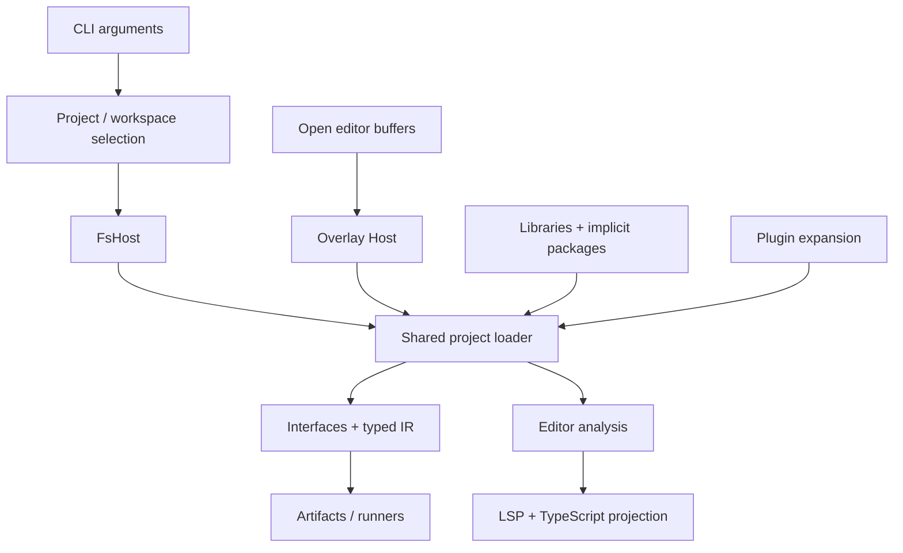

# Projects and the CLI

Active contributors: bondiano, Vassiliy Kuzenkov

The native toolchain turns files, project manifests, installed libraries, and editor buffers into shared compiler requests. This section covers the project model in `flick-core/src/project/` and its filesystem, process, cache, plugin, and editor adapters in `flick/src/`.

## Start with the boundary

`Host` in `flick-core/src/project/mod.rs` accepts absolute paths and supplies source bytes, display names, plugin implementations, cached plugin answers, and optional access to the outside world. The core project loader uses this boundary instead of opening files or launching processes itself.

| Abstraction | Role | Implementation |
| - | - | - |
| `Project` / `Config` | Root directory, effective manifest, entries, dependencies, backend, and grants | `flick-core/src/project/mod.rs`, `flick-core/src/project/config.rs` |
| `FsHost` | Native files, relative diagnostic paths, native plugin host | `flick/src/sources.rs` |
| `Compilation` / `Compiled` | Checked modules, interfaces, typed IR, library ownership, and JS requirements | `flick-core/src/project/load/mod.rs` |
| `Analysis` / `Analyzed` | Source trees, typing metadata, interfaces, and plugin editor state | `flick-core/src/project/load/ide.rs` |
| `Command` / `Outcome` | Diagnostics plus the source map they reference | `flick/src/command.rs` |
| `Snapshot` / `Context` | An editor analysis and its project, standalone-file, or builtin identity | `flick/src/lsp/snapshot.rs` |

The calls behind this diagram are in `flick/src/main.rs`, `flick/src/workspace.rs`, `flick-core/src/project/load/mod.rs`, `flick/src/commands/build.rs`, and `flick/src/lsp/snapshot.rs`. See [compiler internals](../compiler/index.md) for parsing, typing, lowering, and emission after project inputs have been selected.

## Reading paths

- [Project loading and packages](project-loading-and-packages.md): discovery, import boundaries, workspaces, locks, source libraries, and standard-library selection.
- [Caches and artifact ownership](caches-and-artifacts.md): the distinct reuse layers and the inputs that invalidate them.
- [Commands and toolchain](commands-and-toolchain.md): command routing, builds, tests, child processes, and development generations.
- [Language server and IDE](language-server-and-ide.md): overlays, incremental analysis, UTF-16 conversion, shared queries, and TypeScript projections.
- [Foreign interface](foreign-interface.md): declaration import, explicit policies, generated bindings, and review checks.
- [Plugin host](plugin-host.md): component loading, resource limits, grants, snapshots, and build hooks. Language-specific plugin behavior belongs in [plugins](../../packages/plugins.md).

## Contracts contributors must preserve

1. Project checking follows imports and checks their interfaces; it is not the single-module API that takes arbitrary imports on trust. Entry points are in `flick-core/src/project/load/mod.rs`.
2. Source and test modules have different import search roots. Package-private modules stay within their owning package. These rules live in `flick-core/src/project/load/imports.rs`.
3. A failed semantic build returns before publication. Successful outputs are tracked individually, and `clean` must not erase unrelated files sharing an output directory. See `flick/src/commands/build.rs`, `flick/src/cache.rs`, and `flick/src/commands/clean.rs`.
4. Unsaved editor text wins over disk; one project's analysis and diagnostic lifecycle must not leak into another. See `flick/src/lsp/snapshot.rs` and `flick/src/lsp/mod.rs`.
5. Runtime compatibility, plugin permissions, and foreign policies are separate checks. A checked Flick type is not proof that arbitrary foreign code or a plugin IR rewrite behaves as declared.

## Where to make changes

| Change | Start here | Regression anchors |
| - | - | - |
| Manifest or workspace behavior | `flick-core/src/project/config/parse.rs`, `flick-core/src/project/inherit.rs`, `flick/src/workspace.rs` | `flick-core/src/project/config_tests.rs`, `flick/tests/workspace.rs` |
| Module/package discovery | `flick-core/src/project/load/loader.rs`, `flick-core/src/project/load/imports.rs`, `flick-core/src/project/packages.rs` | `flick/tests/project_check.rs`, `flick/tests/source_packages.rs` |
| Build cache or publication | `flick/src/cache.rs`, `flick/src/commands/build/cached.rs` | `flick/tests/build_command/cache.rs`, `flick/tests/build_inputs.rs` |
| Command or process lifecycle | `flick/src/args.rs`, `flick/src/main.rs`, `flick/src/child.rs` | `flick/tests/help_command.rs`, `flick/tests/cli_run.rs` |
| Editor query | `flick-core/src/ide/mod.rs`, `flick/src/lsp/requests.rs` | `flick-core/src/ide/tests.rs`, `flick/tests/lsp_command.rs` |
| FFI policy or import | `flick-core/src/ffi/`, `flick/src/commands/ffi.rs` | `flick-core/src/ffi/tests.rs`, `flick/tests/ffi_command.rs` |

Use `docs/agents/validation.md` for area checks. In particular, package/CLI changes need relevant project/cache tests and `just e2e-tests`; editor changes need open/edit/query/close and UTF-16 regressions. These commands were not run to generate this prose.

## Scoped snapshot

On 2026-11-10, this section's source scope contains **241 Rust files**: `flick/src/`, `flick/tests/`, `flick-core/src/project/`, `flick-core/src/ffi/`, `flick-core/src/ide/`, and `flick-core/src/projection.rs`. A path heuristic classifies 110 as test-named and 131 as other files, a 0.84 test-file/other-file ratio. It counts files under a `tests` or `test` component, files named `tests.rs`, and components containing `_tests`; it misses inline tests and is not coverage.

Contributor bylines use recent nonbot author names from `git log origin/main -- <scope>`. There are two distinct author names across this scope; aliases are not resolved, so this is not a count of independent maintainers.

The working tree is dirty. In this scope, `flick-core/src/project/load/checking_core.rs`, `flick-core/src/project/load/plugins_tests.rs`, `flick/src/plugins/mod.rs`, and `flick/src/plugins/wasm.rs` already had uncommitted changes. Pages describe the inspected working tree, not a clean release or a tested build.

## Key source files

| Source | Why it matters |
| - | - |
| `flick/src/main.rs` | Startup preparation, workspace iteration, and command dispatch |
| `flick/src/args.rs`, `flick/src/args/tools.rs` | Supported command and flag surface |
| `flick-core/src/project/mod.rs` | Host contract, discovery, project roots, module/path mapping |
| `flick-core/src/project/load/mod.rs` | Shared check/compile/analyze orchestration |
| `flick/src/commands/build.rs` | Native compilation and artifact publication |
| `flick/src/lsp/snapshot.rs` | Editor overlay and context isolation |

Related: [architecture](../../overview/architecture.md), [getting started](../../overview/getting-started.md), and [contributor conventions](../../how-to-contribute/patterns-and-conventions.md).
