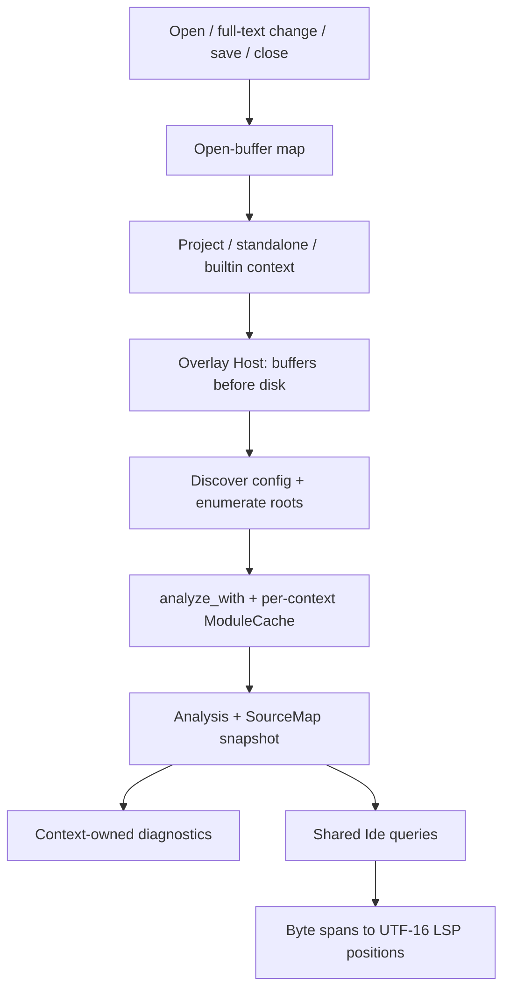

# Language server and IDE

Active contributors: bondiano, Vassiliy Kuzenkov

The native language server analyzes real project graphs with unsaved buffers over disk, then adapts shared IDE queries to LSP. TypeScript integration uses the same analysis boundary to produce declarations and span maps; it does not feed TypeScript's inferred types back into Flick.

## Transport and capabilities

`flick/src/lsp/protocol.rs` implements JSON-RPC over stdin/stdout with Content-Length framing. LSP logs go to stderr through `flick/src/lsp/logging.rs`, which honors the tracing environment filter and adds panic backtraces. `flick/src/lsp/mod.rs` runs a synchronous message loop; this is not a background request scheduler.

`flick/src/lsp/requests.rs` advertises full-document synchronization, hover, definitions/type definitions, references, completion, prepare-rename/rename, code actions, formatting, document/workspace symbols, folding, inlay hints, signature help, and full semantic tokens. Changes replace the whole stored buffer rather than applying incremental text ranges.

## From an edit to diagnostics

The flow is implemented by `flick/src/lsp/mod.rs` and `flick/src/lsp/snapshot.rs`. Context discovery uses the nearest manifest, including an open manifest buffer. Canonicalized paths avoid duplicate physical modules through symlink aliases, while display paths preserve the user's opened path.

`flick/src/lsp/snapshot.rs` enumerates source/test roots, adds open Flick buffers, restricts roots to the current context, then calls `project::analyze_with`. The overlay also exposes plugin access, but its outside-world adapter always replays network snapshots rather than issuing live HTTP requests.

### Closing and switching contexts

The server tracks which paths each context published. Refreshing/closing a context clears only its previous diagnostics, and republishes another live context when paths overlap, in `flick/src/lsp/mod.rs`. Project caches survive closing their last document for reuse; standalone-file caches are removed then. Regression coverage lives in `flick/tests/lsp_command/isolation.rs`.

Builtin modules are materialized under a temporary builtin directory for navigation. They use a dedicated context and declaration-order analysis; rename rejects their read-only source in `flick/src/lsp/requests.rs` and `flick/src/lsp/snapshot.rs`.

## Shared queries

`Ide` in `flick-core/src/ide/mod.rs` consumes `Analysis` and `SourceMap`; it does not own a protocol or filesystem. It identifies entities, modules, service operations, instance methods, and local binders.

| Query family | Implementation |
| - | - |
| Hover and source type rendering | `flick-core/src/ide/hover.rs`, `flick-core/src/ide/hover/` |
| Completion and lexical scope | `flick-core/src/ide/complete.rs`, `flick-core/src/ide/scope.rs`, `flick-core/src/ide/locals.rs` |
| Definition, references, rename | `flick-core/src/ide/navigate.rs`, `flick-core/src/ide/rename.rs`, `flick-core/src/ide/fields.rs` |
| Hints, outlines, tokens | `flick-core/src/ide/hints.rs`, `flick-core/src/ide/symbols.rs`, `flick-core/src/ide/tokens.rs` |
| Refactoring actions | `flick-core/src/ide/actions/` |
| Embedded plugin queries | `flick-core/src/ide/plugins.rs` |

`Analyzed` retains the user's source tree, typing metadata, interface, expansion, and editor blocks in `flick-core/src/project/load/ide.rs`. Plugin-generated name origins are mapped back to written source in `flick-core/src/project/load/checking.rs`; renaming must not blindly edit synthetic generated text.

Core positions are UTF-8 byte offsets. `flick/src/lsp/protocol.rs` converts them to UTF-16 code units per line, including astral characters. The browser also uses the shared IDE but has its own bridge; see [browser tools](../browser-tools.md).

### Incremental analysis is not a build result

`ModuleCache` reuses parses and checked outputs when text, configuration, import interfaces, and plugin watcher identities match. Imported declaration locations/docs do not force type rechecking, and re-export locations are refreshed on reuse, in `flick-core/src/project/load/checking.rs` and `flick-core/src/project/load/checking_core.rs`.

In the inspected working tree, cached editor checking can perform lowering for diagnostics but drops retained IR to avoid cloning it on each edit. Consequently `analyze_with` returns no compiled modules, unlike the noncached `analyze` path, in `flick-core/src/project/load/ide.rs` and `flick-core/src/project/load/checking_core.rs`. Consumers needing executable IR must not treat every `Analysis` as a complete compilation.

## TypeScript projections and Content Mapper

`flick-core/src/projection.rs` renders an editor-only `.flick.ts` representation of exports, a format version, an analysis marker, and bidirectional byte ranges. Interface-only builtin/package projections have no source mappings. Unsupported value types can be represented as `unknown` with a reason instead of fabricating a precise TypeScript type.

Mappings distinguish exact unchanged names from projected types. `flick/src/mapper.rs` permits write-back features only when a mapping is exact and both texts still match; type mappings are read-only. This prevents a TypeScript rename/fix from substituting generated type text into Flick source.

`flick content-mapper` uses LSP-style framing but negotiates **UTF-8**, not LSP's UTF-16 positions. Each transform overlays the supplied file's text, resolves project modules through their `.fl` files, and writes builtin/interface projections under `.flick/projections`. `--declarations` writes neighboring `.d.fl.ts` declarations for consumers without a Content Mapper.

The projection's analysis marker is derived from the `Compilation` it receives through `flick/src/commands/inspect.rs`. Since incremental editor analysis intentionally retains no compiled modules, do not interpret that marker as proof that the mapper's whole edited graph matches an executable build. `analysis_fingerprint` only hashes the modules actually present, in `flick-core/src/project/load/ide.rs`.

## FFI and foreign navigation

`flick/src/lsp/foreign.rs` resolves local JS/TS foreign file/export locations, with Go sibling navigation for a Go project. It uses a small declaration scanner rather than a full JavaScript/Go language server.

`flick/src/lsp/ffi.rs` offers explicit regeneration on a generated binding header. It avoids invoking Node for automatic cursor-triggered requests and returns a disabled action with a reason when declarations cannot be read. See [foreign interface](foreign-interface.md).

## Modification and validation

Put reusable query semantics under `flick-core/src/ide/`; keep JSON-RPC details, filesystem materialization, and UTF-16 adaptation under `flick/src/lsp/`. Changes to open/close handling need multi-context tests, not only a single-document hover assertion. Projection changes must preserve exact-name/write-back restrictions and UTF-8 negotiation.

Regression anchors: `flick-core/src/ide/tests.rs`, `flick-core/src/ide/actions/tests.rs`, `flick/src/lsp/tests.rs`, `flick/tests/lsp_command.rs`, `flick/tests/lsp_editor/`, and `flick/tests/content_mapper.rs`. Run relevant core IDE/LSP tests; add `just e2e-js` when shared browser queries change, per `docs/agents/validation.md`. None were run for this prose.

The editor scope described here has 54 Rust files, 16 test-named and 38 other files, a 0.42 file ratio by the [section method](index.md#scoped-snapshot). It includes native LSP, mapper, shared IDE, projection, and the project's IDE adapter. History contains two distinct nonbot author names.

## Key source files

| Source | Responsibility |
| - | - |
| `flick/src/lsp/mod.rs` | Document lifecycle and diagnostic ownership |
| `flick/src/lsp/snapshot.rs` | Overlay Host, context isolation, analysis |
| `flick/src/lsp/requests.rs` | Capabilities and request adaptation |
| `flick/src/lsp/protocol.rs` | Framing, URIs, UTF-16 conversion |
| `flick-core/src/ide/mod.rs` | Shared query boundary |
| `flick-core/src/project/load/ide.rs` | Retained editor metadata |
| `flick-core/src/projection.rs` | TypeScript projection and exact mappings |
| `flick/src/mapper.rs` | Native Content Mapper and declaration sidecars |

Related: [project loading](project-loading-and-packages.md), [incremental caches](caches-and-artifacts.md), and [section overview](index.md).
