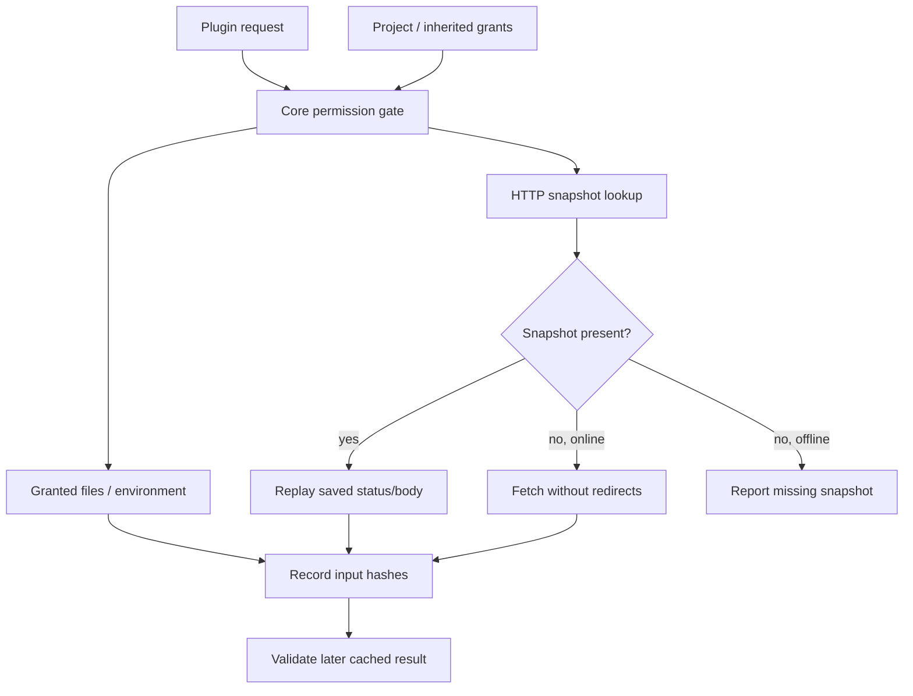

# Plugin host

Active contributors: bondiano, Vassiliy Kuzenkov

The native host loads package-provided compiler extensions, supplies explicitly granted outside data, and reuses stable plugin answers. This page covers execution and trust boundaries; plugin language features and SDK types are described under [plugins](../../packages/plugins.md).

## Selection and component loading

`flick-core/src/project/packages.rs` reads plugin component paths, foreign-file extensions, build hooks, and watched names from source-library package metadata. Project discovery can also inherit workspace plugins and grants through `flick-core/src/project/inherit.rs`.

In the inspected working tree, `flick/src/plugins/mod.rs` requires a package component and loads it through Wasmtime when the `wasm-plugins` Cargo feature is enabled. Without that feature, it reports why a WASM package plugin cannot load; `flick/Cargo.toml` makes Wasmtime optional. This is distinct from internal first-party plugin support in `flick-core/src/plugin/first_party.rs`.

`flick/src/plugins/wasm.rs` checks the component's imported SDK version before compiling it. Its identity includes package name plus component-byte SHA-256. Compilation is lazy and retained within the loaded plugin object; calls answered entirely from cache need not compile the component.

Each plugin call uses a fresh instance with a **1,000,000,000 fuel** budget and **64 MiB memory** limit, in `flick/src/plugins/wasm.rs`. The component binds the compiler's WIT interface rather than inheriting unrestricted WASI filesystem/network access. Fuel/memory traps become plugin failures; these limits do not establish semantic correctness of returned code.

The component-only native selection and resource behavior above include pre-existing uncommitted edits to `flick/src/plugins/mod.rs` and `flick/src/plugins/wasm.rs`. They describe this working tree rather than a verified release artifact.

## Expansion and shared state

`flick-core/src/project/load/plugins.rs` groups blocks by plugin and source/test/package ownership. A plugin collects group state, then expands individual blocks; nested user-code blocks are processed in bounded rounds. Derived code, published names, enum knowledge, and watched calls are separate collaborators under `flick-core/src/project/load/plugins/`.

Results and their source origins are retained for diagnostics and editor queries. `flick-core/src/project/load/checking.rs` maps written names out of expansion metadata rather than exposing every generated symbol as an editable source name. `flick-core/src/project/load/checking_core.rs` includes watcher identities in module-cache keys, including for modules without blocks.

## Grants and HTTP snapshots

`Grants` in `flick-core/src/project/config.rs` names readable paths, environment variables, network hosts, and disabled block/class handlers. The core `Gate` in `flick-core/src/plugin/reach.rs` checks requests against grants and records hashes of the answers that influenced a cached result.

`flick/src/plugins/outside.rs` reads current files/variables and replays HTTP responses first. Online misses fetch and save responses below status 500. Requests do not follow redirects, have a 30-second timeout, and cap response bodies at 16 MiB. Snapshots live under `.flick/plugin-snapshots`, one package directory per plugin, as defined in `flick-core/src/plugin/reach.rs`.

`--offline` or the presence of `CI` makes CLI plugin HTTP access snapshot-only, in `flick/src/main.rs`. The LSP always requests an offline outside adapter in `flick/src/lsp/snapshot.rs`. Offline here does not deny granted local file/environment reads, nor does it sandbox other toolchain subprocesses.

Snapshots contain request method/URL plus response status/body. Treat them as potentially sensitive project data; do not infer that secret-bearing HTTP responses are safe to commit. Their persistence format and replay behavior are in `flick/src/plugins/outside.rs`.

## Caching and diagnostics

The disk adapter in `flick/src/plugins/cache.rs` keys answers by compiler-binary prefix and SHA-256 of the call key, writes through temporary files, and evicts other-binary entries when saving. Core result handling validates outside inputs before reuse, in `flick-core/src/project/load/plugins/results.rs`. See [cache layers](caches-and-artifacts.md) for how this differs from checked-package and artifact caches.

`FLICK_PLUGIN_TRACE` appends call traces through the wrapper in `flick/src/plugins/mod.rs`. `flick plugins` reports origins/pins through `flick/src/commands/plugins.rs`; `flick expand` exposes expansion text through `flick/src/commands/expand.rs`. Plugin diagnostic explanations come from the package's explanation files through `flick/src/commands/tools.rs`.

## Foreign-file loading and build hooks

`flick-core/src/project/load/files.rs` lets a plugin load another text extension as a module. Its source comments state current limits: UTF-8 only; generated code cannot add arbitrary project imports after import closure; generated deriving is not expanded; generated call-site lines do not yet carry full foreign-file origins. Duplicate extension ownership reports P045.

`flick/src/commands/build/hooks.rs` runs hooks in dependency order:

| Hook | Boundary |
| - | - |
| `ir` | Receives checked IR before optimization, returns replacement IR; structural validation and identical module-name sets are required |
| `emit` | Receives artifacts and can replace them; changed JS with an unchanged/missing supplied source map is rejected |

IR rewrites report P048 explicitly stating that resulting behavior is the plugin's responsibility outside Flick's checks. Structural IR validation is not proof that a rewrite preserves typing, effects, or execution semantics. Invalid IR reports P047; source-map violations report P046.

Run generations skip emit hooks so the code they execute is not replaced at that publication stage, in `flick/src/commands/build/cached.rs`. Hook behavior is therefore not interchangeable between ordinary build publication and every execution command.

## Modification and validation

Change native component loading/resource policy in `flick/src/plugins/wasm.rs`, outside access in `flick/src/plugins/outside.rs` together with the core gate, expansion coordination in `flick-core/src/project/load/plugins/`, and hook validation in `flick/src/commands/build/hooks.rs`.

Regression anchors include `flick/tests/plugins.rs`, `flick/src/plugins/outside_tests.rs`, `flick-core/src/project/load/plugins_tests.rs`, and `flick-core/src/project/load/plugins_tests/`. Follow `docs/agents/validation.md`: relevant host/SDK tests, `cargo test -p flick --test plugins`, `just wasm-plugins`, and `just e2e-tests`, covering permissions, offline replay, invalidation, and failure diagnostics. These checks were not run for wiki generation.

## Key source files

| Source | Responsibility |
| - | - |
| `flick/src/plugins/mod.rs` | Native selection and tracing |
| `flick/src/plugins/wasm.rs` | SDK compatibility, lazy compilation, fresh bounded instances |
| `flick/src/plugins/outside.rs` | Files/environment, offline replay, HTTP persistence |
| `flick/src/plugins/cache.rs` | Persistent call-answer cache |
| `flick-core/src/project/load/plugins.rs` | Collection/expansion coordination |
| `flick-core/src/project/load/plugins/results.rs` | Reuse and tracked external inputs |
| `flick-core/src/project/load/files.rs` | Foreign text module loading |
| `flick/src/commands/build/hooks.rs` | IR/artifact rewrite policy |

Related: [project dependencies](project-loading-and-packages.md), [IDE origins](language-server-and-ide.md), and [section overview](index.md).
