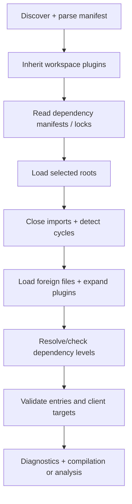

# Project loading and packages

Active contributors: Vassiliy Kuzenkov, bondiano

The project loader closes the import graph, checks modules against dependency interfaces, and records where each module belongs. Native discovery and package parsing add disk-oriented policy around the shared `Host`-backed loader in `flick-core/src/project/load/mod.rs`.

## Manifest and discovery

`discover` in `flick-core/src/project/mod.rs` accepts an explicit directory or TOML path; otherwise it searches from the working directory upward for the nearest manifest. No implicit project is `Ok(None)`; a missing explicitly selected project is `FLICK-P008`.

`flick-core/src/project/config/parse.rs` checks `schema-version = 1` before validating the rest of the document. Unknown fields are errors. `parse_manifest` accepts a project, workspace, or both; `parse` requires an actual project and rejects a workspace-only root.

| Default | Value | Source |
| - | - | - |
| Source/test directories | `src` / `test` | `flick-core/src/project/config/parse.rs` |
| Output directory | `dist` | `flick-core/src/project/config.rs` |
| Profile / emit target | debug / JavaScript | `flick-core/src/project/config.rs` |
| Project runtime backend | Flick RT | `flick-core/src/project/config.rs` |
| Single-entry name | `main` | `flick-core/src/project/config.rs` |

An application can instead declare named entries, per-entry runners, and browser-client targets. `flick-core/src/project/load/entry.rs`, `flick-core/src/project/load/runner.rs`, and `flick-core/src/project/load/target.rs` validate the entry contract and target reachability. Without a custom runner, `main_kind` accepts a Unit argument/result, the scheduler's Async requirement, and AppError failures rather than arbitrary unprovided services or errors.

## Loading flow

This ordering is explicit in `flick-core/src/project/load/mod.rs`. Independent modules at one dependency level run in parallel on native targets; the WASM implementation is sequential. Cyclic graphs take a diagnostic-producing recursive path instead of being accepted as a topological ordering, in `flick-core/src/project/load/checking.rs` and `flick-core/src/project/load/checking/graph.rs`.

`flick-core/src/project/load/loader.rs` checks module headers against capitalized file/directory paths, diagnoses duplicate names, and infers a name from a valid project-relative path when no header supplies one. For example, `App.Users` maps to a file named Users.fl inside an App directory through `module_path` in `flick-core/src/project/mod.rs`.

### Import boundaries

The search directories depend on the importing module, in `flick-core/src/project/load/imports.rs`:

- Source modules search the source root, then source packages; they cannot pull ordinary test-root modules into production.
- Tests search source and test roots, then packages.
- Package modules search package source directories.
- Standalone modules use the sibling root established by their declared module path.
- Builtin interfaces are the fallback when no loaded/package module supplies the import.

The loader also rejects imports of lexical inline namespaces and enforces package-private module visibility with `FLICK-R017`. Named applications of parameterized modules can create virtual modules; their parameters and contract interfaces participate in checking and incremental keys in `flick-core/src/project/load/imports.rs` and `flick-core/src/project/load/checking_core.rs`.

## Two dependency channels

| Channel | Resolution and ownership |
| - | - |
| Flick `[dependencies]` | Path libraries, Git tags with optional subdirectories, or SHA-256-pinned URL tarballs; each library's own `flick.toml` supplies its source root and transitive dependencies |
| npm dependencies/devDependencies | Direct installed packages from the project's package manifest; a `flick.source-dir` field makes a package a Flick source package |
| `[js.dependencies]` | JS runtime requirements collected from the project, implicit packages, and Flick library closure, then merged into the project npm manifest by installation |

The first two channels meet in `flick-core/src/project/packages.rs`. Dependencies must be libraries; compiler requirements are checked with semver and report `FLICK-P033` when incompatible. Implicit packages are handled through builtin interfaces rather than recompiled as ordinary dependency modules.

`flick-core/src/project/js.rs` handles the JS requirement closure, conflicts, and unmet packages. Conflicting version requirement text is rejected; this is not a general npm range-intersection solver.

### Fetching and locks

`flick/src/fetch/mod.rs` installs fetched dependencies recursively and writes `flick.lock`; it does not use pnpm's lock format. `flick-core/src/project/lock.rs` records package source pins, versions, tree checksums, and built local plugin component checksums. `flick/src/fetch/download.rs` resolves a Git tag to a commit, verifies URL archive bytes against the manifest's SHA-256, then names the stored tree by a hash of its files.

`--locked` refuses lock changes; offline installation requires already available package-store entries. `FLICK_STORE` overrides the source-package store; otherwise it is `pkg` under the user cache. The cache-directory precedence is `XDG_CACHE_HOME`, `LOCALAPPDATA`, then the .cache directory under `HOME`, each with a `flick` subdirectory, in `flick-core/src/project/store.rs`.

Checks/builds resolve fetched sources from the lock and store rather than silently fetching missing project dependencies. Missing pins direct the user to `flick install`, in `flick-core/src/project/packages.rs`. See [commands](commands-and-toolchain.md) for the separate pnpm installation path.

## Standard-library selection

`flick/src/stdlib.rs` chooses implicit packages before commands that need checking:

1. A nonempty `FLICK_STD_PATH` overrides the first implicit package, with the others located beside it.
2. An explicit project dependency or the package currently being developed supplies its own directory.
3. For an implicit dependency not explicitly named, a recognized source checkout can supply its local package. Detection considers the project/current directory and the checkout used to build the binary.
4. Installed releases use the compiler's `std-v<version>` source tag, fetched by installation and pinned in the lock. Outside projects, preparation can fetch into a versioned user-cache context on first use.

Preparation and installation are different entry points. Do not read the global plugin-offline flag as a universal prohibition on all network access: outside-project implicit-package preparation calls the fetcher with its own options in `flick/src/stdlib.rs`.

## Workspaces

`flick/src/workspace.rs` expands a whole-project command over every member only at a workspace-only root, with no explicit paths and no long-running watch/stdin mode. `--package` selects one member; `--project` bypasses member selection. Members run sequentially in `flick/src/main.rs`.

`flick-core/src/project/inherit.rs` adds workspace plugins as member dependencies, rebases dependency paths, and unions grants. Grant filesystem paths remain relative to each member's root. A conflicting same-name dependency is an error; the plugin's own package does not inherit a self-dependency.

## Modification and validation

Change discovery in `flick-core/src/project/mod.rs`, manifest rules in `flick-core/src/project/config/`, import visibility in `flick-core/src/project/load/imports.rs`, and dependency closure in `flick-core/src/project/packages.rs`. Preserve diagnostics/spans and update both reuse and invalidation behavior when inputs change.

Regression anchors are `flick-core/src/project/config_tests.rs`, `flick-core/src/project/workspace_tests.rs`, `flick-core/src/project/inherit_tests.rs`, `flick/tests/project_check.rs`, `flick/tests/source_packages.rs`, and `flick/tests/fetched_dependencies.rs`. Run relevant project/CLI tests and `just e2e-tests` for behavior changes, following `docs/agents/validation.md`.

The `flick-core/src/project/` scope has 52 Rust files: 16 test-named and 36 other files by the [section's counting method](index.md#scoped-snapshot). History contains two distinct nonbot author names, not necessarily two people.

## Key source files

| Source | Responsibility |
| - | - |
| `flick-core/src/project/mod.rs` | Host, discovery, roots, path normalization |
| `flick-core/src/project/config/parse.rs` | Strict manifest parsing and schema version |
| `flick-core/src/project/load/mod.rs` | Shared loader orchestration and results |
| `flick-core/src/project/load/imports.rs` | Import closure, visibility, virtual modules |
| `flick-core/src/project/packages.rs` | Source libraries and installed npm source packages |
| `flick-core/src/project/js.rs` | Transitive JS requirements |
| `flick/src/fetch/mod.rs`, `flick/src/fetch/download.rs` | Fetch/install and checksums |
| `flick/src/stdlib.rs` | Implicit-package selection |
| `flick/src/workspace.rs`, `flick-core/src/project/inherit.rs` | Member routing and inherited plugins |

Related: [caches](caches-and-artifacts.md), [plugin host](plugin-host.md), and [architecture](../../overview/architecture.md).
